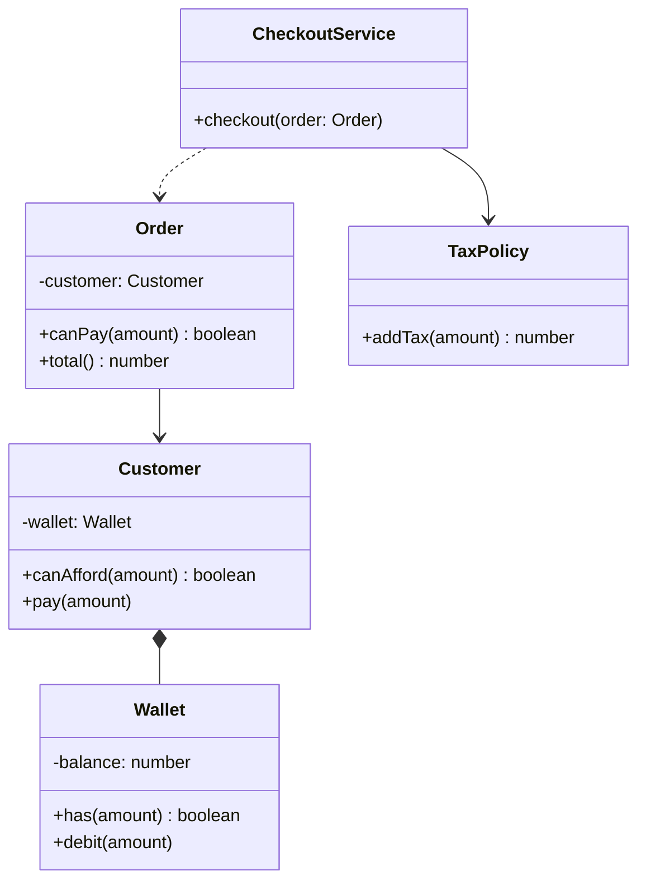

# L07 · DRY, KISS, YAGNI, coupling, cohesion, Law of Demeter

> **Time:** ~35 min · **Visual:** [visual.html](visual.html) · **Code:** [demo.ts](demo.ts) (`npx tsx lld/1-foundations/L07-design-principles/demo.ts`)
> **Builds on:** [L03 Composition over inheritance](../L03-composition-over-inheritance/README.md) · [L04 SRP and OCP](../L04-solid-srp-ocp/README.md) · [L05 LSP, ISP and DIP](../L05-solid-lsp-isp-dip/README.md) · **Used in:** every LLD problem; clearest in [18 Food Delivery](../../problems/18-food-delivery/README.md), [20 E-commerce Cart](../../problems/20-ecommerce-cart-coupons/README.md), [19 Payment Wallet](../../problems/19-payment-wallet/README.md), [09 Splitwise](../../problems/09-splitwise/README.md)

## The idea in one line

Keep each rule in one place (DRY), choose the simplest design that works (KISS), build only what is needed now (YAGNI), make modules know little about each other (low coupling) and keep each module about one thing (high cohesion), and talk only to your direct friends (Law of Demeter).

## Why it matters (the problem it solves)

SOLID tells you how to shape classes. These six ideas tell you how classes should **relate** and how much to build. Interviewers use them to judge "code quality" in the last 15 minutes of a machine-coding round.

```ts
// Before: a checkout that breaks all six at once
class CheckoutService {
  checkout(order: Order) {
    // Demeter + coupling: reaches through 3 objects into another class's data
    if (order.getCustomer().getWallet().balance < order.total * 1.18) throw new Error('low balance');
    // DRY: GST rate copied here, in Invoice and in Refund
    const payable = order.total * 1.18;
    order.getCustomer().getWallet().balance -= payable;
    // low cohesion: unrelated helpers piled into one utility class
    OrderUtils.sendSms(order.getCustomer().phone, OrderUtils.formatDate(new Date()));
  }
}
// KISS + YAGNI: for a single payment provider
class PaymentProviderFactoryRegistryManager { /* plugins, reflection, config loader ... */ }
```

When the wallet team changes `balance` into a ledger of entries, this checkout breaks. When GST changes, someone updates two of the three copies and invoices stop matching carts.

## How it works

### 1. Coupling: how much one module knows about another

**Coupling** is the number and strength of things one module depends on in another. Low coupling means a change stays inside its module.

| Coupling (strong → weak) | Example | Change in B breaks A when... |
|---|---|---|
| Content | A writes `wallet.balance -= x` | any field inside B changes |
| Common / global | both read a global `config` object | anyone edits the global |
| Control | A passes a flag telling B what to do: `save(order, true)` | B's branches change |
| Stamp | A passes a whole `Order` but B uses one field | the `Order` shape changes |
| Data | A passes only what B needs: `charge(amount)` | that one value's meaning changes |
| Message | A calls a method on an interface: `wallet.debit(amount)` | the contract changes (rare) |

```
 Tight: a field rename in Wallet ripples out          Loose: the ripple stops at the boundary

   CheckoutService ──┐                                   CheckoutService ──> Customer.canAfford()
   InvoiceService ───┼──> wallet.balance (field)          InvoiceService  ──> Customer.canAfford()
   RefundService ────┘     (3 classes break)              Customer ──> Wallet.has(amount)   (only Wallet changes)
```

Tools that lower coupling: interfaces (DIP), passing data instead of objects, events instead of direct calls, encapsulation (no public fields).

### 2. Cohesion: how much a module is about one thing

**Cohesion** is how closely the parts of a module belong together. High cohesion: every method uses the same data for the same purpose.

```ts
// Low cohesion: a junk drawer
class OrderUtils {
  static formatDate(d: Date) { /* ... */ }
  static calcGst(amount: number) { /* ... */ }
  static sendSms(phone: string, text: string) { /* ... */ }
  static hashPassword(p: string) { /* ... */ }
}

// High cohesion: one theme per class
class DateFormatter { format(d: Date): string { /* ... */ return ''; } }
class TaxPolicy { tax(amount: number): number { return Math.round(amount * 0.18); } }
class SmsSender { send(phone: string, text: string): void { /* ... */ } }
```

A quick test: if you can split the fields into groups that are used by different groups of methods, the class has low cohesion and wants to be two classes (that is SRP from the other side).

**The goal is low coupling + high cohesion.** Things that change together live together; things that change separately talk through small interfaces.

### 3. Law of Demeter: talk to friends, not strangers

> A method should only call methods on: `this`, its own fields, its parameters, and objects it creates.

```ts
// Before: "train wreck" - the checkout knows the shape of Order, Customer AND Wallet
if (order.getCustomer().getWallet().getBalance() >= total) { /* ... */ }

// After: tell, don't ask - each object answers for its own data
if (order.canPay(total)) { /* ... */ }

class Order    { canPay(amt: number) { return this.customer.canAfford(amt); } }
class Customer { canAfford(amt: number) { return this.wallet.has(amt); } }
class Wallet   { has(amt: number) { return this.#balance >= amt; } }
```

Each hop now talks only to a direct field. When `Wallet` switches to a ledger, only `Wallet.has()` changes.

**Not every dot is a violation.** Chains on **data** or **fluent APIs** are fine: `items.filter(...).map(...)`, `qb.where(...).orderBy(...)`, `promise.then(...)`, a builder. The rule is about reaching through objects that **hide behaviour** to grab their internals.

**Tell, don't ask** is the habit behind it: instead of asking for data and deciding outside (`if (wallet.balance >= x) wallet.balance -= x`), tell the object what you want (`wallet.debit(x)`) and let it apply its own rule.

### 4. DRY: Don't Repeat Yourself

> "Every piece of knowledge must have a single, unambiguous, authoritative representation within a system." (The Pragmatic Programmer)

DRY is about **knowledge**, not identical text.

```ts
// Before: the GST rule lives in 3 places
const cartTotal    = subtotal * 1.18;
const invoiceTotal = subtotal * 1.18;
const refundTotal  = paid / 1.18;     // when GST changes, someone forgets one

// After: one authoritative place
class TaxPolicy {
  static readonly GST = 0.18;
  addTax(amount: number) { return Math.round(amount * (1 + TaxPolicy.GST)); }
  removeTax(amount: number) { return Math.round(amount / (1 + TaxPolicy.GST)); }
}
```

**Careful: incidental duplication.** Two lines that look the same but encode **different** rules should stay separate. `maxRetries = 3` for payments and `maxRetries = 3` for emails are different decisions; merging them couples two teams. Rule of three: tolerate the second copy, extract on the third.

### 5. KISS: Keep It Simple

Choose the simplest design that meets today's requirements and is easy to read. In a 90-minute round: plain classes, one interface where variation is real, a `Map` for storage. No reflection, no plugin loader, no generic `Manager<TReq, TRes, TCtx>`.

Simple is not "no design": a 400-line `if/else` is not simple, it is just short-sighted. KISS is about **fewest concepts** a reader must hold in their head.

### 6. YAGNI: You Aren't Gonna Need It

Don't build features or extension points for requirements you **don't have yet**. An abstraction for one implementation costs reading time today and is usually the wrong shape when the real second case arrives.

| Situation | YAGNI says |
|---|---|
| One payment provider, no plan for more | one `RazorpayClient` class (behind an interface only if you need a test fake) |
| The interviewer said "more vehicle types will come" | that is a requirement: add the interface now (OCP) |
| "Maybe we'll need multi-currency" | skip it; say how you'd add it |
| Plugin system, config-driven rules engine | no, unless asked |

**OCP vs YAGNI** (a classic follow-up): they don't fight. Apply OCP where the problem **says** things vary; apply YAGNI everywhere else.

### Class diagram (after)



### How to spot each one in code or a problem statement

| You see | Principle |
|---|---|
| `a.getB().getC().doX()` on domain objects | Law of Demeter: add a method on `a` |
| The same constant or formula in 2+ files | DRY: one owner |
| A class named `Utils`, `Helpers`, `Common`, `Manager` | low cohesion: split by theme |
| A change to one class forces edits in many | high coupling: hide behind a method or interface |
| Abstract base + factory + registry for a single case | KISS / YAGNI |
| Boolean flag parameters: `save(order, true, false)` | control coupling: split into two methods |

## In TypeScript

```ts
class Wallet {
  #balance = 0;
  has(amount: number) { return this.#balance >= amount; }
  debit(amount: number) { if (!this.has(amount)) throw new Error('Insufficient funds'); this.#balance -= amount; }
}
class Customer {
  constructor(private readonly wallet: Wallet) {}
  canAfford(amount: number) { return this.wallet.has(amount); }
  pay(amount: number) { this.wallet.debit(amount); }
}
class CheckoutService {
  constructor(private readonly tax: TaxPolicy) {}
  checkout(order: Order) {
    const payable = this.tax.addTax(order.total());   // DRY: one tax rule
    if (!order.canPay(payable)) throw new Error('low balance'); // Demeter: one hop
    order.pay(payable);                               // tell, don't ask
  }
}
```

[demo.ts](demo.ts) measures the ripple of a `Wallet` change in tight vs loose designs, shows the DRY tax bug, and scores the cohesion of a junk-drawer class.

## Trade-offs / when NOT to use it

- **Demeter can create "wrapper" methods everywhere** (`order.getCustomerCity()`, `order.getCustomerPincode()`...). If you are only reading plain data (a DTO, a config), a chain is fine. Apply it to objects with behaviour.
- **DRY taken too far couples unrelated code.** A shared helper used by two teams for different reasons is worse than two copies. Merge only the same knowledge.
- **KISS vs extensibility.** The simplest thing that cannot take the change the interviewer is about to ask for is not simple, it is a rewrite later. Read the problem for "types of".
- **Low coupling has a cost**: more interfaces and indirection. Couple tightly inside a module, loosely across modules.

## Common mistakes

- Counting dots instead of asking "am I reaching into another object's internals?"
- Extracting a shared function the moment two lines look alike (incidental duplication).
- Calling every abstraction "YAGNI" even when the problem statement asked for extensibility.
- A `Utils` class "just for now" that becomes the biggest file in the repo.
- Getters for everything, so callers still pull data out and decide outside (ask, not tell).
- Boolean flags that switch behaviour inside a method (`notify(user, true)`): two methods are clearer.

## Say this in the interview

> "I keep the checkout from reaching into the wallet. Instead of `order.getCustomer().getWallet().balance`, I ask `order.canPay(amount)`, and each object answers for its own data. That's the Law of Demeter. It means when the wallet moves to a ledger, only `Wallet` changes. Low coupling, and each class stays cohesive."

> "The GST rule lives in one `TaxPolicy`, so cart, invoice and refund can never disagree. I'm not building a plugin system for payment providers; there's one provider today. If you tell me more are coming, I'll put an interface there."

## Your experience hook

- API gateway: auth, rate limiting and caching were separate middlewares with one job each (high cohesion), and services never imported gateway code (low coupling).
- Payment webhooks: the handler called `payment.markSucceeded(eventId)` instead of setting `payment.status` and `payment.paidAt` itself. Tell, don't ask. That is what kept out-of-order webhooks from corrupting state.
- IoT platform: Redis queue + batch writer decoupled device ingestion from MySQL. The socket servers did not know the DB schema at all, so the MongoDB to MySQL migration did not touch them.

## Self-test

<details><summary>1. Is <code>users.filter(u =&gt; u.active).map(u =&gt; u.email)</code> a Law of Demeter violation?</summary>No. It chains operations on data (an array) through a fluent API. Demeter is about reaching through objects with behaviour to use their internals, like <code>order.getCustomer().getWallet().debit()</code>.</details>

<details><summary>2. Coupling vs cohesion in one line each?</summary>Coupling: how much one module depends on others (want low). Cohesion: how much the parts of one module belong together (want high).</details>

<details><summary>3. Two services both have <code>maxRetries = 3</code>. Should you extract a shared constant?</summary>Only if it is the same decision. Payment retries and email retries are different rules owned by different teams; sharing them couples them. DRY is about knowledge, not identical text.</details>

<details><summary>4. "Tell, don't ask": rewrite <code>if (acc.balance &gt;= x) acc.balance -= x;</code></summary><code>acc.debit(x)</code>, where <code>debit</code> checks the rule and throws or returns a result. The object applies its own rule.</details>

<details><summary>5. Do OCP and YAGNI contradict each other?</summary>No. Use OCP where the problem says behaviour varies ("types of", "more will be added"). Use YAGNI for variation nobody asked for.</details>

<details><summary>6. A method <code>save(order, true)</code>. What is wrong?</summary>Control coupling: the caller tells the method which branch to take. Split into two clearly named methods (<code>save</code>, <code>saveAndNotify</code>) or pass a strategy.</details>

<details><summary>7. How do you tell a class has low cohesion?</summary>Its fields split into groups used by different groups of methods; its name is vague (<code>Utils</code>, <code>Manager</code>); you describe it with "and".</details>

## Go deeper

- Next: [L08 · Singleton](../../2-creational/L08-singleton/README.md) and the rest of the patterns
- Lower coupling with events: [L21 · Observer](../../4-behavioral/L21-observer/README.md); with a hub: [L28 · Mediator](../../4-behavioral/L28-mediator/README.md); with a simple front: [L15 · Facade](../../3-structural/L15-facade/README.md)
- The round itself: [L30 · Machine-coding framework](../../5-machine-coding/L30-machine-coding-framework/README.md)
- Long notes: [archive/notes/LLD-guide.md](../../../archive/notes/LLD-guide.md) (common pitfalls: tight coupling)
- Books: The Pragmatic Programmer (DRY, Demeter, "tell, don't ask"); A Philosophy of Software Design (John Ousterhout) on deep modules and complexity
