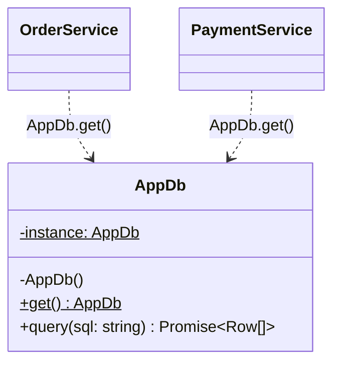

# L08 · Singleton

> **Time:** ~35 min · **Visual:** [visual.html](visual.html) · **Code:** [demo.ts](demo.ts) (`npx tsx lld/2-creational/L08-singleton/demo.ts`)
> **Builds on:** [L01 Classes and interfaces](../../1-foundations/L01-classes-and-interfaces/README.md) · [L05 SOLID: LSP, ISP, DIP](../../1-foundations/L05-solid-lsp-isp-dip/README.md) · **Used in:** Logger (`LogManager`), Parking Lot (only if asked), KV Store (one store per process)

## The idea in one line

A class has exactly one instance per process, and every caller gets that same instance through one access point.

## Why it matters (the problem it solves)

Some objects must exist once: a DB connection pool, a logger with open file handles, a metrics registry, the parsed config. If every module calls `new`, you get many copies.

```ts
// Before: every module opens its own pool
// orders.ts
const pool = new DbPool({ size: 10 });
// payments.ts
const pool = new DbPool({ size: 10 });
// reports.ts
const pool = new DbPool({ size: 10 });
// 30 connections. Postgres max_connections is 25 on this box → "too many clients".
```

Problems with the "before":
- **Resource waste.** Each pool opens its own sockets and keeps them alive.
- **No shared limits.** Three pools of 10 cannot coordinate. The DB sees 30.
- **Split state.** Two loggers buffer to the same file and interleave lines.

## How it works

### The classic form (GoF)

Three parts:
1. A `private constructor`, so no other code can call `new`.
2. A `private static` field that holds the one instance.
3. A `public static get()` that creates the instance on the first call (lazy) and returns it on every call.

```
        orders.ts ──get()──┐
      payments.ts ──get()──┼──► AppDb.get() ──► instance? ── no ──► new AppDb() (once)
       reports.ts ──get()──┘                         │
                                                   yes ──► return the same AppDb#1
```

### Class diagram



### The Node way: the module cache

Node evaluates each module once and caches the result (both CommonJS `require` and ES modules). Every `import` of the same file gets the same object. So this is already a singleton:

```ts
// db.ts
export const db = new DbPool({ size: 10 });   // runs once per process
// orders.ts and payments.ts
import { db } from './db';                    // same object in both
```

This is what most real Node code does (`export const prisma = new PrismaClient()`). Use the class form when the interviewer asks for "the Singleton pattern".

### Eager vs lazy

| | Eager | Lazy |
|---|---|---|
| When created | At module load / startup | On the first `get()` |
| Good for | Things you always need (config, logger) | Costly things you may not need |
| Risk | Slower startup | First request pays the cost; async races |

### Scope: "one" means one per what?

| Runtime | How many instances you really get |
|---|---|
| One Node process | 1 |
| `cluster` / PM2 with 4 workers | 4 (one per process) |
| 4 Kubernetes pods | 4 |
| Worker threads | 1 per thread (each has its own module graph) |
| Two versions of a package in `node_modules` | 2 (two module copies) |
| NestJS provider, default scope | 1 per app; `Scope.REQUEST` gives 1 per request |

This is the most important point in an SDE-2 interview: a singleton is a **per-process** idea. Anything that must be shared across processes (rate-limit counters, locks, sessions) lives in Redis or the DB.

### How to spot it in a problem statement

- "There is only **one** parking lot / one ATM / one elevator controller system." (Use it only if the interviewer wants it. Usually inject one instance instead.)
- "A global **logger** / **config** / **registry**."
- "All services share one connection pool / cache."

## In TypeScript

```ts
class AppDb {
  private static instance?: AppDb;
  private constructor(readonly pool: DbPool) {}

  static get(): AppDb {
    return (AppDb.instance ??= new AppDb(new DbPool({ size: 10 })));
  }
}

AppDb.get() === AppDb.get(); // true
// new AppDb(pool);          // TS2673: Constructor of class 'AppDb' is private
```

Async init: cache the **promise**, not the result.

```ts
let p: Promise<Db> | undefined;
export const getDb = (): Promise<Db> => (p ??= connect()); // second caller awaits the same promise
```

Better in real code: create once, inject everywhere.

```ts
// main.ts (the composition root)
const db = new AppDb(new DbPool({ size: 10 }));
const orders = new OrderService(db);
const payments = new PaymentService(db);
// orders.test.ts
const svc = new OrderService(fakeDb); // no global to reset
```

## Trade-offs / when NOT to use it

| Pro | Con |
|---|---|
| One shared resource, no duplicates | Global mutable state with a nice name |
| One place to configure it | Hides dependencies (not visible in constructors) |
| Lazy creation is easy | Tests share state; order of tests starts to matter |
| | Ties callers to one concrete class (breaks DIP) |

Do not use it:
- For **business state** like `BookingManager.getInstance()`. It hides who changes what and makes tests leak.
- When you need **one per tenant, per request or per test**. That is not a singleton.
- As a way to share state **across pods**. It will not.

## Common mistakes

1. **Thinking a singleton is shared across servers.** It is per process. 4 pods = 4 instances.
2. **Lazy async init without caching the promise.** Two early requests open two pools.
3. **Calling `AppDb.get()` deep inside business code.** Now the service cannot be tested with a fake. Inject it.
4. **Making everything a singleton** ("Manager" classes everywhere). Singleton is for resources, not for domain logic.
5. **Forgetting `private constructor`.** Without it, anyone can still call `new`.
6. **Mixing it up with a static class.** A class of only static methods has no instance, cannot implement an interface and cannot be injected. A singleton is a real object.

## Say this in the interview

> "I need one config and one DB pool per process. In Node the simplest singleton is a module-level export, because modules are evaluated once and cached. If you want the classic pattern, it's a private constructor and a static `get()`, and for async setup I cache the promise so two early callers don't open two pools."

> "I still create it in the composition root and pass it into services through the constructor. That keeps one instance but makes dependencies visible, and tests can pass a fake. And it's one per process: with 4 pods I have 4 instances, so a shared counter or lock goes to Redis."

## Your experience hook

- **IoT platform (10k+ devices):** WebSocket servers ran as several Docker instances behind Nginx. Any in-memory "singleton" registry of sockets was per instance, which is why you used the **Redis adapter** to broadcast across nodes. Say this when asked "is a singleton enough here?".
- **API gateway rate limiting:** an in-memory counter works for one gateway instance only. Behind a load balancer the counter must live in Redis.
- **NestJS:** providers are singleton-scoped by default. You already use this every day: one `PrismaService` / `RedisService` injected into many services.

## Self-test

<details><summary>1. What makes the TS class form a singleton at compile time?</summary>

The `private constructor`. Outside code cannot call `new`, so the static `get()` is the only way in. At runtime, plain JS could still call it, so it is a compile-time guard.
</details>

<details><summary>2. Is the lazy `if (!instance) instance = new X()` check safe in Node?</summary>

Yes for synchronous creation: the check and the assignment run in one turn of the event loop, and no other code runs in between. Not safe if there is an `await` between the check and the assignment.
</details>

<details><summary>3. Two concurrent first calls to an async `getDb()` open two pools. Fix it.</summary>

Store the promise: `let p: Promise<Db> | undefined; export const getDb = () => (p ??= connect());`. The assignment is synchronous, so the second caller awaits the same promise. Also reset `p` on failure if you want retries.
</details>

<details><summary>4. You run 4 pods. Each has an in-memory singleton rate counter with limit 25/min. What is the real limit?</summary>

About 100/min, because each pod counts alone. Use Redis `INCR` with `EXPIRE` (or a Lua script) so all pods share one count.
</details>

<details><summary>5. Why do people call Singleton an anti-pattern?</summary>

It is global mutable state. It hides dependencies, couples code to a concrete class, and leaks state between tests. Creating one instance in `main()` and injecting it gives "only one" without these problems.
</details>

<details><summary>6. How do you reset a singleton between tests?</summary>

Best: don't need to; inject it. Otherwise add a `static resetForTests()`, or use `vi.resetModules()` in Vitest to re-evaluate modules.
</details>

<details><summary>7. Singleton vs a class with only static methods?</summary>

A singleton is an object: it can implement an interface, be passed as a dependency, be lazily created and be replaced by a fake. A static-only class can do none of that.
</details>

## Go deeper

- Visual: [visual.html](visual.html) (lazy creation, async race, per-pod trap)
- Inject instead of `get()`: [L31 Repository and DI](../../5-machine-coding/L31-repository-and-di/README.md)
- Event loop and why the sync check is safe: [L32 Concurrency in Node](../../5-machine-coding/L32-concurrency-in-node/README.md)
- Problem: [03 Logger](../../problems/03-logger/README.md) (`LogManager` registry), [14 KV Store](../../problems/14-kv-store/README.md)
- Older long-form notes: [LLD-guide.md](../../../archive/notes/LLD-guide.md) (Part 3, "Singleton Pattern")
- Books: GoF "Singleton"; Head First Design Patterns ch. 5
