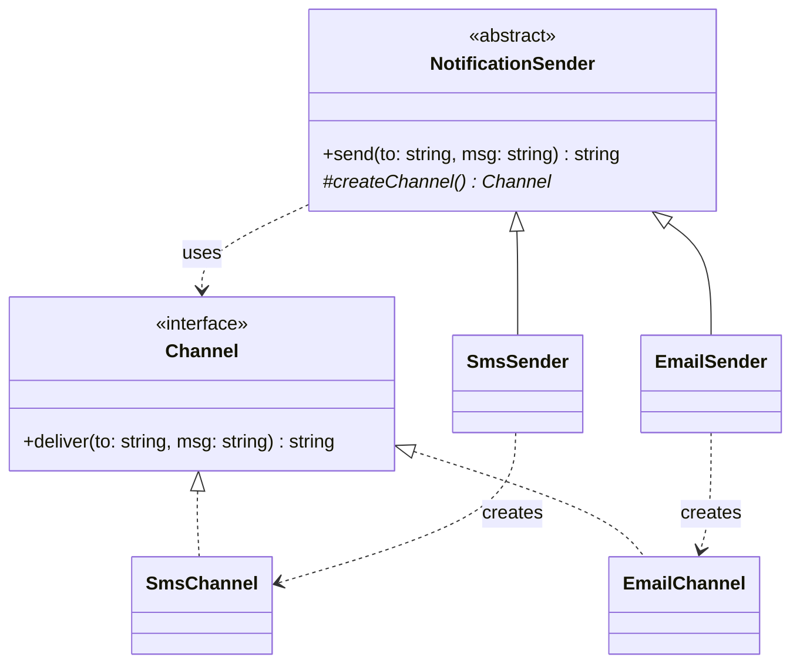
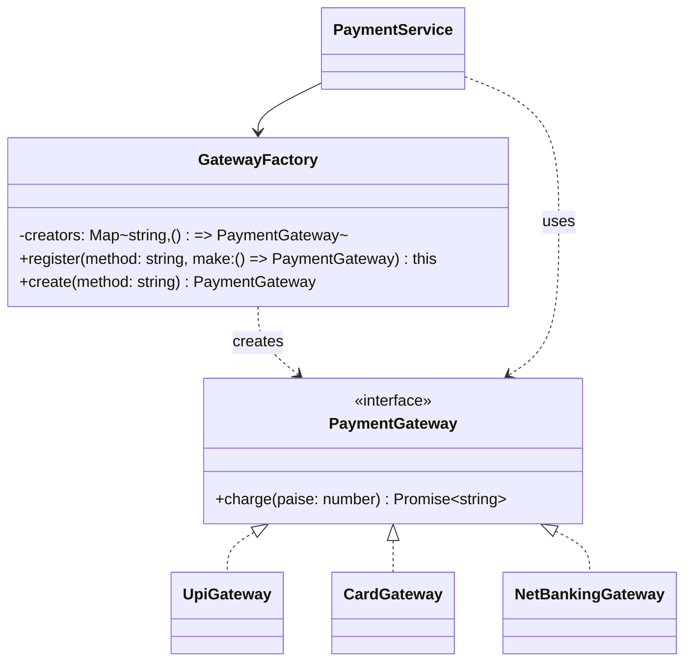

# L09 · Simple Factory and Factory Method

> **Time:** ~40 min · **Visual:** [visual.html](visual.html) · **Code:** [demo.ts](demo.ts) (`npx tsx lld/2-creational/L09-factory-method/demo.ts`)
> **Builds on:** [L01 Classes and interfaces](../../1-foundations/L01-classes-and-interfaces/README.md) · [L04 SOLID: SRP, OCP](../../1-foundations/L04-solid-srp-ocp/README.md) · **Used in:** Parking Lot (vehicle / spot types), Rate Limiter (algorithm from config), Chess (piece from a letter), Notification Service (channel from type), Payment Wallet

## The idea in one line

Put the "which concrete class do I create?" decision in one place, so the rest of the code works only with an interface.

## Why it matters (the problem it solves)

```ts
// Before: the creation logic is copied into every caller
async function checkout(method: string, paise: number) {
  let gw: PaymentGateway;
  if (method === 'UPI') gw = new UpiGateway(process.env.UPI_KEY!);
  else if (method === 'CARD') gw = new CardGateway(process.env.CARD_KEY!, { retries: 3 });
  else throw new Error('Unknown method');
  return gw.charge(paise);
}
// refund(), retryPayment() and reconcile() repeat the same chain.
```

What goes wrong:
- **Shotgun edits.** A new method (net banking) means finding and editing every copy.
- **Tight coupling.** Every caller imports every concrete class and knows its keys and options.
- **Drift.** One copy forgets `retries: 3`, so refunds behave differently from checkouts.
- **Hard tests.** You cannot give `checkout()` a fake gateway, because it calls `new` itself.

## How it works

There are three things people call "factory". Know all three names; you will mostly write the first.

### 1. Simple factory (a function or class with a lookup table)

Not a GoF pattern, but the one you use in 90% of machine-coding rounds.

```
 checkout() ─┐                          ┌─► new UpiGateway(key)
 refund()   ─┼─► createGateway('UPI') ──┤   new CardGateway(key, {retries: 3})
 reconcile()─┘     lookup table         └─► throw UnsupportedMethodError → 400
                    returns PaymentGateway (the interface)
```

- Input: a string, enum or config value.
- Output: an object typed as the **interface**.
- Unknown input: throw at the boundary, so nothing downstream sees bad data.

**Self-registration** removes even the one edit to the table: each gateway module calls `factory.register('UPI', () => new UpiGateway(...))`. Plugin systems work this way.

### 2. Factory Method (GoF)

A base class has a fixed algorithm. One step of it creates an object, and that step is an abstract method. Subclasses override it.



`send()` validates and trims, then calls `this.createChannel().deliver(...)`. You call `new SmsSender().send(...)`, the inherited code runs, and dynamic dispatch sends the `createChannel()` call to `SmsSender`. It is the Template Method idea ([L26](../../4-behavioral/L26-template-method/README.md)) where the varying step is "create the product".

### 3. Abstract Factory

One factory that creates a **family** of matching objects. Covered in [L10](../L10-abstract-factory/README.md).

### Class diagram: the simple factory



### How to spot it in a problem statement

- "Support vehicle types **car, bike, truck**", "payment methods **UPI, card, wallet**", "notification **channels**". A type field picks a class.
- "Read the algorithm **from config**" (rate limiter: token bucket or sliding window).
- "Set up the board from a string like `RNBQKBNR`" (chess pieces from letters).
- "We will **add more types later**." That sentence is an OCP hint: one place to add them.

## In TypeScript

```ts
const creators: Record<Method, () => PaymentGateway> = {
  UPI: () => new UpiGateway(env.UPI_KEY),
  CARD: () => new CardGateway(env.CARD_KEY, { retries: 3 }),
  NETBANKING: () => new NetBankingGateway(),
};
type Method = 'UPI' | 'CARD' | 'NETBANKING';

export function createGateway(m: string): PaymentGateway {
  if (!(m in creators)) throw new UnsupportedMethodError(m); // map to 400 at the edge
  return creators[m as Method]();
}
```

`Record<Method, ...>` gives you a compile error if you add `'WALLET'` to the union and forget its entry. That is an exhaustiveness check for free.

Factory Method:

```ts
abstract class NotificationSender {
  protected abstract createChannel(): Channel;
  send(to: string, msg: string) {
    return this.createChannel().deliver(to, msg.trim());
  }
}
class SmsSender extends NotificationSender {
  protected createChannel() { return new SmsChannel(); }
}
```

Node already does this everywhere: `crypto.createHash('sha256')`, `http.createServer()`, `axios.create({ baseURL })`, `winston.createLogger()`, NestJS `useFactory` providers.

## Trade-offs / when NOT to use it

| Pro | Con |
|---|---|
| One place decides which class | One more indirection to read through |
| Callers depend on the interface only (DIP) | The table still changes for each new type (unless self-registered) |
| Construction details (keys, retries) live in one spot | Factory Method needs inheritance, which is rigid |
| Easy to test: inject a factory that returns fakes | |

Skip it when:
- There is **one** concrete class and no plan for more. Just call `new`.
- The factory would only forward to a constructor with no choice and no config.
- You are tempted to build `FactoryProvider` → `FactoryFactory`. A `Record<Type, () => T>` is enough.

## Common mistakes

1. **A factory that returns a concrete type** (`create(): UpiGateway`). Then callers still depend on the class. Return the interface.
2. **No error for unknown input.** Returning `undefined` pushes the crash deep into the code. Throw a typed error at the edge.
3. **Mixing up Factory and Strategy.** The factory creates; the strategy does the work. Say both names when they appear together.
4. **Calling it "Factory Method" when it is a simple factory.** Interviewers notice. GoF Factory Method is the inheritance version.
5. **Sharing stateful products.** Caching one instance per key is fine only if the product has no per-request fields.
6. **A switch on type in every method** of one big class instead of separate classes. That is the "before", just moved.

## Say this in the interview

> "Callers only see the `PaymentGateway` interface. One factory maps the method to a constructor in a lookup table, so adding net banking is one new class and one table entry; checkout and refund don't change. Unknown methods throw at the edge and become a 400."

> "If there is a base algorithm where only the product differs, like `send()` creating a channel, I'd use the GoF Factory Method: an abstract `createChannel()` that each subclass overrides. In TypeScript I usually prefer the registry, because it composes better than inheritance."

## Your experience hook

- **Payment orchestration across 3 providers:** you picked the provider adapter per payment from config/routing rules. That lookup is a factory: `providerFactory.create(route.provider)` returning a `PaymentProvider` interface.
- **NestJS `useFactory`:** you have built providers from config at startup (Redis client, RabbitMQ connection). That is a factory function the DI container calls once.

## Self-test

<details><summary>1. Doesn't the factory still contain a switch? Isn't that an OCP violation?</summary>

It is in one place, and every caller is closed to change. With self-registration (`factory.register('UPI', ...)` inside the UPI module) even the factory file stays unchanged.
</details>

<details><summary>2. Factory vs Strategy?</summary>

Factory decides which object to create. Strategy is the object that does the varying work. Typical pair: a factory creates the pricing strategy from the vehicle type, and the parking lot calls `strategy.price()`.
</details>

<details><summary>3. Simple factory vs GoF Factory Method?</summary>

A simple factory is a function or class with a lookup. Factory Method uses inheritance: a base class algorithm calls an abstract creation method, and subclasses override it.
</details>

<details><summary>4. Chess: create pieces from the letters "KQRBNP". How?</summary>

A simple factory: `Record<Letter, (color: Color) => Piece>`. The board parses the setup string and calls the factory for each square.
</details>

<details><summary>5. When can the factory return the same object every time?</summary>

When the product is stateless (a strategy with no fields). Cache one per key. That is factory plus the Flyweight idea.
</details>

<details><summary>6. How do you test `PaymentService` that uses a factory?</summary>

Inject the factory through the constructor. In the test, register fake gateways (`factory.register('UPI', () => fakeGw)`) so no network is needed.
</details>

<details><summary>7. How does TypeScript help you not forget a new type in the factory?</summary>

Type the table as `Record<Method, () => PaymentGateway>`. Adding a member to the `Method` union without adding its entry is a compile error.
</details>

## Go deeper

- Visual: [visual.html](visual.html) (registry lookup, adding a type, unknown input, factory method dispatch)
- Next: [L10 Abstract Factory](../L10-abstract-factory/README.md) (families of products)
- Pairs with: [L20 Strategy](../../4-behavioral/L20-strategy/README.md), [L26 Template Method](../../4-behavioral/L26-template-method/README.md)
- Problems: [01 Parking Lot](../../problems/01-parking-lot/README.md), [04 Rate Limiter](../../problems/04-rate-limiter/README.md), [05 Notification Service](../../problems/05-notification-service/README.md), [23 Chess](../../problems/23-chess/README.md), [19 Payment Wallet](../../problems/19-payment-wallet/README.md)
- Older long-form notes: [LLD-guide.md](../../../archive/notes/LLD-guide.md) (Part 3, "Factory Pattern")
- Books: GoF "Factory Method"; Head First Design Patterns ch. 4
