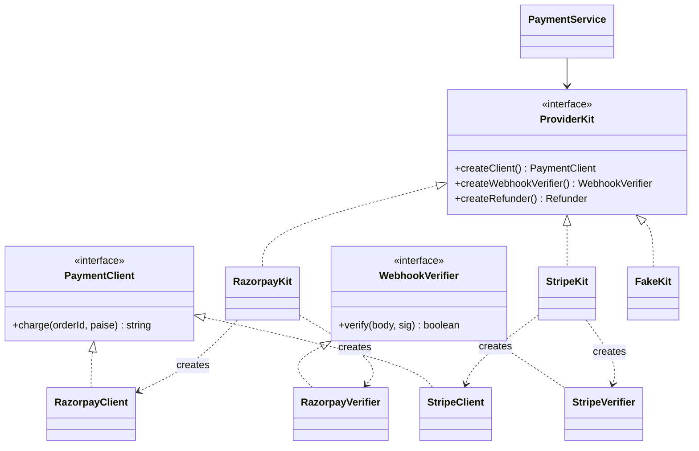

# L10 · Abstract Factory

> **Time:** ~30 min · **Visual:** [visual.html](visual.html) · **Code:** [demo.ts](demo.ts) (`npx tsx lld/2-creational/L10-abstract-factory/demo.ts`)
> **Builds on:** [L09 Simple Factory and Factory Method](../L09-factory-method/README.md) · [L05 SOLID: LSP, ISP, DIP](../../1-foundations/L05-solid-lsp-isp-dip/README.md) · **Used in:** Payment Wallet (provider kits), Notification Service (provider families), any "test mode vs live mode" design

## The idea in one line

One factory interface creates a whole **family** of related objects, and each concrete factory returns only objects from its own family, so families can never be mixed.

## Why it matters (the problem it solves)

A payment provider is not one object. To take payments you need:
- a **client** that creates charges,
- a **webhook verifier** that checks the provider's signature header with the provider's secret,
- a **refunder** that calls the provider's refund API.

These three only work with each other. A Stripe webhook can only be verified by Stripe's verifier.

```ts
// Before: two independent factories driven by two config values
const client = clientFactory.create(env.PAYMENT_PROVIDER);   // 'stripe'
const verifier = verifierFactory.create(env.WEBHOOK_PROVIDER); // 'razorpay' (someone forgot to update it)

// Charges work. Every webhook fails the signature check.
// Orders stay PENDING, customers are charged but get no confirmation.
```

The bug is not in any single class. It is in the **combination**. Abstract Factory removes the chance to combine wrongly.

## How it works

### The parts

| Part | In our example |
|---|---|
| Abstract factory (interface) | `ProviderKit` with `createClient()`, `createWebhookVerifier()`, `createRefunder()` |
| Concrete factories (one per family) | `RazorpayKit`, `StripeKit`, `FakeKit` |
| Abstract products (interfaces) | `PaymentClient`, `WebhookVerifier`, `Refunder` |
| Concrete products | `RazorpayClient`, `StripeVerifier`, `FakeRefunder`, ... |
| Client code | `PaymentService`, which only knows the interfaces |

### Picture: rows are families

```
                       createClient()    createWebhookVerifier()   createRefunder()
  RazorpayKit   ───►   RazorpayClient    RazorpayVerifier          RazorpayRefunder
  StripeKit     ───►   StripeClient      StripeVerifier            StripeRefunder
  FakeKit       ───►   FakeClient        FakeVerifier              FakeRefunder

  main.ts reads PROVIDER once → injects ONE kit → PaymentService
  PaymentService can only ever get products from one row.
```

### Class diagram



### Relation to Factory Method

Each `createX()` method on a kit is itself a factory method. Abstract Factory is "a set of factory methods that belong together, behind one interface". Factory Method varies **one** product by subclass; Abstract Factory varies a **set** of products by swapping one object.

### The asymmetry (know this for the interview)

| Change | Cost |
|---|---|
| Add a new family (PayU) | Easy: one new kit + its product classes. Nothing else changes. |
| Add a new product kind (payouts) | Hard: change the interface **and every kit**. |

### How to spot it in a problem statement

- "Support **multiple providers**, and each provider has several APIs we use" (payments, SMS + delivery-report webhooks, cloud storage + signed URLs).
- "Run in **test mode / sandbox / live mode**" where several objects must switch together.
- "**Light and dark** UI kits", "Postgres vs SQLite **repositories**" (a set of repos for one storage backend).
- Words like "family", "suite", "kit", "must be consistent", "works only with".

If there is only one product per provider, you only need a simple factory ([L09](../L09-factory-method/README.md)).

## In TypeScript

```ts
interface ProviderKit {
  createClient(): PaymentClient;
  createWebhookVerifier(): WebhookVerifier;
  createRefunder(): Refunder;
}

class StripeKit implements ProviderKit {
  constructor(private cfg: { apiKey: string; webhookSecret: string }) {}
  createClient() { return new StripeClient(this.cfg.apiKey); }
  createWebhookVerifier() { return new StripeVerifier(this.cfg.webhookSecret); }
  createRefunder() { return new StripeRefunder(this.cfg.apiKey); }
}

// composition root: ONE decision
const kits: Record<Provider, () => ProviderKit> = {
  razorpay: () => new RazorpayKit(cfg.razorpay),
  stripe: () => new StripeKit(cfg.stripe),
  fake: () => new FakeKit(),
};
const payments = new PaymentService(kits[env.PROVIDER]());

class PaymentService {
  constructor(private kit: ProviderKit) {}
  onWebhook(body: string, sig: string) {
    return this.kit.createWebhookVerifier().verify(body, sig);
  }
}
```

A lighter TS form: a kit can be a plain object of factory functions, `{ client: () => ..., verifier: () => ... }`, typed by an interface. Same guarantee, less ceremony.

## Trade-offs / when NOT to use it

| Pro | Con |
|---|---|
| Families can't be mixed | Many classes (kits x products) |
| Switch the whole family with one object | Adding a product kind touches every kit |
| Easy fakes: one `FakeKit` for tests | Overkill if there is only one product per family |
| Client code depends only on interfaces (DIP) | Indirection makes "go to definition" less direct |

Do not use it when there is one family only, or one product per family. In machine-coding rounds it is rare. Mention it when the problem has providers with multiple matching parts.

## Common mistakes

1. **Using it for one product.** That is a simple factory. Calling it Abstract Factory sounds like pattern-dropping.
2. **Two config values** that each pick one product. That reintroduces the mixing bug the pattern exists to stop.
3. **Leaking concrete types**: `createClient(): StripeClient`. Return the interface.
4. **Kits that read config inside each create call.** Pass config to the kit's constructor once.
5. **Forgetting the cost.** Interviewers ask "what if you add a new product?" Say: the interface and every kit change.

## Say this in the interview

> "Each payment provider has a client, a webhook verifier and a refund API that only work together. I define a `ProviderKit` interface with one create method per product and one kit per provider. The composition root reads one config value and injects one kit, so the service can never use Stripe's client with Razorpay's verifier."

> "Tests inject a `FakeKit`. Adding a new provider is one kit. The trade-off is that adding a new product kind, like payouts, means changing the interface and every kit, so I'd keep the kit small."

## Your experience hook

- **Payment orchestration across 3 providers:** each provider had its own charge API, webhook signature scheme and refund call. Grouping them per provider (one module or kit per provider) is exactly this pattern, and it is how you avoid verifying provider A's webhook with provider B's secret.
- **Sandbox vs live:** you likely had test keys and test webhook secrets. A "sandbox kit" vs "live kit" switches them all together.

## Self-test

<details><summary>1. What bug does Abstract Factory prevent that two separate simple factories do not?</summary>

Mixing families: for example a Stripe client with a Razorpay webhook verifier, chosen by two different config values. One kit creates all products from one family.
</details>

<details><summary>2. You add `createPayoutApi()`. What has to change?</summary>

The `ProviderKit` interface and every concrete kit (Razorpay, Stripe, Fake). New product kinds are the expensive change.
</details>

<details><summary>3. You add a new provider, PayU. What has to change?</summary>

Add `PayUKit` and its product classes, plus one entry in the kit registry. `PaymentService` does not change.
</details>

<details><summary>4. Abstract Factory vs Factory Method in one sentence each?</summary>

Factory Method: a subclass decides which one product the base algorithm creates. Abstract Factory: an object with several create methods that returns one consistent family of products.
</details>

<details><summary>5. Your service takes `ProviderKit` in its constructor. What does a unit test pass?</summary>

A `FakeKit` that returns in-memory client, verifier and refunder objects, so the test needs no network and can assert on recorded calls.
</details>

<details><summary>6. Where should the "which kit?" decision live?</summary>

In the composition root (`main.ts` or a DI module), made once at startup from config. Not inside the service.
</details>

## Go deeper

- Visual: [visual.html](visual.html) (mixed-family bug, kit rows, switching providers, FakeKit, the cost)
- Previous: [L09 Simple Factory and Factory Method](../L09-factory-method/README.md)
- Related: [L13 Adapter](../../3-structural/L13-adapter/README.md) (each provider's client is often an adapter), [L31 Repository and DI](../../5-machine-coding/L31-repository-and-di/README.md)
- Problems: [19 Payment Wallet](../../problems/19-payment-wallet/README.md), [05 Notification Service](../../problems/05-notification-service/README.md)
- Older long-form notes: [LLD-guide.md](../../../archive/notes/LLD-guide.md) (Part 3, "Factory Pattern")
- Books: GoF "Abstract Factory"; Head First Design Patterns ch. 4
