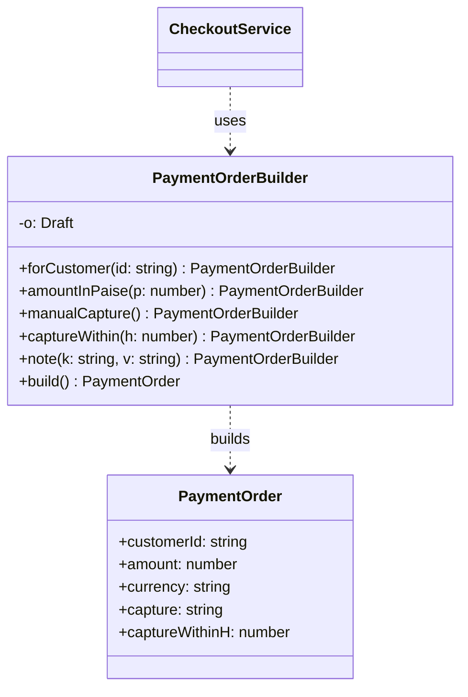

# L11 · Builder

> **Time:** ~35 min · **Visual:** [visual.html](visual.html) · **Code:** [demo.ts](demo.ts) (`npx tsx lld/2-creational/L11-builder/demo.ts`)
> **Builds on:** [L01 Classes and interfaces](../../1-foundations/L01-classes-and-interfaces/README.md) · [L09 Simple Factory and Factory Method](../L09-factory-method/README.md) · **Used in:** Snake and Ladder (board setup), KV Store (config), Text Editor / Chess (test fixtures), test-data builders in every problem

## The idea in one line

Build a complex object step by step with named methods, check every rule once in `build()`, and return an immutable result.

## Why it matters (the problem it solves)

```ts
// Before: a telescoping constructor
const order = new PaymentOrder(
  'ord_1', 49900, 'INR', undefined, undefined, true, 3, 'cust_9', undefined, 'notes',
);
// Is `true` auto-capture? Is `3` retries or a capture window in hours?
// Swap them and it still compiles. Amount in paise or rupees?
```

Problems:
- **Unreadable call sites.** Positional arguments hide meaning, and `undefined` placeholders pile up.
- **Easy, silent mistakes.** Two `number` or two `boolean` arguments can be swapped with no compile error.
- **Scattered validation.** Rules between fields ("manual capture needs a capture window") get checked in many places, or nowhere.
- **Half-built objects.** If you build with setters (`order.setAmount(...)`), the object exists in an invalid state between calls.

## How it works

### The parts

1. A **builder** class holds a draft with **defaults** (`currency: 'INR'`, `capture: 'auto'`).
2. **Named methods** set one part each and `return this`, so calls chain.
3. **`build()`** is the only exit. It checks all rules (including rules between fields), copies the draft into a new object, and freezes it.
4. The **product** has only `readonly` fields. It is valid from the moment it exists.

```
new PaymentOrderBuilder()            draft: { currency: INR, capture: auto, notes: {} }
  .forCustomer('cust_9')       ──►   draft.customerId = 'cust_9'      (returns this)
  .amountInPaise(49900)        ──►   draft.amount = 49900             (returns this)
  .manualCapture()             ──►   draft.capture = 'manual'         (rule now pending)
  .build()                     ──►   ✓ customer  ✓ amount > 0  ✗ manual ⇒ captureWithin → throw
  .captureWithin(24).build()   ──►   all ✓ → Object.freeze({...}) → PaymentOrder
```

### Class diagram



GoF also has a **Director** class that runs a fixed sequence of builder calls. You rarely need it. A static helper like `PaymentOrderBuilder.upiDefaults()` returning a pre-filled builder does the same job.

### Three TypeScript options, from light to strict

| Option | When |
|---|---|
| **Options object** `create({ customerId, amount, capture })` | Fields are independent, no steps. TS already gives named fields. Most common. |
| **Fluent builder** (this page) | Many optional parts, rules between fields, built over several steps or places. |
| **Step builder** (typed stages) | A public API where required steps must be checked at compile time. |

### Step builder

Each method returns an interface that only has the next allowed methods. `build()` does not exist until the required steps are done.

```ts
interface NeedsUrl { url(u: string): NeedsMethod }
interface NeedsMethod { get(): Optional; post(body: unknown): Optional }
interface Optional { header(k: string, v: string): Optional; timeout(ms: number): Optional; build(): HttpRequest }

request().url('/orders').post(body).header('Idempotency-Key', key).build(); // ok
request().build(); // TS2339: Property 'build' does not exist on type 'NeedsUrl'
```

### How to spot it in a problem statement

- "Create a game / board **with configurable** snakes, ladders, players, dice." (Snake and Ladder.)
- An entity with **many optional settings** and a few **"if X then Y is required"** rules.
- "The object must not change after creation" plus "it is assembled from several inputs".
- Tests that need **lots of slightly different objects**: `aBooking().forSeat('A1').expired().build()`.

## In TypeScript

```ts
class PaymentOrderBuilder {
  private o: Draft = { currency: 'INR', capture: 'auto', notes: {} };

  forCustomer(id: string) { this.o.customerId = id; return this; }
  amountInPaise(p: number) { this.o.amount = p; return this; }
  manualCapture() { this.o.capture = 'manual'; return this; }
  captureWithin(h: number) { this.o.captureWithinH = h; return this; }

  build(): Readonly<PaymentOrder> {
    if (!this.o.customerId) throw new ValidationError('customerId is required');
    if (!(this.o.amount! > 0)) throw new ValidationError('amount must be > 0');
    if (this.o.capture === 'manual' && !this.o.captureWithinH)
      throw new ValidationError('manual capture needs captureWithin');
    return Object.freeze({ ...this.o, notes: { ...this.o.notes } }) as PaymentOrder;
  }
}

const order = new PaymentOrderBuilder()
  .forCustomer('cust_9').amountInPaise(49900).manualCapture().captureWithin(24)
  .build();
```

Node examples you already use: Knex / TypeORM query builders (`qb.where(...).orderBy(...).limit(10)`), Zod schemas (`z.object({...}).strict()`), `new URL()` + `searchParams.append()`, supertest (`request(app).post('/x').set('Auth', t).send(body)`).

## Trade-offs / when NOT to use it

| Pro | Con |
|---|---|
| Readable call sites with named steps | More code: a second class per product |
| All rules in one `build()` | Required fields are a runtime check (unless step builder) |
| Immutable, always-valid product | Must keep builder and product in sync when fields change |
| Great for test data | Overkill for 3–4 independent fields |

Skip it when:
- The object has a few fields and no rules between them. Use a constructor or options object.
- `build()` would have no validation and no defaults. Then the builder is ceremony.

## Common mistakes

1. **No validation in `build()`.** Then it is just a slow options object.
2. **Returning the draft itself** (not a copy). Later builder calls change an object that was already "built".
3. **Forgetting that `Object.freeze` is shallow.** Copy (and freeze) nested objects like `notes`.
4. **Using a builder for a 3-field object.** Interviewers see it as pattern-dropping. Say "an options object is enough here".
5. **Validating in each setter.** Cross-field rules cannot be checked until all fields are known.
6. **Mixing it up with Factory.** Factory picks which class; Builder assembles one object over many calls.

## Say this in the interview

> "A payment order has many optional fields and rules between them, like 'manual capture needs a capture window'. I'll use a builder with named methods, keep defaults inside it, and validate everything once in `build()`. The result is frozen, so the rules stay true for its whole life."

> "For simple objects I'd just use an options object, since TypeScript already gives named fields. If this were a public SDK, I'd make it a step builder so missing required fields are compile errors."

## Your experience hook

- **Payment orchestration:** a charge request to a provider has amount, currency, customer, capture mode, metadata and an idempotency key. Building it through one builder (or one function with validation) is where you made sure the idempotency key and amount in paise were always set.
- **Query builders:** you have written TypeORM / Knex-style queries during the MongoDB to MySQL migration. That chaining API is this pattern.

## Self-test

<details><summary>1. Why freeze the built object?</summary>

So no code changes it after validation. The checks done in `build()` stay true for the object's whole life.
</details>

<details><summary>2. Why validate in `build()` and not in each setter?</summary>

Cross-field rules ("manual capture needs captureWithin") cannot be checked until all fields are set. `build()` is the one moment when the full picture is known.
</details>

<details><summary>3. Snake and Ladder: how does a builder help?</summary>

`new BoardBuilder(100).snake(99, 7).ladder(3, 38).build()`. `build()` checks that snakes go down, ladders go up, no cell has both, and no snake sits on the last cell.
</details>

<details><summary>4. When is an options object better than a builder?</summary>

When the fields are independent and there are no steps or cross-field rules. It is less code and just as readable, and required fields are checked by the compiler.
</details>

<details><summary>5. How do you make required fields a compile-time check?</summary>

A step builder: each method returns an interface with only the next allowed methods, so `build()` is not available until the required steps are done.
</details>

<details><summary>6. Should the builder be reusable after `build()`?</summary>

Either way, but be explicit. If it is reusable, `build()` must copy fields (including nested ones) so later calls do not change built objects.
</details>

<details><summary>7. Builder vs Factory in one line each?</summary>

Factory: which class to create, in one call. Builder: how to assemble one object over several calls. A factory can return a pre-filled builder.
</details>

## Go deeper

- Visual: [visual.html](visual.html) (fields filling, a failing rule, the frozen result, step builder)
- Related: [L09 Simple Factory and Factory Method](../L09-factory-method/README.md), [L12 Prototype](../L12-prototype/README.md), [L33 Domain modelling in TS](../../5-machine-coding/L33-domain-modeling/README.md) (readonly, value objects)
- Testing with builders: [L34 Testing your design](../../5-machine-coding/L34-testing-designs/README.md)
- Problems: [08 Snake and Ladder](../../problems/08-snake-ladder/README.md), [14 KV Store](../../problems/14-kv-store/README.md)
- Older long-form notes: [LLD-guide.md](../../../archive/notes/LLD-guide.md) (Part 3, "Builder Pattern")
- Books: GoF "Builder"; Effective Java, Item 2
