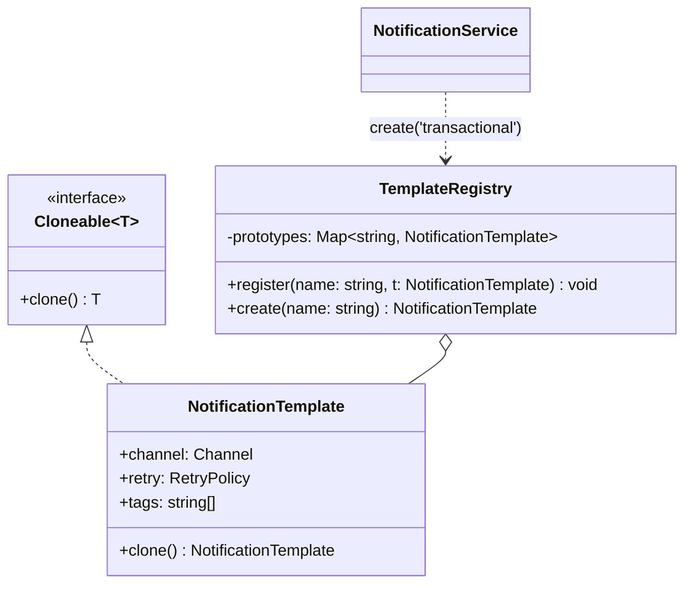

# L12 · Prototype

> **Time:** ~25 min · **Visual:** [visual.html](visual.html) · **Code:** [demo.ts](demo.ts) (`npx tsx lld/2-creational/L12-prototype/demo.ts`)
> **Builds on:** [L01 Classes and interfaces](../../1-foundations/L01-classes-and-interfaces/README.md) · [L11 Builder](../L11-builder/README.md) · **Used in:** Chess (copy the board to test a move), Snake and Ladder (board templates), KV Store (snapshots), Text Editor (undo snapshots, with Memento)

## The idea in one line

Create new objects by copying a configured existing object (the prototype), and make the copy own every part it might change.

## Why it matters (the problem it solves)

You have a configured object that is costly or long to set up (a notification template, a parsed rule set, a board layout). You need many similar objects with small changes. Building each from scratch repeats the setup, and copying by hand is easy to get wrong:

```ts
// Before: "copy" with spread
const template = { channel: 'EMAIL', retry: { max: 3, backoffMs: 500 }, tags: ['txn'] };
const otp = { ...template };
otp.retry.max = 1;     // template.retry.max is now 1 too
otp.tags.push('otp');  // template.tags is now ['txn', 'otp']
// Every email sent after this retries once and is tagged "otp". Nobody touched `template` directly.
```

The bug: spread copies only the top level. `retry` and `tags` are references, so both objects share them.

## How it works

### Shallow vs deep, in pictures

```
Shallow ({ ...template })                 Prototype clone()
template ──► retry {max 3} ◄── otp        template ──► retry  {max 3}
         └─► tags  ['txn'] ◄──┘           otp      ──► retry′ {max 1}     (own copy)
   one write through otp changes both               template ──► tags ['txn']
                                                    otp      ──► tags′ ['txn','otp']
```

### The parts

| Part | Job |
|---|---|
| `Cloneable<T>` interface | Declares `clone(): T` |
| Concrete prototype | Knows how to copy itself correctly: deep where the clone may change, shared where data is immutable |
| Prototype registry (optional) | A `Map<name, prototype>`; `create(name)` returns `proto.clone()`, never the prototype itself |

### Class diagram



### Deciding what to deep-copy

Ask for each field: "Will a clone ever change this?"
- **Primitives** (string, number, boolean): copied by value already.
- **Immutable or frozen objects** (a `Money` value object, a frozen config): safe to share.
- **Mutable objects and arrays the clone may change** (`retry`, `tags`, a `Map` of board squares): copy them.
- **Resources** (DB connection, socket, file handle): never clone. Share or re-create.

### JS copy tools and their traps

| Tool | Depth | Keeps class? | Gotchas |
|---|---|---|---|
| `{ ...obj }`, `Object.assign` | Shallow | No (plain object) | Nested objects shared |
| `JSON.parse(JSON.stringify(x))` | Deep | No | `Date` → string, `Map`/`Set` → `{}`, `undefined` dropped, `BigInt` throws |
| `structuredClone(x)` (Node 17+) | Deep | **No** | Keeps Date/Map/Set; throws on functions; result is a plain object, methods gone |
| Your own `clone()` | You decide | Yes | Must be updated when you add fields |

**Do not confuse with JavaScript's prototype chain.** `Object.create(proto)` links an object to another to **inherit methods**; nothing is copied. The Prototype pattern **copies state** to make an independent object.

### How to spot it in a problem statement

- "Users can **create a new X from an existing one** / from a template" (duplicate a board, clone a campaign, copy a notification template).
- "**Try** a move / a change and **roll back** if invalid" (chess check detection, what-if pricing).
- "Take a **snapshot**" (KV store snapshot, undo history; see Memento [L24](../../4-behavioral/L24-memento/README.md)).
- Setup is **expensive** (parsed rules, loaded config) but copying is cheap.

## In TypeScript

```ts
interface Cloneable<T> { clone(): T }

class NotificationTemplate implements Cloneable<NotificationTemplate> {
  constructor(
    public channel: 'EMAIL' | 'SMS',
    public retry: { max: number; backoffMs: number },
    public tags: string[],
  ) {}
  clone(): NotificationTemplate {
    return new NotificationTemplate(this.channel, { ...this.retry }, [...this.tags]);
  }
}

class TemplateRegistry {
  private prototypes = new Map<string, NotificationTemplate>();
  register(name: string, t: NotificationTemplate) { this.prototypes.set(name, t); }
  create(name: string) { return this.prototypes.get(name)!.clone(); }
}

const otp = registry.create('transactional');
otp.retry.max = 1; // the template is safe
```

Chess move check:

```ts
function isLegal(board: Board, move: Move): boolean {
  const copy = board.clone();        // Map of squares copied
  copy.apply(move);
  return !copy.isInCheck(move.color); // throw the copy away either way
}
```

## Trade-offs / when NOT to use it

| Pro | Con |
|---|---|
| New objects without repeating costly setup | `clone()` must be kept in sync with every new field |
| The client does not need to know the concrete class | Deep copies of big graphs are slow and use memory |
| Safe "try then discard" (snapshots) | Cycles and shared sub-objects make deep copy tricky |

Skip it when:
- A constructor or a factory with defaults is enough. Most of the time it is.
- The object is immutable. Then you do not need copies at all; share it, or build a changed version (`{ ...order, status: 'PAID' }` on a frozen object is fine).
- The object holds resources (connections, sockets).
- You copy a large graph on a hot path. Consider immutable data with structural sharing instead.

## Common mistakes

1. **Treating spread as a deep copy.** The classic bug: nested arrays and objects are shared.
2. **Using `structuredClone` on class instances** and then calling a method on the result.
3. **`JSON.parse(JSON.stringify())`** for copying: silently breaks `Date`, `Map`, `Set`, `undefined`.
4. **Deep-copying everything**, including immutable value objects and big read-only data. Wasteful.
5. **Returning the prototype itself from the registry.** Then callers mutate the shared template.
6. **Mixing it up with JS prototypal inheritance** (`Object.create`, `__proto__`).

## Say this in the interview

> "Each notification type starts from a template. I keep templates in a registry, and `create(name)` returns `template.clone()`. The clone copies the nested parts it may change, the retry policy and the tags, so changing one OTP message never changes the template. Strings and frozen value objects are shared, since they can't change."

> "For chess, I clone the board, apply the move on the copy and check if my king is in check. If it is, I discard the copy. Note that spread is shallow, and `structuredClone` is deep but returns a plain object without the class methods."

## Your experience hook

- **Notification / alert templates:** in the IoT platform, device alert rules or message templates were configured once and reused per device. Cloning a configured template per device (and not sharing the nested threshold objects) is this pattern.
- **Spread bugs in reducers or config:** if you have ever had a config object changed "by itself" in Node, it was a shared nested reference after a shallow copy.

## Self-test

<details><summary>1. `const b = { ...a }; b.items.push(x)`. What happens to `a`?</summary>

`a.items` also gets `x`. Spread copies only the top level, so both objects point to the same array.
</details>

<details><summary>2. What does `structuredClone(new Money(100, 'INR'))` return?</summary>

A plain object `{ amount: 100, currency: 'INR' }`. It is not an instance of `Money`, so its methods are gone.
</details>

<details><summary>3. When is a shallow copy enough?</summary>

When nested values are immutable (strings, numbers, frozen objects) or are meant to be shared and nobody mutates them. Deep-copy only the parts the clone will change.
</details>

<details><summary>4. Chess: why clone the board when checking a move?</summary>

To apply the move on a copy and test "is my king in check now?" without changing the real board. If the move is illegal, throw the copy away.
</details>

<details><summary>5. How does Prototype relate to Memento?</summary>

Both copy state. Memento stores a snapshot to restore later (undo). Prototype copies to create a new, independent object. A `clone()` is often used to make a memento.
</details>

<details><summary>6. Why should a prototype registry return clones, not the stored object?</summary>

If it returns the stored object, every caller shares and can mutate the template. Returning `clone()` keeps the prototype pristine.
</details>

<details><summary>7. Name two things `JSON.parse(JSON.stringify(x))` gets wrong.</summary>

`Date` becomes a string, `Map` and `Set` become `{}`, `undefined` fields are dropped, and `BigInt` throws. Any two.
</details>

## Go deeper

- Visual: [visual.html](visual.html) (shared vs owned references, structuredClone, chess copy)
- Related: [L11 Builder](../L11-builder/README.md), [L24 Memento](../../4-behavioral/L24-memento/README.md), [L33 Domain modelling in TS](../../5-machine-coding/L33-domain-modeling/README.md) (immutable value objects)
- Problems: [23 Chess](../../problems/23-chess/README.md), [08 Snake and Ladder](../../problems/08-snake-ladder/README.md), [14 KV Store](../../problems/14-kv-store/README.md), [22 Text Editor](../../problems/22-text-editor/README.md)
- Older long-form notes: [LLD-guide.md](../../../archive/notes/LLD-guide.md) (Part 3, creational patterns)
- Books: GoF "Prototype"; Head First Design Patterns, appendix "Leftover Patterns"
