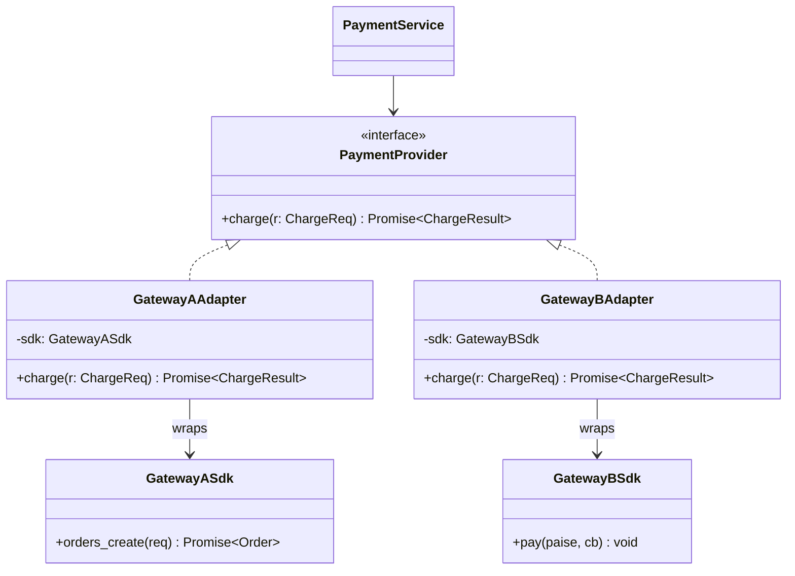

# L13 · Adapter

> **Time:** ~30 min · **Visual:** [visual.html](visual.html) · **Code:** [demo.ts](demo.ts) (`npx tsx lld/3-structural/L13-adapter/demo.ts`)
> **Builds on:** [L01 Classes and interfaces](../../1-foundations/L01-classes-and-interfaces/README.md) · [L05 SOLID: LSP, ISP, DIP](../../1-foundations/L05-solid-lsp-isp-dip/README.md) · **Used in:** Notification Service (SMS / email provider SDKs), Payment Wallet (payment gateways), Logger (sinks), Ride Sharing (maps / ETA providers)

## The idea in one line

Wrap a class that has the wrong interface so it looks like the interface your code expects, translating names, units, async style and errors on the way.

## Why it matters (the problem it solves)

Every third-party SDK has its own shape. If your service calls them directly, their shapes leak into your business code:

```ts
// Before: the service speaks every SDK
async function charge(gateway: string, orderId: string, paise: number) {
  if (gateway === 'A') {
    try {
      const o = await sdkA.orders.create({ amount: (paise / 100).toFixed(2), receipt: orderId }); // rupees string
      return { ref: o.id };
    } catch (e: any) { if (e.error?.code === 'BAD_REQUEST_ERROR') throw new Error('declined'); throw e; }
  } else if (gateway === 'B') {
    return new Promise((ok, fail) => sdkB.pay(paise, (code, id) => (code === 0 ? ok({ ref: id }) : fail(code)))); // callbacks, code 51
  } else {
    const r = await sdkC.charge({ cents: paise, ccy: 'inr' });
    if (r.status === 'FAILED') throw new Error(r.reason); // a failure inside HTTP 200
    return { ref: r.txn };
  }
}
```

Problems: three unit systems, two async styles, three error formats, all in domain code. Tests must mock three SDKs. A fourth gateway edits this function again (OCP violation), and someone will forget Gateway C's "200 but FAILED".

## How it works

### The parts

| Role | In our example |
|---|---|
| **Target** (the interface you own) | `PaymentProvider.charge({ orderId, paise }): Promise<{ ref, status }>`, error type `PaymentDeclinedError` |
| **Adaptee** (the thing with the wrong shape) | `gatewayASdk`, `gatewayBSdk`, `gatewayCSdk` |
| **Adapter** (one per adaptee) | `GatewayAAdapter`, `GatewayBAdapter`, `GatewayCAdapter`; each `implements PaymentProvider` and holds its SDK |
| **Client** | `PaymentService`, which only knows `PaymentProvider` |

```
PaymentService ──charge({orderId, paise})──► GatewayBAdapter ──pay(49900, cb)──► GatewayB SDK
      ▲                                           │  (wrap callback in a Promise)        │
      └──── {ref:'B-778812', status:'CAPTURED'} ◄─┘◄──────── cb(0, 'B-778812') ──────────┘
                     or PaymentDeclinedError('INSUFFICIENT_FUNDS')  ◄── cb(51, null)
```

### What an adapter translates

| Concern | Example |
|---|---|
| Method and field names | `charge()` → `orders.create()`, `orderId` → `receipt` |
| Units | integer paise → `"499.00"` rupee string, or `cents` |
| Async style | callback → Promise (`util.promisify`), event emitter → async iterator |
| Response shape | `{ id, status: 'created' }` → `{ ref, status: 'PENDING' }` |
| Errors | `{ error: { code } }`, numeric `51`, `status: 'FAILED'` → `PaymentDeclinedError` |
| Status vocabularies | provider statuses → your enum |

### Class diagram



### Object adapter vs class adapter

- **Object adapter** (composition): the adapter holds the adaptee in a field. Works with any instance, including ones you get from a factory. Use this in TS.
- **Class adapter** (inheritance): the adapter `extends` the adaptee and implements the target. Needs multiple inheritance in most languages; in TS you can only extend one class. Rare.

### Two-way and "anti-corruption layer"

In DDD, a set of adapters at the boundary of your service is called an **anti-corruption layer**: it stops another system's model (its names, statuses, IDs) from leaking into your domain. Hexagonal architecture calls the interface a **port** and the adapter an **adapter**.

### How to spot it in a problem statement

- "Integrate with **multiple providers / vendors / gateways**" (payments, SMS, email, KYC, maps).
- "We are **migrating** from the old X to the new Y" (wrap the old module behind the new interface).
- "The external API returns **different formats / units**".
- "Make it easy to **switch provider**" or "add a fallback provider".

## In TypeScript

```ts
interface PaymentProvider { charge(r: ChargeReq): Promise<ChargeResult> }

class GatewayBAdapter implements PaymentProvider {
  constructor(private sdk: GatewayBSdk) {}
  charge(r: ChargeReq): Promise<ChargeResult> {
    return new Promise((ok, fail) =>
      this.sdk.pay(r.paise, (code, id) =>
        code === 0 ? ok({ ref: id!, status: 'CAPTURED' })
                   : fail(new PaymentDeclinedError(B_CODES[code] ?? `B_${code}`))));
  }
}

class GatewayCAdapter implements PaymentProvider {
  constructor(private sdk: GatewayCSdk) {}
  async charge(r: ChargeReq): Promise<ChargeResult> {
    const res = await this.sdk.charge({ cents: r.paise, ccy: 'inr' });
    if (res.status === 'FAILED') throw new PaymentDeclinedError('CARD_DECLINED');
    return { ref: res.txn!, status: 'CAPTURED' };
  }
}

const payments = new PaymentService(new GatewayCAdapter(sdkC)); // swap freely
```

Node has adapters built in: `util.promisify` / `util.callbackify`, `Readable.from(asyncIterable)`, `Readable.toWeb()` / `fromWeb()`. ORMs and Knex adapt each SQL dialect behind one API. `serverless-http` adapts an Express app to a Lambda handler.

## Trade-offs / when NOT to use it

| Pro | Con |
|---|---|
| Domain code never sees SDK types | One more class per provider |
| Swap or add providers without touching the service (OCP) | Mapping code must be kept up to date with SDK versions |
| One error type, one unit, one status enum | Can hide useful provider details if you map too aggressively |
| Easy tests: fake the interface, not the SDK | |

Skip it when:
- You own both sides. Change the interface instead of adding a wrapper.
- There is exactly one provider and no plan for more, and the SDK shape is already close to what you want. (Many teams still add one adapter for testability. That is fine.)

## Common mistakes

1. **One adapter with `if (provider === ...)` inside.** That is the "before" code moved. One adapter per adaptee.
2. **Leaking the SDK**: `getRawClient()` or returning the SDK's response object. Callers start depending on it again.
3. **Forgetting to map errors.** Units and names get mapped, but the service still checks `err.code === 51`.
4. **Money in floats.** Convert to the provider's unit at the edge only; keep integer paise inside.
5. **Calling a Facade or Decorator an "adapter".** Adapter changes the interface; Decorator keeps it and adds behaviour; Facade simplifies a whole subsystem.
6. **No contract tests.** Each adapter should pass the same test suite for the `PaymentProvider` contract.

## Say this in the interview

> "The service depends on my `PaymentProvider` interface, not on any SDK. Each provider gets one adapter that converts the request, the units, the response and the error codes into my types. So Gateway B's callback and code 51 become a promise and a `PaymentDeclinedError`, and Gateway C's 'HTTP 200 with status FAILED' becomes the same error."

> "Adding or replacing a provider is one new class; the domain code and its tests don't change. And because every adapter has the same interface, I can put a fallback router or a retry decorator in front without touching any of them."

## Your experience hook

- **Payment orchestration across 3 providers via the Adapter pattern:** this is your story. One internal `PaymentProvider` interface, one adapter per gateway, mapping amounts, statuses and webhook payloads. Mention that it let you add a provider without touching the core flow, and made idempotency and retries provider-agnostic.
- **MongoDB to MySQL migration:** a repository interface with a Mongo adapter and a MySQL adapter lets you switch storage behind one API, and even dual-write during the migration.
- **IoT devices:** different device firmware or MQTT payload formats normalised into one internal telemetry type is an adapter (anti-corruption layer) at the ingestion edge.

## Self-test

<details><summary>1. Gateway A uses rupees as strings, B uses integer paise. Where do you convert?</summary>

Inside each adapter. Your domain uses one unit (integer paise) everywhere.
</details>

<details><summary>2. Which Node utility is a ready-made adapter for callback APIs?</summary>

`util.promisify` (and `util.callbackify` for the other direction).
</details>

<details><summary>3. The SDK throws `{ code: 'CARD_DECLINED' }`. What should your adapter throw?</summary>

Your own error type, for example `PaymentDeclinedError('CARD_DECLINED')`, so the service never checks provider-specific codes.
</details>

<details><summary>4. Adapter vs Facade vs Decorator vs Proxy?</summary>

Adapter changes the interface to the one the client expects. Facade gives a simpler interface over many classes. Decorator keeps the same interface and adds behaviour. Proxy keeps the same interface and controls access (lazy, cache, auth).
</details>

<details><summary>5. Object adapter vs class adapter? Which in TS?</summary>

Object adapter holds the adaptee (composition); class adapter extends it (inheritance). Use the object adapter in TS.
</details>

<details><summary>6. How do you test three adapters without three copies of the tests?</summary>

A shared contract test suite (`describe.each([adapterA, adapterB, adapterC])`) with each SDK stubbed, plus a few integration tests against each provider's sandbox.
</details>

<details><summary>7. A fallback router tries A, then B. Should it fall through on a card decline?</summary>

No. A decline is a final business answer; retrying on another gateway can double-charge or annoy the bank. Fall through only on outages or timeouts, and always send an idempotency key.
</details>

## Go deeper

- Visual: [visual.html](visual.html) (three SDK shapes, unit and error mapping, fallback)
- Compare: [L14 Decorator](../L14-decorator/README.md), [L15 Facade](../L15-facade/README.md), [L16 Proxy](../L16-proxy/README.md)
- Related: [L10 Abstract Factory](../../2-creational/L10-abstract-factory/README.md) (a kit of adapters per provider), [L31 Repository and DI](../../5-machine-coding/L31-repository-and-di/README.md)
- Problems: [05 Notification Service](../../problems/05-notification-service/README.md), [19 Payment Wallet](../../problems/19-payment-wallet/README.md), [03 Logger](../../problems/03-logger/README.md)
- Older long-form notes: [LLD-guide.md](../../../archive/notes/LLD-guide.md) (Part 3, "Adapter Pattern")
- Books: GoF "Adapter"; Head First Design Patterns ch. 7
