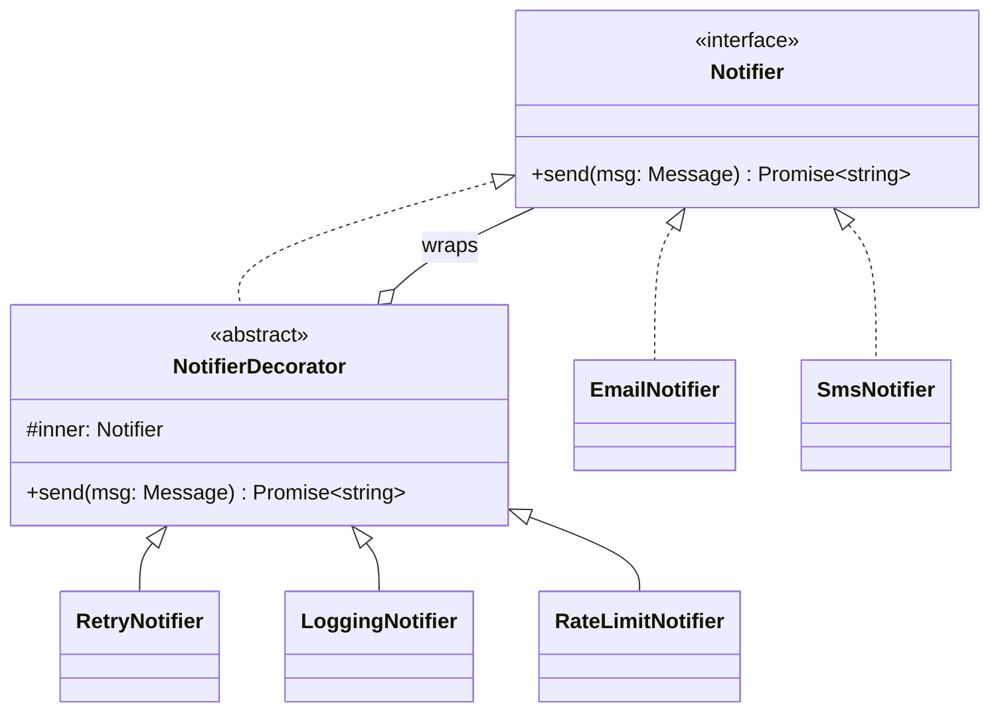

# L14 · Decorator

> **Time:** ~35 min · **Visual:** [visual.html](visual.html) · **Code:** [demo.ts](demo.ts) (`npx tsx lld/3-structural/L14-decorator/demo.ts`)
> **Builds on:** [L03 Composition over inheritance](../../1-foundations/L03-composition-over-inheritance/README.md) · [L04 SOLID: SRP, OCP](../../1-foundations/L04-solid-srp-ocp/README.md) · [L13 Adapter](../L13-adapter/README.md) · **Used in:** Logger (formatters, masking), Notification Service (retry, rate limit), Cart with Coupons (stacked price add-ons), LRU / KV store (cache wrapper)

## The idea in one line

Wrap an object in another object with the **same interface** that adds behaviour before or after the call, and stack wrappers to combine behaviours at runtime.

## Why it matters (the problem it solves)

You want retry, logging and rate limiting around an email sender, and maybe around SMS and push too. Each behaviour is optional.

```ts
// Before: one subclass per combination
class RetryEmailNotifier extends EmailNotifier {}
class LoggingEmailNotifier extends EmailNotifier {}
class RetryLoggingEmailNotifier extends EmailNotifier {}
class RetryLoggingRateLimitedEmailNotifier extends EmailNotifier {}
// 3 optional behaviours = 7 combinations, × email, SMS, push = 21 classes.
// And the combination is fixed at compile time.
```

The other "before" is worse: flags inside the class (`if (this.retryEnabled) ... if (this.logEnabled) ...`). Now one class does four jobs (SRP) and you edit it for every new behaviour (OCP).

## How it works

### The parts

| Role | In our example |
|---|---|
| **Component** (interface) | `Notifier { send(msg): Promise<string> }` |
| **Concrete component** | `EmailNotifier` (only talks to SMTP) |
| **Decorators** | `RetryNotifier`, `LoggingNotifier`, `RateLimitNotifier`; each `implements Notifier` and holds `inner: Notifier` |
| **Client** | Any service that takes a `Notifier`; it can't tell it got a stack |

Each decorator does its bit, then calls `this.inner.send(msg)`, then can act on the result or error on the way out.

### The onion

```
send(msg) ─►┌ RateLimitNotifier ─ take a token, else throw ─────────────────────────┐
            │ ┌ LoggingNotifier ─ log "start", start timer ─────────────────────┐   │
            │ │ ┌ RetryNotifier ─ try; on error wait 200ms, 400ms and try again ┐│   │
            │ │ │        EmailNotifier.send(msg) → SMTP                          ││   │
            │ │ └───────────────────────────────────────────────────────────────┘│   │
            │ └ log "ok in 240ms" / "failed" ◄──────────────────────────────────┘   │
            └────────────────────────────────────────────────────────────────────────┘
```

### Order is a design decision

Same three decorators, one SMTP failure, different order (see the demo):

| Stack (outer → inner) | Tokens used | Log lines | What it means |
|---|---|---|---|
| RateLimit → Logging → Retry → Email | 1 | 2 | One token per user call; logs show total time the user waited |
| RateLimit → Retry → Logging → Email | 1 | 4 | Every attempt logged (good for debugging flaky SMTP) |
| Retry → RateLimit → Logging → Email | 2 | 4 | Every attempt costs a token (protects the provider more) |

Rules of thumb: cheap rejections (auth, rate limit, validation) outermost; metrics/timing outside retry if you want user-visible latency; retry closest to the flaky call.

### Class diagram



The abstract base is optional in TS. Each decorator can just `implements Notifier` and take `inner` in its constructor.

### How to spot it in a problem statement

- "**Optionally** add logging / caching / retries / encryption / compression **on top of** X."
- "**Combinations** of features" (pizza toppings, coffee add-ons, coupon stacking, price add-ons like gift wrap + express delivery).
- "Mask PII in logs", "add a timestamp to every log line" (formatter decorators in a Logger).
- "Cache the results of a slow service" without changing it (cache-aside decorator; some call this a caching proxy).

## In TypeScript

```ts
interface Notifier { send(msg: Message): Promise<string> }

class RetryNotifier implements Notifier {
  constructor(private inner: Notifier, private tries = 3) {}
  async send(msg: Message) {
    for (let i = 1; ; i++) {
      try { return await this.inner.send(msg); }
      catch (e) { if (i >= this.tries) throw e; await sleep(100 * 2 ** i); }
    }
  }
}

class RateLimitNotifier implements Notifier {
  constructor(private inner: Notifier, private bucket: TokenBucket) {}
  send(msg: Message) {
    if (!this.bucket.take()) throw new RateLimitedError();
    return this.inner.send(msg);
  }
}

// composition root: the only place that knows the stack
const notifier: Notifier =
  new RateLimitNotifier(new LoggingNotifier(new RetryNotifier(new EmailNotifier(smtp))), bucket);
```

**Function form.** A decorator is often a higher-order function with the same signature in and out:

```ts
type Send = (m: Message) => Promise<string>;
const withRetry = (f: Send, n = 3): Send => async (m) => { /* loop around f(m) */ };
const withTiming = (f: Send): Send => async (m) => {
  const t = Date.now();
  try { return await f(m); } finally { metrics.observe('send_ms', Date.now() - t); }
};
const send = withTiming(withRetry(email.send.bind(email)));
```

You see this everywhere in Node: `p-retry`, `p-timeout`, Express `asyncHandler(fn)`, NestJS interceptors, `stream.pipeline(src, zlib.createGzip(), dest)`.

**TS `@decorators` are a different thing.** `@Injectable()`, `@Get()` are language decorators that run on class definitions, mostly to add metadata. A method decorator like `@Retry(3)` can implement this pattern by wrapping the method, but the GoF pattern is about wrapping objects at runtime.

## Trade-offs / when NOT to use it

| Pro | Con |
|---|---|
| Add behaviour without editing the class (OCP) | Many small objects; stack traces show every layer |
| Each behaviour is one small, testable class (SRP) | Order bugs are subtle (see the table) |
| Combinations chosen at runtime / from config | Identity checks break: the decorated object is not `=== ` the core |
| Works with any implementation of the interface | Big interfaces mean lots of forwarding boilerplate |

Skip it when:
- The behaviour is always on and belongs to the class. Just write it there.
- The wrapper needs a **different** interface. That is an Adapter.
- The stack would be 6+ layers deep. Debugging gets painful; group related concerns.

## Common mistakes

1. **Not keeping the same interface.** If a "decorator" adds new public methods callers depend on, you can't stack it freely.
2. **Ignoring order.** Retry outside the rate limiter, or logging inside retry, changes behaviour. Say which order you chose and why.
3. **Retrying non-idempotent calls.** A retry decorator around "charge card" double-charges unless every attempt carries the same idempotency key.
4. **Confusing it with Chain of Responsibility.** A decorator always calls the inner object. A chain handler may stop and not call `next()`.
5. **Confusing it with TS `@decorators`.** Different concept; say so if the interviewer mixes them.
6. **Building the stack inside the service.** The service should receive a `Notifier`; only the composition root knows the layers.

## Say this in the interview

> "I keep `EmailNotifier` simple and add retry, logging and rate limiting as decorators that implement the same `Notifier` interface. Each one holds an inner `Notifier`, does its job, and delegates. I compose the stack once at startup, so the service doesn't know they exist, and I can use the same decorators around SMS or push."

> "The order is deliberate: rate limit outermost so one user call costs one token, metrics outside retry so we measure what the user waited, retry closest to the flaky call. Retry is only safe because each send carries an idempotency key."

## Your experience hook

- **API gateway:** your Express gateway did JWT auth, rate limiting, logging and LRU response caching around proxied calls. Caching and logging around the proxy call are decorators; the auth check that can reject early is chain-of-responsibility-style middleware. Knowing which is which is a strong signal.
- **Payment retries with idempotency keys:** a retry wrapper around the provider adapter, with exponential backoff and the same idempotency key on every attempt, is a decorator over the `PaymentProvider` interface.
- **Redis cache-aside (~400ms → ~160ms):** a `CachedReportService` that implements the same interface as `ReportService`, checks Redis, and falls back to the inner service on a miss is a decorator.

## Self-test

<details><summary>1. `new Retry(new Logging(gw))` and the gateway fails twice then succeeds. How many "start" log lines?</summary>

Three, one per attempt, because logging is inside the retry. `new Logging(new Retry(gw))` gives one.
</details>

<details><summary>2. Retry inside or outside the rate limiter?</summary>

Rate limit outside retry: one token per user call. Retry outside the rate limiter: every attempt costs a token, which protects the provider more. Either can be right; choose and explain.
</details>

<details><summary>3. Why is a decorator better than a `retryCount` flag in every gateway class?</summary>

The retry logic is written once and works for every implementation. Gateways stay focused on talking to their provider (SRP), and you add behaviour without editing them (OCP).
</details>

<details><summary>4. Decorator vs Proxy?</summary>

Same structure (same interface, holds the real object). Intent differs: a decorator adds behaviour and you often stack many; a proxy controls access (lazy creation, caching, permissions, remote calls), usually one.
</details>

<details><summary>5. Decorator vs Chain of Responsibility?</summary>

A decorator always calls the inner object. A chain handler decides: handle and stop, or pass to `next()`. Express middleware is a chain because `next()` is optional.
</details>

<details><summary>6. What must be true for a retry decorator around `charge()` to be safe?</summary>

The call must be idempotent: every attempt carries the same idempotency key, so a retry after a timeout cannot charge twice.
</details>

<details><summary>7. Is `@Injectable()` the GoF Decorator pattern?</summary>

No. It is a TypeScript language decorator that registers metadata for NestJS DI. It doesn't wrap an object to add behaviour.
</details>

## Go deeper

- Visual: [visual.html](visual.html) (layers wrapping, a call going in and out, order changing the result)
- Compare: [L16 Proxy](../L16-proxy/README.md), [L13 Adapter](../L13-adapter/README.md), [L25 Chain of Responsibility](../../4-behavioral/L25-chain-of-responsibility/README.md)
- Problems: [03 Logger](../../problems/03-logger/README.md), [05 Notification Service](../../problems/05-notification-service/README.md), [20 Cart with Coupons](../../problems/20-ecommerce-cart-coupons/README.md)
- Older long-form notes: [LLD-guide.md](../../../archive/notes/LLD-guide.md) (Part 3, "Decorator Pattern")
- Books: GoF "Decorator"; Head First Design Patterns ch. 3
