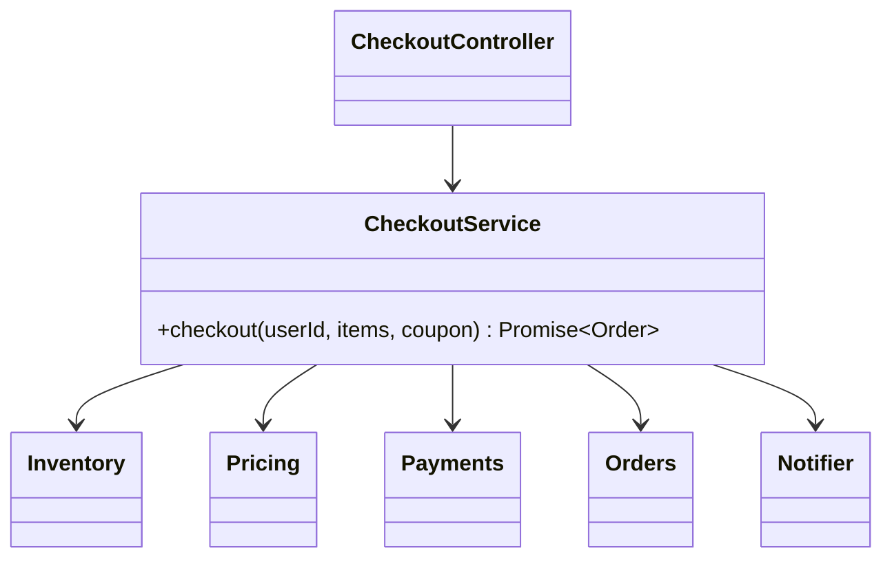

# L15 · Facade

> **Time:** ~35 min · **Visual:** [visual.html](visual.html) · **Code:** [demo.ts](demo.ts) (`npx tsx lld/3-structural/L15-facade/demo.ts`)
> **Builds on:** [L04 SRP and OCP](../../1-foundations/L04-solid-srp-ocp/README.md) · [L13 Adapter](../L13-adapter/README.md) · **Used in:** Parking Lot, BookMyShow, ATM, Food Delivery, Payment Wallet, Library Management (the top class the tests call is a facade)

## The idea in one line

Give a group of classes **one simple entry point** that runs the common flow in the right order, so callers don't need to know the parts, their order, or how to clean up when a step fails.

## Why it matters (the problem it solves)

A real use case touches many subsystems. Checkout needs inventory, pricing, payments, orders and notifications. If every caller wires these together itself:

- The same 6-step sequence is copied into the HTTP controller, the mobile API, the admin tool and the retry job.
- One copy forgets to release reserved stock when payment fails. Stock leaks.
- Every caller depends on five classes. Change one constructor and five files break.
- Tests have to set up five objects to check one flow.

A facade writes the flow **once**. Callers depend on one class with one method.

## How it works

### Before: the controller orchestrates everything

```ts
app.post('/checkout', async (req, res) => {
  const items = await cartRepo.get(req.body.userId);
  inventory.reserve(items);                                   // step 1
  const total = pricing.total(items, req.body.coupon);        // step 2
  const txnId = await payments.charge(req.body.userId, total); // step 3: can throw
  const order = orders.create(req.body.userId, items, total, txnId);
  await notifier.send(req.body.userId, `Order ${order.id} placed`); // slow SMTP blocks reply
  res.json(order);
});
// If charge() throws, the reservation is never released.
// The retry job and the admin tool copy this code, each slightly differently.
```

### After: one facade per use case

```ts
class CheckoutService {               // the facade
  constructor(
    private inventory: Inventory,
    private pricing: Pricing,
    private payments: Payments,
    private orders: Orders,
    private notifier: Notifier,
  ) {}

  async checkout(userId: string, items: Item[], coupon?: string): Promise<Order> {
    const hold = this.inventory.reserve(items);
    try {
      const total = this.pricing.total(items, coupon);
      const txnId = await this.payments.charge(userId, total);
      const order = this.orders.create(userId, items, total, txnId);
      this.inventory.commit(hold);
      void this.notifier.send(userId, `Order ${order.id} placed`).catch(log); // side effect
      return order;
    } catch (e) {
      this.inventory.release(hold);   // compensation lives in one place
      throw e;
    }
  }
}

// controller: res.json(await checkout.checkout(userId, items, coupon));
```

### Class diagram

```
  CheckoutController ──────▶ CheckoutService   (facade)
  RetryJob ────────────────▶   + checkout(userId, items, coupon): Order
  AdminTool ───────────────▶        │
                                     ├──▶ Inventory     reserve / commit / release
                                     ├──▶ Pricing       total(items, coupon)
                                     ├──▶ Payments      charge(userId, amount)
                                     ├──▶ Orders        create(...)
                                     └──▶ Notifier      send(userId, text)

  Subsystems do NOT know the facade exists. Arrows go one way only.
```



### What a facade owns, and what it doesn't

| Facade owns | Subsystem owns |
|---|---|
| The order of steps | Its own rules (coupon maths stays in `Pricing`) |
| Compensation on failure (release stock) | Its own validation |
| Which steps are sync and which are fire-and-forget | Its own data and storage |
| A small, use-case-shaped API | A rich, general API |

The subsystems are still public. A power user (a batch report) can call `Pricing` directly. The facade is a shortcut, not a wall.

### Facade vs its neighbours

| Pattern | Interface | Number of wrapped objects | Purpose |
|---|---|---|---|
| **Facade** | New, simpler | Many | Run a common flow in one call |
| Adapter | An existing one you already depend on | One | Make a foreign API fit your interface |
| Proxy | Same as the real object | One | Control access (cache, lazy, auth) |
| Decorator | Same as the wrapped object | One (stackable) | Add behaviour |
| Mediator | Colleagues talk through it | Many, both directions | Coordinate peers that know the mediator |

### How to spot it in a problem statement

- "The system should let a user **park / book / withdraw / place an order**" and that one action touches 3+ objects.
- The interviewer gives a demo script: `lot.park(car)`, `bms.book(show, seats)`. The class the script calls is your facade.
- You hear "the controller is getting fat" or "we copy this sequence in many places".

### Facade at three sizes

1. **Object level (LLD):** `ParkingLot.park()` hides floors, spots, ticket factory, pricing.
2. **Service layer (Nest/Express app):** `OrdersService.placeOrder()` hides repositories, payment client, queue.
3. **System level (HLD):** an API gateway or a BFF (backend-for-frontend) gives the mobile app one call that fans out to five services. When the steps cross services, the facade becomes a **saga orchestrator** with retries and idempotency.

## In TypeScript

Keep the facade thin. It takes subsystems through the constructor (easy to fake in tests) and returns one result.

```ts
class ParkingLot {
  constructor(private floors: Floor[], private tickets: TicketFactory, private fees: FeeCalculator) {}

  park(v: Vehicle): Ticket {
    const spot = this.floors.map((f) => f.findSpot(v.size)).find(Boolean);
    if (!spot) throw new Error('LOT_FULL');
    spot.occupy(v);
    return this.tickets.issue(v, spot);
  }

  unpark(ticketId: string, now: Date): number {
    const t = this.tickets.close(ticketId);
    t.spot.free();
    return this.fees.fee(t.entryAt, now, t.vehicle.size);
  }
}
```

The full runnable checkout facade, with a failing payment and stock release, is in [demo.ts](demo.ts).

## Trade-offs / when NOT to use it

- **God class risk.** A facade with 40 methods is a monolith in disguise. Split by use case or actor: `CheckoutService`, `RefundService`, `CartService`.
- **Business rules leak in.** If the facade starts computing discounts, the rule is now in two places. The facade orchestrates; it does not decide prices.
- **Over one class it is noise.** A facade over a single class is just an extra layer.
- **Hides power.** If callers often need a step the facade doesn't expose, either add a second method or let them use the subsystem directly. Don't add 10 boolean flags.
- **Across services it is not free.** A remote facade (BFF) adds a network hop and becomes a point of failure. Run it stateless, behind a load balancer.

## Common mistakes

- Calling every service class a "facade". A facade is defined by hiding **several** collaborators behind a **simpler** API.
- Putting `await notifier.send()` inside the main flow, so a slow email server slows or fails a paid order.
- No compensation: payment fails, stock stays reserved.
- Making the facade a singleton with `new` inside. Inject the subsystems so tests can fake them.
- Mixing up Facade and Mediator. In a facade, subsystems never call back into it.

## Say this in the interview

> "`CheckoutService` is a facade over inventory, pricing, payments, orders and notifications. It owns the order of steps and the compensation: if payment fails, it releases the reserved stock. Controllers and jobs call this one method, so the flow exists in one place. Each subsystem keeps its own rules, and I can still call them directly when I need to."

> "I keep facades per use case so they don't turn into god classes. If these steps were separate services, the same class would become a saga orchestrator, and each step would need an idempotency key and a compensating action."

## Your experience hook

- The **API gateway** you built in Express is a system-level facade: one entry point that hides auth, product, order, payment and notification services from the client.
- The **payment orchestration service** is a facade over three providers (each behind an adapter): callers ask for `pay()` and never see which gateway ran, the retries, or the webhook handling.

## Self-test

<details><summary>1. Name the facade in a Parking Lot solution and its public methods.</summary>

`ParkingLot` with `park(vehicle)`, `unpark(ticketId)` and maybe `availableSpots(size)`. Floors, spots, ticket creation and fee calculation stay behind it.
</details>

<details><summary>2. Why send the confirmation without `await` in the checkout facade?</summary>

A slow or failing email must not slow down or fail an order that is already paid. Start it, catch and log its error. Better: publish an `OrderPlaced` event and let a worker send it.
</details>

<details><summary>3. Facade vs Adapter in one sentence each?</summary>

Adapter makes one existing class fit an interface you already have. Facade creates a new, simpler interface over many classes.
</details>

<details><summary>4. Facade vs Mediator?</summary>

Facade is one-way: clients call it, subsystems don't know it. Mediator sits between peers that talk to each other through it, and they hold a reference to the mediator.
</details>

<details><summary>5. Your facade has grown to 25 methods. What do you do?</summary>

Split it by use case or by actor into several small services. Each keeps a short, focused API.
</details>

<details><summary>6. Can callers still use the subsystems directly?</summary>

Yes. A facade offers a shortcut for the common path. It does not forbid direct use. That is the difference from a strict layer boundary.
</details>

<details><summary>7. The steps are now in separate microservices. What changes?</summary>

You can't use a local try/catch for rollback. The facade becomes a saga orchestrator: each step gets a compensating action, calls are retried with idempotency keys, and state is persisted so a crash can resume.
</details>

## Go deeper

- Animation: [visual.html](visual.html) shows the "before" fan-out, the facade flow, and the rollback when payment fails.
- LLD problems: [01 Parking Lot](../../problems/01-parking-lot/README.md), [13 BookMyShow](../../problems/13-bookmyshow/README.md), [11 ATM](../../problems/11-atm/README.md), [18 Food Delivery](../../problems/18-food-delivery/README.md)
- Related patterns: [L13 Adapter](../L13-adapter/README.md), [L16 Proxy](../L16-proxy/README.md), [L28 Mediator](../../4-behavioral/L28-mediator/README.md)
- System-level facade: [H06 Proxies and API gateway](../../../hld/1-basics/H06-proxies-api-gateway/README.md); cross-service flow: [H23 Distributed transactions](../../../hld/4-async/H23-distributed-transactions/README.md)
- Long-form notes: [LLD-guide.md](../../../archive/notes/LLD-guide.md) (Facade section)
