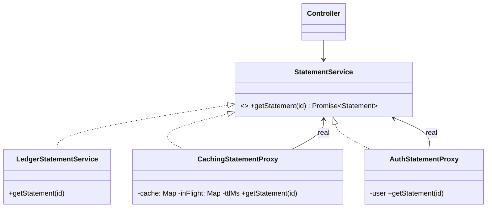

# L16 · Proxy

> **Time:** ~35 min · **Visual:** [visual.html](visual.html) · **Code:** [demo.ts](demo.ts) (`npx tsx lld/3-structural/L16-proxy/demo.ts`)
> **Builds on:** [L14 Decorator](../L14-decorator/README.md) · [L05 LSP, ISP, DIP](../../1-foundations/L05-solid-lsp-isp-dip/README.md) · **Used in:** LRU Cache (caching proxy over a slow store), Rate Limiter (protection proxy), Library Management (role checks), KV Store (remote client)

## The idea in one line

Put a stand-in object with the **same interface** in front of the real one, so you can **control access** to it: cache results, create it lazily, check permissions, or forward calls over the network.

## Why it matters (the problem it solves)

The ledger service takes 800 ms to build a statement. Three callers (the web API, the mobile API and an export job) all need it. Without a proxy:

```ts
async function getStatement(user: User, accountId: string) {
  if (user.role !== 'ADMIN' && user.accountId !== accountId) throw new Error('Forbidden');
  const cached = cache.get(accountId);
  if (cached) return cached;
  const s = await ledger.getStatement(accountId);   // 800 ms
  cache.set(accountId, s);                           // no TTL: grows forever
  return s;
}
// The export job copies this and forgets the permission check.
// The mobile API forgets the cache, so the ledger DB gets 3x the load.
```

Access control and caching are written again and again, slightly differently each time. A proxy puts each concern in one class, and callers don't change at all, because the proxy **looks exactly like** the real service.

## How it works

### The structure

```
                 «interface» StatementService
                 + getStatement(accountId): Promise<Statement>
                    ▲               ▲                 ▲
         implements │               │ implements      │ implements
  AuthProxy ────────┘   CachingProxy┘     LedgerStatementService (real, slow)
     │ real ─────────────▶ │ real ───────────────▶
  Controller ──▶ StatementService (it does not know which one it holds)
```



Wiring happens once, in the composition root:

```ts
const service: StatementService =
  new AuthStatementProxy(new CachingStatementProxy(new LedgerStatementService(), 60_000), user);
```

Order matters: auth goes **outside** the cache, so a forbidden request is rejected before it can read a cached value.

### The four kinds of proxy

| Kind | What it controls | Real-world example |
|---|---|---|
| **Caching proxy** | Repeated expensive calls | Cache in front of a slow ledger or pricing API; `DataLoader` |
| **Virtual (lazy) proxy** | Builds the costly object on first use | Lazy DB pool, lazy-loaded image, ORM lazy relations |
| **Protection proxy** | Who can call what | Role check before a service; rate-limit guard |
| **Remote proxy** | A local object that forwards calls over the network | gRPC client stub, AWS SDK client, Redis client |

Others you may hear: a **logging/metrics proxy** (timing every call) and a **smart reference** (reference counting). Same structure, different intent.

### Caching proxy, done properly

A naive cache has three bugs. A good caching proxy fixes all three:

| Problem | Fix |
|---|---|
| Entries never expire, memory grows forever | TTL per entry plus a size limit (LRU) |
| Two misses at the same time both hit the slow service | Cache the **in-flight promise** (request coalescing / single flight) |
| Stale data after a write | `invalidate(id)` on the write path, or a short TTL |

```
t=0   call acc_1 ──▶ proxy: miss ──▶ ledger (800 ms) ──▶ store {value, expiresAt: t+60s}
t=1s  call acc_1 ──▶ proxy: HIT, return in ~0 ms     (ledger untouched)
t=2s  2 calls acc_2 at once ──▶ first: miss, starts promise; second: awaits same promise
t=61s call acc_1 ──▶ proxy: expired ──▶ ledger again
```

### Proxy vs Decorator vs Adapter vs Facade

| | Interface | Intent | Who decides to wrap |
|---|---|---|---|
| **Proxy** | Same as real | Control access to one object; often manages its lifecycle | Usually the wiring code; client doesn't know |
| Decorator | Same as wrapped | Add behaviour; often several stacked | Client composes the stack |
| Adapter | Different (converts) | Make a foreign API fit | Integration code |
| Facade | New, simpler | Hide many classes behind one flow | Designer of the module |

Proxy and Decorator have the **same class diagram**. The difference is intent. If an interviewer asks, say: "A caching wrapper could be called either; I call it a caching proxy because it controls access to the real service and decides whether the real call happens at all."

### How to spot it in a problem statement

- "This call is expensive; avoid repeating it" → caching proxy.
- "Only admins can …", "users can only see their own …" → protection proxy.
- "Load it only when needed", "startup is slow" → virtual proxy.
- "The service runs on another machine" → remote proxy (client stub).
- The key test: the caller must **not change**. If callers have to call a different method, it is not a proxy.

## In TypeScript

```ts
class CachingStatementProxy implements StatementService {
  private cache = new Map<string, { value: Statement; expiresAt: number }>();
  private inFlight = new Map<string, Promise<Statement>>();
  constructor(private real: StatementService, private ttlMs: number, private now = Date.now) {}

  async getStatement(id: string): Promise<Statement> {
    const hit = this.cache.get(id);
    if (hit && hit.expiresAt > this.now()) return hit.value;          // hit
    const pending = this.inFlight.get(id);
    if (pending) return pending;                                      // coalesce
    const p = this.real.getStatement(id)
      .then((value) => { this.cache.set(id, { value, expiresAt: this.now() + this.ttlMs }); return value; })
      .finally(() => this.inFlight.delete(id));
    this.inFlight.set(id, p);
    return p;
  }
  invalidate(id: string) { this.cache.delete(id); }
}

class AuthStatementProxy implements StatementService {
  constructor(private real: StatementService, private user: User) {}
  getStatement(id: string) {
    if (this.user.role !== 'ADMIN' && this.user.accountId !== id) return Promise.reject(new Error('FORBIDDEN'));
    return this.real.getStatement(id);
  }
}
```

JavaScript also has a built-in `Proxy` object with traps (`get`, `set`, `has`, `apply`). Vue 3 and MobX use it to track property reads. It is a language tool for building proxies; in an interview, a class that implements the interface is clearer. [demo.ts](demo.ts) shows both, plus a lazy proxy.

## Trade-offs / when NOT to use it

- **Hidden cost.** A remote proxy makes a network call look like a local call. Callers forget timeouts and retries. Make remote failures explicit (typed errors, timeouts).
- **Stale data.** A caching proxy trades freshness for speed. Bad for balances shown before a payment; fine for statements, catalogues, profiles.
- **Unbounded cache = memory leak.** Always a TTL **and** a size cap.
- **One caller only.** If one function needs a cache, a local `Map` is simpler than a new class.
- **Wrong order.** Cache outside auth means a forbidden user can read a cached value. Put auth outermost.
- **Errors cached by mistake.** Don't store rejected promises; delete the in-flight entry in `finally`.

## Common mistakes

- Giving the proxy a different method name (`getCachedStatement`). Then callers change and it is not a proxy.
- Forgetting request coalescing: on a cold cache, 100 concurrent requests make 100 slow calls (a cache stampede).
- Using `Date.now()` directly, so TTL can't be tested. Inject the clock.
- Mixing caching, auth and logging into one "SmartProxy" class. One concern per proxy; stack them.
- Saying "Proxy and Decorator are the same". The structure is the same; the intent is not.

## Say this in the interview

> "The statement service is slow, so I put a caching proxy in front of it. It implements the same `StatementService` interface, so the controller doesn't change. The cache has a TTL and a size limit, and it coalesces concurrent misses so a cold key hits the ledger once. Permission checks are a separate protection proxy placed outside the cache, so the rule runs on every call no matter who the caller is."

> "A gRPC stub is the same idea at the network level: a remote proxy. It looks like a local object, but every call is a network request, so I always give it a deadline and handle `UNAVAILABLE`."

## Your experience hook

- Your **Redis cache-aside** layer for the Chesa dashboards (about 400 ms down to 160 ms) is a caching proxy idea at service level; you can say you'd add single-flight to stop stampedes on hot keys.
- Your **gRPC calls** between signaling and media services use generated client stubs: textbook remote proxies (REST 20-50 ms down to gRPC 2-5 ms).
- The **API gateway** that checks JWTs and rate limits before forwarding is a protection proxy at the network edge.

## Self-test

<details><summary>1. Which kind of proxy is a gRPC client stub?</summary>

A remote proxy. It has the service's interface locally and turns each method call into a network request.
</details>

<details><summary>2. Proxy vs Decorator: same diagram, so what's the difference?</summary>

Intent. A decorator adds behaviour and is often stacked by the client. A proxy controls access to one real object: it may skip the real call (cache, auth) or decide when to create it (lazy).
</details>

<details><summary>3. Two requests miss the cache for the same key at the same moment. What happens, and how do you fix it?</summary>

Both call the slow service. Fix with request coalescing: store the in-flight promise on the first miss; the second caller awaits the same promise.
</details>

<details><summary>4. Why must the auth proxy sit outside the caching proxy?</summary>

If the cache is outside, a forbidden user can get a value someone else already cached. Auth must run on every call before any data is returned.
</details>

<details><summary>5. Why does the caching proxy take the clock as a constructor parameter?</summary>

So tests can move time forward and check TTL expiry instantly, without sleeping.
</details>

<details><summary>6. What does a JS `Proxy` `get` trap let you do?</summary>

Run code on every property read: log it, validate it, track dependencies (Vue reactivity), or return a default value.
</details>

<details><summary>7. How do you keep the cached statement fresh after a new transaction?</summary>

Short TTL if slight staleness is fine. For stricter needs, call `proxy.invalidate(accountId)` on the write path, or listen to a `TransactionPosted` event and delete the key.
</details>

## Go deeper

- Animation: [visual.html](visual.html): hit, miss, coalescing, TTL expiry, auth rejection, remote stub.
- LLD problems: [02 LRU Cache](../../problems/02-lru-cache/README.md), [04 Rate Limiter](../../problems/04-rate-limiter/README.md), [12 Library Management](../../problems/12-library-management/README.md), [14 KV Store](../../problems/14-kv-store/README.md)
- Related patterns: [L14 Decorator](../L14-decorator/README.md), [L13 Adapter](../L13-adapter/README.md), [L15 Facade](../L15-facade/README.md)
- HLD at system scale: [H09 Caching](../../../hld/2-scaling/H09-caching/README.md) (cache-aside, stampede), [H06 Proxies and API gateway](../../../hld/1-basics/H06-proxies-api-gateway/README.md) (reverse proxies)
