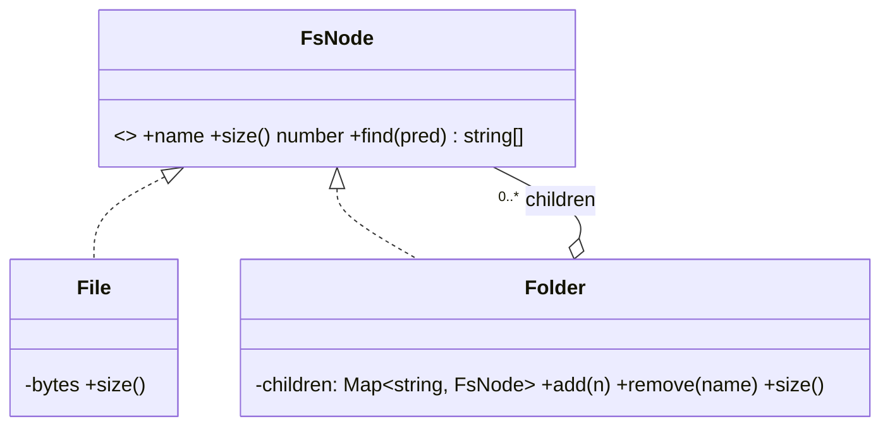

# L17 · Composite

> **Time:** ~35 min · **Visual:** [visual.html](visual.html) · **Code:** [demo.ts](demo.ts) (`npx tsx lld/3-structural/L17-composite/demo.ts`)
> **Builds on:** [L03 Composition over inheritance](../../1-foundations/L03-composition-over-inheritance/README.md) · [L04 SRP and OCP](../../1-foundations/L04-solid-srp-ocp/README.md) · **Used in:** In-memory File System (main pattern), Text Editor (grouped commands), E-commerce Cart (bundles, AND/OR coupon rules), Food Delivery (menu sections)

## The idea in one line

Make a **single object** and a **group of objects** implement the same interface, so you can build a tree and call one method on the root without asking "is this a leaf or a group?"

## Why it matters (the problem it solves)

Many domains are trees: folders and files, menus and items, org charts, product bundles, UI layouts, rule groups (`A AND (B OR C)`). Without Composite, every operation repeats the same type check:

```ts
// Before: "is it a file or a folder?" in every function
function size(n: FileNode | FolderNode): number {
  if (n.kind === 'file') return n.bytes;
  let total = 0;
  for (const c of n.children) total += c.kind === 'file' ? c.bytes : size(c);
  return total;
}
function count(n: FileNode | FolderNode): number { /* same if/else again */ }
function find(n: FileNode | FolderNode, ext: string): string[] { /* and again */ }
// Add a new node type (Symlink) and you edit every one of these functions.
```

With Composite, each node answers for itself. A folder asks its children and combines their answers. The caller writes `root.size()` and is done.

## How it works

### The three roles

| Role | What it is | File-system example |
|---|---|---|
| **Component** | The shared interface | `FsNode { name; size(); print(); find() }` |
| **Leaf** | Has no children, does the real work | `File` returns its own bytes |
| **Composite** | Holds children **of the Component type**, delegates and combines | `Folder` sums `child.size()` |

The key line: a composite's children are typed as the **interface**, not as `File`. So a folder can contain files, folders, or any future node type.

### Before vs after

```ts
// After: each node answers for itself
interface FsNode {
  readonly name: string;
  size(): number;
  find(pred: (n: FsNode) => boolean, path?: string): string[];
}

class File implements FsNode {
  constructor(readonly name: string, private bytes: number) {}
  size() { return this.bytes; }
  find(pred: (n: FsNode) => boolean, path = '') { return pred(this) ? [path + this.name] : []; }
}

class Folder implements FsNode {
  private children = new Map<string, FsNode>();
  constructor(readonly name: string) {}
  add(n: FsNode): this { this.children.set(n.name, n); return this; }
  size() { let s = 0; for (const c of this.children.values()) s += c.size(); return s; }
  find(pred: (n: FsNode) => boolean, path = '') {
    const here = path + this.name + '/';
    return [...this.children.values()].flatMap((c) => c.find(pred, here));
  }
}

root.size();   // one call: works for one file or a 10,000-node tree
```

### Class diagram

```
             «interface» FsNode
             + name
             + size(): number
             + find(pred): string[]
               ▲               ▲
    implements │               │ implements
        ┌──────┴───┐     ┌─────┴──────────────┐
        │  File    │     │  Folder            │
        │ - bytes  │     │ - children: Map<FsNode> ◆──┐
        └──────────┘     │ + add / remove     │       │ 0..*
                         └────────────────────┘       │
                                   ▲──────────────────┘  (children are FsNode, so folders nest)
```



### How a call flows

```
root.size()
 ├─ src.size()
 │   ├─ index.ts.size() → 3
 │   ├─ app.ts.size()   → 5
 │   └─ lib.size()
 │       ├─ util.ts → 4
 │       └─ db.ts   → 6        lib = 10
 │                              src = 18
 ├─ docs.size() → guide.md 8    docs = 8
 └─ README.md.size() → 2
                                root = 28
```

Calls go **down**, results come **up**. Cost is O(number of nodes). For a hot read on a big tree, cache the size in each folder and update ancestors on change (walk up `parent` pointers): O(depth) per write, O(1) per read.

### Two design choices interviewers ask about

**1. Where do `add()` / `remove()` live?**

| Option | Pro | Con |
|---|---|---|
| Only on `Folder` (type-safe, used above) | `file.add()` is a compile error | Caller must narrow the type before adding |
| On the interface (transparent) | Caller treats every node the same | `File.add()` must throw at runtime: breaks LSP |

Prefer **type safety** in TypeScript. Narrow with `instanceof Folder` or a `kind` tag at the one place you build trees.

**2. Do children know their parent?** A `parent` pointer makes `path()`, "move", "delete" and "is X inside Y" cheap. It is required for the cycle guard: you must not move a folder into its own descendant.

### Composite beyond file systems

- **Cart bundles:** `Item` and `Bundle` both have `price()`. A "Combo" holds items and other combos and applies its own discount.
- **Rule trees:** `AndRule(MinAmount(500), OrRule(NewUser(), Category('shoes')))`. Each rule has `matches(cart)`. Coupon engines and feature-flag targeting work this way.
- **Macro commands:** a `CompositeCommand` runs a list of commands; its `undo()` undoes them in reverse. One undo for "replace all".
- **UI trees:** React elements, the DOM. `render()` on a container renders its children.
- **Org charts / approval chains:** `totalSalary()` of a department.

### How to spot it in a problem statement

- The words **"contains"**, **"nested"**, **"group of"**, **"sub-folder / sub-menu / sub-task"**.
- An operation must work "for one item or for the whole group" (price of a combo, size of a folder, total of a department).
- You are about to write `if (x.type === 'group')` inside a recursive function.

## In TypeScript

A composite rule tree, the shape you'll reuse in coupon and pricing problems:

```ts
interface Rule { matches(c: Cart): boolean; describe(): string }

class MinAmount implements Rule {
  constructor(private min: number) {}
  matches(c: Cart) { return c.total >= this.min; }
  describe() { return `total >= ${this.min}`; }
}

class AllOf implements Rule {        // composite: AND
  constructor(private rules: Rule[]) {}
  matches(c: Cart) { return this.rules.every((r) => r.matches(c)); }
  describe() { return `(${this.rules.map((r) => r.describe()).join(' AND ')})`; }
}

class AnyOf implements Rule {        // composite: OR
  constructor(private rules: Rule[]) {}
  matches(c: Cart) { return this.rules.some((r) => r.matches(c)); }
  describe() { return `(${this.rules.map((r) => r.describe()).join(' OR ')})`; }
}
```

[demo.ts](demo.ts) runs a file tree (size, find, cycle guard), a priced combo bundle, and this rule tree.

## Trade-offs / when NOT to use it

- **No real tree.** If groups never nest (a cart is just a flat list), a plain array and `reduce` is simpler.
- **Too general.** The interface must make sense for every node. If half the methods only apply to leaves, the interface is wrong.
- **Hard to restrict.** "A playlist may only contain songs, not podcasts" is hard to enforce through a general `add(node)`. Add checks in `add()` or use narrower types.
- **Deep trees and recursion.** Very deep trees can overflow the call stack. Use an explicit stack (iterative walk) for untrusted input.
- **Repeated full walks.** `size()` on every request over a huge tree is O(n). Cache aggregates and invalidate upward.

## Common mistakes

- Typing children as `File[]` instead of the interface, so folders can't nest.
- Putting `add()` on the interface and letting `File.add()` silently do nothing.
- Forgetting the cycle guard on move: `mv /src /src/lib` creates a loop and `size()` never ends.
- Doing the type check in the client anyway (`if (n instanceof Folder) ... else ...`) for normal operations: that defeats the pattern.
- Mixing up Composite with Decorator. Both wrap the same interface, but a decorator wraps **one** object to add behaviour; a composite holds **many** children to treat them as one.

## Say this in the interview

> "A directory holds files and other directories, so I use Composite. `File` and `Directory` both implement `FsNode` with `size()` and `find()`. A directory keeps its children as `FsNode` and its `size()` is the sum of its children's `size()`. The caller just calls `root.size()` and never checks types. If size is read often, I cache it in each directory and update the ancestors on every write."

> "I keep `add()` only on `Directory`, not on the interface, so adding to a file is a compile error instead of a runtime throw. Each node has a parent pointer, which gives me `path()` and the guard against moving a folder into its own child."

## Your experience hook

- Your **API gateway routing** can be described as a tree: route groups (`/api/v1/orders/...`) hold sub-groups and handlers, and middleware applied to a group applies to everything inside it.
- For **10k IoT devices**, a site → building → floor → device tree with `onlineCount()` or `alertCount()` on any node is a natural Composite: the dashboard asks the root, each level sums its children.

## Self-test

<details><summary>1. Name the three roles in Composite and give a file-system example of each.</summary>

Component (`FsNode` interface), Leaf (`File`), Composite (`Folder`, which holds `FsNode` children).
</details>

<details><summary>2. Why must a folder's children be typed as the interface, not as File?</summary>

So a folder can hold other folders (nesting) and any future node type without changing `Folder`.
</details>

<details><summary>3. Should `add()` be on the interface? What is the trade-off?</summary>

On the interface, all nodes look the same, but `File.add()` must throw, which breaks LSP. Only on `Folder`, misuse is a compile error but callers must narrow the type. In TypeScript, prefer the type-safe version.
</details>

<details><summary>4. `size()` on the root is called 1,000 times a second on a big tree. What do you change?</summary>

Cache the size in each folder. On add/remove/resize, walk up the parent pointers and adjust each ancestor. Reads become O(1), writes O(depth).
</details>

<details><summary>5. How do you stop `mv /a /a/b/c`?</summary>

Before moving, walk up from the target's parent pointers. If you reach the node being moved, reject: you'd create a cycle.
</details>

<details><summary>6. Composite vs Decorator?</summary>

Same interface in both. Decorator wraps exactly one object to add behaviour. Composite holds many children and combines their results to treat a group as one.
</details>

<details><summary>7. Give a non-tree-looking problem where Composite still helps.</summary>

Coupon conditions: `AND(minAmount 500, OR(newUser, category shoes))`. Each rule has `matches(cart)`; AND/OR are composites. Also macro commands for one-step undo.
</details>

## Go deeper

- Animation: [visual.html](visual.html): calls flow down the tree, sums flow up; then add, find, and the cycle guard.
- LLD problems: [24 File System](../../problems/24-file-system/README.md) (main pattern), [22 Text Editor](../../problems/22-text-editor/README.md) (composite command), [20 Cart with Coupons](../../problems/20-ecommerce-cart-coupons/README.md) (bundles and rules)
- Related patterns: [L14 Decorator](../L14-decorator/README.md), [L27 Iterator](../../4-behavioral/L27-iterator/README.md) (walking the tree), [L29 Visitor](../../4-behavioral/L29-visitor/README.md) (new operations over a tree), [L23 Command](../../4-behavioral/L23-command/README.md)
