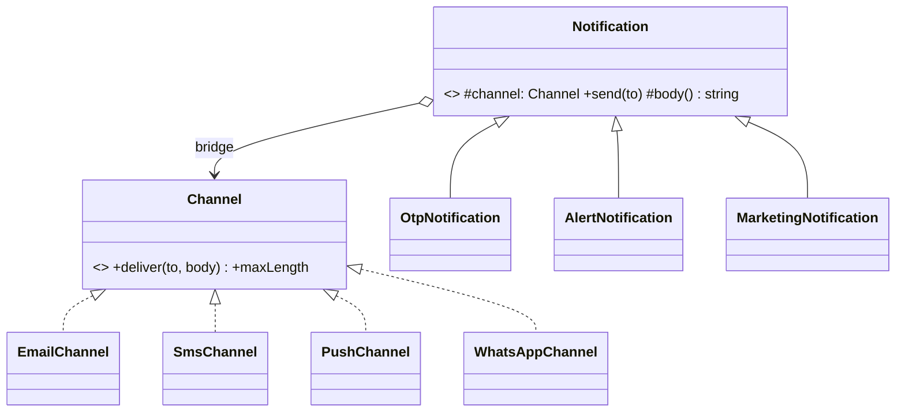

# L18 · Bridge

> **Time:** ~35 min · **Visual:** [visual.html](visual.html) · **Code:** [demo.ts](demo.ts) (`npx tsx lld/3-structural/L18-bridge/demo.ts`)
> **Builds on:** [L03 Composition over inheritance](../../1-foundations/L03-composition-over-inheritance/README.md) · [L05 LSP, ISP, DIP](../../1-foundations/L05-solid-lsp-isp-dip/README.md) · [L13 Adapter](../L13-adapter/README.md) · **Used in:** Notification Service (message type × channel), Payment Wallet (payment flow × gateway), Logger (log format × sink), Parking Lot / Ride Sharing (vehicle × pricing, when both vary)

## The idea in one line

When a class varies along **two independent dimensions**, split it into **two hierarchies** and connect them with a reference (the "bridge"), so you write **M + N** classes instead of **M × N**.

## Why it matters (the problem it solves)

A notification service sends different **kinds** of message (OTP, order alert, marketing) over different **channels** (email, SMS, push). Model both with inheritance and you get one class per pair:

```
Notification
├── OtpNotification
│   ├── OtpEmail   ├── OtpSms   └── OtpPush
├── AlertNotification
│   ├── AlertEmail ├── AlertSms └── AlertPush
└── MarketingNotification
    ├── MktEmail   ├── MktSms   └── MktPush         3 × 3 = 9 leaf classes
```

- Add WhatsApp: **3 new classes** (one per message kind). Add a "Reminder" kind: **3 more**. Growth is M × N.
- The SMS sending code is copied into `OtpSms`, `AlertSms` and `MktSms`. Fix a bug in one, the other two keep it.
- You cannot switch an OTP from SMS to WhatsApp at runtime when SMS is down: the channel is baked into the class.

Bridge pulls the channel out into its own hierarchy. The message kind **has a** channel instead of **being** one.

## How it works

### Two hierarchies, one reference

| Side | GoF name | What it varies | Example classes |
|---|---|---|---|
| High-level "what" | **Abstraction** (and Refined Abstractions) | The business meaning: what to say, how urgent, retry rules | `Notification`, `OtpNotification`, `AlertNotification`, `MarketingNotification` |
| Low-level "how" | **Implementor** (and Concrete Implementors) | The platform work: how bytes get delivered | `Channel`, `EmailChannel`, `SmsChannel`, `PushChannel`, `WhatsAppChannel` |

The abstraction holds a field `protected channel: Channel`. That field is the bridge. The abstraction calls only the small primitive operations of the implementor (`deliver(to, body)`), and builds its higher-level behaviour on top of them.

### Before vs after

```ts
// BEFORE: inheritance on two axes. Every pair is a class.
class OtpSms extends OtpNotification {
  send(to: string, code: string) {
    const body = `Your OTP is ${code}. Valid 5 min.`;
    smsGateway.post({ to, text: body.slice(0, 160) });   // SMS code copied into every *Sms class
  }
}
class AlertSms extends AlertNotification { /* the same SMS code again */ }
```

```ts
// AFTER: the implementor side
interface Channel {
  readonly name: string;
  maxLength: number;
  deliver(to: string, body: string): Promise<void>;
}
class SmsChannel implements Channel { name = 'sms'; maxLength = 160; async deliver(to: string, body: string) { /* gateway */ } }
class EmailChannel implements Channel { name = 'email'; maxLength = 100_000; async deliver(to: string, body: string) { /* SES */ } }

// AFTER: the abstraction side
abstract class Notification {
  constructor(protected channel: Channel) {}          // the bridge
  setChannel(c: Channel) { this.channel = c; }         // switchable at runtime
  protected abstract body(): string;
  async send(to: string) {
    const text = this.body().slice(0, this.channel.maxLength);
    await this.channel.deliver(to, text);
  }
}
class OtpNotification extends Notification {
  constructor(ch: Channel, private code: string) { super(ch); }
  protected body() { return `Your OTP is ${this.code}. Valid 5 min.`; }
}

new OtpNotification(new SmsChannel(), '482913').send('+91-98xxxx');
```

### Class diagram

```
   Abstraction side                              Implementor side
  ┌──────────────────────────┐   channel   ┌──────────────────────────┐
  │ Notification (abstract)  │◆───────────▶│ «interface» Channel      │
  │ # channel: Channel       │   (bridge)  │ + deliver(to, body)      │
  │ + send(to)               │             │ + maxLength              │
  └──────────────────────────┘             └──────────────────────────┘
        ▲        ▲        ▲                    ▲       ▲       ▲       ▲
   OtpNotif  AlertNotif  MarketingNotif     Email    Sms    Push   WhatsApp

  3 + 4 = 7 classes. Add WhatsApp: +1. Add Reminder: +1.
  With inheritance it would be 3 × 4 = 12, and each addition costs 3 or 4.
```



### The maths that sells it in an interview

| Kinds (M) | Channels (N) | Inheritance (M × N) | Bridge (M + N) |
|---|---|---|---|
| 3 | 3 | 9 | 6 |
| 3 | 4 | 12 | 7 |
| 5 | 6 | 30 | 11 |
| 10 | 8 | 80 | 18 |

### Bridge vs Adapter vs Strategy

These three look alike in a diagram (a class holding a reference to an interface). The difference is **when** and **why**.

| | Bridge | Adapter | Strategy |
|---|---|---|---|
| When you apply it | **Up front**, at design time | **After the fact**, to fit an existing class | Up front |
| Problem | Two dimensions that grow independently | Interface mismatch with a library / legacy class | One algorithm that must be swappable |
| Both sides have hierarchies? | Yes: abstraction **and** implementor are both extended | No: one adaptee | Usually only the strategy side grows |
| Example | `Notification` × `Channel` | `RazorpayAdapter implements PaymentGateway` | `PricingStrategy` in a parking lot |

A quick way to say it: "Strategy swaps **one behaviour** inside a class. Bridge splits **the whole class** into two hierarchies that both grow." In real code, each channel in a bridge is often an adapter around a vendor SDK, so the patterns stack.

### How to spot it in a problem statement

- You can describe the classes as a grid: "**X** over **Y**" (message type over channel, shape over renderer, report over export format, payment type over gateway, device over remote).
- Your class names are **two words glued together**: `OtpSms`, `PdfInvoiceReport`, `RazorpaySubscription`.
- The interviewer says "now add another channel" and you realise every kind needs a new subclass.
- The platform must be switchable at **runtime** (fallback from SMS to WhatsApp).

## In TypeScript

Runtime switching is where Bridge pays off in production code: the message kind keeps its rules, and a failing channel is swapped out.

```ts
async function sendWithFallback(n: Notification, to: string, channels: Channel[]) {
  for (const ch of channels) {
    try {
      n.setChannel(ch);
      await n.send(to);
      return ch.name;
    } catch {
      /* log and try the next channel */
    }
  }
  throw new Error('ALL_CHANNELS_FAILED');
}
```

[demo.ts](demo.ts) builds 3 kinds × 4 channels from 7 classes, prints the class-count maths, adds a new kind and a new channel with one class each, and runs the SMS-down fallback.

## Trade-offs / when NOT to use it

- **Only one dimension varies.** If there is only one channel, or only one kind of message, a bridge is two hierarchies for nothing. Use plain inheritance or a single interface.
- **The dimensions are not independent.** If marketing messages can never go over SMS and OTPs only go over SMS, the grid is mostly empty. A small lookup table of allowed pairs may be clearer.
- **The implementor interface is hard to design.** It must be the **lowest common denominator** (deliver text) yet rich enough (push needs a title, email a subject). Too thin and abstractions hack around it; too fat and simple channels must stub methods (ISP).
- **Indirection.** One more hop to read through. Worth it only when the grid is real.

## Common mistakes

- Calling any "class holds an interface" design a bridge. Bridge needs **two** hierarchies that **both** grow.
- Letting the abstraction reach into channel details (`if (this.channel instanceof SmsChannel)`). That re-creates the coupling you removed. Push the difference into the implementor (`maxLength`, `supportsRichText`).
- Mixing up Bridge and Adapter. Adapter is a retrofit for one mismatched class; Bridge is a structure you choose at design time.
- Making the channel a constructor-only dependency when the problem asks for fallback. Add `setChannel` or pass the channel per call.
- Forgetting the class-count argument. Interviewers want to hear "M × N becomes M + N".

## Say this in the interview

> "Notifications vary in two independent ways: what we send (OTP, order alert, marketing) and how we deliver it (email, SMS, push). If I used inheritance for both I'd get M times N classes, like `OtpSms` and `AlertEmail`, and SMS code would be copied everywhere. So I use Bridge: `Notification` is the abstraction and holds a `Channel`. Each kind decides the content and rules; each channel only knows delivery. Adding WhatsApp is one class, adding a Reminder is one class."

> "Because the channel is a field, I can switch it at runtime: if the SMS provider is down, the same OTP goes out on WhatsApp. Each concrete channel is usually an adapter over the vendor SDK."

## Your experience hook

- Your **notification service** with RabbitMQ and adapters is a natural bridge: event type (order placed, payment failed) on one side, delivery channel on the other.
- Your **payment orchestration** has two axes too: the payment flow (one-time, refund, payout) and the provider (3 gateways behind adapters). Saying "flow × provider is a bridge; each provider is an adapter" shows you can name the structure.

## Self-test

<details><summary>1. What problem does Bridge solve, in one sentence?</summary>

A class hierarchy that grows on two independent axes (M × N subclasses); Bridge splits it into two hierarchies joined by a reference (M + N classes).
</details>

<details><summary>2. Name the four roles.</summary>

Abstraction (`Notification`), Refined Abstraction (`OtpNotification`), Implementor (`Channel`), Concrete Implementor (`SmsChannel`).
</details>

<details><summary>3. 5 report types × 4 export formats. How many classes with inheritance, and with Bridge?</summary>

20 with inheritance, 9 with Bridge.
</details>

<details><summary>4. Bridge vs Adapter?</summary>

Bridge is designed up front to let two hierarchies vary independently. Adapter is applied after the fact to make one existing class fit an interface you already use.
</details>

<details><summary>5. Bridge vs Strategy: the diagrams match. What is different?</summary>

Intent and scope. Strategy swaps one algorithm inside a class and usually only the strategy side grows. Bridge splits the whole class into two hierarchies and both sides grow (new kinds and new channels).
</details>

<details><summary>6. The OTP body is 200 characters but SMS allows 160. Where does that rule go?</summary>

The channel exposes its limit (`maxLength`), and the abstraction trims or picks a short template. Never `if (channel instanceof SmsChannel)` inside the abstraction.
</details>

<details><summary>7. When is Bridge overkill?</summary>

When only one dimension really varies, or when most combinations are invalid. Then plain inheritance, one interface, or a lookup table is simpler.
</details>

## Go deeper

- Animation: [visual.html](visual.html): the 3 × 4 class explosion, the split into two hierarchies, runtime channel switch.
- LLD problems: [05 Notification Service](../../problems/05-notification-service/README.md), [19 Payment Wallet](../../problems/19-payment-wallet/README.md), [03 Logger](../../problems/03-logger/README.md) (formatter × sink)
- Related patterns: [L13 Adapter](../L13-adapter/README.md), [L20 Strategy](../../4-behavioral/L20-strategy/README.md), [L10 Abstract Factory](../../2-creational/L10-abstract-factory/README.md) (can create matching abstraction + implementor pairs)
- HLD view: [H05 Realtime communication](../../../hld/1-basics/H05-realtime-communication/README.md), case study [05 Notification system](../../../hld/case-studies/05-notification-system/README.md)
