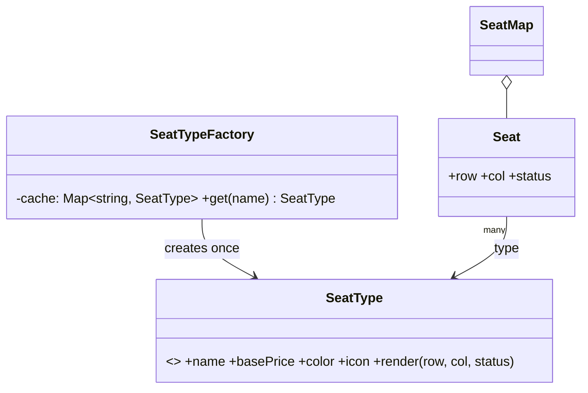

# L19 · Flyweight

> **Time:** ~30 min · **Visual:** [visual.html](visual.html) · **Code:** [demo.ts](demo.ts) (`npx tsx lld/3-structural/L19-flyweight/demo.ts`)
> **Builds on:** [L09 Factory Method](../../2-creational/L09-factory-method/README.md) · [L12 Prototype](../../2-creational/L12-prototype/README.md) · [L01 Classes and interfaces](../../1-foundations/L01-classes-and-interfaces/README.md) (immutability with `readonly`) · **Used in:** BookMyShow (seat types across thousands of seats), Text Editor (glyphs), Chess (shared piece definitions), Ride Sharing (map markers), Library Management (book metadata vs copies)

## The idea in one line

When you have **a huge number of similar objects**, pull the part they all share (the **intrinsic** state) into a few **shared, immutable** objects, and keep only the part that differs (the **extrinsic** state) per instance.

## Why it matters (the problem it solves)

A cinema chain shows a seat map. One screen has 300 seats; a city has 2,000 shows a day; you keep a week of shows in memory for fast seat-map reads. That is about **4 million seat objects**. If each seat carries its own copy of its type data:

```ts
// Before: every seat owns a full copy of data that is identical for its type
class Seat {
  constructor(
    public row: string, public col: number, public status: 'FREE' | 'HELD' | 'BOOKED',
    public typeName: string,          // "Silver"
    public basePrice: number,         // 180
    public color: string,             // "#9aa5b1"
    public amenities: string[],       // ["standard"]
    public icon: Uint8Array,          // ~2 KB sprite
  ) {}
}
// 4,000,000 seats × ~2.1 KB ≈ 8.4 GB. There are only 3 seat types.
```

The data that is the same for every Silver seat is stored millions of times. Flyweight stores it **once per type** and lets each seat point to it.

## How it works

### Split the state

| | Intrinsic (shared) | Extrinsic (per instance) |
|---|---|---|
| Meaning | The same for every object of this kind | Unique to this object or this moment |
| Seat map | type name, base price, colour, icon, amenities | row, column, status (FREE/HELD/BOOKED), price override |
| Text editor | font, size, glyph outline for `'a'` | position in the document |
| Map markers | car icon sprite, size | lat/lng, heading, driver id |
| Chess | piece kind and move rules | square, colour, has-moved flag |
| Mutability | **Immutable.** Shared objects must never change | Changes freely |
| Stored where | In the flyweight, created by a factory with a cache | In the client object (small) or passed in at call time |

### Before vs after

```ts
// After: the flyweight (intrinsic, shared, immutable)
class SeatType {
  constructor(
    readonly name: string,
    readonly basePrice: number,
    readonly color: string,
    readonly icon: Uint8Array,
  ) { Object.freeze(this); }
  render(row: string, col: number, status: SeatStatus): string {   // extrinsic passed in
    return `${row}${col}:${this.name}:${status}`;
  }
}

// The factory guarantees one object per key
class SeatTypeFactory {
  private cache = new Map<string, SeatType>();
  get(name: string, price: number, color: string): SeatType {
    let t = this.cache.get(name);
    if (!t) { t = new SeatType(name, price, color, loadIcon(name)); this.cache.set(name, t); }
    return t;
  }
  get count() { return this.cache.size; }
}

// The context object keeps only extrinsic state + a reference
class Seat {
  constructor(readonly row: string, readonly col: number, readonly type: SeatType, public status: SeatStatus = 'FREE') {}
}
```

### Class diagram

```
  Client (SeatMap) ─────────▶ SeatTypeFactory
       │ holds many             - cache: Map<string, SeatType>
       ▼                        + get(name, ...): SeatType   (create once, then reuse)
     Seat  (context)                    │ creates / returns
     - row, col, status   ───type───▶  SeatType  (flyweight, immutable)
       (≈ 16-40 bytes)      many : 1    - name, basePrice, color, icon (≈ 2 KB)
                                        + render(row, col, status)
```



### The memory maths (say this out loud)

```
Naive:      4,000,000 seats × (2,048 B type data + ~40 B position/status) ≈ 8.35 GB
Flyweight:  3 types × 2,048 B  +  4,000,000 × (~40 B + 8 B pointer)        ≈ 0.19 GB
Saving:     ~97%. The cost moved from O(objects × shared size) to O(kinds × shared size + objects × small size).
```

Rule of thumb: Flyweight is worth it when **(number of objects) × (size of shared part)** is large and **(number of distinct kinds)** is small.

### Where you already use flyweights

- **String interning:** JS engines keep one copy of identical string literals; property names are interned.
- **V8 hidden classes (shapes):** all objects with the same property layout share one shape description.
- **Java `Integer.valueOf(-128..127)`** returns cached objects; **Redis** shares integer objects 0-9999 instead of allocating them per key.
- **Columnar databases and Parquet:** dictionary encoding stores each distinct string once and keeps small integer ids per row. Same idea at storage level.
- **Game engines / map SDKs:** one texture or sprite, drawn at thousands of positions.

### Flyweight vs similar ideas

| | Flyweight | Cache | Object pool | Singleton | Prototype |
|---|---|---|---|---|---|
| Goal | Share immutable state among many users at once | Avoid recomputing a result | Reuse expensive mutable objects one user at a time | Exactly one instance of a class | Make new objects by copying |
| Instances | One per **kind** | One per key, may expire | Fixed set, borrowed and returned | One | Many copies |
| Mutable? | No | Usually no | Yes (reset on return) | Often | Copies are |

### How to spot it in a problem statement

- "Millions of" seats, cells, characters, tiles, markers, particles, log lines.
- Most fields are the **same** across many objects and are decided by a **type/category**.
- The interviewer asks "how much memory will this take?" after your entity design.
- Memory, not CPU, is the bottleneck (mobile, browser, in-memory seat maps, caches).

## In TypeScript

The two rules that make Flyweight safe in TS: make the shared object **readonly and frozen**, and create it **only through the factory**.

```ts
const factory = new SeatTypeFactory();
const seats: Seat[] = [];
for (const row of 'ABCDEFGHIJ') {
  const type = row === 'A' ? factory.get('Recliner', 450, '#c96f12')
             : row <= 'D'  ? factory.get('Gold', 250, '#a0700a')
             :               factory.get('Silver', 180, '#9aa5b1');
  for (let col = 1; col <= 30; col++) seats.push(new Seat(row, col, type));
}
console.log(seats.length, factory.count);   // 300 seats, 3 SeatType objects
seats[0].type === seats[1].type;            // true: same object
```

A per-seat discount does **not** go into `SeatType`. It is extrinsic: add `priceOverride?: number` on `Seat`, or compute it at call time.

[demo.ts](demo.ts) builds about 100,000 seats both ways, counts objects, measures heap use, and shows the shared-mutation bug.

## Trade-offs / when NOT to use it

- **Few objects.** For 300 seats the saving is a few hundred KB. Not worth the extra factory and the split state.
- **Complexity moves to the caller.** Extrinsic state must be stored or passed in on every call (`render(row, col, status)`). APIs get wider.
- **Shared mutable state is a bug factory.** If anyone mutates a flyweight, every user sees the change. Freeze it.
- **CPU for memory.** Looking up the factory and passing context costs a little CPU. Usually fine; measure for hot loops.
- **Identity confusion.** Code that uses flyweights as map keys or compares them by reference must know that many contexts share one object.
- **Concurrency.** The factory's `get-or-create` must not create two objects for the same key. In Node's single thread that is automatic for sync code; with async creation (loading an icon from disk), cache the **promise**.

## Common mistakes

- Putting extrinsic state (status, position, per-seat price) into the flyweight "because it was easy". Now every seat of that type shows BOOKED.
- Creating flyweights with `new` outside the factory, so duplicates slip in and the saving disappears.
- Forgetting to make the shared object immutable (`readonly` + `Object.freeze`).
- Using Flyweight to describe any cache. A cache stores results; a flyweight shares **state** across many live objects.
- Not doing the memory maths. Without numbers, the interviewer can't tell whether it matters.

## Say this in the interview

> "A city has about 2,000 shows a day with around 300 seats each, so a week of seat maps is about 4 million seat objects. Only a few seat types exist, so I apply Flyweight: `SeatType` holds the shared, immutable data, like name, base price, colour and icon, and a factory returns one instance per type. Each `Seat` keeps only row, column and status plus a reference. That takes us from roughly 8 GB to under 200 MB."

> "The important rule is that the flyweight is immutable. Anything that varies per seat, like a hold, a booking or a special price, is extrinsic and lives on the seat or is passed in at call time."

## Your experience hook

- With **10,000+ IoT devices**, device-model data (firmware limits, sensor units, thresholds) is the same for every device of a model. Keeping one `DeviceModel` object per model and a small per-device record (id, last reading, socket) is Flyweight, and it keeps the WebSocket servers' memory flat as the fleet grows.
- In the **video SFU**, many consumers share the same producer's codec parameters (RTP capabilities). Sharing one immutable description per producer instead of copying it per consumer is the same idea.

## Self-test

<details><summary>1. Define intrinsic and extrinsic state with a seat-map example.</summary>

Intrinsic: shared and context-free, like seat type name, base price, colour, icon. Extrinsic: depends on the instance or moment, like row, column, status and any per-seat price override.
</details>

<details><summary>2. Why must a flyweight be immutable?</summary>

Many objects share it. If one caller changes it (sets Silver price to 0), every Silver seat in every show changes.
</details>

<details><summary>3. What does the factory guarantee, and how?</summary>

At most one flyweight per key. It keeps a `Map<key, Flyweight>` and returns the cached object if present, otherwise creates, stores and returns it.
</details>

<details><summary>4. 1,000,000 map markers, 5 icon types of 4 KB each, 32 B of position data per marker. Memory with and without Flyweight?</summary>

Without: about 1M × (4,096 + 32) B ≈ 4.1 GB. With: 5 × 4 KB + 1M × (32 + 8) B ≈ 40 MB.
</details>

<details><summary>5. Flyweight vs object pool?</summary>

A flyweight is immutable and shared by many users at the same time. A pooled object is mutable and used by one user at a time, then reset and returned.
</details>

<details><summary>6. A theatre runs a "first row 50% off" offer. Where does that discount go?</summary>

Not in `SeatType`. It is extrinsic: a price override on those `Seat` objects, or a pricing rule applied at checkout using row as input.
</details>

<details><summary>7. Name two flyweights you use without writing one.</summary>

String interning in JS engines, V8 hidden classes, Redis shared small integers, dictionary encoding in columnar storage.
</details>

## Go deeper

- Animation: [visual.html](visual.html): 40 duplicated type objects collapse into 3 shared ones; the shared-mutation bug.
- LLD problems: [13 BookMyShow](../../problems/13-bookmyshow/README.md) (seat map), [22 Text Editor](../../problems/22-text-editor/README.md) (glyphs), [23 Chess](../../problems/23-chess/README.md), [17 Ride Sharing](../../problems/17-ride-sharing/README.md) (map markers)
- Related patterns: [L09 Factory Method](../../2-creational/L09-factory-method/README.md), [L08 Singleton](../../2-creational/L08-singleton/README.md), [L17 Composite](../L17-composite/README.md) (leaves are often flyweights)
- HLD view: [H02 Back-of-envelope](../../../hld/1-basics/H02-back-of-envelope/README.md) (the memory maths), [H09 Caching](../../../hld/2-scaling/H09-caching/README.md), [H37 Data at scale](../../../hld/6-building-blocks/H37-data-at-scale/README.md)
