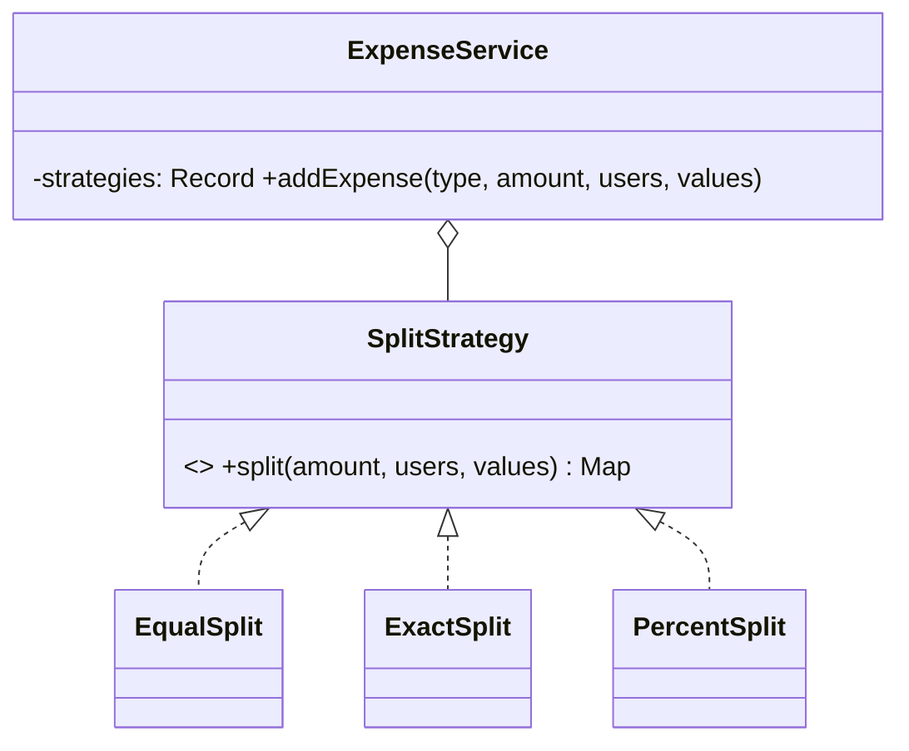

# L20 · Strategy

> **Time:** ~40 min · **Visual:** [visual.html](visual.html) · **Code:** [demo.ts](demo.ts) (`npx tsx lld/4-behavioral/L20-strategy/demo.ts`)
> **Builds on:** [L04 SRP and OCP](../../1-foundations/L04-solid-srp-ocp/README.md) · [L03 Composition over inheritance](../../1-foundations/L03-composition-over-inheritance/README.md) · [L09 Factory Method](../../2-creational/L09-factory-method/README.md) · **Used in:** Parking Lot (pricing, spot allocation), Splitwise (split types), Rate Limiter (algorithms), Notification Service, Elevator (scheduling), Cart with Coupons (discounts), Payment Wallet, Tic-Tac-Toe (win check), Ride Sharing (matching), and most other LLD problems

## The idea in one line

Put each variant of an algorithm behind **one interface**, and give the object that uses it **the one you want**, so new variants are new classes, not new `case` branches.

## Why it matters (the problem it solves)

Almost every LLD prompt has a line like "support different **types of** pricing / split / discount / payment". The first draft is a `switch` inside the service:

```ts
// Before: the split rule is a switch inside the service
class ExpenseService {
  split(type: string, amount: number, users: string[], values: number[] = []) {
    switch (type) {
      case 'EQUAL':   return users.map(() => amount / users.length);          // 33.333...
      case 'EXACT':   return values;                                           // no validation
      case 'PERCENT': return values.map((p) => (amount * p) / 100);
      default: throw new Error('unknown split');
    }
  }
}
```

Problems:

- **OCP broken.** A new type ("by shares") means editing and re-testing the service that every flow depends on.
- **SRP broken.** The service knows the maths and validation of every rule.
- **Hard to test.** You can only test a rule through the whole service.
- **Copies spread.** The same `switch (type)` appears again in `preview()`, `validate()` and `export()`.

Strategy moves each rule into its own class. The service holds an interface and delegates.

## How it works

### The roles

| Role | What it is | Splitwise example |
|---|---|---|
| **Strategy** (interface) | The contract all variants share | `SplitStrategy.split(amount, users, values)` |
| **Concrete strategies** | One class (or function) per variant | `EqualSplit`, `ExactSplit`, `PercentSplit` |
| **Context** | The class that uses a strategy and never checks which one | `ExpenseService` |
| **Selector** (often a factory/registry) | Turns input ("EQUAL") into a strategy object | `Record<SplitType, SplitStrategy>` |

### After

```ts
interface SplitStrategy {
  split(amountPaise: number, users: string[], values: number[]): Map<string, number>;
}

class EqualSplit implements SplitStrategy {
  split(amount: number, users: string[]) {
    const base = Math.floor(amount / users.length);
    let rest = amount - base * users.length;          // leftover paise
    return new Map(users.map((u) => [u, base + (rest-- > 0 ? 1 : 0)]));
  }
}

class PercentSplit implements SplitStrategy {
  split(amount: number, users: string[], pcts: number[]) {
    if (pcts.reduce((s, p) => s + p, 0) !== 100) throw new Error('percentages must add up to 100');
    /* floor each share, give the rounding remainder to the payer */
  }
}

class ExpenseService {                                // context
  constructor(private strategies: Record<SplitType, SplitStrategy>) {}
  addExpense(type: SplitType, amount: number, users: string[], values: number[] = []) {
    return this.strategies[type].split(amount, users, values);   // no switch
  }
}
```

A new split type = one new class + one registry entry. `ExpenseService` doesn't change.

### Class diagram

```
  ExpenseService (context) ◇──────▶ «interface» SplitStrategy
  - strategies: Record<type, SplitStrategy>      + split(amount, users, values)
  + addExpense(type, ...)                          ▲          ▲           ▲
        │ delegates, no switch                     │          │           │
        ▼                                     EqualSplit  ExactSplit  PercentSplit   (+ SharesSplit later)
```



### Who picks the strategy?

| Picked by | When | Example |
|---|---|---|
| Constructor injection | Fixed for the object's life | `new ParkingLot(new HourlyPricing(20))` |
| Setter / per call | Changes per request | `checkout.setStrategy(factory.create(req.method))` |
| Registry / factory from input | User or config chooses by name | `registry['upi']`, with a 400 on unknown names |
| Rule engine | Chosen by data (weekend, tenant, A/B bucket) | `pricingFor(tenant, date)` |

Keep the choosing **at the boundary** (composition root, factory, or request validation). The context only uses what it is given.

### Functions are strategies too

In TypeScript, a one-method strategy can be just a function type. Use a class when the strategy has configuration, state, dependencies, or more than one method.

```ts
type PricingFn = (minutes: number) => number;
const hourly = (rate: number): PricingFn => (m) => Math.max(1, Math.ceil(m / 60)) * rate;
const flat   = (fee: number): PricingFn => () => fee;
const capped = (inner: PricingFn, cap: number): PricingFn => (m) => Math.min(inner(m), cap); // composes
```

`Array.prototype.sort(compareFn)`, retry backoff functions and Express middleware all use this idea.

### Strategy vs its look-alikes

| | Strategy | State | Template Method | Bridge |
|---|---|---|---|---|
| Who changes the behaviour | The **caller** picks it | The **state objects** switch the context themselves | Subclass overrides fixed steps | Two hierarchies chosen at wiring time |
| Mechanism | Composition | Composition | Inheritance | Composition |
| Changes during the object's life? | Rarely, by the client | Constantly, by events | Never (fixed at class) | Sometimes |
| Example | Pricing rule, split type, payment method | Vending machine, order lifecycle | Report export steps | Notification kind × channel |

### How to spot it in a problem statement

- "**different types of** …", "**support multiple** …", "**configurable** …", "**can be changed later**".
- You are about to write `switch (type)` or `if (mode === ...)` in a service method.
- The same object should behave differently per tenant, per city, per day, or per A/B bucket.
- Common in LLD: pricing, fee calculation, discount, split, spot allocation, matching (nearest driver vs best rated), elevator scheduling, rate-limit algorithm, eviction policy (LRU/LFU), retry/backoff, sorting/ranking, win checking.

## In TypeScript

A payment-method registry with fail-fast validation, the version from the [visual](visual.html):

```ts
interface PaymentStrategy { pay(amountPaise: number): Promise<Receipt> }

const registry: Record<string, () => PaymentStrategy> = {
  card:   () => new CardStrategy(gateway),
  upi:    () => new UpiStrategy(psp),
  wallet: () => new WalletStrategy(walletRepo),
};

function strategyFor(method: string): PaymentStrategy {
  const make = registry[method];
  if (!make) throw new UnsupportedMethodError(method);   // map to HTTP 400 at the edge
  return make();
}

class CheckoutService {
  checkout(amount: number, s: PaymentStrategy) { return s.pay(amount); }  // no switch
}
```

[demo.ts](demo.ts) runs the Splitwise strategies with exact paise maths, the payment registry, and function strategies for parking prices.

## Trade-offs / when NOT to use it

- **Two cases that will never grow.** An `if` is clearer than an interface plus two classes.
- **Too much context needed.** If the strategy needs ten parameters or half of the context's internals, the split is in the wrong place. Pass a small, focused input object.
- **Clients must know the options.** Someone has to choose. Hide that in a factory/registry so not every caller learns all class names.
- **Gold-plating.** In a 90-minute round, add strategies where the prompt hints at variation, not "for the future" everywhere.
- **Shared mutable state.** A strategy that keeps per-request data must not be a shared singleton. Stateless ones can be reused.

## Common mistakes

- Moving the `switch` from the service into the factory **and** keeping it in the service too.
- Strategies that return different shapes, so the context checks types again. The interface must fully describe the result.
- Floating-point money in split strategies. Use integer paise and give the remainder to someone so shares add up exactly.
- Validation in the context instead of in each strategy (percentages adding to 100 belongs to `PercentSplit`).
- Mixing up Strategy and State: in State, the object changes its own behaviour as events arrive; in Strategy, the client chooses.

## Say this in the interview

> "Split types change independently of the expense flow, so each one is a `SplitStrategy`. The service gets a map from split type to strategy in its constructor and just delegates, so adding 'split by shares' is one class and one map entry, with no change to the service. That's open/closed. Each strategy validates its own input, and all amounts are integer paise so the shares add up exactly."

> "Unknown types fail fast at the boundary: the factory throws and the API returns 400, so the core code can trust that the strategy exists. For one-method strategies with no state I just use a function type."

## Your experience hook

- In your **payment orchestration**, choosing Razorpay vs another provider per request (by method, by success rate, by cost) is a routing strategy, while each provider integration is an adapter. Saying both names shows you know the difference.
- Your **API gateway rate limiting** can swap algorithms (token bucket vs sliding window) behind one `RateLimiter` interface: textbook Strategy.
- **Nginx IP-hash vs round robin** for your WebSocket servers is a load-balancing strategy chosen by config.

## Self-test

<details><summary>1. Split Rs 1.00 (100 paise) equally among 3 users. What are the shares?</summary>

34, 33, 33. Work in integer paise and hand the remainder to some users so the total is exact.
</details>

<details><summary>2. Weekend pricing for the parking lot. What changes in your code?</summary>

A new `WeekendPricing` strategy (or a wrapper that checks the day and delegates), plus wiring. `ParkingLot` itself doesn't change.
</details>

<details><summary>3. Strategy vs State: same UML, so what is different?</summary>

In Strategy the client chooses the algorithm and it rarely changes on its own. In State, the state objects move the context to the next state as events arrive.
</details>

<details><summary>4. When is a plain function better than a strategy class?</summary>

When there is one method and no state, config or dependencies beyond what a closure captures.
</details>

<details><summary>5. Where should "unknown payment method" be rejected?</summary>

At the boundary: in the factory or request validation, returning 400. The context then never sees invalid input.
</details>

<details><summary>6. Should strategies be shared singletons or created per request?</summary>

Stateless ones can be shared. If a strategy keeps per-request data, create a new one per request so requests don't leak into each other.
</details>

<details><summary>7. Name three Strategy uses in Node libraries you know.</summary>

Passport.js login strategies, `Array.prototype.sort(compareFn)`, retry/backoff policies, load-balancing policies in proxies and HTTP clients.
</details>

## Go deeper

- Animation: [visual.html](visual.html): from a growing switch to a strategy registry; runtime swap; adding pay-later; unknown method rejected.
- LLD problems: [09 Splitwise](../../problems/09-splitwise/README.md), [01 Parking Lot](../../problems/01-parking-lot/README.md), [04 Rate Limiter](../../problems/04-rate-limiter/README.md), [20 Cart with Coupons](../../problems/20-ecommerce-cart-coupons/README.md), [10 Elevator](../../problems/10-elevator/README.md), [02 LRU Cache](../../problems/02-lru-cache/README.md) (eviction policy)
- Related patterns: [L22 State](../L22-state/README.md), [L26 Template Method](../L26-template-method/README.md), [L18 Bridge](../../3-structural/L18-bridge/README.md), [L09 Factory Method](../../2-creational/L09-factory-method/README.md)
- HLD view: [H26 Rate limiting](../../../hld/5-reliability/H26-rate-limiting/README.md) (swappable algorithms), [H08 Load balancing](../../../hld/2-scaling/H08-load-balancing/README.md) (balancing policies)
