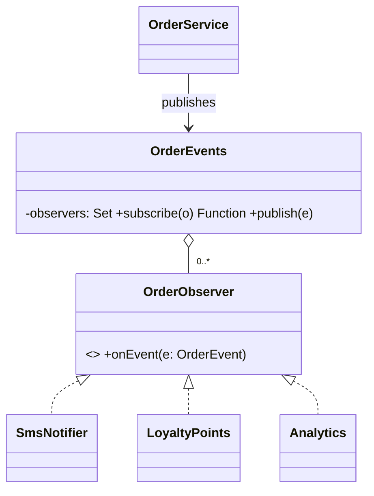

# L21 · Observer and pub-sub

> **Time:** ~40 min · **Visual:** [visual.html](visual.html) · **Code:** [demo.ts](demo.ts) (`npx tsx lld/4-behavioral/L21-observer/demo.ts`)
> **Builds on:** [L04 SRP and OCP](../../1-foundations/L04-solid-srp-ocp/README.md) · [L05 LSP, ISP, DIP](../../1-foundations/L05-solid-lsp-isp-dip/README.md) · [L20 Strategy](../L20-strategy/README.md) · **Used in:** Notification Service, Pub-Sub Queue (Kafka-lite), Food Delivery and Ride Sharing (status and location updates), Parking Lot (display board), Library Management (book-available alerts), Elevator, Splitwise; HLD: Chat, News Feed, Notification System, Live Comments

## The idea in one line

A **subject** keeps a list of **observers** and notifies all of them when something happens, without knowing what each one does. **Pub-sub** is the same idea with a **broker** in the middle, so publishers and subscribers don't even know each other.

## Why it matters (the problem it solves)

```ts
// Before: the order service calls every interested team directly
class OrderService {
  async markDelivered(orderId: string, userId: string) {
    await this.repo.setStatus(orderId, 'DELIVERED');
    await this.sms.send(userId, 'Delivered');        // notifications team
    await this.loyalty.addPoints(userId, 10);        // loyalty team
    await this.analytics.track('delivered', orderId); // data team
  }
}
```

- **OCP broken:** a new team (referrals, invoices) means editing `OrderService` again.
- **Coupling:** the order service imports SMS, loyalty and analytics clients it has no business knowing.
- **Latency:** the HTTP reply waits for the slowest side effect (SMTP at 300 ms).
- **Fragility:** if analytics throws, loyalty never runs and the delivered order looks failed.

Observer flips the dependency: the order service **announces** "order delivered", and anyone who cares **subscribes**.

## How it works

### Roles

| Role | What it does | Example |
|---|---|---|
| **Subject** (publisher) | Keeps a set of observers; `subscribe`, `unsubscribe`, `notify` | `OrderEvents`, Node `EventEmitter` |
| **Observer** (subscriber) | Implements one method, e.g. `onEvent(e)` | `SmsNotifier`, `LoyaltyPoints`, `Analytics` |
| **Event** | The data passed along: type, ids, timestamp, event id | `{ type: 'DELIVERED', orderId, userId, eventId }` |

### After

```ts
type OrderEvent = { eventId: string; type: 'DELIVERED' | 'CANCELLED'; orderId: string; userId: string };
interface OrderObserver { readonly name: string; onEvent(e: OrderEvent): Promise<void> | void }

class OrderEvents {
  private observers = new Set<OrderObserver>();

  subscribe(o: OrderObserver): () => void {
    this.observers.add(o);
    return () => this.observers.delete(o);        // unsubscribe handle: prevents leaks
  }

  publish(e: OrderEvent): void {                   // async notify: start all, don't wait
    const runs = [...this.observers].map((o) =>
      Promise.resolve().then(() => o.onEvent(e)).catch((err) => log(o.name, err)), // isolate failures
    );
    void Promise.allSettled(runs);
  }
}

class OrderService {
  constructor(private events: OrderEvents) {}
  async markDelivered(orderId: string, userId: string) {
    await this.repo.setStatus(orderId, 'DELIVERED');
    this.events.publish({ eventId: randomUUID(), type: 'DELIVERED', orderId, userId });
  }
}
```

### Class diagram

```
   OrderService ──publishes──▶ OrderEvents (subject)
                                - observers: Set<OrderObserver>
                                + subscribe(o): unsubscribe
                                + publish(e)
                                        │ notifies 0..*
                                        ▼
                              «interface» OrderObserver
                              + onEvent(e)
                                ▲        ▲          ▲
                       SmsNotifier  LoyaltyPoints  Analytics     (+ new teams, no change above)
```



### Sync vs async notify: the choice that matters

| | Sync (`for … await o.onEvent(e)`) | Async (start all, `allSettled`, don't await) |
|---|---|---|
| Reply latency | Sum of all observers (300 + 40 + 20 = 360 ms) | About 1 ms |
| One observer throws | Loop stops; later observers never run; error reaches the request | Only that observer fails; error is logged |
| Order guaranteed | Yes, registration order | No |
| Use when | The reaction is part of the operation (rare) | Side effects: email, analytics, cache refresh |

Node's `EventEmitter.emit()` is **synchronous**: it calls every listener in order, inside `emit()`. If a listener is `async`, `emit` ignores the returned promise, and a rejection becomes an unhandled rejection unless you catch it (or set `captureRejections`). Emitting `'error'` with no `'error'` listener **throws**.

### Push vs pull

- **Push:** the event carries the data (`{ orderId, status, amount }`). Simple; most common.
- **Pull:** the event is a small signal (`{ orderId }`) and observers read what they need. Avoids big payloads and stale copies.

### From Observer to pub-sub

Inside one process, Observer is enough. Across services you need a broker:

```
 Observer (in-process)                  Pub-sub (broker)
 OrderService ──▶ [sms, loyalty]        OrderService ──▶ topic "order.delivered" ──▶ EmailSvc
  holds direct references                                 (Kafka / RabbitMQ / SNS+SQS)  ──▶ LoyaltySvc
                                                          broker buffers if a consumer is down
```

| | Observer (in-process) | Pub-sub with a broker |
|---|---|---|
| Who knows whom | Subject holds observer references | Both sides know only the broker and a topic name |
| Filtering | Every observer gets every event | By topic, key or attributes |
| Subscriber down or slow | Event lost, or the caller waits | Broker buffers; consumer catches up |
| Delivery | Function call | Network, **at-least-once**: handlers must be **idempotent** |
| Durability | None (process crash loses it) | Kafka/SQS persist; Redis pub/sub does **not** |
| Examples | `EventEmitter`, RxJS `Subject`, DOM events | Kafka, RabbitMQ, SNS+SQS, Redis Streams |

To publish to a broker safely after a DB write, use the **transactional outbox**: write the event row in the same transaction as the state change, and a relay publishes it. Otherwise a crash between "DB commit" and "publish" loses the event.

### How to spot it in a problem statement

- "**Notify** the user when…", "**alert** subscribers", "update the **display board**", "**live** location / status".
- One state change, several independent reactions, more reactions expected later.
- The words "subscribe", "follow", "watch", "listen", "webhook".

## In TypeScript

Node's `EventEmitter` can be typed with an event map (recent `@types/node`):

```ts
import { EventEmitter } from 'node:events';

type PaymentEvents = {
  captured: [paymentId: string, amount: number];
  failed: [paymentId: string, reason: string];
};

const bus = new EventEmitter<PaymentEvents>();
bus.on('captured', (id, amount) => ledger.record(id, amount));   // typed args
bus.once('failed', (id, reason) => alertOps(id, reason));         // runs once, then removed
bus.on('error', (err) => log(err));                               // always add one
```

An idempotent subscriber, needed as soon as delivery is at-least-once:

```ts
const seen = new Set<string>();      // in production: a DB unique key or Redis SET NX with TTL
function onPaymentFailed(e: { eventId: string; userId: string }) {
  if (seen.has(e.eventId)) return;   // duplicate delivery: ignore
  seen.add(e.eventId);
  sendEmail(e.userId, 'Payment failed');
}
```

[demo.ts](demo.ts) shows the before code, sync vs async timing, failure isolation, unsubscribe, a typed `EventEmitter`, a tiny topic broker with an offline subscriber, and idempotent handling of a duplicate.

## Trade-offs / when NOT to use it

- **One reaction that is part of the core flow** (payment then ledger entry): call it directly, in the same transaction. Hidden control flow is harder to read and test.
- **Order or success matters.** If B must run after A, or the operation fails when B fails, observers are the wrong tool.
- **Event chains.** A emits, B reacts and emits, C reacts… Debugging needs tracing (correlation ids).
- **In-process observers lose events** on crash. If the event must not be lost, use a durable broker plus an outbox.
- **Memory leaks.** Every `subscribe` without an `unsubscribe` keeps the observer alive. Node warns after 10 listeners per event.

## Common mistakes

- `await`ing every observer inside the request path, so the slowest side effect sets your p99.
- No try/catch per observer, so one bug stops all the others.
- Forgetting to unsubscribe (component unmounts, socket closes) and leaking memory.
- Calling Redis pub/sub a queue. It is fire-and-forget: an offline subscriber misses messages. Use Redis Streams, Kafka or SQS when every message matters.
- Non-idempotent consumers on an at-least-once broker: the same "send refund" runs twice.
- Publishing after the DB commit without an outbox, and losing events on a crash.

## Say this in the interview

> "When an order is delivered, the order service publishes an `OrderDelivered` event. Notifications, loyalty and analytics subscribe. The service doesn't know them, so a new consumer doesn't change it. I don't let a slow listener delay the response: I start them without awaiting and isolate each one's errors."

> "Across services I use a broker with topics, written through an outbox so the event can't be lost after commit. Delivery is at-least-once, so every consumer is idempotent: it dedupes on the event id."

## Your experience hook

- In the **IoT platform (10k+ devices)** you used the **Redis adapter for Socket.io**: a message published on one WebSocket node is fanned out through Redis pub/sub to clients connected on other nodes. That is pub-sub across servers.
- In the **video SFU**, signaling state is synced across instances with Redis pub/sub, and Mediasoup itself is event-driven (`producer.on('close')`, `transport.on('dtlsstatechange')`): Observer inside one process.
- Your **notification service with RabbitMQ** is pub-sub with durable queues: producers publish events, notification workers consume and retry.

## Self-test

<details><summary>1. A listener throws inside `emitter.emit('paid')`. What happens to the listeners after it?</summary>

With plain `EventEmitter`, the error propagates out of `emit()` and later listeners do not run. Wrap listeners or catch inside them.
</details>

<details><summary>2. Does `EventEmitter.emit()` wait for async listeners?</summary>

No. It calls each listener synchronously in order and ignores returned promises. A rejection there is unhandled unless you catch it or enable `captureRejections`.
</details>

<details><summary>3. Why does a forgotten unsubscribe leak memory?</summary>

The subject keeps a reference to the observer, so the observer and everything it holds can never be garbage collected.
</details>

<details><summary>4. Parking lot display board: which is the subject and which is the observer?</summary>

The floor (or spot allocator) is the subject; it publishes "spot freed / taken". The display board observes and updates its counts.
</details>

<details><summary>5. Is Redis pub/sub a durable queue?</summary>

No. An offline subscriber misses the message. Use Redis Streams, Kafka or SQS when every message must be processed.
</details>

<details><summary>6. The broker delivers "payment.failed" twice. How do you avoid two emails?</summary>

Make the consumer idempotent: store processed event ids (unique key in the DB, or Redis `SET NX` with a TTL) and skip ids already seen.
</details>

<details><summary>7. Observer vs Mediator?</summary>

Observer is one-to-many broadcast: the subject doesn't know what observers do. Mediator coordinates two-way interaction between peers through one central object that contains the coordination logic.
</details>

<details><summary>8. You write the order row, then publish the event, and the process crashes in between. Fix?</summary>

Transactional outbox: insert the event into an outbox table in the same DB transaction, and a relay publishes it to the broker (and marks it sent). Consumers stay idempotent because the relay may publish twice.
</details>

## Go deeper

- Animation: [visual.html](visual.html): sync vs async notify, failure isolation, unsubscribe, topic routing, an offline subscriber, duplicate delivery.
- LLD problems: [15 Pub-Sub Queue](../../problems/15-pub-sub-queue/README.md) (build it), [05 Notification Service](../../problems/05-notification-service/README.md), [18 Food Delivery](../../problems/18-food-delivery/README.md), [17 Ride Sharing](../../problems/17-ride-sharing/README.md), [01 Parking Lot](../../problems/01-parking-lot/README.md)
- Related patterns: [L28 Mediator](../L28-mediator/README.md), [L20 Strategy](../L20-strategy/README.md)
- HLD: [H20 Message queues](../../../hld/4-async/H20-message-queues/README.md), [H22 Delivery semantics](../../../hld/4-async/H22-delivery-semantics/README.md), [H24 Event-driven and CQRS](../../../hld/4-async/H24-event-driven-cqrs/README.md), [H05 Realtime communication](../../../hld/1-basics/H05-realtime-communication/README.md)
- Case studies: [05 Notification system](../../../hld/case-studies/05-notification-system/README.md), [06 Chat system](../../../hld/case-studies/06-chat-system/README.md), [07 News feed](../../../hld/case-studies/07-news-feed/README.md)
