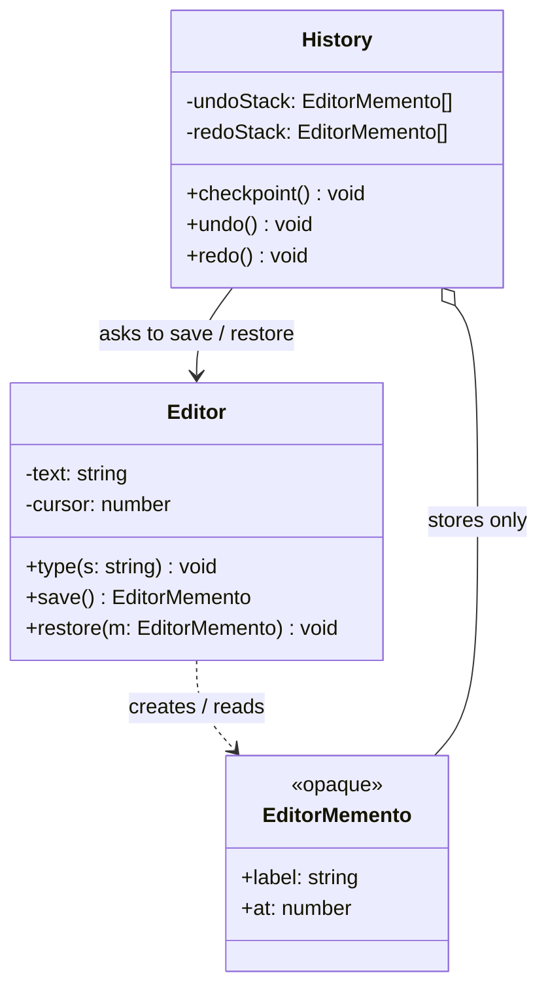

# L24 · Memento

> **Time:** ~30 min · **Visual:** [visual.html](visual.html) · **Code:** [demo.ts](demo.ts) (`npx tsx lld/4-behavioral/L24-memento/demo.ts`)
> **Builds on:** [L23 Command (undo and redo)](../L23-command/README.md) · [L12 Prototype](../../2-creational/L12-prototype/README.md) · **Used in:** [22 Text Editor](../../problems/22-text-editor/README.md), [14 KV Store](../../problems/14-kv-store/README.md) (BEGIN / ROLLBACK), [Collaborative Editor](../../../hld/case-studies/25-collaborative-editor/README.md)

## The idea in one line

Take a sealed snapshot of an object's state so you can put the object back to that point later, without anyone else seeing or touching its insides.

## Why it matters (the problem it solves)

You need "go back": undo in an editor, rollback of a transaction, "restore draft" in a long form, a checkpoint before a risky step in a game or a wizard. The easy way breaks encapsulation:

```ts
// Before: the history reaches into the editor's private fields
class History {
  private saved: { text: string; cursor: number; selection: [number, number] | null }[] = [];
  backup(e: Editor) {
    this.saved.push({ text: e.text, cursor: e.cursor, selection: e.selection }); // must make these public
  }
  undo(e: Editor) {
    const s = this.saved.pop();
    if (s) { e.text = s.text; e.cursor = s.cursor; e.selection = s.selection; } // anyone can write junk
  }
}
// Add a "fontSize" field to Editor -> History must change too. Forget it -> undo silently loses it.
```

Problems: every field must be public, the history knows the editor's layout, and any code can restore a half-valid state. Memento fixes this by letting the **editor itself** make and read the snapshot.

## How it works

### Three roles

| Role | Who | Can do |
|---|---|---|
| **Originator** | The object whose state you save (`Editor`, `KvStore`, `CheckoutForm`) | `save(): Memento` and `restore(m: Memento)`. Only it knows what goes inside. |
| **Memento** | The snapshot value | Immutable. Opaque to everyone except the originator. May expose harmless metadata (label, time). |
| **Caretaker** | Whoever keeps the snapshots (`History`, transaction stack, draft store) | Stores, orders and hands back mementos. Never reads or edits the contents. |

```
        save()                      push(m)
 +------------+   Memento   +----------------+
 | Originator | ----------> |   Caretaker    |   undo stack: [m1, m2, m3]
 |  (Editor)  | <---------- |   (History)    |
 +------------+  restore(m) +----------------+
       ^                            |
       |  only the originator       |  the caretaker sees an opaque box
       +---- reads the contents ----+  (maybe a label and a timestamp)
```

### Class diagram



### Undo and redo with snapshots

```
start "Hi"        checkpoint -> undo=[Hi]
type " there"     text "Hi there"
checkpoint        undo=[Hi, Hi there]
type "!"          text "Hi there!"
undo()            redo=[Hi there!]  restore "Hi there"
undo()            redo=[Hi there!, Hi there]  restore "Hi"
redo()            restore "Hi there"
type "?"          redo stack is CLEARED (that future no longer exists)
```

Rule: before an undo, save the **current** state onto the redo stack, so redo can bring it back. Any new change clears the redo stack.

### How to keep the memento opaque in TypeScript

TS has no "friend" classes, so pick one of these:

1. **Private class fields on the memento + a module-private key.** The memento holds state in `#state`; only code in the same module can read it.
2. **A branded type** `type EditorMemento = { readonly __brand: 'EditorMemento' }` and keep the real data in a `WeakMap<EditorMemento, State>` inside the originator's module. The caretaker holds a token that means nothing on its own.
3. **Nested class pattern:** the memento is a class declared inside the originator's file and not exported; only its interface (`label`, `at`) is exported.

Always `Object.freeze` the snapshot, or `structuredClone` it, so later changes to the originator do not leak into old mementos (a shared array is the classic bug).

### Snapshot vs reverse command

| | Memento (snapshot) | Command undo (L23) |
|---|---|---|
| What is stored | The whole state (or a chunk of it) | Only the change and how to reverse it |
| Memory | High: N steps x state size | Low: N steps x change size |
| Correctness | Very easy: restore is exact | Each command must write a correct `undo()` |
| Best for | Small state, complex changes (form, game board, config) | Big state, small changes (1 MB document, many keystrokes) |

Real systems mix them: a **snapshot every K steps + commands in between** (like a database checkpoint plus the WAL, or event sourcing with periodic snapshots). Restore = load nearest snapshot, replay the commands after it.

### Where you meet it in real code

- **Redux / Zustand time-travel**: each state is an immutable snapshot; undo = point to an earlier one.
- **DB transactions / savepoints**: `SAVEPOINT s1` ... `ROLLBACK TO s1` is memento at the storage layer.
- **Form drafts**: save the form's state to `localStorage` or the server every few seconds; "Restore draft?" on reload.
- **Event sourcing snapshots**: the aggregate's state at version 500 so you replay 20 events, not 520.
- **Game checkpoints**, VM / container snapshots, `git stash`.

### How to spot it in a problem statement

- "undo", "rollback", "revert", "restore", "checkpoint", "save draft", "go back to version N".
- Nested transactions in a KV store (`BEGIN` / `ROLLBACK` / `COMMIT`).
- "the history must not be able to change the object directly".

## In TypeScript

```ts
// Originator and memento live in one module. The memento's contents are #private.
export class EditorMemento {
  #state: Readonly<{ text: string; cursor: number }>;
  constructor(state: { text: string; cursor: number }, readonly label: string) {
    this.#state = Object.freeze({ ...state });
  }
  static read(m: EditorMemento) { return m.#state; } // only Editor calls this
}

export class Editor {
  private text = '';
  private cursor = 0;
  type(s: string) { this.text = this.text.slice(0, this.cursor) + s + this.text.slice(this.cursor); this.cursor += s.length; }
  save(label: string) { return new EditorMemento({ text: this.text, cursor: this.cursor }, label); }
  restore(m: EditorMemento) { const s = EditorMemento.read(m); this.text = s.text; this.cursor = s.cursor; }
}

// Caretaker: stores tokens, never looks inside.
export class History {
  private undoStack: EditorMemento[] = [];
  private redoStack: EditorMemento[] = [];
  constructor(private editor: Editor, private limit = 50) {}
  checkpoint(label: string) {
    this.undoStack.push(this.editor.save(label));
    if (this.undoStack.length > this.limit) this.undoStack.shift(); // cap memory
    this.redoStack = [];
  }
  undo() {
    const m = this.undoStack.pop();
    if (!m) return;
    this.redoStack.push(this.editor.save('redo'));
    this.editor.restore(m);
  }
}
```

The full demo (editor undo/redo plus KV store transactions with nested `BEGIN`) is in [demo.ts](demo.ts).

## Trade-offs / when NOT to use it

- **Large state, frequent saves**: a 5 MB canvas snapshotted on every stroke = 500 MB after 100 strokes. Use reverse commands, diffs, or structural sharing (immutable trees share unchanged parts).
- **State with external effects**: a memento cannot un-send an email or un-charge a card. Restoring local state is not compensation. Use a saga / compensating command for that.
- **Deep object graphs**: a shallow copy shares nested arrays; a deep copy can be slow and breaks on class instances, functions, sockets. Decide what is really "state".
- **Only one level of "cancel"**: a single saved copy is enough; you do not need the full pattern.

## Common mistakes

- **Shallow copy.** `{ ...this.state }` copies the top level only; pushing to `state.items` later also changes the old memento.
- **Caretaker reads the snapshot** (`history.top.text`) to show a preview. That couples it to the originator. Expose a `label` instead.
- **No cap on history.** Unlimited mementos in a long session is a memory leak. Cap it (e.g. 100) or drop old ones.
- **Forgetting to clear redo** after a new change.
- **Not saving the current state before undo**, so redo has nothing to return to.
- **Confusing it with Command.** Command stores the operation; Memento stores the state. Say which one you use and why.

## Say this in the interview

> "For undo I have two options. Command stores each operation with its reverse, which is cheap in memory. Memento stores a snapshot of the state, which is simpler and always exact. The editor is the originator: it creates the snapshot and is the only one that can read it. The history is the caretaker: it keeps an undo stack and a redo stack of opaque mementos and caps them at, say, 100."

> "For the KV store's nested transactions, `BEGIN` pushes a memento, `ROLLBACK` restores and pops it, `COMMIT` just pops it. To save memory, I would store only the old values of keys touched in that transaction instead of the whole map. That is a partial memento."

## Your experience hook

- In the payment orchestration service, a failed multi-step flow cannot be "restored" with a memento, because the provider already moved money. That is why you used compensation (refund) there and would use snapshots only for local, in-process state. Saying this difference out loud shows maturity.
- For 10k+ IoT devices, keeping a last-known-good config snapshot per device and rolling back to it when a new config fails is a memento at system level.

## Self-test

<details><summary>1. Name the three roles and what each one may do.</summary>Originator creates and restores mementos and is the only one that reads them. Memento is an immutable snapshot. Caretaker stores and returns mementos but never looks inside.</details>

<details><summary>2. Why must the memento be immutable?</summary>If it were mutable, later changes (by the originator or the caretaker) would change the saved past, so restore would not return the true earlier state.</details>

<details><summary>3. A 2 MB document, 1,000 undo steps. Memento or Command?</summary>Command (or diffs). Full snapshots would need about 2 GB. Command stores only each small change. A hybrid with a snapshot every 50 steps is also fine.</details>

<details><summary>4. How do you keep the memento opaque in TypeScript?</summary>Store the state in a `#private` field read only by a static helper in the originator's module, or use a branded token with a module-private `WeakMap`. Do not export the real state type.</details>

<details><summary>5. KV store: BEGIN, SET a 1, BEGIN, SET a 2, ROLLBACK. What is a?</summary>1. The second ROLLBACK restores the memento pushed by the inner BEGIN, which had a = 1.</details>

<details><summary>6. Why can a memento not undo a payment?</summary>The effect is outside the process (the bank). Restoring local state would make your records lie. You need a compensating action, like a refund.</details>

<details><summary>7. What is the bug in `save() { return { items: this.items } }`?</summary>It shares the same array. Later pushes to `this.items` change the snapshot. Copy it: `[...this.items]` or `structuredClone`.</details>

## Go deeper

- Pairs with: [L23 Command](../L23-command/README.md) (operation-based undo)
- Build it: [22 Text Editor](../../problems/22-text-editor/README.md), [14 KV Store](../../problems/14-kv-store/README.md)
- System level: [Collaborative Editor](../../../hld/case-studies/25-collaborative-editor/README.md) (snapshots + operation log)
- Long notes: [LLD guide](../../../archive/notes/LLD-guide.md) (behavioral patterns section)
- GoF Design Patterns, "Memento"
