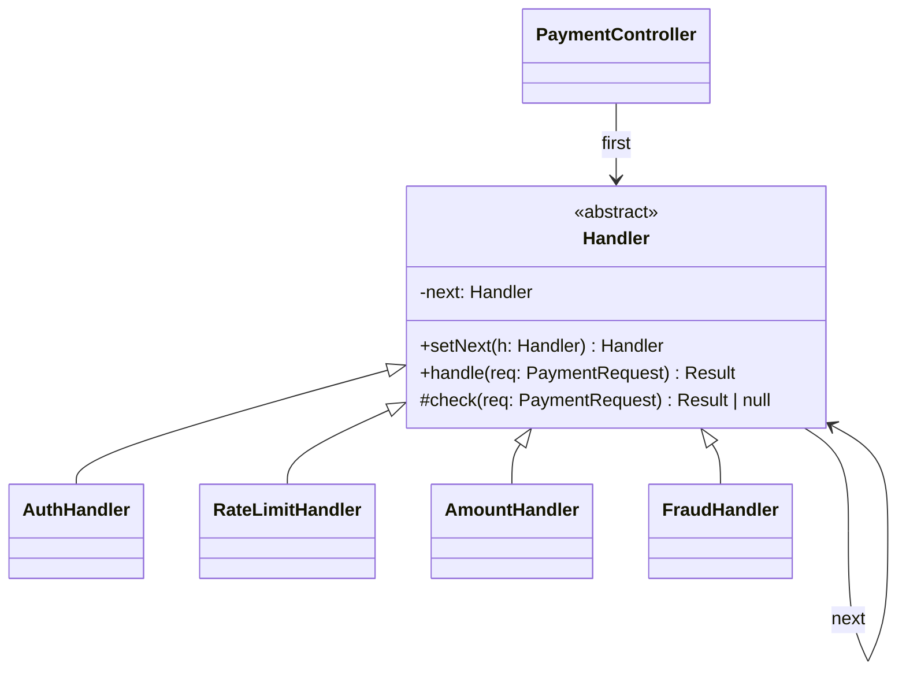

# L25 · Chain of Responsibility

> **Time:** ~30 min · **Visual:** [visual.html](visual.html) · **Code:** [demo.ts](demo.ts) (`npx tsx lld/4-behavioral/L25-chain-of-responsibility/demo.ts`)
> **Builds on:** [L14 Decorator](../../3-structural/L14-decorator/README.md) · [L04 SOLID: SRP and OCP](../../1-foundations/L04-solid-srp-ocp/README.md) · **Used in:** [03 Logger](../../problems/03-logger/README.md), [11 ATM](../../problems/11-atm/README.md) (note dispensers), [20 Cart with Coupons](../../problems/20-ecommerce-cart-coupons/README.md), [04 Rate Limiter](../../problems/04-rate-limiter/README.md), [Payment System](../../../hld/case-studies/08-payment-system/README.md)

## The idea in one line

Send a request down a line of handlers; each one either handles it (and can stop it) or passes it to the next one, so the sender never needs to know who will deal with it.

## Why it matters (the problem it solves)

Real requests go through many checks before the real work: auth, rate limit, validation, fraud, then the handler. Written inline, it becomes one fat function:

```ts
// Before: every check hard-coded, in a fixed order, in one place
async function createPayment(req: PaymentRequest): Promise<Result> {
  if (!req.token) return { ok: false, error: 'unauthorized' };
  if (await rateLimiter.isLimited(req.userId)) return { ok: false, error: 'rate limited' };
  if (req.amount <= 0 || req.amount > 200_000) return { ok: false, error: 'invalid amount' };
  if ((await fraud.score(req)) > 0.9) return { ok: false, error: 'blocked' };
  return gateway.charge(req);
}
// New check = edit this function (breaks OCP).
// Refund endpoint needs auth + limits but no fraud -> copy-paste half of it.
// Testing "fraud" alone means faking auth and rate limit too.
```

With a chain, each check is a small class or function with one job. Each endpoint assembles its own chain from the same parts.

## How it works

### Two shapes you must know

**1. GoF object chain (linked handlers).** Each handler holds a `next` reference.

```
client --> [Auth] --next--> [RateLimit] --next--> [Amount] --next--> [Fraud] --next--> (final: charge)
             |                   |                    |                 |
          reject 401          reject 429           reject 400        reject 403
```

**2. Middleware / pipeline chain (Express, Koa, NestJS).** Handlers are functions `(req, next) => ...`; a small runner calls them in order.

```
            Koa "onion": code after await next() runs on the way back
  logTiming ----------------------------------------------> logTiming (after)
     auth -------------------------------------------> auth (after)
        limits -------------------------------> limits (after)
                      charge (final handler)
```

### Class diagram



### The three questions every chain must answer

| Question | Options | Example |
|---|---|---|
| Who stops? | First handler that handles it stops (pure CoR) / every handler runs (pipeline) | Auth stops on bad token; logger runs for every request |
| What happens at the end? | Final handler, default answer, or error | Express returns 404 if no route matched; ATM throws "cannot dispense" |
| Who builds the order? | Code (`a.setNext(b).setNext(c)`), config, or DI module | NestJS order: middleware, guards, interceptors (before), pipes, handler, interceptors (after), filters |

**Order matters.** Cheap checks first (auth, schema) and expensive ones last (fraud call: ~50 ms). Rate limit before heavy work so attackers cannot make you burn CPU.

### Variants you will meet

- **Handle-and-stop** (classic): support escalation L1 -> L2 -> manager; only one handles it.
- **Handle-partly-and-pass**: ATM dispenser. ₹3,700 -> 2000 handler gives 1 note, passes 1,700; 500 handler gives 3, passes 200; 200 handler gives 1. Done.
- **Everyone may act**: logger with DEBUG / INFO / ERROR sinks, each writes if the level is high enough, then passes on.
- **Around (onion)**: Koa / NestJS interceptors run code before and after `next()`, like a decorator.

### Chain vs Decorator vs Pipeline

| | Chain of Responsibility | Decorator (L14) | Pipeline |
|---|---|---|---|
| Can a link stop the request? | Yes, that is the point | No, it always calls the wrapped object | Usually no |
| Typical job | Decide who handles it / reject early | Add behaviour around one call | Transform data step by step |
| Example | Express middleware, ATM notes | Retry + logging around a notifier | ETL, RxJS `pipe` |

### How to spot it in a problem statement

- "a request goes through several checks / approvals / levels".
- "the set of rules changes per endpoint / per customer / by config".
- "escalate if the first level cannot handle it".
- "dispense using the largest notes first", "log to console, file, and alerting by level", "apply discount rules in order".

## In TypeScript

Middleware style (the one you will write most):

```ts
type Next = () => Promise<Result>;
type Middleware = (req: PaymentRequest, next: Next) => Promise<Result>;

function compose(mws: Middleware[], final: (req: PaymentRequest) => Promise<Result>) {
  return (req: PaymentRequest) => {
    const run = (i: number): Promise<Result> =>
      i === mws.length ? final(req) : mws[i]!(req, () => run(i + 1));
    return run(0);
  };
}

const auth: Middleware = async (req, next) => (req.token ? next() : { ok: false, error: 'unauthorized' });
const limits: Middleware = async (req, next) =>
  req.amount > 0 && req.amount <= 200_000 ? next() : { ok: false, error: 'invalid amount' };

const createPayment = compose([auth, rateLimit, limits, fraud], charge);
const refund = compose([auth, limits], refundCharge); // same parts, different chain
```

GoF style (good for the ATM problem):

```ts
abstract class NoteHandler {
  private next?: NoteHandler;
  setNext(h: NoteHandler): NoteHandler { this.next = h; return h; } // returns h so you can chain calls
  dispense(amount: number, out: Map<number, number>): void {
    const left = this.take(amount, out);
    if (left === 0) return;
    if (!this.next) throw new Error(`cannot dispense ${left}`);
    this.next.dispense(left, out);
  }
  protected abstract take(amount: number, out: Map<number, number>): number;
}
// n2000.setNext(n500).setNext(n200).setNext(n100);
```

Runnable version with both, plus an Express-style error path: [demo.ts](demo.ts).

## Trade-offs / when NOT to use it

- **Two fixed steps that never change**: just call them. A chain adds indirection.
- **Debugging is harder**: "which link rejected my request?" Log the handler name on every reject.
- **Silent fall-through**: if no handler handles it and there is no default, the request is lost. In Express, a middleware that neither responds nor calls `next()` hangs the request until timeout.
- **Hidden order dependency**: `fraud` may need `req.user` set by `auth`. Document it or check it, otherwise reordering breaks things.
- **Greedy chains can fail**: ATM with notes 500 and 200 and amount 600: greedy takes one 500 and is stuck at 100, but 3 x 200 works. Plan first, then commit.

## Common mistakes

- Calling `next()` **and** returning a response (double reply: "headers already sent" in Express).
- Forgetting `return` before `next()` and running code after it by accident.
- Building the chain inside the request handler on every call instead of once at startup.
- Putting business logic (the actual charge) inside a "check" link. Keep a separate final handler.
- Mixing up CoR and Decorator in the interview. Say: "a chain link may stop; a decorator always forwards".
- Mutating shared state in a link (the ATM removing notes before it knows the full amount can be paid).

## Say this in the interview

> "The checks before a payment are a chain of responsibility: auth, rate limit, amount limits, fraud, then the charge. Each link has one job and either rejects with a clear error or calls next. It is the same model as Express middleware and NestJS guards. Each endpoint composes its own chain from the same links, so refund can skip fraud. I put cheap checks first and the 50 ms fraud call last."

> "For the ATM, the dispensers are a chain from ₹2000 down to ₹100. Each takes as many notes as it can and passes the rest. I compute the plan first and only remove notes from the cassettes if the whole amount works, so a failed request changes nothing."

## Your experience hook

- Your Express API Gateway (SenseGrass) was a chain: JWT auth, rate limiting, LRU response cache, then reverse-proxy routing. The cache link can stop the chain early with a hit; that is CoR, not just a pipeline.
- In the payment orchestration service, the webhook path is a chain too: verify signature, dedupe by provider event id (stop if seen), then process. Dedupe as an early "stop" link is a strong story.
- NestJS guards and interceptors you use daily are a framework-built chain; mention the order (middleware, guards, interceptors, pipes, handler).

## Self-test

<details><summary>1. Chain of Responsibility vs Decorator in one sentence?</summary>A chain link may stop the request; a decorator always calls the wrapped object and only adds behaviour around it.</details>

<details><summary>2. In Express, what happens if a middleware neither responds nor calls next()?</summary>The request hangs until the client or server times out.</details>

<details><summary>3. Dispense ₹3,700 with 2000, 500, 200, 100 notes (plenty of each).</summary>1 x 2000 + 3 x 500 + 1 x 200 = 3,700.</details>

<details><summary>4. Why should setNext return the handler you passed in?</summary>So you can write <code>a.setNext(b).setNext(c)</code> and build the chain in one readable line.</details>

<details><summary>5. Where do you put a fraud check that costs 50 ms, and why?</summary>Near the end, after cheap checks like auth, schema and rate limit. Most bad requests are rejected cheaply and never pay the 50 ms.</details>

<details><summary>6. How do you test a chain?</summary>Test each link alone with a fake <code>next</code> (assert it was or was not called). Then one test for the assembled order and one for the "falls off the end" case.</details>

<details><summary>7. Logger with DEBUG, INFO, ERROR handlers: does a message stop at the first match?</summary>Usually no: each sink writes if its level allows and then passes the message on. It is the "everyone may act" variant.</details>

## Go deeper

- Build it: [11 ATM](../../problems/11-atm/README.md), [03 Logger](../../problems/03-logger/README.md), [20 Cart with Coupons](../../problems/20-ecommerce-cart-coupons/README.md)
- System level: [H06 Proxies and API gateway](../../../hld/1-basics/H06-proxies-api-gateway/README.md) (gateway filters are a chain), [Rate Limiter case study](../../../hld/case-studies/02-rate-limiter/README.md)
- Compare: [L14 Decorator](../../3-structural/L14-decorator/README.md)
- Long notes: [LLD guide](../../../archive/notes/LLD-guide.md) (search "Chain of Responsibility Pattern")
- GoF Design Patterns, "Chain of Responsibility"
