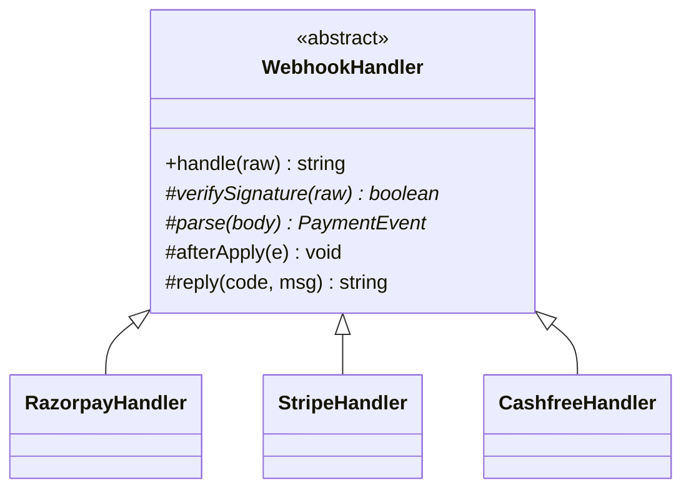

# L26 · Template Method

> **Time:** ~35 min · **Visual:** [visual.html](visual.html) · **Code:** [demo.ts](demo.ts) (`npx tsx lld/4-behavioral/L26-template-method/demo.ts`)
> **Builds on:** [L03 Composition over inheritance](../../1-foundations/L03-composition-over-inheritance/README.md) · [L20 Strategy](../L20-strategy/README.md) · **Used in:** Notification Service, Logger, ATM, File System

## The idea in one line

A base class owns the steps of an algorithm and their order in one method. Subclasses fill in some steps, but they cannot change the order or skip the shared ones.

## Why it matters (the problem it solves)

You have three payment providers. Each one sends webhooks. Every webhook must go through the same flow: verify the signature, parse the body, drop duplicates, update the payment, reply. Only two steps differ per provider: how to verify, and how to parse.

Without a shared skeleton, each handler copies the whole flow. After six months they drift. One handler forgets the duplicate check, and a retried webhook marks a payment as paid twice. Template Method puts the flow in one place, so the shared steps (dedupe, audit, metrics) always run.

## How it works

### Before: every variant copies the flow

```ts
class RazorpayWebhook {
  handle(raw: RawWebhook) {
    if (raw.headers['x-razorpay-signature'] !== sign(raw.body)) return 401;
    const e = parseRazorpay(raw.body);
    if (seen.has(e.eventId)) return 200;        // dedupe
    seen.add(e.eventId);
    db.update(e.paymentId, e.status);
    return 200;
  }
}
class StripeWebhook {
  handle(raw: RawWebhook) {
    if (!verifyStripe(raw)) return 401;
    const e = parseStripe(raw.body);
    db.update(e.paymentId, e.status);           // forgot dedupe: double credit on retry
    return 200;
  }
}
```

### After: the base class owns the skeleton

```ts
abstract class WebhookHandler {
  handle(raw: RawWebhook): string {             // the template method
    if (!this.verifySignature(raw)) return this.reply(401, 'bad signature');
    const e = this.parse(raw.body);
    if (seen.has(e.eventId)) return this.reply(200, 'duplicate');
    seen.add(e.eventId);
    db.set(e.paymentId, e.status);
    this.afterApply(e);                         // hook
    return this.reply(200, 'ok');
  }
  protected abstract verifySignature(raw: RawWebhook): boolean;  // required
  protected abstract parse(body: string): PaymentEvent;          // required
  protected afterApply(_e: PaymentEvent): void {}                // hook
  protected reply(code: number, msg: string) { return `${code} ${msg}`; } // default
}
```

### Three kinds of steps

| Kind | In the base class | Subclass | Example |
|---|---|---|---|
| Fixed step | concrete, private or not meant to change | does not touch it | dedupe, DB update |
| Abstract step | `protected abstract` | must implement | `verifySignature`, `parse` |
| Default step | concrete `protected` | may override, may call `super` | `reply`, `render` |
| Hook | empty `protected` method | may override to add behaviour | `afterApply`, `beforeSave` |

### Who calls whom (the Hollywood principle)

```
  caller ──handle()──▶ WebhookHandler.handle()        "don't call us, we'll call you"
                          │ 1. this.verifySignature()  ──▶ StripeHandler
                          │ 2. this.parse()            ──▶ StripeHandler
                          │ 3. dedupe                  (base, fixed)
                          │ 4. db update               (base, fixed)
                          │ 5. this.afterApply()       ──▶ StripeHandler (hook, optional)
                          ▼ 6. this.reply()            (base default)
```

The subclass never calls the base flow. The base calls down into the subclass. That is why frameworks are built this way: the framework runs the lifecycle and calls your overrides.

### Class diagram



```
        ┌──────────────────────────────┐
        │ «abstract» WebhookHandler    │
        │ + handle(raw)   ← template   │
        │ # verifySignature()  abstract│
        │ # parse()            abstract│
        │ # afterApply()       hook    │
        └──────────────▲───────────────┘
           ┌───────────┼────────────┐
   RazorpayHandler  StripeHandler  CashfreeHandler
```

### No `final` in TypeScript

Java has `final` to stop a subclass from overriding `handle()`. TypeScript does not. Options:
1. Document it and enforce in review ("never override `handle`").
2. Keep the skeleton in a function that takes the steps as an object (composition). Nothing to override.
3. Make the steps `protected` so outside code cannot call them out of order.

### Composition version (often better)

```ts
interface WebhookSteps { verify(raw: RawWebhook): boolean; parse(body: string): PaymentEvent }
class WebhookProcessor {
  constructor(private steps: WebhookSteps) {}
  handle(raw: RawWebhook) { /* same fixed order, calls this.steps.verify / parse */ }
}
```

This is Template Method's skeleton plus Strategy's injected steps. You can test each step alone and swap them at runtime.

### How to spot it in a problem statement

- "All channels/providers/report types follow the same steps, only X differs."
- "Every request must be validated and audited." (shared steps that must not be skipped)
- "Add a new provider without changing the flow."
- You see two classes with the same method body except for two lines.

### Where you already use it

- **Node streams:** `Readable` calls your `_read()`, `Transform` calls `_transform()` and `_flush()`.
- **NestJS lifecycle:** the framework calls `onModuleInit`, `onApplicationBootstrap`, `onModuleDestroy` in a fixed order. These are hooks.
- **Test runners:** `beforeEach` / `afterEach` around each test.
- **ORMs:** `beforeInsert` / `afterLoad` hooks in TypeORM entities.

## In TypeScript

```ts
class StripeHandler extends WebhookHandler {
  protected readonly name = 'stripe';
  protected verifySignature(raw: RawWebhook) { return raw.headers['stripe-signature']?.startsWith('t=') ?? false; }
  protected parse(body: string): PaymentEvent {
    const j = JSON.parse(body);
    return { eventId: j.id, paymentId: j.data.object.metadata.paymentId,
             status: j.type === 'payment_intent.succeeded' ? 'SUCCESS' : 'FAILED' };
  }
  protected afterApply(e: PaymentEvent) {            // hook: only Stripe needs it
    if (e.status === 'FAILED') alertOnCall(e.paymentId);
  }
}
```

The full runnable version, with a retried webhook being dropped by the shared dedupe step, is in [demo.ts](demo.ts).

## Trade-offs / when NOT to use it

| Use Template Method when | Prefer something else when |
|---|---|
| The steps and their order are stable | The varying part must be picked at runtime: use Strategy |
| Shared steps must always run (audit, dedupe, metrics) | Variants need different orders: the skeleton is wrong |
| 2–5 variants, one level of inheritance | Hierarchy grows deep (`Base → Txn → OtpSms`): nobody knows what runs |
| You are writing a framework-like base | You need to mix parts freely (Email + SMS retry policy): compose |

Inheritance is the cost. A subclass is tied to every detail of the base class. Change the base, and all subclasses may break (the "fragile base class" problem).

## Common mistakes

- **Overriding the template method itself.** Then the guarantee is gone. Keep `handle()` off-limits.
- **Too many abstract steps.** If every step is abstract, there is no shared code. You just have an interface.
- **Calling `super.handle()` from a subclass** to "add a bit". Use a hook instead.
- **Hooks with surprising side effects**, such as a hook that throws and stops the flow halfway after the DB write.
- **Deep chains of subclasses**, each overriding one step. Flatten it or switch to composition.
- **Confusing it with Strategy.** Template Method = inheritance, the skeleton is in the base. Strategy = composition, the whole algorithm is swapped.

## Say this in the interview

> "Every provider's webhook follows the same flow: verify the signature, parse, drop duplicates by event id, update the payment, reply. I'll put that flow in an abstract `WebhookHandler.handle()`, so the order and the dedupe step can never be skipped. Each provider only implements `verifySignature` and `parse`. If one provider needs an extra action, like alerting on failures, it overrides the `afterApply` hook."

> "TypeScript has no `final`, so if I worry about someone overriding `handle()`, I'd keep the skeleton in one `WebhookProcessor` class and inject the provider steps as a strategy. Same guarantee, but composition instead of inheritance."

## Your experience hook

- In the payment orchestration service with 3 providers, every webhook had to be verified, deduped by provider event id and applied in a transaction. That shared flow is a template method; the per-provider parsing sat in adapters.
- In NestJS you already rely on this every day: lifecycle hooks like `onModuleInit` are hook methods the framework calls in a fixed order.

## Self-test

<details><summary>1. Name the kinds of steps in a template method.</summary>

Fixed steps (base only), abstract steps (subclass must implement), default steps (subclass may override), and hooks (empty by default, optional to override).
</details>

<details><summary>2. What is the Hollywood principle?</summary>

"Don't call us, we'll call you." The base class calls the subclass steps. The subclass never drives the flow.
</details>

<details><summary>3. Template Method vs Strategy: what is the core difference?</summary>

Template Method uses inheritance and varies steps inside a fixed skeleton. Strategy uses composition and swaps a whole algorithm object, possibly at runtime.
</details>

<details><summary>4. In a Node Transform stream, which methods are the steps you fill in?</summary>

`_transform(chunk, encoding, callback)` and optionally `_flush(callback)`. Node runs the stream machinery and calls them.
</details>

<details><summary>5. A new provider needs to send a delivery receipt after the update. How?</summary>

Override the `afterApply` hook in that provider's subclass. The skeleton does not change.
</details>

<details><summary>6. How do you stop a subclass from overriding the template method in TS?</summary>

There is no `final`. Use a review or lint rule, or move the skeleton into a class or function that receives the steps (composition), so there is nothing to override.
</details>

<details><summary>7. What is the fragile base class problem?</summary>

Subclasses depend on the base class internals. A change in the base (new step, changed order) can silently break every subclass.
</details>

## Go deeper

- Build it: [05 Notification Service](../../problems/05-notification-service/README.md) (`BaseChannel` runs validate, render, deliver), [03 Logger](../../problems/03-logger/README.md), [11 ATM](../../problems/11-atm/README.md), [24 File System](../../problems/24-file-system/README.md)
- Compare with: [L20 Strategy](../L20-strategy/README.md), [L25 Chain of Responsibility](../L25-chain-of-responsibility/README.md)
- Long-form notes: [LLD guide](../../../archive/notes/LLD-guide.md)
