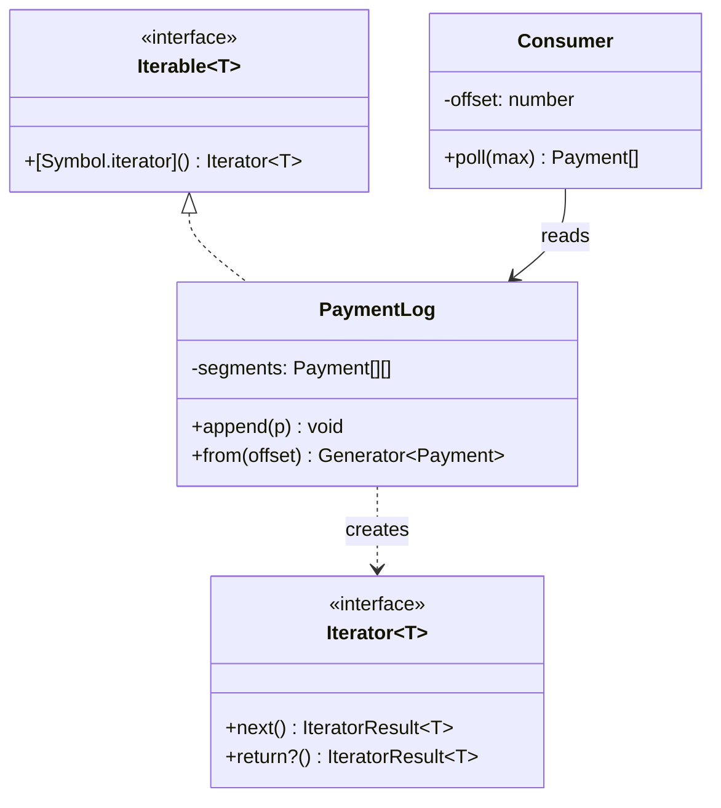

# L27 · Iterator (and JS generators)

> **Time:** ~40 min · **Visual:** [visual.html](visual.html) · **Code:** [demo.ts](demo.ts) (`npx tsx lld/4-behavioral/L27-iterator/demo.ts`)
> **Builds on:** [L01 Classes and interfaces](../../1-foundations/L01-classes-and-interfaces/README.md) · [L17 Composite](../../3-structural/L17-composite/README.md) · **Used in:** Pub-Sub Queue, File System, LRU Cache, Library Management

## The idea in one line

Give callers a way to walk through a collection one item at a time, without showing them how the collection is stored.

## Why it matters (the problem it solves)

A collection's insides change. Today the message log is an array. Tomorrow it is split into segments of 1,000 so old segments can be deleted. Next month it is a ring buffer. If every consumer loops over `log.segments[i][j]`, every consumer breaks each time.

The Iterator pattern puts the "how do I walk this" logic inside the collection. Callers only ask for "the next item". In JavaScript this pattern is part of the language: the **iteration protocol**, **generators** and **async iterators**. Most interviewers expect you to use them, not to hand-write a Java-style `hasNext()` class.

## How it works

### Before: callers know the layout

```ts
class PaymentLog {
  segments: Payment[][] = [[]];             // public internals
}
for (const seg of log.segments)              // every caller repeats this
  for (const p of seg) reconcile(p);
// switch to a linked list → every caller breaks
```

### After: the collection is iterable

```ts
class PaymentLog implements Iterable<Payment> {
  private segments: Payment[][] = [[]];
  *[Symbol.iterator](): Generator<Payment> {   // default walk
    for (const seg of this.segments) yield* seg;
  }
  *from(offset: number): Generator<Payment> {  // a second walk
    let i = 0;
    for (const p of this) if (i++ >= offset) yield p;
  }
}
for (const p of log) reconcile(p);             // for..of, spread, Array.from, destructuring
```

### The protocol (what `for..of` really calls)

```
 for (const x of coll) { ... }
        │
        ▼
 it = coll[Symbol.iterator]()     ← Iterable: "give me a fresh cursor"
        │
        ▼
 loop: r = it.next()              ← Iterator: the cursor
        r = { value: 3, done: false } → run the body with x = 3
        r = { value: 2, done: false } → run the body
        r = { done: true }            → stop
 on break/throw: it.return?.()    ← cleanup hook (generator `finally` runs)
```

| Term | What it is | Reusable? |
|---|---|---|
| **Iterable** | Has `[Symbol.iterator]()` that returns a new iterator | Yes, walk it many times |
| **Iterator** | Has `next()` → `{ value, done }` | No, it is used up when done |
| **Generator** | `function*`; returns an object that is both iterable and an iterator | One walk only |
| **Async iterable** | Has `[Symbol.asyncIterator]()`; `next()` returns a Promise | Used with `for await` |

### Generators: the iterator written for you

`yield` pauses the function and hands one value out. The next `next()` call resumes from that exact line. Local variables survive between calls. This makes generators **lazy**: they compute an item only when someone pulls it.

```
 caller             generator *from(4)
 next() ──────────▶ runs until first yield ─▶ { value: pay_5, done:false }
 next() ──────────▶ resumes, next yield     ─▶ { value: pay_6, done:false }
 (break) ─────────▶ return() → finally {}   ─▶ { done: true }
```

Laziness means you can walk an infinite sequence (`naturals()`), a 5 GB file, or 10 million DB rows without building an array.

### Async iterators: pagination without leaking cursors

```ts
async function* allPayments(api: Api): AsyncGenerator<Payment> {
  let cursor: string | undefined;
  try {
    do {
      const page = await api.list({ cursor, limit: 100 });
      yield* page.items;
      cursor = page.nextCursor;
    } while (cursor);
  } finally {
    // runs on normal end AND on break/throw in the caller
  }
}
for await (const p of allPayments(api)) reconcile(p);   // callers never see pages
```

If the caller breaks after 2 items, only one page is fetched. Pull-based = backpressure for free: the producer never runs ahead of the consumer.

### Class diagram



### How to spot it in a problem statement

- "Consumers read messages from an offset" (Pub-Sub, Kafka-like queue).
- "List all files under a folder", "depth-first / breadth-first" (File System, Composite).
- "Iterate entries from most to least recently used" (LRU Cache linked list).
- "Fetch all records from a paginated API", "process a huge file line by line".
- Any time you are tempted to return an internal array or expose `node.next`.

### Where you already use it

- `Map`, `Set`, arrays, strings are iterable. `map.entries()` returns an iterator.
- Node `Readable` streams are async iterable: `for await (const chunk of fs.createReadStream(p))`.
- `readline.createInterface({ input })` gives lines with `for await`.
- `events.on(emitter, 'data')` turns events into an async iterator.
- MongoDB cursors and many SDKs (Stripe `autoPagingEach`) expose async iteration.

## In TypeScript

```ts
// Two walks over a tree (Composite + Iterator)
class Folder {
  constructor(public name: string, public children: Folder[] = []) {}
  *depthFirst(): Generator<Folder> {
    yield this;
    for (const c of this.children) yield* c.depthFirst();
  }
  *breadthFirst(): Generator<Folder> {
    const queue: Folder[] = [this];
    while (queue.length) { const f = queue.shift()!; yield f; queue.push(...f.children); }
  }
}

// Lazy pipeline: nothing runs until [...] pulls
function* take<T>(src: Iterable<T>, n: number) { let i = 0; for (const x of src) { if (i++ >= n) return; yield x; } }
const firstThree = [...take(log.from(100), 3)];
```

[demo.ts](demo.ts) runs all of this: the hand-written protocol, laziness on an infinite generator, one-shot generators, and async pagination that stops fetching on `break`.

## Trade-offs / when NOT to use it

| Use it when | Skip it when |
|---|---|
| The internal layout is non-trivial or may change | A plain array is fine: return `readonly T[]` |
| There are several ways to walk (offset, DFS, BFS) | You need random access by index (`arr[i]`) |
| Data is large, infinite or arrives over time | You need the length up front (iterators do not know it) |
| You want callers to stop early cheaply | You need to walk twice: store an iterable, not a generator |

- Generators are slower than a raw `for` loop on hot paths (millions of items per second). Usually it does not matter. Measure first.
- `[...gen]` on an infinite generator hangs. Always `take()` first.

## Common mistakes

- **Writing a Java-style `hasNext()/next()` class.** In TS a generator is shorter and works with `for..of`, spread and destructuring.
- **Reusing a generator object.** It is one-shot. The second loop gets nothing. Return a fresh generator per call, or expose an iterable.
- **Changing the collection during iteration** without a rule. Decide: snapshot, or "see new items", and test it.
- **Forgetting cleanup.** Put resource release in `finally` inside the generator. It runs on `break` too.
- **`Array.from(asyncGen)`**: does not work. Use `for await` or `Array.fromAsync` (Node 22+).
- **Fetching all pages into an array first**, then looping. You lose laziness and blow memory on large accounts.

## Say this in the interview

> "The topic stores messages in segments, but consumers should not know that. So the topic is iterable through a generator, and each consumer group keeps its own offset, like Kafka. `poll(n)` reads the next n messages from that offset and then moves the offset. Generators are lazy, so reading from an offset does not copy the log."

> "For the reconciliation job I would wrap the provider's cursor pagination in an async generator. The job just does `for await (const p of allPayments())`. It never sees cursors, it fetches the next page only when it needs it, and if it stops early the `finally` block closes the connection."

## Your experience hook

- The payment orchestration service had to reconcile against 3 providers. A provider "list transactions" API is cursor-paginated: an async generator per provider hides the cursor format behind one `for await` loop.
- For the 10k IoT devices, a Redis-queue batch reader that yields batches of readings (`async *batches(size)`) is an iterator: the DB writer pulls the next batch only when the last insert is done, which is backpressure.

## Self-test

<details><summary>1. Iterable vs iterator: what is the difference?</summary>

An iterable has `[Symbol.iterator]()` and gives a fresh iterator each time, so it can be walked many times. An iterator is the cursor with `next()`; once `done` is true it is used up.
</details>

<details><summary>2. Why does the second <code>[...gen]</code> on the same generator return an empty array?</summary>

A generator object is its own iterator, and it is already finished. Call the generator function again to get a new one.
</details>

<details><summary>3. What happens when you <code>break</code> out of a <code>for..of</code> over a generator?</summary>

The loop calls the iterator's `return()`. The generator stops at its current `yield` and runs its `finally` blocks. That is where you close files or DB cursors.
</details>

<details><summary>4. Write the signature of an async generator that yields rows page by page.</summary>

`async function* rows(): AsyncGenerator<Row> { ... yield* page.items ... }` and consume it with `for await (const r of rows())`.
</details>

<details><summary>5. Why is <code>for await (const line of rl)</code> better than <code>readFileSync</code> for a 5 GB log?</summary>

It reads chunk by chunk, so memory stays small, and it pulls only as fast as the loop body runs (backpressure).
</details>

<details><summary>6. File system: how do you offer both DFS and BFS?</summary>

Two generator methods on the folder: `*depthFirst()` with recursion and `yield*`, and `*breadthFirst()` with a queue.
</details>

<details><summary>7. How do consumer groups read the same log at their own pace?</summary>

The log is shared and append-only. Each group stores its own offset (its iterator position). Committing the offset after processing gives at-least-once delivery.
</details>

## Go deeper

- Build it: [15 Pub-Sub Queue](../../problems/15-pub-sub-queue/README.md) (offsets), [24 File System](../../problems/24-file-system/README.md) (tree walks), [02 LRU Cache](../../problems/02-lru-cache/README.md) (ordered walk), [12 Library Management](../../problems/12-library-management/README.md)
- Related: [L17 Composite](../../3-structural/L17-composite/README.md), [H21 Kafka deep dive](../../../hld/4-async/H21-kafka/README.md) (offsets), [H36 Batch and stream processing](../../../hld/6-building-blocks/H36-batch-stream/README.md)
- Long-form notes: [LLD guide](../../../archive/notes/LLD-guide.md)
