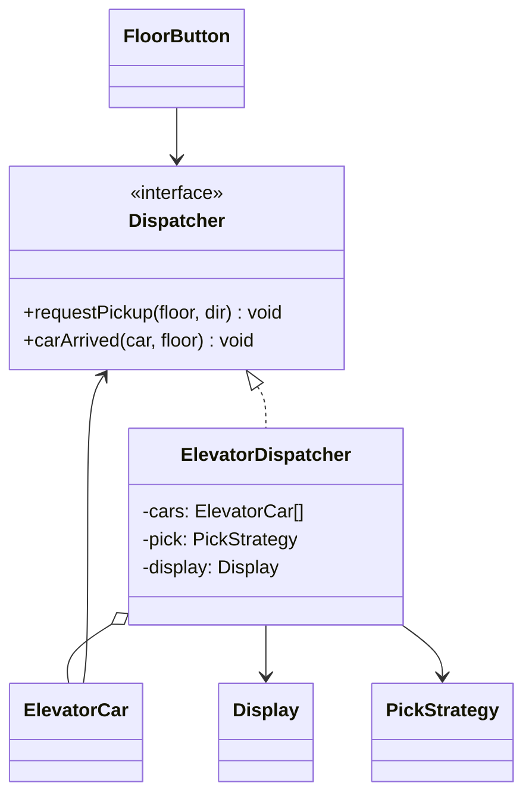

# L28 · Mediator

> **Time:** ~35 min · **Visual:** [visual.html](visual.html) · **Code:** [demo.ts](demo.ts) (`npx tsx lld/4-behavioral/L28-mediator/demo.ts`)
> **Builds on:** [L21 Observer and pub-sub](../L21-observer/README.md) · [L20 Strategy](../L20-strategy/README.md) · [L15 Facade](../../3-structural/L15-facade/README.md) · **Used in:** Elevator, Meeting Room Scheduler, Ride Sharing, Chat system

## The idea in one line

Objects do not talk to each other directly. They talk to one mediator object, and the mediator holds the rules of how they interact.

## Why it matters (the problem it solves)

When many objects call each other, every object must know every other object. With N components you get up to N x (N-1) / 2 links. The coordination rule (which elevator goes, who gets this chat message, which driver gets this rider) ends up copied in many classes.

```ts
// BEFORE: the button decides which car to send, and cars know each other and the display
class FloorButton {
  constructor(private cars: ElevatorCar[]) {}
  press(floor: number) {
    // dispatch rule lives in the button. The mobile app and admin panel copy it too.
    const car = this.cars.filter((c) => !c.maintenance)
      .sort((a, b) => Math.abs(a.floor - floor) - Math.abs(b.floor - floor))[0];
    car.addStop(floor);
  }
}
class ElevatorCar {
  constructor(private display: Display, private others: ElevatorCar[]) {}
  arrive(floor: number) {
    this.display.show(this.id, floor);         // car knows the display
    this.others.forEach((o) => o.forget(floor)); // and every other car
  }
}
```

Problems: change the dispatch rule and you edit three places. Add a new display type and every car changes. Testing one car needs all the others.

## How it works

### The shape

```
   BEFORE (mesh)                       AFTER (star)

  Btn1 ─── CarA ─── Display           Btn1    CarA    Display
   │  \   /  │  \  /                     \      |      /
   │   CarB ─┼── Btn2                     \     |     /
   │  /   \  │  /                     Btn2 ── Dispatcher ── CarB
  Btn3 ─── CarC                             /         \
                                         Btn3         CarC
  links: N(N-1)/2                      links: N
```

Each component (a "colleague" in GoF terms) holds one reference: the mediator. The mediator holds references to all colleagues. Calls go both ways:

1. A colleague tells the mediator something happened: `dispatcher.requestPickup(7, 'DOWN')`.
2. The mediator applies the rule and calls the right colleague: `carB.addStop(7)`.
3. The colleague reports back: `dispatcher.carArrived(carB, 7)`.
4. The mediator updates whoever else cares: `display.show('B', 7)`.

### Class diagram



Colleagues depend on the `Dispatcher` interface, not the concrete class. That is DIP: you can pass a fake dispatcher in a unit test of `ElevatorCar`.

### What goes where

| Lives in the colleague | Lives in the mediator | Lives in a Strategy |
|---|---|---|
| Its own state (car floor, stop list) | Who to tell when something happens | The decision rule (nearest car, same direction first) |
| Its own behaviour (move one floor) | Routing calls between colleagues | Swappable at runtime |
| Calls to the mediator | Cross-object rules (block list, mute) | |

This split is the key to avoiding a god class. The mediator routes. It does not move cars and it does not contain a 200-line scoring function.

### Mediator vs Observer vs Facade

| | Mediator | Observer | Facade |
|---|---|---|---|
| Direction | Two-way: colleagues call it, it calls them | One-way: subject to listeners | One-way: client to subsystem |
| Knows the others | Yes, by role | No, just a list of callbacks | Yes, but they do not know it |
| Holds logic | Interaction rules | None | A common flow |
| Example | Chat room, dispatcher, matcher | `order.on('paid', ...)` | `checkout()` wraps 5 services |

A mediator is often built with observer-style events inside (colleagues `emit`, mediator listens). The difference is intent: the mediator decides what happens next.

### How to spot it in a problem statement

- "When X happens, Y and Z must update, unless W" (rules across several objects).
- Words like dispatcher, scheduler, matcher, controller, room, hub, coordinator, air traffic control.
- Many-to-many: riders and drivers, requests and rooms, buttons and cars, users and users.
- UI forms: "if country is India, show PIN code and hide ZIP; disable submit until valid".

### In the Node and TS world

- A Socket.IO server is a mediator between clients: clients emit to the server, the server picks rooms and sockets.
- `@nestjs/cqrs` `CommandBus` and .NET MediatR send a request to a central bus that finds the handler.
- At system level, a saga orchestrator or an API gateway plays the same role between services.

## In TypeScript

```ts
interface Dispatcher {
  requestPickup(floor: number, dir: Direction): string;
  carArrived(car: ElevatorCar, floor: number): void;
}

class ElevatorDispatcher implements Dispatcher {
  private cars: ElevatorCar[] = [];
  constructor(private display: Display, private pick: PickStrategy) {}
  register(car: ElevatorCar) { this.cars.push(car); }
  requestPickup(floor: number, dir: Direction) {
    const car = this.pick(this.cars, floor);      // the one place with the rule
    if (!car) throw new Error('No elevator available');
    car.addStop(floor);
    return `pickup ${floor} ${dir} -> ${car.id}`;
  }
  carArrived(car: ElevatorCar, floor: number) {
    this.display.show(car.id, floor);              // cars never see the display
  }
}

class FloorButton {
  constructor(private floor: number, private dispatcher: Dispatcher) {}
  press(dir: Direction) { return this.dispatcher.requestPickup(this.floor, dir); }
}
```

Chat room version: `user.say(text)` calls `room.send(this, text)`. The room checks the mute list and each receiver's block list, then calls `receive()` on the allowed users. Users never hold references to each other. See [demo.ts](demo.ts) for both.

## Trade-offs / when NOT to use it

- **God object risk.** All the coupling moves into one class. If the mediator has 30 unrelated methods, split it (one per workflow) and push decisions into strategies.
- **Two objects with a simple link.** A `Cart` calling `PriceCalculator` does not need a mediator.
- **Fire-and-forget events.** If the sender does not care who reacts, Observer or an event bus is simpler.
- **Hidden flow.** Reading a colleague no longer shows what happens next; you must read the mediator. Good names and logs help.
- **Distributed systems.** In one process, a mediator is just an object. A central dispatcher service is a bottleneck and single point of failure; you shard it (for example by city for ride matching) and replicate it.

## Common mistakes

- Colleagues still keep references to each other "for speed". Then you have both a mesh and a mediator.
- Colleagues depend on the concrete `ElevatorDispatcher` instead of an interface, so tests need the full system.
- The mediator mutates colleague internals (`car.stops.push(...)`) instead of calling their methods.
- Calling it Observer. Observer has no coordination logic; the mediator does.
- Putting all the scoring and matching math inside the mediator. Extract a `PickStrategy` or `MatchStrategy`.
- Re-entrancy: mediator calls car, car calls mediator back, mediator calls car again. Keep callbacks simple, or queue events.

## Say this in the interview

> "Floor buttons and elevator cars don't talk to each other. They report to an `ElevatorDispatcher`, which is a mediator. The dispatcher picks a car using a pluggable strategy, like nearest idle car first, and updates the displays when a car arrives. That keeps the dispatch rule in one place and each car testable alone."

> "To stop the mediator from becoming a god class, I keep each car's movement inside `ElevatorCar`, the decision rule in a `PickStrategy`, and only routing in the dispatcher. If it grows, I split it per workflow."

> "Mediator versus Observer: Observer broadcasts to whoever listens and has no rules. A mediator knows the colleagues by role and decides who does what next."

## Your experience hook

- Mediasoup SFU: the room/router is a mediator. Peers never send media to each other directly; the server decides which producer streams go to which consumers, and handles mute and leave.
- WebSocket chat or IoT gateway: devices send to the hub, and the hub routes commands and fans out status to dashboards (10k+ devices never know about each other).
- Payment orchestration: the orchestrator sits between the order, the gateway adapters and the ledger, and decides retries and fallbacks.

## Self-test

<details><summary>1. Chat room: user A blocks user B. Where does that rule live, and why?</summary>

In the chat room (the mediator). It checks A's block list before delivering B's messages. Users hold no references to each other, so the rule cannot live anywhere else without bringing back the mesh.
</details>

<details><summary>2. 10 components. How many links with and without a mediator?</summary>

Without: up to 10 x 9 / 2 = 45 pairs. With: 10 links, one from each component to the mediator.
</details>

<details><summary>3. Mediator vs Observer in one sentence.</summary>

Observer broadcasts events to anyone listening and holds no rules; a mediator actively coordinates specific colleagues using rules.
</details>

<details><summary>4. Mediator vs Facade?</summary>

A facade is one-way: the client calls it, and the subsystems do not know it exists. With a mediator, colleagues know the mediator and call it, and it calls them back.
</details>

<details><summary>5. Your mediator class has 25 methods. What do you do?</summary>

Move decisions into strategies, keep state in colleagues, and split the mediator by workflow (for example `PickupDispatcher` and `MaintenanceCoordinator`).
</details>

<details><summary>6. Is the mediator a single point of failure?</summary>

In-process, no more than any object. As a distributed service, yes: replicate it, or shard it by key (city, room id) so each shard is small and can fail alone.
</details>

<details><summary>7. How do you unit test an ElevatorCar in this design?</summary>

Pass a fake `Dispatcher` that records `carArrived` calls. Because the car depends only on the interface, no other car or display is needed.
</details>

## Go deeper

- Build it: [10 Elevator](../../problems/10-elevator/README.md), [21 Meeting Room Scheduler](../../problems/21-meeting-room-scheduler/README.md), [17 Ride Sharing](../../problems/17-ride-sharing/README.md)
- System scale: [HLD case study 06 Chat system](../../../hld/case-studies/06-chat-system/README.md)
- Related: [L21 Observer](../L21-observer/README.md), [L20 Strategy](../L20-strategy/README.md), [L15 Facade](../../3-structural/L15-facade/README.md)
- GoF Design Patterns, "Mediator"
