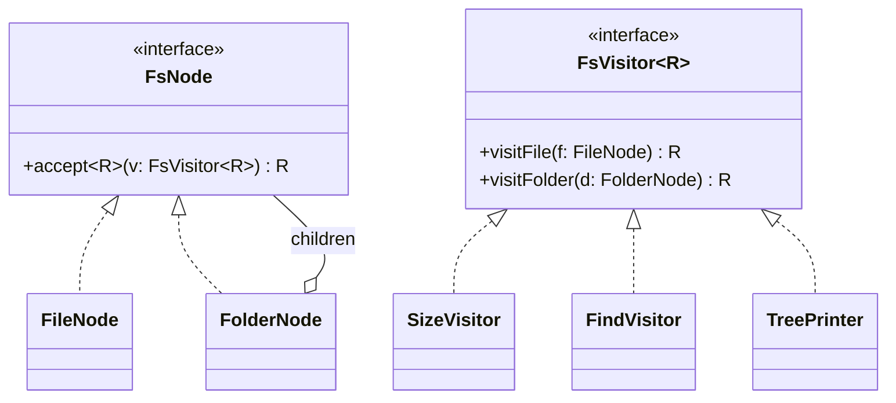

# L29 · Visitor

> **Time:** ~40 min · **Visual:** [visual.html](visual.html) · **Code:** [demo.ts](demo.ts) (`npx tsx lld/4-behavioral/L29-visitor/demo.ts`)
> **Builds on:** [L17 Composite](../../3-structural/L17-composite/README.md) · [L27 Iterator](../L27-iterator/README.md) · [L04 SOLID: SRP and OCP](../../1-foundations/L04-solid-srp-ocp/README.md) · **Used in:** File System, E-commerce Cart and Coupons, Text Editor (export), compilers and linters

## The idea in one line

Keep a stable set of element classes, and add new operations over them as separate visitor classes, without editing the elements.

## Why it matters (the problem it solves)

You have a tree or a list of mixed objects (files and folders, AST nodes, cart items). The set of types rarely changes. The set of operations keeps growing: size, search, export to JSON, permissions check, tax, shipping, render. If every operation is a method on every class, each new feature touches every class.

```ts
// BEFORE: every new operation is a new method on every node class
class FileNode {
  size() { return this.bytes; }
  find(ext: string) { /* ... */ }
  toJson() { /* ... */ }
  virusScan() { /* ... */ }        // security team's feature lives in the File class
}
class FolderNode {
  size() { return this.children.reduce((s, c) => s + c.size(), 0); }
  find(ext: string) { /* ... */ }
  toJson() { /* ... */ }
  virusScan() { /* ... */ }
}
// Or the other "before": one function with instanceof chains, easy to miss a type
function size(n: FsNode): number {
  if (n instanceof FileNode) return n.bytes;
  if (n instanceof FolderNode) return n.children.reduce((s, c) => s + size(c), 0);
  return 0; // a new SymlinkNode silently returns 0
}
```

Node classes grow without limit (SRP broken), and each feature is spread across many files. The `instanceof` version silently forgets new types.

## How it works

### Double dispatch

TypeScript (like Java) picks a method by the runtime type of **one** object: the receiver. A visitor needs to pick by **two** types: which node and which operation. It does that with two calls.

```
client             node (runtime: FileNode)        visitor (runtime: SizeVisitor)
  │  node.accept(v)        │                               │
  │───────────────────────▶│  dispatch 1: FileNode.accept  │
  │                        │  v.visitFile(this)            │
  │                        │──────────────────────────────▶│ dispatch 2: SizeVisitor.visitFile
  │                        │                               │ return this.bytes
  │◀───────────────────────┴───────────────────────────────│
```

1. `node.accept(v)` runs the `accept` of the node's real class. That class knows its own type.
2. Inside, it calls the matching method on the visitor: `v.visitFile(this)`. That runs the method of the visitor's real class.

Result: the code that runs depends on both (node type, visitor type). It is a 2D table:

| | SizeVisitor | FindVisitor | JsonExporter |
|---|---|---|---|
| FileNode | `bytes` | match name | `{type:'file'}` |
| FolderNode | sum of children | recurse with path | `{type:'dir', children}` |

Adding a **column** (operation) = one new visitor class, no node edits. Adding a **row** (node type) = edit every visitor. Pick Visitor only when columns change more often than rows.

### Class diagram



Visitor and [Composite](../../3-structural/L17-composite/README.md) are a natural pair: the composite gives the tree, the visitor walks it with a new operation each time.

### Who walks the tree?

| Option | How | When |
|---|---|---|
| Visitor recurses | `visitFolder` calls `child.accept(this)` | Operation needs control (skip a subtree, track depth) |
| Element recurses | `FolderNode.accept` visits children itself | Every visitor walks the same way |
| Separate iterator | Iterator yields nodes, visitor handles one | Flat processing, streaming |

### The TypeScript-native alternative: discriminated union

In TS, data is often plain objects with a `kind` tag. Then you get the same benefit with a `switch` and the `never` trick, with no `accept` boilerplate:

```ts
type CartItem =
  | { kind: 'physical'; price: number; weightKg: number }
  | { kind: 'digital'; price: number }
  | { kind: 'giftCard'; price: number };

function assertNever(x: never): never { throw new Error('Unhandled ' + JSON.stringify(x)); }

function gstRate(item: CartItem): number {
  switch (item.kind) {
    case 'physical': return 0.18;
    case 'digital': return 0.18;
    case 'giftCard': return 0;
    default: return assertNever(item); // compile error if a kind is missing
  }
}
```

Each function is one "visitor". Adding a new `kind` makes `tsc` flag every switch that misses it, which is the safety the classic pattern gives you through the interface. ESLint's `switch-exhaustiveness-check` does the same.

### Where you meet it in real code

- Compilers and linters: Babel plugins and ESLint rules are visitors (`{ Identifier(path) {...}, CallExpression(path) {...} }`). The TypeScript compiler uses `forEachChild` plus `switch (node.kind)`.
- GraphQL `visit(ast, { Field: {...} })`, PostCSS walkers, Markdown renderers (same AST, many output formats).
- Reports and exports: one model, many exporters (CSV, PDF, JSON).

### How to spot it in a problem statement

- "A tree or list of a few fixed types" plus "many different operations / reports / exports over it".
- "Calculate X for every node, also Y, and later we will add Z".
- Words: AST, expression, document elements, shapes (area, perimeter, draw), file system (size, search, permissions).

## In TypeScript

```ts
interface FsVisitor<R> { visitFile(f: FileNode): R; visitFolder(d: FolderNode): R; }

class FileNode {
  constructor(readonly name: string, readonly bytes: number) {}
  accept<R>(v: FsVisitor<R>): R { return v.visitFile(this); }
}
class FolderNode {
  constructor(readonly name: string, readonly children: (FileNode | FolderNode)[] = []) {}
  accept<R>(v: FsVisitor<R>): R { return v.visitFolder(this); }
}

class SizeVisitor implements FsVisitor<number> {
  visitFile(f: FileNode) { return f.bytes; }
  visitFolder(d: FolderNode) { return d.children.reduce((s, c) => s + c.accept(this), 0); }
}

root.accept(new SizeVisitor()); // 30980
```

The generic `R` lets each visitor return its own type (number, string[], JSON) with no casts.

## Trade-offs / when NOT to use it

- **Element types change often.** Each new node type means editing every visitor. That is the opposite trade of plain polymorphism.
- **Encapsulation.** Visitors need data from the elements, so elements expose more public fields than they otherwise would.
- **Small, stable operation set.** If there are two operations, put them on the classes. Visitor adds `accept` boilerplate and an indirection that juniors find hard to read.
- **Plain data in TS.** If your nodes are JSON-like objects, a discriminated union + exhaustive switch is simpler and just as safe.
- **Deep trees.** Recursive visitors can blow the stack on very deep inputs; use an explicit stack.

## Common mistakes

- Writing `if (node instanceof File)` inside the visitor. That defeats double dispatch.
- Forgetting that `accept` must be implemented in **each** concrete class. One shared `accept` in a base class cannot know which `visitX` to call.
- Mutable state in a visitor reused across calls (depth counters, accumulators) without reset. Create a fresh visitor per run, or return values instead of accumulating.
- Using Visitor when the type set is the thing that grows (for example payment methods). Use Strategy or polymorphism there.
- Missing the `never` default in the union version, so a new kind silently falls through.
- Confusing it with Iterator: an iterator decides the order of elements; a visitor decides what to do with each type.

## Say this in the interview

> "The node types here are stable, file and folder, but the operations keep growing: size, search, export, permission checks. So I'd use a Visitor. Each node has an `accept(visitor)` that calls back `visitFile` or `visitFolder`. That's double dispatch: the method chosen depends on both the node type and the operation. A new operation is one new class, and the node classes stay closed for modification."

> "The trade-off is that adding a new node type means touching every visitor. In TypeScript, if the nodes are plain data, I'd rather use a discriminated union with an exhaustive switch and `assertNever`. The compiler then tells me every place I forgot to handle a new kind."

## Your experience hook

- Payment orchestration: payment events of a few fixed kinds (authorised, captured, refunded, failed) with many consumers (ledger entry, settlement report, reconciliation, notifications). A union of event types plus one exhaustive handler per consumer is the visitor idea.
- IoT telemetry: a fixed set of message types from 10k+ devices, with many processors (store, alert, aggregate). Exhaustive `switch (msg.type)` caught missing handlers at compile time.

## Self-test

<details><summary>1. What is double dispatch, and why does Visitor need it?</summary>

Choosing the code to run based on two runtime types. TS dispatches on one (the receiver), so Visitor does two calls: `node.accept(v)` picks by node type, then `v.visitFile(this)` picks by visitor type.
</details>

<details><summary>2. You add a SymlinkNode. What changes?</summary>

The `FsVisitor` interface gets `visitSymlink`, and every visitor must implement it. The compiler lists them all. This is the cost of Visitor.
</details>

<details><summary>3. You add a "count files" operation. What changes?</summary>

One new class `CountVisitor`. No node class changes. This is the benefit.
</details>

<details><summary>4. When would you choose a discriminated union over the classic pattern in TS?</summary>

When the elements are plain data (JSON from an API, events, AST from a parser) and you do not want `accept` methods. A `switch` on `kind` with `assertNever` gives the same exhaustiveness check.
</details>

<details><summary>5. Visitor vs Strategy?</summary>

Strategy swaps one algorithm for one kind of object. Visitor adds an operation that behaves differently for each of several element types.
</details>

<details><summary>6. Why can't a base class implement accept once for all nodes?</summary>

Inside a shared base method, `this` is typed as the base, so it cannot statically choose `visitFile` vs `visitFolder`. Each concrete class must call its own `visitX`.
</details>

<details><summary>7. Name a tool you use daily that is built on visitors.</summary>

ESLint (rules register handlers per AST node type), Babel plugins, Prettier, the TypeScript compiler's tree walkers, GraphQL `visit`.
</details>

## Go deeper

- Build it: [24 File System](../../problems/24-file-system/README.md) (size, search as visitors), [20 E-commerce Cart and Coupons](../../problems/20-ecommerce-cart-coupons/README.md) (pricing per item type), [22 Text Editor](../../problems/22-text-editor/README.md) (export one document to many formats)
- Related: [L17 Composite](../../3-structural/L17-composite/README.md), [L27 Iterator](../L27-iterator/README.md), [L20 Strategy](../L20-strategy/README.md)
- GoF Design Patterns, "Visitor"; TypeScript handbook, "Discriminated unions" and "Exhaustiveness checking"
