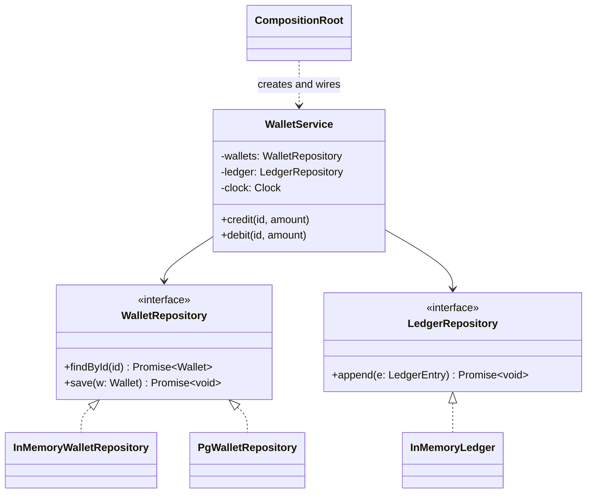

# L31 · Repository and dependency injection

> **Time:** ~30 min · **Visual:** [visual.html](visual.html) · **Code:** [demo.ts](demo.ts) (`npx tsx lld/5-machine-coding/L31-repository-and-di/demo.ts`)
> **Builds on:** [L05 LSP, ISP, DIP](../../1-foundations/L05-solid-lsp-isp-dip/README.md) · [L30 Machine-coding framework](../L30-machine-coding-framework/README.md) · **Used in:** [Library management](../../problems/12-library-management/README.md), [Payment wallet](../../problems/19-payment-wallet/README.md), and in practice every LLD problem (storage behind an interface, clock and ids injected)

## The idea in one line

A **repository** hides storage behind a small, collection-like interface (`findById`, `save`). **Dependency injection** means a class receives its repositories, gateways and clock from outside instead of creating them, and one **composition root** wires everything.

## Why it matters (the problem it solves)

```ts
// Before: the service builds its own DB client, writes SQL inline, reads the real clock
import { Pool } from 'pg';
class WalletService {
  private db = new Pool({ connectionString: process.env.DATABASE_URL }); // hard-wired
  async credit(walletId: string, amount: number) {
    const r = await this.db.query('SELECT balance FROM wallets WHERE id = $1', [walletId]);
    await this.db.query('UPDATE wallets SET balance = $1 WHERE id = $2',
      [r.rows[0].balance + amount, walletId]);            // lost update if two credits race
    await this.db.query('INSERT INTO ledger ...');
    console.log(new Date().toISOString());                  // real clock: not testable
  }
}
```

Problems with this:

- **Untestable.** A unit test needs a running Postgres and cannot control time.
- **Rigid.** Moving to DynamoDB, or adding a cache, means editing business logic.
- **Mixed concerns.** SQL strings and money rules live in the same method (SRP broken).
- **Hidden dependencies.** You cannot see what `WalletService` needs by reading its constructor.

## How it works

### The two halves

| Piece | Job | Lives in |
|---|---|---|
| Repository interface | Domain-language storage contract: `findById`, `save`, `findByUser` | `repositories/WalletRepository.ts` |
| Repository implementation | `Map` (round), Postgres or Mongo (prod) | `InMemoryWalletRepository.ts`, `PgWalletRepository.ts` |
| Service | Business rules only; depends on interfaces | `services/WalletService.ts` |
| Composition root | The only place that calls `new` on concrete classes | `main.ts` or a Nest module |

This is the Dependency Inversion Principle made concrete: the high-level service and the low-level Postgres class both depend on the interface. The arrow from service to DB is "inverted" through it.

```
 BEFORE                                AFTER
 WalletService ──new──> pg.Pool        WalletService ──uses──> «interface» WalletRepository
   (rules + SQL + clock)                  (rules only)                ▲            ▲
                                                                       │ implements │
                                                       InMemoryWalletRepo    PgWalletRepo
                                       main.ts ──creates & injects──> all of the above
```

### Class diagram



### Repository rules that matter

1. **One repository per aggregate**, not per table. A `Wallet` with its rules is one aggregate; ledger entries are another.
2. **Only the queries the use cases need.** `findByUser`, `findOverdue`. No generic `BaseRepository<T>` with 20 methods.
3. **Return copies, not live references.** A real DB read gives you a fresh object. If the in-memory fake hands out the stored object, a caller can change state without `save()`, and tests pass in memory but fail on Postgres.
4. **Optimistic locking lives in `save`.** Each aggregate has a `version`. `save` succeeds only if the stored version is the one you read. In SQL: `UPDATE wallets SET balance=$1, version=version+1 WHERE id=$2 AND version=$3`, then check `rowCount === 1`.
5. **Domain types in, domain types out.** Do not leak Prisma models or TypeORM lazy relations past the repository if you want the domain storage-free.

### Ways to inject

| Style | How | Use when |
|---|---|---|
| Constructor injection | `constructor(private repo: WalletRepository)` | Default. Dependencies are required and visible. |
| Factory function | `buildApp(deps) => ({ wallet: new WalletService(...) })` | Small apps, tests, scripts |
| Method injection | `handle(req, ctx)` | Per-call things like a request context or transaction |
| DI container | NestJS providers, `tsyringe`, `inversify` | Large apps with many modules and scopes |

In a 90-minute round, constructor parameters plus `main.ts` is enough. A container adds setup time and scores nothing.

### NestJS mapping (what you use at work)

TypeScript interfaces are erased at runtime, so Nest cannot inject "a `WalletRepository`" by type. Bind a token:

```ts
export const WALLET_REPO = Symbol('WALLET_REPO');
@Module({ providers: [WalletService, { provide: WALLET_REPO, useClass: PrismaWalletRepository }] })
export class WalletModule {}

@Injectable()
export class WalletService {
  constructor(@Inject(WALLET_REPO) private readonly wallets: WalletRepository) {}
}
// In tests: Test.createTestingModule(...).overrideProvider(WALLET_REPO).useValue(new InMemoryWalletRepository())
```

An abstract class also works as a token, because it exists at runtime.

### Transactions across repositories: Unit of Work

Credit a wallet and append a ledger entry must commit together. Begin one transaction, give both repositories the same transaction client, commit at the end. In Prisma: `prisma.$transaction(async (tx) => { await new PgWalletRepo(tx).save(w); await new PgLedger(tx).append(e); })`.

## In TypeScript

```ts
interface WalletRepository {
  findById(id: string): Promise<Wallet | undefined>;
  save(w: Wallet): Promise<void>;          // throws ConcurrencyError on a stale version
}

class InMemoryWalletRepository implements WalletRepository {
  private rows = new Map<string, Wallet>();
  async findById(id: string) { const w = this.rows.get(id); return w && { ...w }; } // copy
  async save(w: Wallet) {
    const cur = this.rows.get(w.id);
    if (cur && cur.version !== w.version - 1) throw new ConcurrencyError(w.id);
    this.rows.set(w.id, { ...w });
  }
}

class WalletService {
  constructor(
    private readonly wallets: WalletRepository,
    private readonly ledger: LedgerRepository,
    private readonly clock: () => Date,
    private readonly ids: () => string,
  ) {}
  async credit(id: string, amount: number) {
    const w = await this.wallets.findById(id);
    if (!w) throw new NotFoundError(id);
    await this.wallets.save({ ...w, balance: w.balance + amount, version: w.version + 1 });
    await this.ledger.append({ id: this.ids(), walletId: id, amount, type: 'CREDIT', at: this.clock().toISOString() });
  }
}

// main.ts: the composition root
const service = new WalletService(new InMemoryWalletRepository(), new InMemoryLedger(), () => new Date(), randomUUID);
```

[demo.ts](demo.ts) runs the before/after, swaps the repository without touching the service, shows the fixed clock, and catches a lost update with the version check.

## Trade-offs / when NOT to use it

- **Small CRUD app:** using Prisma or TypeORM directly in the service is fine. The repository layer pays off when rules are rich or tests matter.
- **Do not inject pure helpers** (`formatCurrency`, value objects). Import them.
- **Generic repositories** (`Repository<T>` with `findAll`, `findWhere(any)`) leak query details and invite N+1 loops. Prefer named query methods.
- **Containers** hide wiring. When something is not injected, the error comes at runtime. Constructor wiring fails at compile time.
- Each layer costs a file and an indirection. In a one-file round, keep the interface and the in-memory class next to each other.

## Common mistakes

- `new PgWalletRepo()` inside the service "just for now". Now it is not injectable.
- The in-memory repo returns the stored object, so a test passes that would fail on a real DB.
- Business rules (`balance >= amount`) inside the repository. Repositories store and load; services and entities decide.
- Mocking every method with a mock library when a 10-line in-memory fake is clearer and reusable.
- Calling `Date.now()` or `crypto.randomUUID()` inside logic after injecting everything else.
- Thinking DI means "use a framework". DI is just "pass it in".

## Say this in the interview

> "All storage goes through repositories, one per aggregate: `WalletRepository` and `LedgerRepository`. For this round they're in-memory maps that return copies, and later they become Postgres classes with the same interface. The service gets them, plus a clock and an id generator, through its constructor, and `main.ts` is the only place that knows concrete classes."

> "The wallet has a version field, so `save` is a conditional update. If two credits race, the second one fails with a conflict and retries with fresh data instead of silently losing money."

> "In NestJS I'd bind the interface to a token, `{ provide: WALLET_REPO, useClass: PrismaWalletRepository }`, and override it with the in-memory fake in tests."

## Your experience hook

- Your payment orchestration service already uses this shape: one `PaymentProvider` interface, three adapters, injected by Nest. The repository is the same idea pointed at storage instead of a gateway.
- The MongoDB to MySQL migration at Matriot is the classic argument for repositories: with a repository layer only the implementation class changes, not every service.

## Self-test

<details><summary>1. Where is the only place <code>new PgWalletRepository()</code> should appear?</summary>

In the composition root (`main.ts`, or a Nest module's providers). Nowhere in services or entities.
</details>

<details><summary>2. Two credits run at once on the same wallet. How does the version field help?</summary>

Both read version 3. The first saves version 4. The second also tries to save version 4 based on 3, but the stored version is already 4, so `save` throws a conflict. The caller reloads and retries. No lost update.
</details>

<details><summary>3. Nest cannot inject an interface by type. Why, and what do you do?</summary>

TS interfaces do not exist at runtime, so there is nothing to look up. Use an injection token (a symbol, string or abstract class) and `@Inject(TOKEN)`.
</details>

<details><summary>4. Repository vs DAO?</summary>

A DAO is table-centric (`WalletDao.updateBalance(id, x)`). A repository is domain-centric: it loads and saves whole aggregates and looks like a collection. Teams mix the names, so say which one you mean.
</details>

<details><summary>5. Why return copies from the in-memory repository?</summary>

So callers cannot change stored state without `save()`. A real DB behaves like that, so the fake must too, or tests give false confidence.
</details>

<details><summary>6. How do you make "debit wallet + append ledger" atomic?</summary>

Unit of Work: one DB transaction; both repositories are built on the same transaction client; commit at the end, roll back on any error.
</details>

<details><summary>7. Constructor injection vs property injection?</summary>

Constructor injection makes dependencies required and visible, and the object is complete after `new`. Property injection allows half-built objects. Use method injection only for per-call context.
</details>

## Go deeper

- [L30 Machine-coding framework](../L30-machine-coding-framework/README.md): where repositories sit in the folder layout
- [L32 Concurrency in Node](../L32-concurrency-in-node/README.md): optimistic locking and conditional updates in depth
- [L34 Testing your design](../L34-testing-designs/README.md): in-memory fakes and a fixed clock in tests
- [H12 Transactions and isolation](../../../hld/3-databases/H12-transactions-isolation/README.md): what the Unit of Work relies on
- Practice: [19 Payment wallet](../../problems/19-payment-wallet/README.md), [12 Library management](../../problems/12-library-management/README.md)
- Books: Fowler, *Patterns of Enterprise Application Architecture* (Repository, Unit of Work); Seemann, *Dependency Injection Principles, Practices, and Patterns* (Composition Root)
