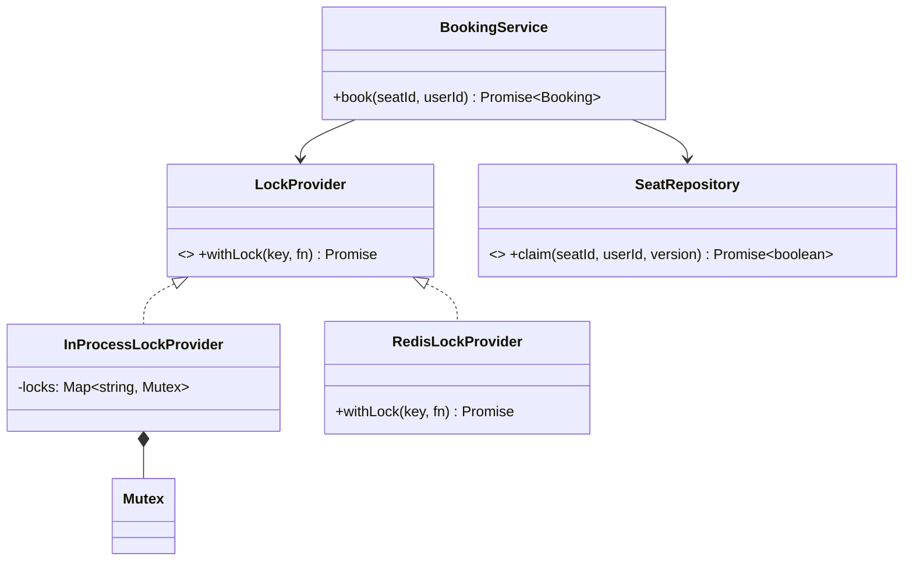

# L32 · Concurrency in Node: event loop, races, locks

> **Time:** ~40 min · **Visual:** [visual.html](visual.html) · **Code:** [demo.ts](demo.ts) (`npx tsx lld/5-machine-coding/L32-concurrency-in-node/demo.ts`)
> **Builds on:** [L30 Machine-coding framework](../L30-machine-coding-framework/README.md) · [L31 Repository and DI](../L31-repository-and-di/README.md) · **Used in:** [BookMyShow](../../problems/13-bookmyshow/README.md), [Payment wallet](../../problems/19-payment-wallet/README.md), [Rate limiter](../../problems/04-rate-limiter/README.md), [Meeting room scheduler](../../problems/21-meeting-room-scheduler/README.md), [Parking lot](../../problems/01-parking-lot/README.md) (extension)

## The idea in one line

Node runs your JavaScript on one thread, but **every `await` lets other requests run**, so "check, then await, then act" is a race exactly like in multi-threaded code; fix it by removing the gap, serialising per key, or letting the database decide.

## Why it matters (the problem it solves)

The follow-up "what if two users book the same seat at the same time?" comes up in almost every machine-coding round. It is also the #1 real bug in booking, wallet and inventory systems: double bookings, negative balances, oversold stock.

```ts
// Before: two requests for the same seat both succeed
async function bookSeat(seatId: string, userId: string) {
  const seat = await seatRepo.find(seatId);        // both requests read status = 'FREE'
  if (seat.status !== 'FREE') throw new SeatTaken();
  await paymentGateway.hold(userId, seat.price);   // the other request runs during this await
  seat.status = 'BOOKED';                          // both write BOOKED: last write wins
  seat.userId = userId;
  await seatRepo.save(seat);
}
```

## How it works

### The event loop in 60 seconds

```
   ┌──────────────► timers        (setTimeout, setInterval)
   │                pending       (some system callbacks)
   │                poll          (I/O callbacks: DB replies, HTTP, files)
   │                check         (setImmediate)
   └──────────────  close         (socket 'close')
        between EVERY callback: drain process.nextTick queue, then the Promise microtask queue
```

- One callback runs at a time, **to completion**. Nothing can interrupt a synchronous block.
- `await x` ends the current piece of work. The rest of the function becomes a microtask that runs **after** `x` settles, and other requests' callbacks may run first.
- DB drivers, HTTP and timers do the waiting outside JS (libuv, kernel). That is why one Node process can hold 10k sockets: it is concurrent (interleaved), not parallel.
- A CPU-heavy loop (say 2 s of JSON parsing) blocks every request, health checks included. Move it to `worker_threads`.

### Where races come from

| Pattern | Safe in one process? | Why |
|---|---|---|
| `if (seat.free) { seat.free = false }` with no await | Yes | One synchronous block |
| `map.set(k, map.get(k)! + 1)` | Yes | One statement, no await |
| `const s = await repo.find(); if (s.free) await repo.save(...)` | **No** | Gap at each `await` |
| Any of the above on **2+ instances** | **No** | Each process has its own memory; the DB is shared |
| A client retry after a timeout | **No** | Same request arrives twice; that is concurrency too |

### How to spot it in a problem statement

Words like *book, reserve, claim, allocate, debit, withdraw, redeem a coupon, assign a driver, limited stock, first come first served, at most N*. Each means "a shared resource and a rule that can break when two requests overlap".

### Fix 0: no gap (reserve synchronously, then do slow work)

```ts
function hold(seat: Seat, userId: string, now: number) {
  if (seat.status !== 'FREE') throw new SeatTaken();   // check
  seat.status = 'HELD'; seat.heldBy = userId;          // act, same tick
  seat.expiresAt = now + 10 * 60_000;                  // TTL so a dead client can't block it
}
// then: await payment; then confirm() or release()
```

This is the best in-memory answer: **hold → pay → confirm or release**.

### Fix 1: per-key mutex (one process only)

```ts
class Mutex {
  private tail: Promise<void> = Promise.resolve();
  async runExclusive<T>(fn: () => Promise<T>): Promise<T> {
    const prev = this.tail;
    let release!: () => void;
    this.tail = new Promise<void>((r) => (release = r));
    await prev;                       // wait for everyone before us
    try { return await fn(); } finally { release(); }
  }
}
const locks = new Map<string, Mutex>();
const lockFor = (k: string) => locks.get(k) ?? locks.set(k, new Mutex()).get(k)!;
await lockFor(`seat:${id}`).runExclusive(() => bookSeat(id, user));
```

A **semaphore** with `n` permits is the same idea for "at most n at once" (limit calls to a payment gateway to 5).

### Fix 2–4: let a shared store decide (works across instances)

| Fix | SQL / command | Conflict looks like | Best for | Risk |
|---|---|---|---|---|
| Conditional atomic update | `UPDATE seats SET owner=$1 WHERE id=$2 AND owner IS NULL` | 0 rows updated → 409 | Most cases; the final write | None; simplest |
| Optimistic (version) | `... WHERE id=$1 AND version=$2`, `version=version+1` | 0 rows → reload + retry | Low/medium contention | Retry storms on hot rows |
| Pessimistic | `BEGIN; SELECT ... FOR UPDATE; UPDATE; COMMIT` | Second tx **waits** | Hot rows, short tx (wallet debit) | Deadlocks, lock waits; never hold across an HTTP call |
| Redis hold | `SET hold:A7 alice NX PX 600000` | `nil` → "held" | 10-minute holds while paying | TTL ends during a GC pause; failover can lose the key |
| Unique constraint | `UNIQUE(show_id, seat_id)` | Insert error → 409 | Always, as the last safety net | None |

Release a Redis hold with a Lua script that deletes only if the value is still your token. For a work queue, `FOR UPDATE SKIP LOCKED` lets workers take different rows.

### Fix 5: idempotency keys (retries)

```ts
const inserted = await idem.insertIfAbsent(key, hash(body)); // UNIQUE(key) or SET NX
if (!inserted) return idem.waitForResult(key);              // same key → same answer
```

A plain "check the table, then insert" has the same race. The unique constraint must pick the winner.

### Class diagram



Put the lock behind an interface (L31). Tests use the in-process version; production swaps in Redis or a DB-backed one.

## In TypeScript

```ts
// After: optimistic claim in the repository, the service maps 0 rows to a domain error
async book(seatId: string, userId: string) {
  const seat = await this.seats.findById(seatId);
  if (!seat || seat.owner) throw new SeatTaken(seatId);
  const won = await this.seats.claim(seatId, userId, seat.version); // UPDATE ... WHERE version = $3
  if (!won) throw new SeatTaken(seatId);                            // someone else won
  return this.bookings.create(seatId, userId);
}
```

[demo.ts](demo.ts) reproduces the double booking with two concurrent `async` calls, then fixes it four ways (sync hold, mutex, version check, idempotency key) and prints the event-loop order of `nextTick`, promises, timers and `setImmediate`.

## Trade-offs / when NOT to use it

- Fully synchronous in-memory code in one process **needs no mutex**. Say so; it shows you understand the event loop.
- In-process locks give false safety the moment you run 2 pods or PM2 cluster mode.
- Pessimistic locks hurt throughput and invite deadlocks if two code paths lock rows in different orders.
- Optimistic locking under heavy contention (a concert launch) gives retry storms. Add a queue or waiting room in front.
- Distributed locks (Redlock) are debated for correctness. If correctness matters, the final write must still be a conditional DB write (or use fencing tokens).

## Common mistakes

- "Node is single-threaded, so there are no races." Wrong at every `await` and across instances.
- Holding a lock (mutex or DB row) while calling a slow payment API.
- Forgetting `finally { release() }`, so one exception locks the key forever.
- A Redis lock without a TTL, or releasing someone else's lock with a plain `DEL`.
- Idempotency done as "SELECT then INSERT" without a unique constraint.
- Using `worker_threads` for I/O-bound work. They are for CPU work.

## Say this in the interview

> "In a single Node process my `holdSeat` is safe because the check and the update are in one synchronous block with no `await` between them. If I add async work in between, I'd guard it with a per-seat mutex, but that only works inside one process."

> "With several instances I move the guarantee to the data store: a conditional update `WHERE owner IS NULL AND version = $v` for the booking, or `SELECT ... FOR UPDATE` for a wallet debit. A unique constraint on (show, seat) is the last safety net. The 10-minute hold while the user pays is a Redis `SET NX PX` or a holds row with `expires_at`."

> "Client retries are concurrency too, so the payment API takes an idempotency key backed by a unique constraint."

## Your experience hook

- Payment orchestration: idempotency keys and webhook dedupe by provider event id are exactly Fix 5. Say how a retried webhook was ignored because the event id was already stored.
- Matriot IoT: duplicate MQTT processing across instances was a cross-instance race; you fixed it with load-sharing (one consumer per message). Same lesson: in-process guards do not help across pods.
- Video SFU: Redis Pub/Sub synced signaling state across instances because memory is not shared.

## Self-test

<details><summary>1. Why can two async requests in single-threaded Node both pass <code>if (balance >= amount)</code>?</summary>

There is an `await` between the check and the debit (a DB read, a gateway call). The event loop runs the other request there, and it reads the old balance.
</details>

<details><summary>2. <code>UPDATE ... WHERE version = 7</code> returns 0 rows. What does it mean and what do you do?</summary>

Someone else updated the row first. Reload and retry the business logic a few times with backoff, or return 409.
</details>

<details><summary>3. Is <code>map.set(k, map.get(k)! + 1)</code> safe in Node?</summary>

Yes in one process with no await in between: it is one synchronous statement. Not across processes, and not in Java with threads.
</details>

<details><summary>4. Optimistic or pessimistic for a wallet debit?</summary>

Usually pessimistic (`FOR UPDATE`) or a single conditional update `balance = balance - $1 WHERE balance >= $1`, because one hot wallet can see many concurrent debits and retries are costly. Write the ledger entry in the same transaction.
</details>

<details><summary>5. Order of output: <code>setTimeout(a,0); setImmediate(b); Promise.resolve().then(c); process.nextTick(d); console.log(e)</code> inside an I/O callback?</summary>

e, d, c, b, a. Sync first, then nextTick, then promises, then check (setImmediate, right after poll), then timers on the next loop turn.
</details>

<details><summary>6. Why is "check idempotency table, then insert" not enough?</summary>

Two retries can both see "no row" and both charge. A unique constraint on the key (or `SET NX`) must decide the winner.
</details>

<details><summary>7. What does the TTL on a seat hold protect against?</summary>

A client that holds the seat and then crashes or closes the tab. Without a TTL the seat is locked forever.
</details>

## Go deeper

- [H12 Transactions and isolation](../../../hld/3-databases/H12-transactions-isolation/README.md): lost updates, write skew, isolation levels
- [H22 Delivery semantics](../../../hld/4-async/H22-delivery-semantics/README.md): idempotency at scale
- [H29 Consensus and locks](../../../hld/5-reliability/H29-consensus-locks/README.md): distributed locks, fencing tokens
- Case study: [Ticket booking](../../../hld/case-studies/09-ticket-booking/README.md)
- Practice: [13 BookMyShow](../../problems/13-bookmyshow/README.md), [19 Payment wallet](../../problems/19-payment-wallet/README.md)
- Book: *Designing Data-Intensive Applications*, chapter 7 (lost updates, compare-and-set, explicit locking)
