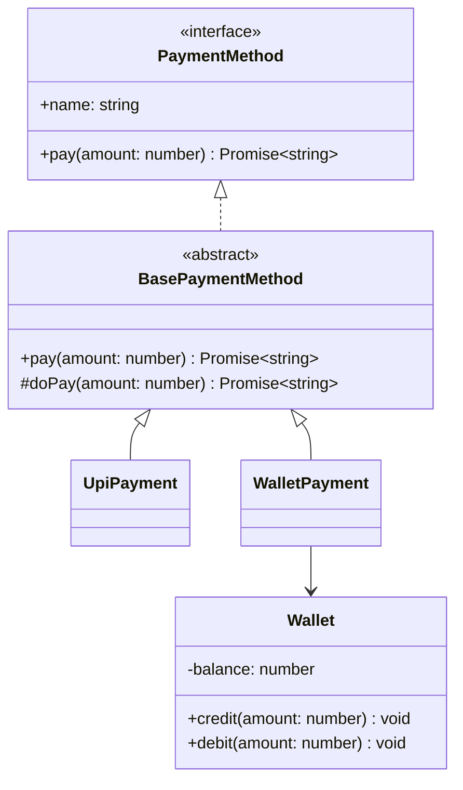

# 01 · OOP Pillars in TypeScript

> **Read time:** 25 min · **Visual:** [v22 UML relationships](../../visuals/v22-uml-relationships.html)
> **Used in:** every problem. Start with [01 Parking Lot](../problems/01-parking-lot/README.md) and [11 ATM](../problems/11-atm/README.md).

## The idea in one line

Encapsulation hides state, abstraction hides details, inheritance shares a contract, and polymorphism lets one call site work with many types.

## The problem it solves

This is a typical first draft in a machine-coding round. It works, but every new payment method touches this function, and anyone can change `balance` directly.

```ts
// Before: public state, a type switch, no contract
class Wallet {
  balance = 0; // anyone can set wallet.balance = -500
}

function pay(method: string, amount: number, wallet: Wallet) {
  if (method === 'WALLET') {
    wallet.balance -= amount; // no check for insufficient funds
  } else if (method === 'UPI') {
    console.log('call UPI API', amount);
  } else if (method === 'CARD') {
    console.log('call card network', amount);
  } // a new method = edit this function again
}
```

## The four pillars

### 1. Encapsulation: protect the invariant

The object owns its state. Outside code changes it only through methods that keep the rules true.

```ts
class Wallet {
  #balance = 0; // truly private at runtime

  get balance(): number { return this.#balance; }

  credit(amount: number): void {
    if (amount <= 0) throw new Error('Amount must be positive');
    this.#balance += amount;
  }

  debit(amount: number): void {
    if (amount > this.#balance) throw new Error('Insufficient funds');
    this.#balance -= amount;
  }
}
```

The invariant "balance is never negative" now lives in one place.

### 2. Abstraction: show what, hide how

Callers depend on a small interface. They do not know about HTTP calls, retries or SDKs.

```ts
interface PaymentMethod {
  readonly name: string;
  pay(amount: number): Promise<string>; // returns a transaction id
}
```

### 3. Inheritance: reuse a contract (use carefully)

Use `extends` for a real IS-A relation and for shared behaviour that will not change often. Prefer composition for everything else.

```ts
abstract class BasePaymentMethod implements PaymentMethod {
  abstract readonly name: string;
  protected abstract doPay(amount: number): Promise<string>;

  async pay(amount: number): Promise<string> {
    if (amount <= 0) throw new Error('Invalid amount'); // shared rule
    return this.doPay(amount);
  }
}
```

### 4. Polymorphism: one call, many behaviours

```ts
class UpiPayment extends BasePaymentMethod {
  readonly name = 'UPI';
  protected async doPay(amount: number) { return `upi_${amount}`; }
}

class WalletPayment extends BasePaymentMethod {
  readonly name = 'WALLET';
  constructor(private wallet: Wallet) { super(); }
  protected async doPay(amount: number) { this.wallet.debit(amount); return `wal_${amount}`; }
}

async function checkout(method: PaymentMethod, amount: number) {
  return method.pay(amount); // no if/else on type
}
```

A new method (`CardPayment`) is a new class. `checkout` does not change.

## Class diagram



## When to use each

- **Encapsulation**: always. Every entity with rules (balance, seat status, stock count) hides its fields.
- **Abstraction**: at every boundary that may change: payment gateways, notification channels, storage, clock.
- **Inheritance**: shallow trees (one level, at most two) where the child really IS-A parent and you share code.
- **Polymorphism**: whenever you see `if (type === ...)` repeated in more than one place.

## When NOT to use them

- Do not build deep trees like `Vehicle → MotorVehicle → Car → ElectricCar → TeslaModel3`. Each level adds coupling. Composition (a car HAS-A `Engine`) is usually better.
- Do not make an interface for a class that will only ever have one implementation and is not a boundary. A `TicketIdGenerator` interface is fine (you mock it in tests). A `ParkingFloorInterface` usually is not.
- Do not hide data that is just data. A `Receipt` record can be a `readonly` type, not a class with getters.

## In the Node/TS world

- `#private` fields are enforced at runtime. The TS `private` keyword is only checked at compile time. See [05 TS for LLD](05-ts-for-lld.md).
- `stream.Readable`, `stream.Writable` and `EventEmitter` are base classes you extend. You override `_read()` / `_write()`. That is inheritance plus Template Method ([P15](patterns/p15-template-method.md)).
- Node's `Error` hierarchy: `class InsufficientFundsError extends Error` is a good, shallow use of inheritance.
- TS uses **structural typing**: any object with a matching `pay()` satisfies `PaymentMethod`, even without `implements`. `implements` is still useful because it makes the compiler check the class at its definition.

## What to say in the interview

> "Each entity owns its state and exposes behaviour, not setters. For example, `Wallet.debit()` checks the balance, so the invariant lives in one place. Things that vary, like payment methods, sit behind an interface, so the checkout code is polymorphic and has no type switch. I'll use inheritance only for a shallow base class with shared validation. Everything else is composition."

## Common follow-ups

<details><summary>Composition vs inheritance: when do you pick inheritance?</summary>

Pick inheritance when the child is truly a subtype (Liskov holds), the tree is shallow, and the parent is stable. Pick composition when behaviour varies independently (pricing, notifications), when you need to swap it at runtime, or when you would otherwise need multiple inheritance.
</details>

<details><summary>Abstraction vs encapsulation: aren't they the same?</summary>

No. Encapsulation is about protecting data and invariants inside one object. Abstraction is about the contract a caller sees, so the caller ignores implementation details. A class can encapsulate well and still expose a leaky abstraction (for example, a method that returns the raw SDK response).
</details>

<details><summary>Is TypeScript really OOP? It has no method overloading at runtime.</summary>

TS has overload signatures, but one implementation body. Runtime polymorphism (dynamic dispatch through the prototype chain) is real JavaScript behaviour. For LLD rounds, interfaces, classes, abstract classes and access modifiers are enough.
</details>

## Self-test (answer before opening)

<details><summary>1. A `Seat` class has a public `status` field. Why is that a problem in BookMyShow?</summary>

Any code can set `status = 'BOOKED'` without the lock and payment checks. Make it private and expose `hold()`, `book()`, `release()`, each checking the current status.
</details>

<details><summary>2. Which pillar removes `if (vehicle.type === 'CAR')` chains?</summary>

Polymorphism (and, often, a lookup table). Each type carries its own behaviour, or a map from type to rule.
</details>

<details><summary>3. `class Square extends Rectangle` and `setWidth` also changes height. Which principle breaks?</summary>

Liskov Substitution. Code written for `Rectangle` expects width and height to be independent. See [02 SOLID](02-solid.md).
</details>

## Go deeper

- Head First Object-Oriented Analysis and Design, chapters 1–2; Head First Design Patterns, chapter 1 ("favor composition over inheritance")
- Effective TypeScript (Dan Vanderkam), the items on structural typing
- Older notes in this repo: `archive/notes/LLD-guide.md`, PART 1 "The Four Pillars of OOP"; practice code in `archive/practice-v1/oop-basics/oops/`
