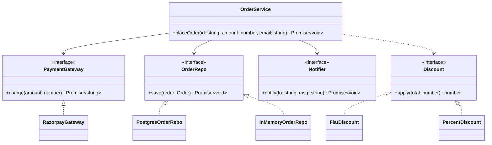

# 02 · SOLID Principles

> **Read time:** 30 min · **Visual:** [v21 SOLID refactor](../../visuals/v21-solid-refactor.html)
> **Used in:** every problem. Clear examples: [01 Parking Lot](../problems/01-parking-lot/README.md) (OCP pricing), [05 Notification Service](../problems/05-notification-service/README.md) (SRP, DIP), [20 Cart with Coupons](../problems/20-ecommerce-cart-coupons/README.md) (OCP)

## The idea in one line

Five rules that keep classes small, open to new features without edits, and easy to test: one reason to change, extend don't modify, subtypes keep promises, small interfaces, depend on abstractions.

## The problem it solves

One class that does everything. It is hard to test and every change risks breaking something else.

```ts
// Before: a god class
class OrderService {
  async placeOrder(order: { id: string; amount: number; email: string; coupon?: string }) {
    if (order.amount <= 0) throw new Error('bad amount');              // validation
    let total = order.amount;
    if (order.coupon === 'FLAT100') total -= 100;                        // pricing rules
    else if (order.coupon === 'TENPCT') total *= 0.9;
    const res = await fetch(process.env.PAY_URL!, { method: 'POST' }); // payment SDK details
    await db.query('INSERT INTO orders ...');                             // persistence
    await sendgrid.send(order.email, `Paid ${total}`);                    // notification
  }
}
declare const db: { query(sql: string): Promise<void> };
declare const sendgrid: { send(to: string, body: string): Promise<void> };
```

Five reasons to change, a hard-coded coupon switch, and you cannot test it without the network.

## The five principles

### S: Single Responsibility

A class has **one reason to change** (one actor who asks for changes). Split validation, pricing, payment, storage and notification.

### O: Open/Closed

Open for extension, closed for modification. A new coupon type is a **new class**, not a new `else if`.

```ts
interface Discount { apply(total: number): number }
class FlatDiscount implements Discount {
  constructor(private off: number) {}
  apply(total: number) { return Math.max(0, total - this.off); }
}
class PercentDiscount implements Discount {
  constructor(private pct: number) {}
  apply(total: number) { return total * (1 - this.pct / 100); }
}
```

### L: Liskov Substitution

A subtype must work anywhere the parent works. It must not throw new errors, demand stronger inputs, or return weaker results.

```ts
// Breaks LSP: callers of PaymentMethod.refund() now crash for cash
class CashOnDelivery implements PaymentMethod {
  refund(): Promise<void> { throw new Error('Not supported'); }
}
```

Fix: split the interface (`Refundable`), or model "refund to wallet" as real behaviour.

### I: Interface Segregation

Clients should not depend on methods they do not use. Many small interfaces beat one fat one.

```ts
interface PaymentMethod { pay(amount: number): Promise<string> }
interface Refundable { refund(txnId: string): Promise<void> }
class UpiPayment implements PaymentMethod, Refundable { /* both */ }
class CashOnDelivery implements PaymentMethod { /* pay only */ }
```

### D: Dependency Inversion

High-level policy (`OrderService`) depends on abstractions. Low-level details (Razorpay SDK, Postgres, SendGrid) implement them. You pass them in through the constructor.

```ts
interface PaymentGateway { charge(amount: number): Promise<string> }
interface OrderRepo { save(o: { id: string; total: number }): Promise<void> }
interface Notifier { notify(to: string, msg: string): Promise<void> }

class OrderService {
  constructor(
    private gateway: PaymentGateway,
    private repo: OrderRepo,
    private notifier: Notifier,
  ) {}

  async placeOrder(id: string, amount: number, email: string, discount?: Discount) {
    const total = discount ? discount.apply(amount) : amount;
    const txnId = await this.gateway.charge(total);
    await this.repo.save({ id, total });
    await this.notifier.notify(email, `Paid ${total} (txn ${txnId})`);
  }
}
```

In tests you pass fakes. In production you pass real adapters. See [P18 Repository and DI](patterns/p18-repository-di.md).

## Class diagram



## When to apply it

- **SRP**: when a class needs more than one mock to test, or its name contains "And" or "Manager".
- **OCP**: at the points the interviewer will extend: pricing, discounts, notification channels, split types, win rules.
- **LSP**: every time you write `extends` or `implements`. Ask: "can this throw where the parent never does?"
- **ISP**: when an implementation has methods that throw `Not supported`.
- **DIP**: for every external dependency: gateway, DB, clock, ID generator, random number generator.

## When NOT to apply it (over-engineering)

- SOLID is a set of heuristics, not laws. In a 90-minute round, do not create an interface for every class.
- OCP for a rule that will never change (for example "a ticket has an id") is wasted time.
- Splitting a 30-line class into five files makes code harder to read, not easier.
- A good rule: abstract **where the problem statement says "types of" or "may change later"**, and for I/O. Keep the rest concrete.

## In the Node/TS world

- **DIP**: NestJS providers are injected by constructor and bound in a module. Without a framework, a composition root (`main.ts`) wires everything. See [05 TS for LLD](05-ts-for-lld.md).
- **OCP**: Express middleware. You add behaviour with `app.use(fn)` without editing the router ([P14](patterns/p14-chain-of-responsibility.md)).
- **ISP**: Node's stream types: `Readable`, `Writable`, `Duplex`, `Transform`. You implement only what you need.
- **SRP**: the common controller → service → repository split in Node backends.

## What to say in the interview

> "I'll keep `OrderService` as the orchestrator. It depends on `PaymentGateway`, `OrderRepo` and `Notifier` interfaces, which I inject through the constructor. That follows dependency inversion, and it makes the class testable with in-memory fakes. Discounts are a `Discount` interface, so a new coupon type is a new class and the service does not change. That's open/closed. I won't add interfaces for plain entities like `Order`."

## Common follow-ups

<details><summary>Isn't SRP the same as "a class does one thing"?</summary>

Not exactly. Robert Martin defines it as "one reason to change", meaning one actor or stakeholder. A `PayrollReport` class that both the finance team and the HR team change for different reasons violates SRP, even if it "does one thing" (makes a report).
</details>

<details><summary>DIP vs DI vs IoC: what is the difference?</summary>

DIP is the principle (depend on abstractions). Dependency Injection is a technique (pass dependencies in instead of `new`-ing them inside). Inversion of Control is the broad idea that a framework or container calls your code and creates your objects. NestJS uses all three.
</details>

## Self-test (answer before opening)

<details><summary>1. A `NotificationService` has `sendEmail`, `sendSms`, `sendPush` and a switch on channel. Which principles break and what's the fix?</summary>

OCP (a new channel means editing the switch) and SRP (it knows every provider). Fix: a `Channel` interface with one class per channel, and a registry `Record<ChannelType, Channel>` injected into the service.
</details>

<details><summary>2. Why does DIP make unit tests fast?</summary>

You inject in-memory fakes for the DB, gateway and clock. No network, no real time, deterministic results.
</details>

<details><summary>3. `Bird` has `fly()`. `Penguin extends Bird`. What's wrong and how do you fix it?</summary>

LSP: `Penguin.fly()` must throw or do nothing. Fix with ISP: a `Bird` base without `fly`, and a separate `Flyer` interface for birds that fly.
</details>

## Go deeper

- Clean Architecture (Robert C. Martin), Part III, chapters 7–11 (one chapter per principle)
- Agile Software Development, Principles, Patterns, and Practices (Robert C. Martin), Section II
- Older notes in this repo: `archive/notes/LLD-guide.md`, PART 2 "SOLID Principles" and PART 7 "Common Pitfalls"
