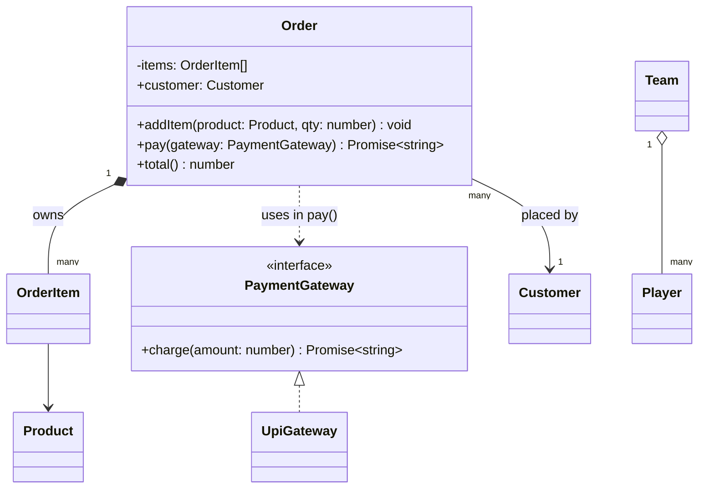

# 03 · UML and Class Relationships

> **Read time:** 25 min · **Visual:** [v22 UML relationships](../../visuals/v22-uml-relationships.html)
> **Used in:** the design step of every problem. Good practice: [01 Parking Lot](../problems/01-parking-lot/README.md), [12 Library Management](../problems/12-library-management/README.md), [24 In-memory File System](../problems/24-file-system/README.md)

## The idea in one line

A class diagram shows classes, their visible members, and six kinds of links between them. In an interview you only need these and the reason you picked each one.

## The problem it solves

Without a diagram, you start coding and discover halfway that nobody owns the `Ticket`, or that `Floor` and `ParkingLot` both create `Spot`s. A 5-minute diagram fixes ownership and direction before you write code.

Bad diagram habits:

- Every line is a plain arrow, so ownership is unclear.
- Arrows go both ways everywhere (bidirectional coupling).
- Fields and methods for 20 classes. Draw only the core 5–8.

## Visibility symbols

| UML | TypeScript | Meaning |
|---|---|---|
| `+` | `public` (default) | anyone |
| `-` | `private` or `#field` | this class only |
| `#` | `protected` | this class and subclasses |
| `~` | not exported from the module | package / module only |

Static members are underlined. Abstract names are in italics, or marked `<<abstract>>`.

## The six relationships (strongest to weakest)

| Relationship | Read as | Mermaid | Code shape |
|---|---|---|---|
| Inheritance | IS-A | `Parent <\|-- Child` | `class Child extends Parent` |
| Realization | implements | `Iface <\|.. Impl` | `class Impl implements Iface` |
| Composition | OWNS-A, part dies with whole | `Whole *-- Part` | whole creates the part inside; part is never shared |
| Aggregation | HAS-A, part lives on | `Whole o-- Part` | part is passed in, may be shared |
| Association | KNOWS-A | `A --> B` | `A` keeps a field of type `B` |
| Dependency | USES for a moment | `A ..> B` | `B` is a parameter, local variable or return type |

```ts
class Order {
  private items: OrderItem[] = [];            // composition: Order creates and owns items
  constructor(readonly customer: Customer) {} // association: Order knows its Customer
  addItem(product: Product, qty: number) {
    this.items.push(new OrderItem(product, qty)); // item dies with the order
  }
  pay(gateway: PaymentGateway) {              // dependency: used only in this call
    return gateway.charge(this.total());
  }
  total() { return this.items.reduce((s, i) => s + i.subtotal(), 0); }
}
class OrderItem {
  constructor(readonly product: Product, readonly qty: number) {} // association to Product
  subtotal() { return this.product.price * this.qty; }
}
class Team {
  constructor(private players: Player[]) {}   // aggregation: players exist without the team
}
class Product { constructor(readonly sku: string, readonly price: number) {} }
class Customer { constructor(readonly id: string) {} }
class Player { constructor(readonly name: string) {} }
interface PaymentGateway { charge(amount: number): Promise<string> }
```

## Class diagram



## How to decide (ask in this order)

1. Is it a subtype? **Inheritance** (or **realization** for an interface).
2. Does A create B, and does B have no meaning in this system without A? **Composition**. The diamond is on A, the whole.
3. Does A hold B, but B is created elsewhere and lives on? **Aggregation**.
4. Does A keep a reference to B to talk to it? **Association**.
5. Does A only use B inside one method? **Dependency**.

The key test is the **lifecycle in this system**, not in real life. A `Wallet` "could" exist without a `User` in the real world, but in a payments app it has no meaning without its user, so `User *-- Wallet`.

Multiplicity: write `1`, `0..1`, `*` or `1..*` at the ends when it matters (a `Floor` has `1..*` spots).

## When NOT to over-do it

- Do not argue composition vs aggregation for a full minute. Both mean "has". Say your choice and the lifecycle reason, then move on.
- Skip getters, setters and constructors in the diagram.
- Do not draw sequence, activity or use-case diagrams unless asked. A state diagram is worth it for State-heavy problems (vending machine, elevator, payment status).

## In the Node/TS world

- Constructor injection of an interface is an **association** to that interface (`OrderService --> PaymentGateway`).
- An Express `app` aggregates routers and middleware. They are created outside and passed to `app.use()`.
- A Prisma model `Order` with `items OrderItem[]` and `onDelete: Cascade` is composition at the database level.
- GitHub and many Markdown tools render mermaid `classDiagram` blocks, so you can keep diagrams next to code.

## What to say in the interview

> "The core classes are `ParkingLot`, `Floor`, `Spot`, `Ticket` and a `PricingStrategy` interface. The lot owns its floors and each floor owns its spots. That's composition, because a spot has no meaning outside its floor. Tickets reference a spot and a vehicle, that's association. The lot depends on the `PricingStrategy` interface, which is injected, so pricing can change without touching the lot."

## Common follow-ups

<details><summary>Composition vs aggregation in code: how can the interviewer see the difference?</summary>

Composition: the whole creates the part (`new Spot()` inside `Floor`), does not expose it for sharing, and removing the whole removes the parts. Aggregation: the part is passed in from outside (`new Team(players)`) and may belong to another whole later.
</details>

<details><summary>Should associations be bidirectional?</summary>

Avoid it by default. `Order → Customer` is enough. If you also need "orders of a customer", ask a repository (`orderRepo.findByCustomer(id)`). Two-way references must be kept in sync and cause circular imports in TS.
</details>

<details><summary>How do you show an interface and a generic in mermaid?</summary>

`<<interface>>` inside the class block, and `~T~` for generics: `class Repository~T~`. Keep signatures simple; mermaid can fail on complex types.
</details>

## Self-test (answer before opening)

<details><summary>1. Library: `Library`, `Book`, `BookCopy`, `Member`. Pick the relationships.</summary>

`Library *-- BookCopy` (copies belong to this library), `BookCopy --> Book` (association to the title metadata), `Library o-- Member` (members exist on their own; some say association). A `Loan` class links `Member` and `BookCopy` with dates.
</details>

<details><summary>2. `NotificationService.send(msg: Message, channel: Channel)`. Relationship to `Channel`?</summary>

Dependency (`..>`), because the channel is only a parameter. If the service kept a `Map<ChannelType, Channel>` field, it would be an association (or aggregation).
</details>

<details><summary>3. Where does the diamond go in `Folder *-- File`?</summary>

On `Folder`, the whole. The diamond is always on the owner side.
</details>

## Go deeper

- UML Distilled (Martin Fowler), chapters 3 and 5 (class diagrams)
- Head First Object-Oriented Analysis and Design, chapter 4 and the UML appendix
- Older notes in this repo: `archive/notes/UML/uml.md` (sections 3–8, the sample problems) and `archive/notes/UML/practice/practice_questions.md`; `archive/notes/LLD-guide.md`, PART 4 "Class Relationships and UML Basics"
