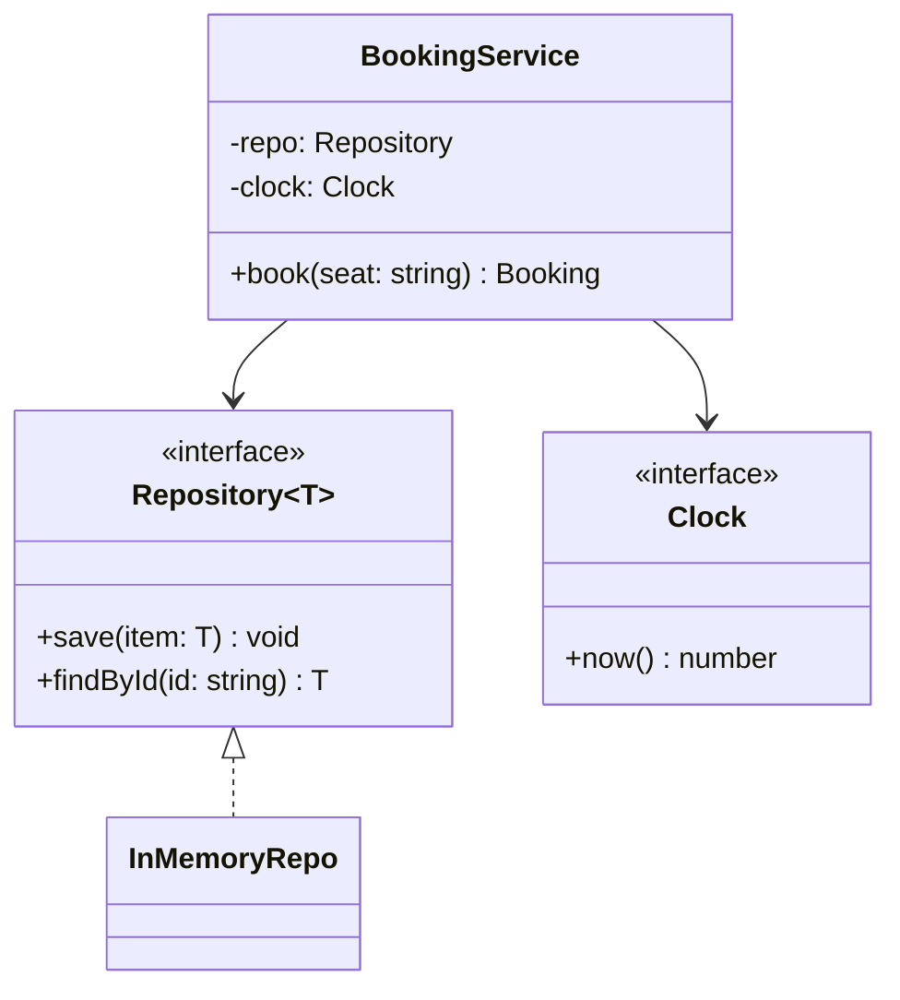

# 05 · TypeScript Features for LLD

> **Read time:** 25 min · **Used in:** every problem. State modelling: [06 Vending Machine](../problems/06-vending-machine/README.md), [17 Ride Sharing](../problems/17-ride-sharing/README.md). DI: [19 Payment Wallet](../problems/19-payment-wallet/README.md)
> **Related:** [01 OOP](01-oop-pillars.md) · [P12 State](patterns/p12-state.md) · [P18 Repository and DI](patterns/p18-repository-di.md)

## The idea in one line

Use the type system to make wrong states impossible to write, and keep runtime code plain: interfaces for contracts, union types for states, generics for reusable containers, constructor injection for dependencies.

## The problem it solves

```ts
// Before: stringly-typed, optional fields everywhere
class Payment {
  status: string = 'created';  // 'captured'? 'CAPTURED'? 'capturd'?
  txnId?: string;              // set only when captured... maybe
  failureReason?: string;      // set only when failed... maybe
}
```

The compiler cannot catch a typo in `status`, and nothing stops `status = 'captured'` with no `txnId`.

## Interfaces vs abstract classes

| | `interface` | `abstract class` |
|---|---|---|
| Runtime code | None (erased) | Real class, real prototype |
| Shared implementation | No | Yes (concrete methods, constructor) |
| Multiple | A class can implement many | A class extends one |
| `instanceof` check | Not possible | Possible |
| Use for | Contracts at boundaries: `PaymentGateway`, `Repository<T>` | A base with shared steps: Template Method ([P15](patterns/p15-template-method.md)) |

Default to interfaces. Use an abstract class only when you really share code.

## Access modifiers, `readonly` and `#private`

```ts
class Account {
  readonly id: string;           // set once in the constructor
  protected ownerId: string;     // subclasses can see it
  private pin: string;           // compile-time only; (acc as any).pin still works at runtime
  #balance = 0;                  // runtime private (ES2022); not visible even through `any`

  constructor(id: string, ownerId: string, pin: string) {
    this.id = id; this.ownerId = ownerId; this.pin = pin;
  }
}
```

- `private` is enough in interviews. Mention `#field` if asked about real privacy.
- `readonly` is shallow: `readonly items: Item[]` still allows `items.push()`. Use `ReadonlyArray<Item>` or `readonly Item[]` for the content too.

## Enums vs union literals

```ts
enum VehicleType { BIKE = 'BIKE', CAR = 'CAR' }   // a runtime object + a type
type SpotSize = 'SMALL' | 'MEDIUM' | 'LARGE';     // type only, zero runtime code
const CHANNELS = ['EMAIL', 'SMS', 'PUSH'] as const;
type Channel = (typeof CHANNELS)[number];        // a union, and an array to loop over
```

Both are fine. Union literals are lighter and work well with plain JSON. String enums are fine if the team likes them. Avoid numeric enums: `VehicleType[0]` reverse mapping and any number being accepted are surprises.

## Discriminated unions for states

```ts
type Payment =
  | { status: 'CREATED'; id: string; amount: number }
  | { status: 'CAPTURED'; id: string; amount: number; txnId: string }
  | { status: 'FAILED'; id: string; amount: number; reason: string };

function describe(p: Payment): string {
  switch (p.status) {
    case 'CREATED': return `pending ${p.amount}`;
    case 'CAPTURED': return `paid, txn ${p.txnId}`;   // txnId is known to exist here
    case 'FAILED': return `failed: ${p.reason}`;
    default: { const never: never = p; return never; } // compile error if a state is missed
  }
}
```

A "captured payment without a `txnId`" cannot be written. The `never` check forces you to handle new states. For behaviour-heavy states, use the State pattern ([P12](patterns/p12-state.md)).

## Generics

```ts
interface Repository<T extends { id: string }> {
  save(item: T): void;
  findById(id: string): T | undefined;
}

class InMemoryRepo<T extends { id: string }> implements Repository<T> {
  private items = new Map<string, T>();
  save(item: T) { this.items.set(item.id, item); }
  findById(id: string) { return this.items.get(id); }
}
```

One repository class for users, orders and seats. Also useful: `Record<VehicleType, number>` for rate tables (the compiler checks every key is present), `Partial<T>`, `Pick<T, K>`, `Readonly<T>`.

## Dependency injection without a framework

1. Each class asks for its dependencies in the constructor, typed by interface.
2. One function, the **composition root**, creates everything and wires it.
3. Tests call the same constructors with fakes.

```ts
interface Clock { now(): number }
interface IdGen { next(): string }

class BookingService {
  constructor(
    private readonly repo: Repository<{ id: string; seat: string; at: number }>,
    private readonly clock: Clock,
    private readonly ids: IdGen,
  ) {}
  book(seat: string) {
    const b = { id: this.ids.next(), seat, at: this.clock.now() };
    this.repo.save(b);
    return b;
  }
}

// main.ts: the composition root
let n = 0;
const service = new BookingService(new InMemoryRepo(), { now: () => Date.now() }, { next: () => `B${++n}` });
```

No decorators, no container, no `reflect-metadata`. Enough for any machine-coding round. NestJS does the same with `@Injectable()` providers and a module that binds tokens to classes.

## Class diagram



## When NOT to use these

- Don't write clever types (conditional types, deep mapped types) in a 90-minute round. Readers must understand them quickly.
- Don't make everything generic. `Repository<T>` yes; `Service<TReq, TRes, TCtx>` no.

## In the Node/TS world

- `tsx` and `ts-node` run TS directly. `tsc --noEmit` only type-checks. This repo uses both.
- Zod or similar libraries infer TS types from runtime schemas, useful to validate input at the API boundary.

## What to say in the interview

> "I model statuses as a union of string literals, and the payment itself as a discriminated union, so a captured payment always has a transaction id. Dependencies are interfaces injected through the constructor, and `main.ts` wires them. That's dependency injection without a framework. Storage is a generic in-memory repository behind an interface, so moving to Postgres only changes the wiring."

## Common follow-ups

<details><summary>`type` or `interface`?</summary>

Both describe object shapes. `interface` can be extended and merged (declaration merging) and gives clearer error messages for classes. `type` is needed for unions, tuples and mapped types. A common rule: `interface` for contracts that classes implement, `type` for data and unions.
</details>

<details><summary>Does TS check `implements` at runtime?</summary>

No. Types are erased. `implements` is a compile-time check that the class matches the shape. At runtime you need `instanceof` on a class, or a type guard function (`isCard(x): x is Card`).
</details>

## Self-test (answer before opening)

<details><summary>1. Model a ride: REQUESTED, ACCEPTED (has driverId), ONGOING (has driverId, startedAt), COMPLETED (adds fare).</summary>

A discriminated union on `status` where each variant has only its fields. Then a `switch` with a `never` default check.
</details>

<details><summary>2. `readonly seats: Seat[]`. Can a caller add a seat?</summary>

Yes, with `seats.push()`. `readonly` only stops reassigning the property. Use `readonly Seat[]` as the type to block mutation methods.
</details>

<details><summary>3. Where should `new PostgresOrderRepo()` appear in a well-designed app?</summary>

Only in the composition root (`main.ts`, or a DI module). Services receive the interface.
</details>

## Go deeper

- Effective TypeScript (Dan Vanderkam), the type design chapter; the TypeScript Handbook pages "Narrowing", "Classes", "Generics"
- Older notes in this repo: `archive/notes/LLD-guide.md`, PART 9 "TypeScript-Specific Best Practices"
