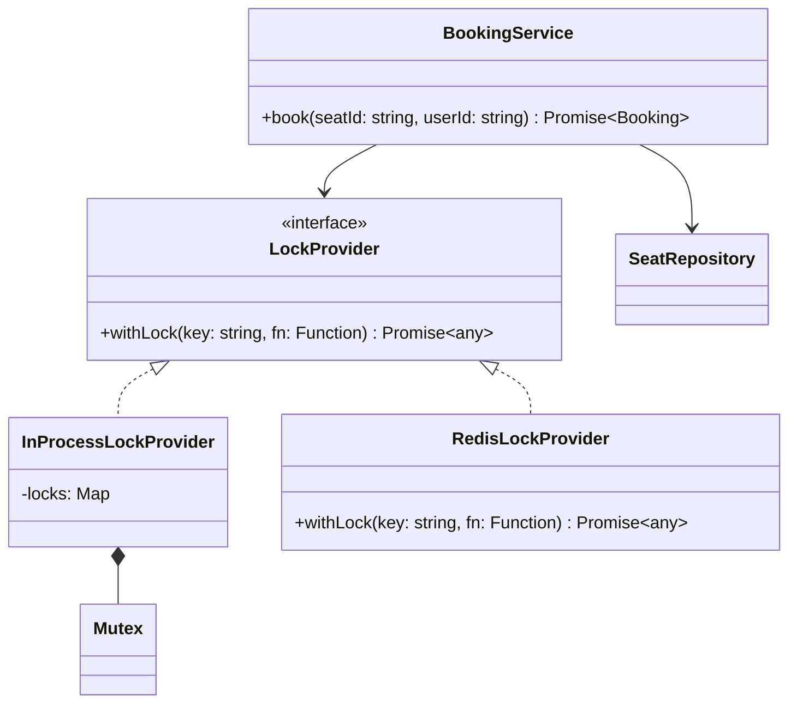

# 06 · Concurrency and Race Conditions in Node LLD

> **Read time:** 30 min · **Visuals:** [v28 Seat locking](../../visuals/v28-seat-locking.html) · [v30 Node event loop](../../visuals/v30-node-event-loop.html)
> **Used in:** [13 BookMyShow](../problems/13-bookmyshow/README.md), [19 Payment Wallet](../problems/19-payment-wallet/README.md), [04 Rate Limiter](../problems/04-rate-limiter/README.md), [01 Parking Lot](../problems/01-parking-lot/README.md) (extension 1)
> **HLD side:** [10 SQL deep dive](../../hld/concepts/10-sql-deep-dive.md) · [19 Idempotency](../../hld/concepts/19-idempotency-delivery-semantics.md) · [30 Distributed locks](../../hld/concepts/30-consensus-coordination.md)

## The idea in one line

Node runs your JavaScript on one thread, but every `await` lets other requests run. So "check, then await, then act" is a race, exactly like in multi-threaded code.

## The problem it solves

```ts
// Before: two requests for the same seat both succeed
async function bookSeat(seatId: string, userId: string) {
  const seat = await seatRepo.find(seatId);      // both requests read status = 'FREE'
  if (seat.status !== 'FREE') throw new Error('Taken');
  await paymentGateway.hold(userId, seat.price); // the other request runs during this await
  seat.status = 'BOOKED';                        // both write BOOKED: double booking
  seat.userId = userId;
  await seatRepo.save(seat);
}
```

Between the check and the write there is an `await`, and the event loop runs the second request there. Both see `FREE`.

**What is safe:** no `await` between check and act. In one process, a synchronous block runs to the end without interruption.

```ts
function holdSeatSync(seat: { status: string; heldBy?: string }, userId: string) {
  if (seat.status !== 'FREE') throw new Error('Taken'); // check
  seat.status = 'HELD';                                  // act, in the same tick
  seat.heldBy = userId;
}
```

That is why in-memory LLD solutions should **reserve first (synchronously), then do the slow async work, then confirm or release**.

## Fix 1: a tiny Mutex (in-process, per key)

```ts
class Mutex {
  private tail: Promise<void> = Promise.resolve();
  async runExclusive<T>(fn: () => Promise<T>): Promise<T> {
    const prev = this.tail;
    let release!: () => void;
    this.tail = new Promise<void>((r) => (release = r));
    await prev;                  // wait for everyone before us
    try { return await fn(); }
    finally { release(); }       // always let the next one go
  }
}

const locks = new Map<string, Mutex>();
const lockFor = (key: string) => locks.get(key) ?? locks.set(key, new Mutex()).get(key)!;
// usage: await lockFor(`seat:${seatId}`).runExclusive(() => bookSeat(seatId, userId));
```

A **Semaphore** lets `n` callers in at once (limit parallel calls to a payment gateway):

```ts
class Semaphore {
  private waiters: Array<() => void> = [];
  constructor(private permits: number) {}
  async acquire(): Promise<void> {
    if (this.permits > 0) { this.permits--; return; }
    await new Promise<void>((r) => this.waiters.push(r));
  }
  release(): void {
    const next = this.waiters.shift();
    if (next) next(); else this.permits++;   // hand the permit straight to a waiter
  }
}
```

These work only **inside one process**: two pods each have their own `Map`. Across instances, use the database or Redis.

## Fix 2: database locking

| | Pessimistic | Optimistic |
|---|---|---|
| How | `SELECT … FOR UPDATE` inside a transaction locks the row | A `version` column; `UPDATE … WHERE id = $1 AND version = $2` |
| Conflict | The second transaction waits | The second update changes 0 rows → retry or fail |
| Good for | High contention, short transactions (wallet debit) | Low contention, reads >> writes (profile edits, inventory with few clashes) |
| Risk | Deadlocks, lock waits; never hold a lock across an HTTP call | Retry storms under high contention |

```sql
-- pessimistic
BEGIN;
SELECT balance FROM wallets WHERE id = $1 FOR UPDATE;
UPDATE wallets SET balance = balance - $2 WHERE id = $1;
COMMIT;

-- optimistic
UPDATE seats SET status = 'BOOKED', user_id = $2, version = version + 1
WHERE id = $1 AND status = 'FREE' AND version = $3;   -- 0 rows updated = someone else won
```

Often you don't need either: one **conditional atomic update** (`WHERE status = 'FREE'`, or `balance = balance - $2 WHERE balance >= $2`) is enough. For queues of work, `FOR UPDATE SKIP LOCKED` lets workers take different rows.

## Fix 3: idempotency keys (retries are also concurrency)

A client times out and retries. Without protection, you charge twice.

```ts
async function charge(idemKey: string, amount: number): Promise<string> {
  const existing = await idemStore.get(idemKey);
  if (existing) return existing.result;           // same key, same answer
  await idemStore.insertPending(idemKey);         // UNIQUE constraint: a second insert fails
  const txnId = await gateway.charge(amount);
  await idemStore.complete(idemKey, txnId);
  return txnId;
}
```

The **unique constraint** (or Redis `SET key value NX`) makes it safe; the `get` alone has the same check-then-act race. Also store a request hash and reject the same key with a different body.

## Real threads: worker_threads and Atomics (briefly)

- `worker_threads` run JS in parallel. They share memory only through `SharedArrayBuffer`; everything else is copied by message passing. `Atomics.add`, `Atomics.compareExchange`, `Atomics.wait` / `notify` work on that shared memory.
- They are for CPU-heavy work (image processing, crypto, parsing), rarely needed in backend LLD. Mention them to show you know concurrency (interleaving) vs parallelism.

## Class diagram



Put the lock behind an interface: the in-memory version passes your tests, and a Redis or DB version plugs in without touching `BookingService`.

## When NOT to add locks

- Fully synchronous in-memory code in one process does not need a mutex. Say so; it shows you understand the event loop.
- Don't hold a lock (in-process or DB) while calling a slow external API. Reserve with a short hold and a TTL instead (seat `HELD` until `expiresAt`).

## In the Node/TS world

- The `async-mutex` npm package provides `Mutex` and `Semaphore` with the same idea as above.
- Redis locks: `SET lock:key token NX PX 30000`, and release only if the token matches (a Lua script). Redlock is the multi-node variant and is debated; for correctness, use fencing tokens.
- Prisma supports interactive transactions and raw `FOR UPDATE` queries; TypeORM has `setLock('pessimistic_write')` and `@VersionColumn` for optimistic locking.

## What to say in the interview: "what if this is multi-threaded?"

> "In a single Node process, my `holdSeat` is safe because the check and the update are in one synchronous block, with no `await` between them. If I add async work in between, I'd guard it with a per-seat mutex. With several instances or real threads, in-process locks don't help, so I'd move the guarantee to the data store: a conditional update `WHERE status = 'FREE'`, or `SELECT … FOR UPDATE` for the wallet debit, plus an idempotency key on the payment API so client retries don't double-charge. A held seat gets a TTL so a crashed client doesn't block it forever."

In Java terms: `ReentrantLock` per key, `ConcurrentHashMap.compute`, `AtomicInteger`.

## Common follow-ups

<details><summary>Is `map.set(k, map.get(k)! + 1)` safe in Node?</summary>

Yes, in one process, if nothing awaits in between. It's one synchronous statement. It is not safe across processes, and the same code in Java with threads is not safe.
</details>

<details><summary>Optimistic or pessimistic for a wallet?</summary>

Most teams use pessimistic row locks or a single conditional update for the debit, because contention on one hot wallet can be high and retries are costly. Writes go to an append-only ledger in the same transaction.
</details>

## Self-test (answer before opening)

<details><summary>1. Why can two `async` requests in single-threaded Node both pass an `if (balance >= amount)` check?</summary>

There is an `await` between the check and the debit (for example a DB read or a gateway call). The event loop runs the other request at that point, and it reads the old balance.
</details>

<details><summary>2. An `UPDATE … WHERE version = 7` returns 0 rows. What does it mean and what do you do?</summary>

Someone else updated the row first. Re-read the row and retry the business logic (a few times with backoff), or return a conflict error to the caller.
</details>

<details><summary>3. Why is "check the idempotency table, then insert" not enough?</summary>

Two retries can both see "no row" and both charge. The unique constraint on the key (or `SET NX`) must decide the winner.
</details>

## Go deeper

- Designing Data-Intensive Applications, chapter 7 (Transactions): "lost updates", "write skew", "explicit locking", "compare-and-set"
- Node.js docs: "The Node.js Event Loop" guide and the `worker_threads` and `Atomics` API pages
- Java Concurrency in Practice, chapters 2–3, if your interviewer thinks in Java threads
- Older notes in this repo: `archive/notes/DB/shardening_partitioning_replication.md` (database background)
