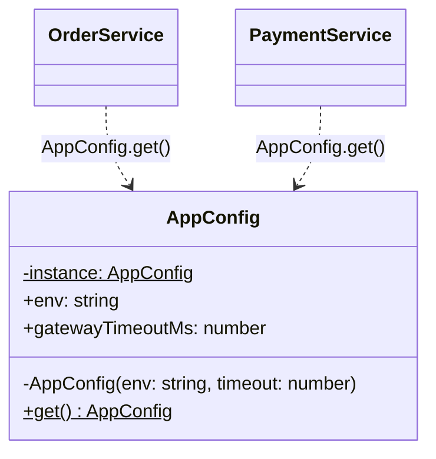

# P01 · Singleton

> **Read time:** 12 min · **Run it:** `npx tsx lld/concepts/patterns/p01-singleton.ts`
> **Used in:** [03 Logger](../../problems/03-logger/README.md), [01 Parking Lot](../../problems/01-parking-lot/README.md) (only if asked)

## The idea in one line

A class has exactly one instance, and everyone gets that same instance through one access point.

## The problem it solves

Some objects should exist once per process: a config loaded from env, a DB connection pool, a logger with shared transports. If every module calls `new`, you get many pools and many file handles.

```ts
// Before: every caller makes its own pool
class DbPool {
  constructor() { console.log('opening 10 connections'); }
}
// orders.ts
const pool1 = new DbPool();
// payments.ts
const pool2 = new DbPool(); // 20 connections now, and they don't share limits
```

## The pattern

```ts
class AppConfig {
  private static instance: AppConfig | undefined;
  private constructor(readonly env: string, readonly gatewayTimeoutMs: number) {}

  static get(): AppConfig {
    if (!AppConfig.instance) {
      AppConfig.instance = new AppConfig(process.env.NODE_ENV ?? 'dev', 3000);
    }
    return AppConfig.instance;
  }
}

AppConfig.get() === AppConfig.get(); // true
// new AppConfig(...)                  // compile error: constructor is private
```

**The Node way: a module export.** ES modules and CommonJS modules are evaluated once and cached. Every `import` gets the same object.

```ts
// config.ts
export const config = { env: process.env.NODE_ENV ?? 'dev', gatewayTimeoutMs: 3000 };
// logger.ts
export const logger = new Logger(config);
```

This is the usual choice in Node code. Use the class form when the interviewer asks for "the Singleton pattern".

## Class diagram



## When to use it

- One shared resource per process: connection pool, logger, metrics registry, config.
- A cache that all modules must share in memory.
- The problem statement says "there is only one parking lot" **and** the interviewer wants to see the pattern.

## When NOT to use it

- As a global variable for business state. A `BookingManager.getInstance()` hides dependencies and makes tests share state.
- When you need test isolation. Prefer to create one instance in the composition root and **inject** it. You still get one instance, but tests can pass a fake.
- When you need one instance per tenant, per request or per test. That is not a singleton.

## In the Node/TS world

- Module caching gives you a singleton for free: `export const prisma = new PrismaClient()` is a common pattern, so the app does not open many pools.
- The cache is **per process** (and per worker thread). With `cluster`, PM2 or Kubernetes replicas, each process has its own "singleton". Shared state across them must live in Redis or the DB.
- Two copies of a package in `node_modules` (different versions) give you two "singletons". This causes real bugs with things like React context or `instanceof` checks.
- In NestJS, providers are singleton-scoped by default. `Scope.REQUEST` and `Scope.TRANSIENT` change that.

## What to say in the interview

> "I need one config and one logger per process. In Node, the simplest singleton is a module-level export, because modules are cached. If you want the classic pattern, I'll use a private constructor and a static `get()`. But I'll still pass the instance into services through the constructor, so tests can swap it. And it's one per process, so anything shared across instances goes to Redis or the database."

## Common follow-ups

<details><summary>Is the lazy `if (!instance)` check thread-safe?</summary>

In Node, yes: the check and the assignment run in one synchronous block. If the init is async (`await connect()`), two callers can both start it. Fix: cache the **promise**, not the result: `instancePromise ??= create()`. In Java you would use double-checked locking or an enum singleton.
</details>

<details><summary>Why do people call Singleton an anti-pattern?</summary>

It is global mutable state with a nice name. It hides dependencies (you cannot see them in the constructor), it couples code to a concrete class, and it leaks state between tests. Dependency injection with a single instance avoids these problems.
</details>

<details><summary>How do you reset a singleton in tests?</summary>

Avoid needing to: inject it. If you must, add a `resetForTests()` static, or use `vi.resetModules()` in Vitest to re-evaluate modules.
</details>

## Self-test (answer before opening)

<details><summary>1. Your app runs 4 pods. Each has an in-memory singleton rate-limit counter. What goes wrong?</summary>

Each pod counts on its own, so the real limit is 4x. The counter must live in a shared store like Redis.
</details>

<details><summary>2. Two concurrent first calls to an async `getDb()` open two pools. Fix it.</summary>

Store the promise: `let p: Promise<Db> | undefined; export const getDb = () => (p ??= connect());`
</details>

<details><summary>3. What makes the TS class form a singleton at compile time?</summary>

The `private constructor`. Outside code cannot call `new`, so the static `get()` is the only way in. At runtime, plain JS could still call it.
</details>

## Go deeper

- GoF Design Patterns, "Singleton" (Creational Patterns chapter)
- Head First Design Patterns, chapter 5 ("One of a Kind Objects")
- Older notes in this repo: `archive/notes/LLD-guide.md`, PART 3, "Singleton Pattern" section
- Related: [P18 Repository and DI](p18-repository-di.md) for the injected alternative
