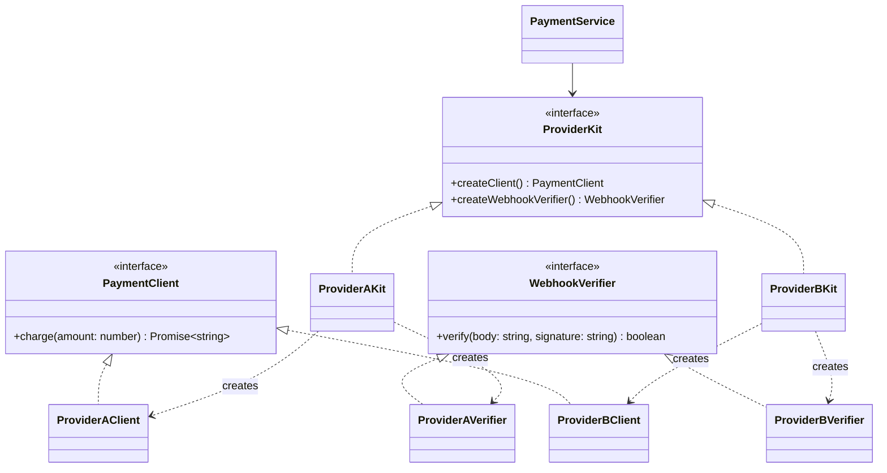

# P02 · Factory Method and Abstract Factory

> **Read time:** 18 min · **Visual:** [v23 Strategy and Factory](../../../visuals/v23-strategy-factory.html) · **Run it:** `npx tsx lld/concepts/patterns/p02-factory.ts`
> **Used in:** [01 Parking Lot](../../problems/01-parking-lot/README.md), [04 Rate Limiter](../../problems/04-rate-limiter/README.md), [23 Chess](../../problems/23-chess/README.md), [05 Notification Service](../../problems/05-notification-service/README.md)

## The idea in one line

Put the "which concrete class do I create?" decision in one place, so the rest of the code works only with interfaces.

## The problem it solves

```ts
// Before: creation logic copied into every caller
async function checkout(method: string, amount: number) {
  let gateway;
  if (method === 'UPI') gateway = new UpiGateway(process.env.UPI_KEY!);
  else if (method === 'CARD') gateway = new CardGateway(process.env.CARD_KEY!, 3);
  else if (method === 'NETBANKING') gateway = new NetBankingGateway();
  else throw new Error('Unknown method');
  return gateway.charge(amount);
}
// refund(), retryPayment() and reconcile() repeat the same if/else chain
```

A new method means finding and editing every copy of the chain.

## The pattern

**Simple factory (a registry).** This is what you write in most machine-coding rounds:

```ts
interface PaymentGateway { charge(amount: number): Promise<string> }
type Method = 'UPI' | 'CARD' | 'NETBANKING';

class GatewayFactory {
  private creators: Record<Method, () => PaymentGateway> = {
    UPI: () => new UpiGateway(),
    CARD: () => new CardGateway(3),
    NETBANKING: () => new NetBankingGateway(),
  };
  create(method: Method): PaymentGateway { return this.creators[method](); }
}
```

**Factory Method (GoF).** A base class defines the algorithm and calls an abstract `create…()` method. Subclasses decide which product to make.

```ts
abstract class NotificationSender {
  protected abstract createChannel(): Channel; // the factory method
  async send(to: string, msg: string) {
    const channel = this.createChannel();
    await channel.deliver(to, msg.trim());
  }
}
class SmsSender extends NotificationSender {
  protected createChannel() { return new SmsChannel(); }
}
```

**Abstract Factory.** One factory creates a **family** of related objects that must match. For example each payment provider has a client, a webhook verifier and a refund API that only work together.

```ts
interface ProviderKit {
  createClient(): PaymentClient;
  createWebhookVerifier(): WebhookVerifier;
}
class ProviderAKit implements ProviderKit { /* returns ProviderA* objects */ }
class ProviderBKit implements ProviderKit { /* returns ProviderB* objects */ }
// The service receives one kit; it can't mix A's client with B's verifier.
```

## Class diagram



## When to use it

- Creation depends on input (vehicle type, payment method, chess piece letter) and happens in more than one place.
- Construction is complex (config, retries, keys) and callers should not know it.
- Abstract Factory: you have product families that must stay consistent (provider A vs provider B, light vs dark UI kit, test vs live mode).

## When NOT to use it

- One concrete class and no plan for more: just call `new`.
- Don't wrap a registry in three layers (`FactoryProvider` → `FactoryFactory`). A `Record<Type, () => T>` is enough.
- Abstract Factory is rare in machine-coding rounds. Use it only when a family really exists.

## In the Node/TS world

- `http.createServer()`, `net.createConnection()`, `crypto.createHash('sha256')`: Node's `create*` functions are factories that hide the concrete class.
- `axios.create({ baseURL, timeout })` returns a configured instance: a factory.
- NestJS `useFactory` providers build a dependency from config at startup.
- Many loggers (`pino()`, `winston.createLogger()`) are factories.

## What to say in the interview

> "Callers only see the `PaymentGateway` interface. One `GatewayFactory` maps the method to a constructor in a lookup table, so adding a method is one new class and one line in the table. If each provider had a client and a webhook verifier that must match, I'd use an abstract factory, one kit per provider, so we never mix them."

## Common follow-ups

<details><summary>Factory vs Strategy: what is the difference?</summary>

Factory decides **which object to create**. Strategy is **the object that does the varying work**. They usually appear together: the factory creates the right pricing strategy, and the lot calls `strategy.price()`.
</details>

<details><summary>Doesn't the factory still have a switch? Isn't that an OCP violation?</summary>

Yes, but it's in one place, and every other caller is closed. You can go further with registration: each class registers itself (`factory.register('UPI', () => new UpiGateway())`), so the factory file never changes.
</details>

<details><summary>Factory Method vs simple factory?</summary>

A simple factory is a function or class with a lookup. GoF Factory Method uses inheritance: a subclass overrides the creation step of a base class algorithm. In TS code, the simple factory is far more common.
</details>

## Self-test (answer before opening)

<details><summary>1. Chess: create pieces from the letters "KQRBNP". Which pattern and how?</summary>

A simple factory: `Record<Letter, (color) => Piece>`. The board parses a setup string and calls the factory.
</details>

<details><summary>2. When does the factory return the same object every time?</summary>

When the products are stateless (a strategy with no fields). Then it can cache one instance per key. That is a factory plus the Flyweight idea.
</details>

<details><summary>3. Your service takes `ProviderKit` in its constructor. What does a test pass?</summary>

A `FakeKit` that returns fake clients and verifiers, so the test needs no network.
</details>

## Go deeper

- GoF Design Patterns, "Factory Method" and "Abstract Factory" (Creational Patterns chapter)
- Head First Design Patterns, chapter 4 ("Baking with OO Goodness")
- Older notes in this repo: `archive/notes/LLD-guide.md`, PART 3, "Factory Pattern" section
- Related: [P10 Strategy](p10-strategy.md), [02 SOLID](../02-solid.md) (open/closed)
