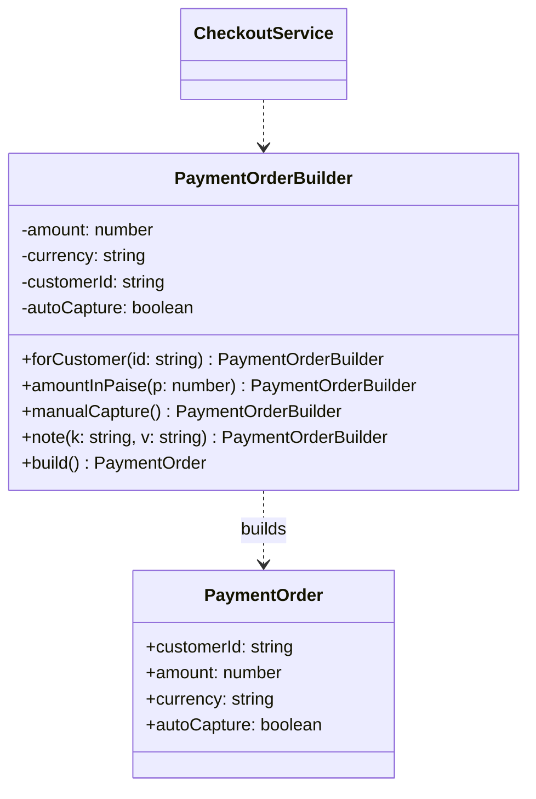

# P03 · Builder

> **Read time:** 12 min · **Run it:** `npx tsx lld/concepts/patterns/p03-builder.ts`
> **Used in:** [08 Snake and Ladder](../../problems/08-snake-ladder/README.md) (board setup), [14 In-memory KV Store](../../problems/14-kv-store/README.md) (config), test data in every problem

## The idea in one line

Build a complex object step by step with named methods, validate once in `build()`, and get back an immutable result.

## The problem it solves

```ts
// Before: a telescoping constructor
const order = new PaymentOrder(
  'ord_1', 49900, 'INR', undefined, undefined, true, 3, 'cust_9', undefined, 'notes',
);
// Which argument is the capture flag? Which one is retries? Is amount in paise?
```

Positional arguments are easy to swap by mistake, and validation is spread out.

## The pattern

```ts
class PaymentOrderBuilder {
  private amount?: number;
  private currency = 'INR';
  private customerId?: string;
  private autoCapture = true;
  private notes: Record<string, string> = {};

  forCustomer(id: string) { this.customerId = id; return this; }
  amountInPaise(p: number) { this.amount = p; return this; }
  inCurrency(c: string) { this.currency = c; return this; }
  manualCapture() { this.autoCapture = false; return this; }
  note(k: string, v: string) { this.notes[k] = v; return this; }

  build(): Readonly<PaymentOrder> {
    if (!this.customerId) throw new Error('customerId is required');
    if (!this.amount || this.amount <= 0) throw new Error('amount must be > 0');
    return Object.freeze({
      customerId: this.customerId, amount: this.amount, currency: this.currency,
      autoCapture: this.autoCapture, notes: { ...this.notes },
    });
  }
}

const order = new PaymentOrderBuilder()
  .forCustomer('cust_9').amountInPaise(49900).manualCapture().note('cart', 'c_77').build();
```

**In TypeScript, an options object often replaces Builder.** Named fields solve the "which argument is which" problem:

```ts
function createPaymentOrder(opts: { customerId: string; amount: number; currency?: string; autoCapture?: boolean }) {}
createPaymentOrder({ customerId: 'cust_9', amount: 49900, autoCapture: false });
```

Use a real builder when construction has **steps, rules between fields, or many optional parts** (an HTTP request, a query, a game board, test fixtures).

A **step builder** goes further. The types force the order: you cannot call `build()` before the required steps.

```ts
interface NeedsUrl { url(u: string): NeedsMethod }
interface NeedsMethod { get(): Optional; post(body: unknown): Optional }
interface Optional { header(k: string, v: string): Optional; timeout(ms: number): Optional; build(): HttpRequest }
```

## Class diagram



## When to use it

- Many optional fields and rules between them ("if manual capture, a capture deadline is required").
- The object must be immutable after creation, but it is assembled over several steps.
- Test data: `aBooking().forSeat('A1').expired().build()` keeps tests short and readable.
- Building a board, a game, a query or a request from parts (snake and ladder positions, SQL query builders).

## When NOT to use it

- Three or four fields: use a constructor or an options object.
- If `build()` has no validation and the fields are independent, the builder is only extra code.
- Don't add a "Director" class (from GoF) unless you really reuse the same build sequence in many places.

## In the Node/TS world

- Query builders: Knex (`knex('orders').where({ status: 'PAID' }).limit(10)`) and TypeORM's `createQueryBuilder()`.
- Zod schemas are built by chaining: `z.object({...}).strict().optional()`.
- `new URL()` plus `url.searchParams.append()` builds a URL step by step.
- Test-data builders are common in Jest/Vitest codebases.

## What to say in the interview

> "A payment order has many optional fields and a few rules between them, so I'll use a builder with named methods and validate everything in `build()`. The result is frozen. For simple objects, I'd just use an options object, since TypeScript gives named fields for free."

## Common follow-ups

<details><summary>Builder vs Factory?</summary>

Factory decides **which** class to create, in one call. Builder decides **how** to assemble one object over several calls. They can combine: a factory returns a pre-filled builder.
</details>

<details><summary>Should the builder be reusable after `build()`?</summary>

Either way, but be explicit. Copy fields into the result (`{ ...this.notes }`) so later builder calls don't change an already built object.
</details>

<details><summary>How do you make required fields a compile-time check?</summary>

A step builder: each step returns an interface that has only the next allowed methods. Or a generic builder that tracks set fields in a type parameter. The step builder is easier to explain.
</details>

## Self-test (answer before opening)

<details><summary>1. Why freeze the built object?</summary>

So no code changes the order after validation. The checks in `build()` stay true.
</details>

<details><summary>2. Snake and Ladder: how does a builder help?</summary>

`new BoardBuilder(100).snake(99, 7).ladder(3, 38).build()`. `build()` checks that no snake and ladder start on the same cell and that no cycle exists.
</details>

<details><summary>3. When is the options object better?</summary>

When fields are independent and there are no steps. It's less code and just as readable.
</details>

## Go deeper

- GoF Design Patterns, "Builder" (Creational Patterns chapter)
- Effective Java (Joshua Bloch), Item 2 "Consider a builder when faced with many constructor parameters"
- Older notes in this repo: `archive/notes/LLD-guide.md`, PART 3, "Builder Pattern" section
- Related: [P02 Factory](p02-factory.md), [05 TS for LLD](../05-ts-for-lld.md) (readonly)
