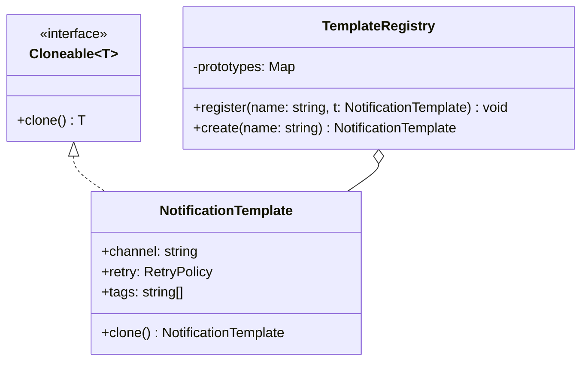

# P04 · Prototype

> **Read time:** 10 min · **Run it:** `npx tsx lld/concepts/patterns/p04-prototype.ts`
> **Used in:** no problem needs it as a main pattern. It helps in [08 Snake and Ladder](../../problems/08-snake-ladder/README.md) (board templates), [23 Chess](../../problems/23-chess/README.md) (copy the board to test a move) and [14 In-memory KV Store](../../problems/14-kv-store/README.md) (snapshots)

## The idea in one line

Create new objects by copying a configured existing object (the prototype), instead of building them from scratch.

## The problem it solves

You have a pre-configured object that is costly or long to set up, and you need many similar ones with small changes. Copying by hand is error-prone, and a shallow copy shares nested data.

```ts
// Before: "copy" with spread, nested objects are shared
const template = { channel: 'EMAIL', retry: { max: 3, backoffMs: 500 }, tags: ['txn'] };
const otp = { ...template };
otp.retry.max = 1;      // changes template.retry.max too
otp.tags.push('otp');   // template.tags is now ['txn', 'otp']
```

## The pattern

Each prototype knows how to clone itself correctly (deep where needed). A registry holds named prototypes.

```ts
interface Cloneable<T> { clone(): T }

class NotificationTemplate implements Cloneable<NotificationTemplate> {
  constructor(
    public channel: 'EMAIL' | 'SMS',
    public retry: { max: number; backoffMs: number },
    public tags: string[],
  ) {}
  clone(): NotificationTemplate {
    return new NotificationTemplate(this.channel, { ...this.retry }, [...this.tags]);
  }
}

const registry = new Map<string, NotificationTemplate>([
  ['transactional', new NotificationTemplate('EMAIL', { max: 3, backoffMs: 500 }, ['txn'])],
]);
const otp = registry.get('transactional')!.clone();
otp.retry.max = 1; // the template is safe
```

For plain data (no class methods), `structuredClone(obj)` makes a deep copy. It is built into Node 17+.

## Class diagram



## When to use it

- Many objects start from the same configured template (notification templates, board layouts, default rate plans).
- You need a snapshot of state to try something and roll back (chess: copy the board, apply a move, check if the king is in check).
- Creating from scratch is costly (parsed config, a loaded rule set) and copying is cheap.

## When NOT to use it

- If a constructor or a factory with defaults works, use that. Prototype adds a `clone()` you must keep in sync with every new field.
- Avoid deep clones of large object graphs on hot paths. Copying is not free.
- Objects with identity or resources (a DB connection, a socket) should not be cloned.

## In the Node/TS world

- JavaScript itself is prototype-based: `Object.create(proto)` makes an object whose prototype is `proto`. That is about inheritance of methods, not about copying state. Don't mix the two ideas up in the interview.
- `structuredClone()` deep-copies plain data, `Map`, `Set`, `Date` and typed arrays. It does **not** keep class prototypes (you get a plain object) and it throws on functions.
- `{ ...obj }` and `Object.assign()` are shallow copies.
- `JSON.parse(JSON.stringify(x))` loses `Date`, `Map`, `undefined` and `BigInt` fails. Prefer `structuredClone`.

## What to say in the interview

> "Each notification type starts from a template. I keep the templates in a registry and give the template class a `clone()` that copies nested parts, so changing one notification never changes the template. For plain data, `structuredClone` is enough. Note that it drops class methods."

## Common follow-ups

<details><summary>Shallow vs deep copy: when is shallow enough?</summary>

When nested values are immutable (strings, numbers, frozen objects) or are meant to be shared (a reference to a `Product` that nobody mutates). Deep-copy only the parts the clone will change.
</details>

<details><summary>How does Prototype relate to Memento?</summary>

Both copy state. Memento stores a snapshot to restore later (undo). Prototype copies to create a new, independent object. A `clone()` method is often used to make a memento. See [P13 Command and Memento](p13-command.md).
</details>

## Self-test (answer before opening)

<details><summary>1. What does `structuredClone(new Money(100, 'INR'))` return?</summary>

A plain object `{ amount: 100, currency: 'INR' }`. It is not an instance of `Money`, so its methods are gone.
</details>

<details><summary>2. `const b = { ...a }` and then `b.items.push(x)`. What happens to `a`?</summary>

`a.items` also gets `x`. Spread copies only the top level, so both point to the same array.
</details>

<details><summary>3. Chess: why clone the board when checking a move?</summary>

To apply the move on a copy and test "is my king in check now?" without changing the real board. If the move is illegal, you throw the copy away.
</details>

## Go deeper

- GoF Design Patterns, "Prototype" (Creational Patterns chapter)
- Head First Design Patterns, appendix "Leftover Patterns" (Prototype)
- Related: [P03 Builder](p03-builder.md), [P13 Command and Memento](p13-command.md)
