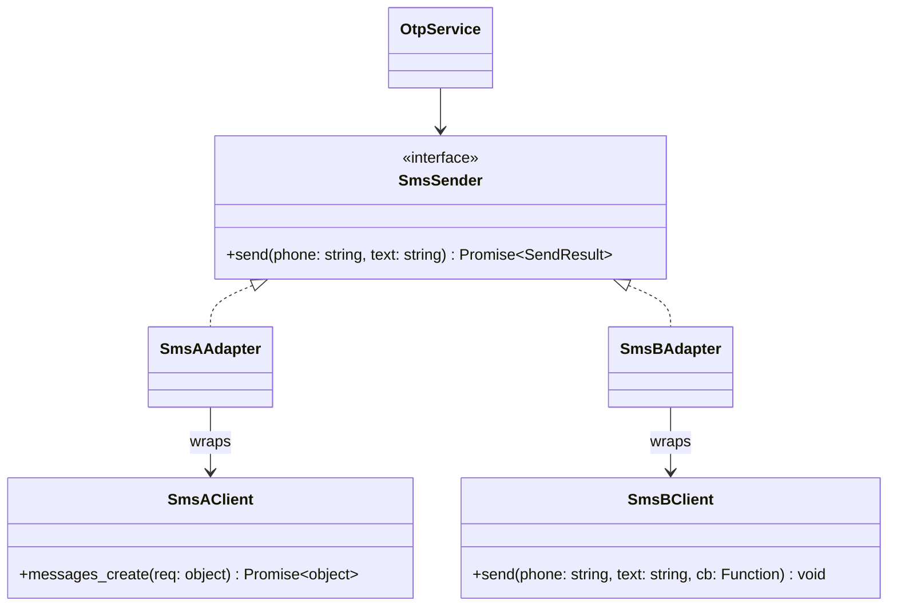

# P05 · Adapter

> **Read time:** 12 min · **Run it:** `npx tsx lld/concepts/patterns/p05-adapter.ts`
> **Used in:** [05 Notification Service](../../problems/05-notification-service/README.md) (provider SDKs), [19 Payment Wallet](../../problems/19-payment-wallet/README.md) (payment gateways), [03 Logger](../../problems/03-logger/README.md) (sinks)

## The idea in one line

Wrap a class with the wrong interface so it looks like the interface your code expects.

## The problem it solves

Third-party SDKs each have their own shape: different method names, units, error styles, callbacks vs promises. If your service calls them directly, the SDK's shape leaks everywhere.

```ts
// Before: the service knows every SDK's quirks
async function sendOtp(provider: string, phone: string, otp: string) {
  if (provider === 'smsA') {
    await smsA.messages.create({ to: `+91${phone}`, body: `OTP ${otp}` }); // promise API
  } else if (provider === 'smsB') {
    smsB.send(phone, `OTP ${otp}`, (err, id) => { /* callback API, errors as codes */ });
  }
}
```

## The pattern

Define **your** interface (the target). Write one adapter per SDK (the adaptee). The service only knows the target.

```ts
interface SmsSender {
  send(phone: string, text: string): Promise<{ messageId: string }>;
}

class SmsAAdapter implements SmsSender {
  constructor(private client: SmsAClient) {}
  async send(phone: string, text: string) {
    const res = await this.client.messages.create({ to: `+91${phone}`, body: text });
    return { messageId: res.sid };
  }
}

class SmsBAdapter implements SmsSender {
  constructor(private client: SmsBClient) {}
  send(phone: string, text: string) {
    return new Promise<{ messageId: string }>((resolve, reject) =>
      this.client.send(phone, text, (code, id) =>
        code === 0 ? resolve({ messageId: id }) : reject(new Error(`SMS-B error ${code}`)),
      ),
    );
  }
}

class OtpService {
  constructor(private sms: SmsSender) {}
  sendOtp(phone: string, otp: string) { return this.sms.send(phone, `Your OTP is ${otp}`); }
}
```

The adapter also converts **units and errors**: paise vs rupees, provider error codes to your own `PaymentDeclinedError`.

## Class diagram



## When to use it

- Integrating any external SDK or API: payment gateways, SMS, email, KYC, maps.
- Migrating from an old internal module to a new one with a different API.
- Keeping your domain types clean: the adapter maps a provider response to your `PaymentResult`.

## When NOT to use it

- When you control both sides, change the interface instead of adding a wrapper.
- Don't build one adapter that grows `if (provider === ...)` branches inside. One adapter per adaptee.
- Don't "adapt" by leaking the raw SDK object out of the adapter (`getRawClient()`). Then callers depend on it again.

## In the Node/TS world

- `util.promisify(fs.readFile)` is an adapter from the callback style to promises. `util.callbackify` goes the other way.
- `stream.Readable.from(asyncIterable)` and `Readable.toWeb()` / `Readable.fromWeb()` adapt between iterables, Node streams and web streams.
- ORMs adapt each SQL dialect (Postgres, MySQL) behind one API. Database drivers in Knex and TypeORM work this way.
- Express → serverless adapters (for example wrapping an Express app as an AWS Lambda handler) are adapters too.

## What to say in the interview

> "The service depends on my `SmsSender` interface, not on any SDK. Each provider gets an adapter that converts the request, the response and the error codes. So adding or replacing a provider is one new class, and the domain code and tests don't change. I'd also put a fallback in front: try provider A, then B."

## Common follow-ups

<details><summary>Adapter vs Facade vs Decorator vs Proxy?</summary>

Adapter **changes the interface** to one the client expects. Facade **simplifies** many classes behind one new interface. Decorator **keeps the same interface** and adds behaviour. Proxy **keeps the same interface** and controls access (lazy, cache, auth).
</details>

<details><summary>Object adapter vs class adapter?</summary>

An object adapter holds the adaptee as a field (composition). A class adapter extends the adaptee (inheritance). In TS, use the object adapter. It works with any instance and you can't extend two classes anyway.
</details>

<details><summary>How do you test an adapter?</summary>

Contract tests: the same test suite runs against every `SmsSender` implementation, with the SDK client stubbed. Plus a few integration tests against the provider's sandbox.
</details>

## Self-test (answer before opening)

<details><summary>1. Gateway A returns amounts in paise, gateway B in rupees as strings. Where do you convert?</summary>

Inside each adapter. Your domain uses one unit (integer paise) everywhere.
</details>

<details><summary>2. Which Node utility is a ready-made adapter for callback APIs?</summary>

`util.promisify`.
</details>

<details><summary>3. The SDK throws `{ code: 'CARD_DECLINED' }`. What should your adapter throw?</summary>

Your own error type, for example `PaymentDeclinedError`, so the service never checks provider-specific codes.
</details>

## Go deeper

- GoF Design Patterns, "Adapter" (Structural Patterns chapter)
- Head First Design Patterns, chapter 7 ("Being Adaptive")
- Older notes in this repo: `archive/notes/LLD-guide.md`, PART 3, "Adapter Pattern" section
- Related: [P07 Facade](p07-facade.md), [P06 Decorator](p06-decorator.md), [02 SOLID](../02-solid.md) (dependency inversion)
