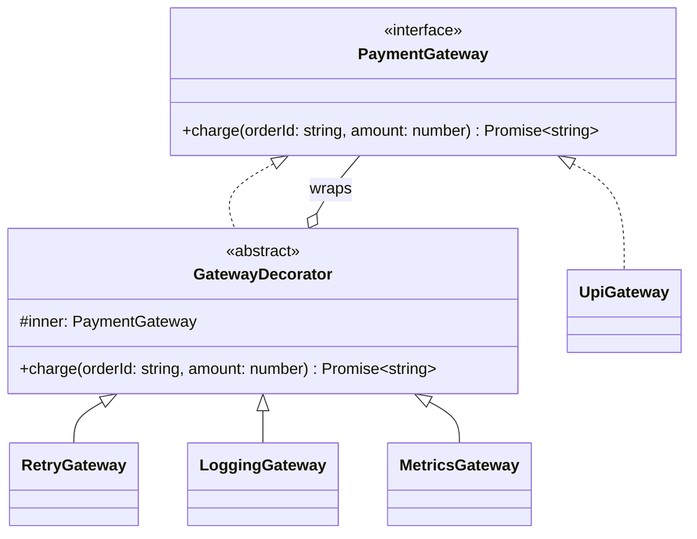

# P06 · Decorator

> **Read time:** 15 min · **Visual:** [v26 Decorator and Chain of Responsibility](../../../visuals/v26-decorator-chain.html) · **Run it:** `npx tsx lld/concepts/patterns/p06-decorator.ts`
> **Used in:** [03 Logger](../../problems/03-logger/README.md) (formatters), [05 Notification Service](../../problems/05-notification-service/README.md) (retry, rate limit), [20 Cart with Coupons](../../problems/20-ecommerce-cart-coupons/README.md) (stacked price add-ons)

## The idea in one line

Wrap an object in another object with the **same interface** that adds behaviour before or after the call. Stack wrappers to combine behaviours.

## The problem it solves

You want retries, logging, metrics and timeouts around a payment gateway. With inheritance you get a class for every combination.

```ts
// Before: subclass explosion
class RetryingGateway extends RazorpayGateway {}
class LoggingGateway extends RazorpayGateway {}
class LoggingRetryingGateway extends RazorpayGateway {}
class LoggingRetryingTimedGateway extends RazorpayGateway {}
// ...and the same again for every other gateway
```

## The pattern

```ts
interface PaymentGateway { charge(orderId: string, amount: number): Promise<string> }

class RetryGateway implements PaymentGateway {
  constructor(private inner: PaymentGateway, private attempts = 3) {}
  async charge(orderId: string, amount: number) {
    let lastErr: unknown;
    for (let i = 1; i <= this.attempts; i++) {
      try { return await this.inner.charge(orderId, amount); }
      catch (e) { lastErr = e; }
    }
    throw lastErr;
  }
}

class LoggingGateway implements PaymentGateway {
  constructor(private inner: PaymentGateway) {}
  async charge(orderId: string, amount: number) {
    console.log(`charge ${orderId} ${amount}`);
    const txn = await this.inner.charge(orderId, amount);
    console.log(`ok ${txn}`);
    return txn;
  }
}

const gateway: PaymentGateway = new LoggingGateway(new RetryGateway(new UpiGateway(), 3));
```

Order matters. `Logging(Retry(x))` logs once per call. `Retry(Logging(x))` logs every attempt.

**Function form.** In TS a higher-order function is often lighter:

```ts
type Charge = (orderId: string, amount: number) => Promise<string>;
const withRetry = (fn: Charge, n: number): Charge => async (id, amt) => { /* loop */ };
const withTiming = (fn: Charge): Charge => async (id, amt) => { const t = Date.now(); try { return await fn(id, amt); } finally { console.log(Date.now() - t, 'ms'); } };
const charge = withTiming(withRetry(upi.charge.bind(upi), 3));
```

## Class diagram



## When to use it

- Cross-cutting behaviour around a call: retry, timeout, cache, logging, metrics, auth checks, rate limiting.
- You want to choose the combination at wiring time (config), not at compile time.
- Adding responsibilities without editing the original class (open/closed).

## When NOT to use it

- One fixed behaviour that is always on: just put it in the class.
- Deep stacks are hard to debug. The stack trace shows five wrappers. Keep it to 2–4.
- If the wrapper needs to change the interface, it's an Adapter, not a Decorator.

## In the Node/TS world

- **TS `@decorators` are a different thing.** `@Get()`, `@Injectable()` in NestJS are language decorators: functions that run on a class or method definition, mostly to add metadata or wrap methods. They can implement this pattern (a `@Retry(3)` method decorator wraps the method), but the GoF pattern is about wrapping objects at runtime.
- Higher-order functions for Express handlers: `asyncHandler(fn)` wraps a handler to catch rejected promises.
- Stream `Transform`s like `zlib.createGzip()` wrap a stream with extra behaviour when you `pipe` or `pipeline` them.
- Libraries like `p-retry` and `p-timeout` wrap a function: decorator-style.

## What to say in the interview

> "Retry, logging and metrics are decorators around the `PaymentGateway` interface. Each wrapper does one thing, and I compose them in the composition root. The service doesn't know they exist. The order is deliberate: metrics outside retry, so we measure the full time the user waits."

## Common follow-ups

<details><summary>Decorator vs Chain of Responsibility?</summary>

Both wrap and pass along. A decorator **always** calls the inner object and adds behaviour. A handler in a chain **may stop** the request (return early, reject) or pass it on. Express middleware is closer to a chain because `next()` is optional.
</details>

<details><summary>Decorator vs Proxy?</summary>

Same structure. The intent differs: a decorator adds behaviour and you stack many; a proxy controls access to the real object (lazy creation, caching, permissions), and usually there is one.
</details>

<details><summary>Retry is a decorator. What must the wrapped call be for retry to be safe?</summary>

Idempotent. For a charge, pass an idempotency key so a retry after a timeout doesn't charge twice. See [06 Concurrency](../06-concurrency-in-node.md).
</details>

## Self-test (answer before opening)

<details><summary>1. `new Retry(new Logging(gw))` and the gateway fails twice then succeeds. How many log lines for "charge"?</summary>

Three, one per attempt, because logging is inside the retry.
</details>

<details><summary>2. Why is a decorator better than a `retryCount` flag inside every gateway?</summary>

The retry logic is written once and works for every gateway. Gateways stay focused on talking to their provider.
</details>

<details><summary>3. Is `@Injectable()` the GoF Decorator pattern?</summary>

No. It's a TS language decorator that registers metadata for NestJS DI. It doesn't wrap an object to add behaviour.
</details>

## Go deeper

- GoF Design Patterns, "Decorator" (Structural Patterns chapter)
- Head First Design Patterns, chapter 3 ("Decorating Objects")
- Older notes in this repo: `archive/notes/LLD-guide.md`, PART 3, "Decorator Pattern" section
- Related: [P14 Chain of Responsibility](p14-chain-of-responsibility.md), [P08 Proxy](p08-proxy.md)
