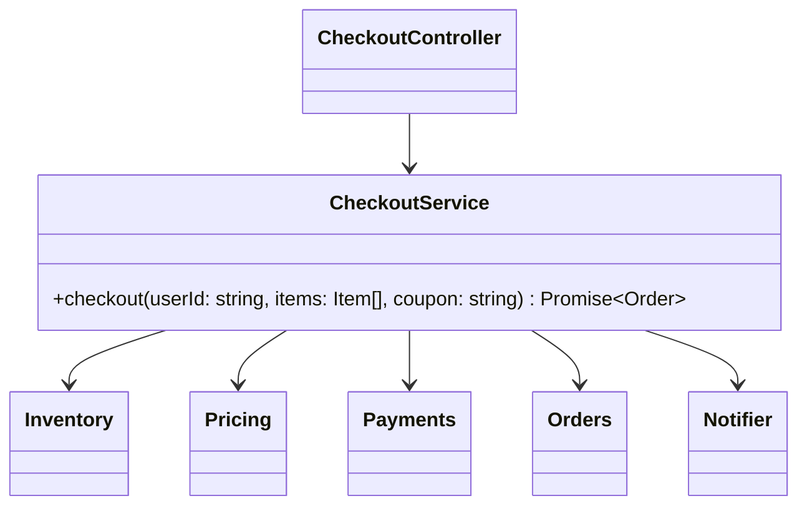

# P07 · Facade

> **Read time:** 10 min · **Run it:** `npx tsx lld/concepts/patterns/p07-facade.ts`
> **Used in:** [01 Parking Lot](../../problems/01-parking-lot/README.md) (`ParkingLot` is the facade), [13 BookMyShow](../../problems/13-bookmyshow/README.md), [18 Food Delivery](../../problems/18-food-delivery/README.md), [11 ATM](../../problems/11-atm/README.md)

## The idea in one line

Give a group of classes one simple entry point that runs the common flow, so callers don't need to know the parts or their order.

## The problem it solves

```ts
// Before: the controller orchestrates five subsystems itself
app.post('/checkout', async (req, res) => {
  const cart = await cartRepo.get(req.body.userId);
  inventory.reserve(cart.items);
  const total = pricing.total(cart.items, req.body.coupon);
  const txn = await payments.charge(req.body.userId, total);
  const order = orders.create(cart, txn);
  await notifier.send(req.body.userId, `Order ${order.id} placed`);
  res.json(order);
});
// the mobile API, the admin tool and the retry job copy this sequence, and some forget to release stock on failure
```

## The pattern

```ts
class CheckoutService {
  constructor(
    private inventory: Inventory,
    private pricing: Pricing,
    private payments: Payments,
    private orders: Orders,
    private notifier: Notifier,
  ) {}

  async checkout(userId: string, items: Item[], coupon?: string): Promise<Order> {
    const reservation = this.inventory.reserve(items);
    try {
      const total = this.pricing.total(items, coupon);
      const txnId = await this.payments.charge(userId, total);
      const order = this.orders.create(userId, items, total, txnId);
      this.inventory.commit(reservation);
      void this.notifier.send(userId, `Order ${order.id} placed`); // don't fail checkout on notification
      return order;
    } catch (e) {
      this.inventory.release(reservation);
      throw e;
    }
  }
}
// controller: res.json(await checkoutService.checkout(userId, items, coupon));
```

The subsystems still exist and can be used directly. The facade only offers the common path, with the correct order and cleanup.

## Class diagram



## When to use it

- A use case touches several subsystems in a fixed order (checkout, book a seat, place a food order, withdraw cash).
- You want one public API for the machine-coding demo and the tests (`lot.park()`, `lot.unpark()`).
- To hide a complex library behind a small API your team needs.

## When NOT to use it

- Don't let the facade become a god class with 40 methods. Split by use case: `CheckoutService`, `RefundService`.
- Don't put business rules of the subsystems into the facade. It orchestrates; pricing rules stay in `Pricing`.
- A facade over a single class is just an extra layer.

## In the Node/TS world

- The service layer in a controller → service → repository app is usually a facade per use case.
- `fs.promises.readFile()` hides open, read in chunks, close. `http.get()` is a short form of `http.request()` plus `req.end()`.
- Higher-level libraries over low-level SDKs: for example AWS SDK v3's `@aws-sdk/lib-storage` `Upload` class hides multipart upload steps (create, upload parts, complete, abort).
- In machine-coding problems, the top class (`ParkingLot`, `BookMyShow`, `Splitwise`) is the facade the tests call.

## What to say in the interview

> "`CheckoutService` is a facade over inventory, pricing, payments, orders and notifications. It owns the order of steps and the compensation: if payment fails, it releases the reserved stock. Controllers and jobs call this one method, so the flow is written once. Each subsystem keeps its own rules."

## Common follow-ups

<details><summary>Facade vs Mediator?</summary>

A facade is one-way: clients call it, and the subsystems don't know it exists. A mediator coordinates objects that talk to each other through it, and they know the mediator. See [P17 Mediator](p17-mediator.md).
</details>

<details><summary>Facade vs Adapter?</summary>

An adapter makes one existing interface fit another interface you already have. A facade defines a new, simpler interface over many classes.
</details>

<details><summary>What happens when the steps span services (microservices)?</summary>

The facade becomes an orchestrator of a saga: each step has a compensating action, and you need retries and idempotency. See [20 Distributed transactions](../../../hld/concepts/20-distributed-transactions.md).
</details>

## Self-test (answer before opening)

<details><summary>1. Name the facade in a Parking Lot solution and its methods.</summary>

`ParkingLot` with `park(plate, type)`, `unpark(ticketId)` and `availableSpots(size)`. Floors, spots and pricing are behind it.
</details>

<details><summary>2. Why send the notification without `await` in the checkout facade?</summary>

A slow or failed notification should not fail or slow down a paid order. Better still: publish an event and let a worker send it.
</details>

<details><summary>3. The facade has grown to 25 methods. What do you do?</summary>

Split it by use case or actor into several smaller services.
</details>

## Go deeper

- GoF Design Patterns, "Facade" (Structural Patterns chapter)
- Head First Design Patterns, chapter 7 ("Being Adaptive", the Facade half)
- Older notes in this repo: `archive/notes/LLD-guide.md`, PART 3, "Facade Pattern" section
- Related: [P05 Adapter](p05-adapter.md), [P17 Mediator](p17-mediator.md)
