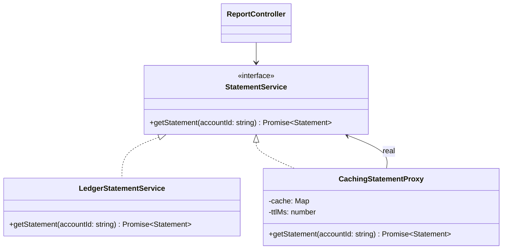

# P08 · Proxy

> **Read time:** 12 min · **Visual:** [v29 LRU cache internals](../../../visuals/v29-lru-cache.html) (for the caching proxy) · **Run it:** `npx tsx lld/concepts/patterns/p08-proxy.ts`
> **Used in:** [02 LRU / LFU Cache](../../problems/02-lru-cache/README.md) (a caching proxy in front of a slow store), [04 Rate Limiter](../../problems/04-rate-limiter/README.md) (a protection proxy), [12 Library Management](../../problems/12-library-management/README.md) (role checks)

## The idea in one line

Put a stand-in object with the **same interface** in front of the real one, to control access: cache it, create it lazily, check permissions, or call it remotely.

## The problem it solves

```ts
// Before: every caller handles caching and permission checks itself
async function getStatement(user: User, accountId: string) {
  if (user.role !== 'ADMIN' && user.accountId !== accountId) throw new Error('Forbidden');
  const cached = cache.get(accountId);
  if (cached) return cached;
  const s = await ledgerService.getStatement(accountId); // slow: 800 ms
  cache.set(accountId, s);
  return s;
}
// the export job and the mobile API repeat this, and one of them forgets the permission check
```

## The pattern

```ts
interface StatementService { getStatement(accountId: string): Promise<Statement> }

class CachingStatementProxy implements StatementService {
  private cache = new Map<string, { value: Statement; expiresAt: number }>();
  constructor(private real: StatementService, private ttlMs: number, private now = Date.now) {}
  async getStatement(accountId: string) {
    const hit = this.cache.get(accountId);
    if (hit && hit.expiresAt > this.now()) return hit.value;
    const value = await this.real.getStatement(accountId);
    this.cache.set(accountId, { value, expiresAt: this.now() + this.ttlMs });
    return value;
  }
}

class AuthStatementProxy implements StatementService {
  constructor(private real: StatementService, private user: User) {}
  getStatement(accountId: string) {
    if (this.user.role !== 'ADMIN' && this.user.accountId !== accountId) {
      return Promise.reject(new Error('Forbidden'));
    }
    return this.real.getStatement(accountId);
  }
}
```

Kinds of proxy:

| Kind | Controls |
|---|---|
| Caching proxy | Repeated expensive calls |
| Virtual (lazy) proxy | Creates the costly real object on first use |
| Protection proxy | Who can call what |
| Remote proxy | A local object that forwards calls over the network (gRPC stubs, SDK clients) |

## Class diagram



## When to use it

- An expensive call is repeated with the same input (cache).
- An object is costly to build and often not needed (lazy load).
- Access rules must be enforced in one place, around an object you don't want to change.

## When NOT to use it

- If only one caller needs caching, a local `Map` in that caller may be enough.
- Don't hide a network call so well that callers think it is cheap. Remote proxies need timeouts and clear errors.
- A caching proxy without a TTL or size limit is a memory leak. Use an LRU.

## In the Node/TS world

- The JavaScript `Proxy` object intercepts property access with traps (`get`, `set`, `has`, `apply`). Vue 3 reactivity and MobX (v6, by default) use it to track reads and writes. It is a language tool; you can build this pattern with it, but a class with the same interface is clearer in an interview.
- gRPC and many SDK clients are remote proxies: a local method call becomes a network request.
- `http-proxy-middleware` is a reverse proxy. That's a network proxy, not quite the object pattern, but the idea (stand in front, forward) is the same.
- `DataLoader` batches and caches loads per request, a proxy in front of a DB.

## What to say in the interview

> "The statement service is slow, so I put a caching proxy in front of it. It has the same interface, so the controller doesn't change. The cache has a TTL and a size limit. Permission checks are a separate protection proxy, so the rule is enforced in one place no matter who calls."

## Common follow-ups

<details><summary>Proxy vs Decorator: same structure, so what's the difference?</summary>

Intent. A decorator adds behaviour, and you often stack several, chosen by the client. A proxy controls access to one real object, and it often manages that object's lifecycle (lazy creation). A caching wrapper can be called either; say "caching proxy" and explain.
</details>

<details><summary>How do you invalidate the cache when the data changes?</summary>

Short TTL for data that can be a bit stale. For strict data, delete the key on write (write path calls `proxy.invalidate(id)`) or listen to change events. See [08 Caching](../../../hld/concepts/08-caching.md).
</details>

<details><summary>Two requests miss the cache at the same time. Both call the slow service. Fix?</summary>

Cache the in-flight promise (request coalescing): store the promise on the first miss, and later callers await the same promise.
</details>

## Self-test (answer before opening)

<details><summary>1. Which kind of proxy is a gRPC client stub?</summary>

A remote proxy.
</details>

<details><summary>2. What does a JS `Proxy` `get` trap let you do?</summary>

Run code on every property read, for example to log, validate, track dependencies (Vue) or return a default.
</details>

<details><summary>3. Why should the caching proxy take the clock as a parameter?</summary>

So tests can move time forward and check TTL expiry without waiting.
</details>

## Go deeper

- GoF Design Patterns, "Proxy" (Structural Patterns chapter)
- Head First Design Patterns, chapter 11 ("Controlling Object Access")
- Related: [P06 Decorator](p06-decorator.md), [P05 Adapter](p05-adapter.md)
