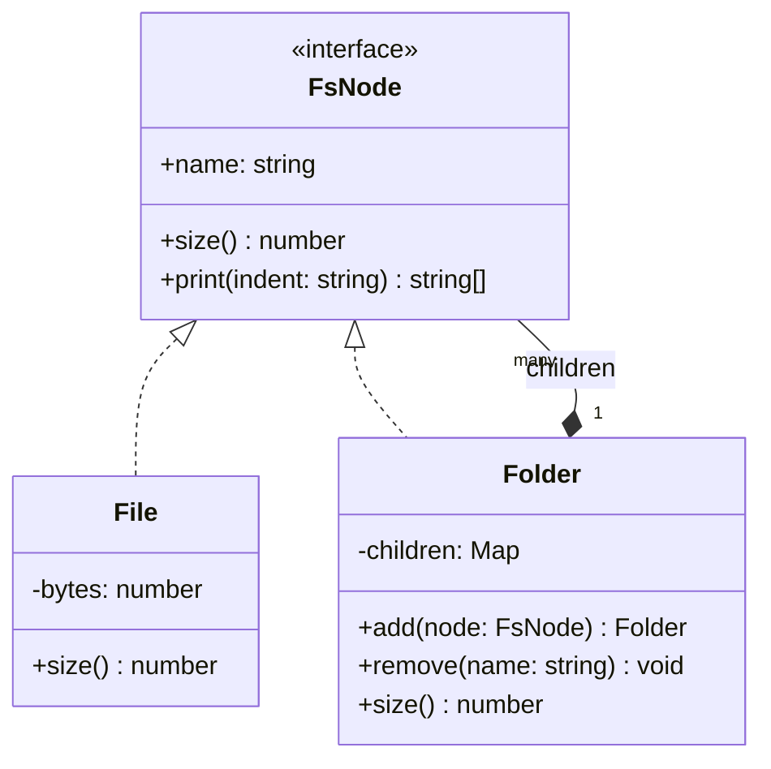

# P09 · Composite

> **Read time:** 12 min · **Run it:** `npx tsx lld/concepts/patterns/p09-composite.ts`
> **Used in:** [24 In-memory File System](../../problems/24-file-system/README.md) (main pattern), [20 Cart with Coupons](../../problems/20-ecommerce-cart-coupons/README.md) (bundles of items)

## The idea in one line

Treat a single object and a group of objects the same way, through one interface, so you can build trees and call one method on the root.

## The problem it solves

```ts
// Before: every operation checks "is it a file or a folder?"
function size(node: FileNode | FolderNode): number {
  if (node.kind === 'file') return node.bytes;
  let total = 0;
  for (const child of node.children) {
    total += child.kind === 'file' ? child.bytes : size(child); // the same check again
  }
  return total;
}
// search(), count(), print() and delete() repeat the same type checks
```

## The pattern

```ts
interface FsNode {
  readonly name: string;
  size(): number;
  print(indent?: string): string[];
}

class File implements FsNode {
  constructor(readonly name: string, private bytes: number) {}
  size() { return this.bytes; }
  print(indent = '') { return [`${indent}${this.name} (${this.bytes}B)`]; }
}

class Folder implements FsNode {
  private children = new Map<string, FsNode>();
  constructor(readonly name: string) {}
  add(node: FsNode): this {
    if (this.children.has(node.name)) throw new Error(`${node.name} exists`);
    this.children.set(node.name, node);
    return this;
  }
  size() { return [...this.children.values()].reduce((s, c) => s + c.size(), 0); }
  print(indent = '') {
    return [`${indent}${this.name}/`, ...[...this.children.values()].flatMap((c) => c.print(indent + '  '))];
  }
}

root.size(); // works the same for one file or a whole tree
```

`File` is a **leaf**. `Folder` is a **composite** that holds children of the interface type. Each call recurses down the tree.

## Class diagram



## When to use it

- Part-whole trees: file systems, org charts, menus, product bundles, nested comments, permission groups.
- Clients should not care if they hold one item or a group (a `Bundle` of products priced like a `Product`).
- An operation naturally recurses: total size, total price, render, search.

## When NOT to use it

- Flat lists: no tree, no composite.
- When leaves and groups really need different operations, forcing one interface creates methods that throw (`file.add()`). Keep `add()` only on the composite (this card does that), and accept that clients check the type when they add.
- Very deep or very large trees: recursion can be slow or hit the stack limit. Cache sizes, or walk with an explicit stack.

## In the Node/TS world

- The DOM is a composite: `Node` is the interface, `Element` holds children, `Text` is a leaf.
- React component trees: a component renders children that are elements or other components, and rendering recurses.
- An Express `Router` can be mounted inside another router with `router.use('/v1', subRouter)`: routers and routes form a tree.
- AST tools (Babel, the TypeScript compiler API) walk trees of nodes with the same base type.

## What to say in the interview

> "Files and folders both implement `FsNode` with `size()` and `print()`. A folder holds a map of children by name, so lookup by path is fast and duplicate names are rejected. Size is computed by recursion. If size is read often, I'd cache it in each folder and update parents on writes."

## Common follow-ups

<details><summary>How do you resolve a path like `/a/b/c.txt`?</summary>

Split by `/`, start at the root, and for each part look it up in the current folder's children map. If a part is missing, or a file appears before the last part, throw a not-found error. `mkdir -p` creates missing folders on the way.
</details>

<details><summary>Should `File` have an `add()` that throws?</summary>

The GoF book discusses both choices: "transparency" (all methods on the interface) vs "safety" (child methods only on the composite). In TS, prefer safety. The type system then stops `file.add()` at compile time.
</details>

<details><summary>How do you move a folder?</summary>

Remove it from the old parent's map and add it to the new parent. Check that the destination is not inside the folder being moved, or you create a cycle.
</details>

## Self-test (answer before opening)

<details><summary>1. A product bundle contains products and other bundles. How do you price it?</summary>

`Product.price()` returns its price. `Bundle.price()` returns the sum of children's `price()` minus a bundle discount. The cart calls `price()` on each line without checking the type.
</details>

<details><summary>2. Which relationship is Folder to its children in UML?</summary>

Composition: deleting a folder deletes its children.
</details>

<details><summary>3. Why a `Map` and not an array for children?</summary>

O(1) lookup by name for path resolution, and easy duplicate checks.
</details>

## Go deeper

- GoF Design Patterns, "Composite" (Structural Patterns chapter)
- Head First Design Patterns, chapter 9 ("Well-Managed Collections", the Composite half)
- Related: [P16 Iterator](p16-iterator.md) (walking the tree), [03 UML relationships](../03-uml-relationships.md)
