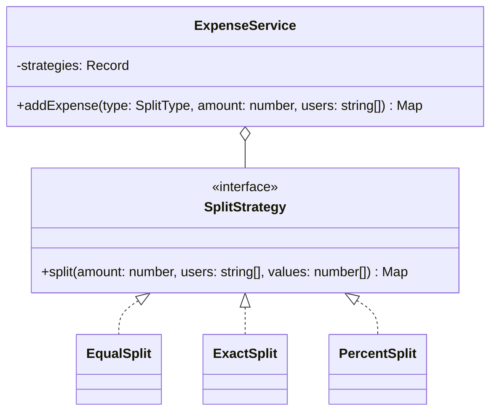

# P10 · Strategy

> **Read time:** 15 min · **Visual:** [v23 Strategy and Factory](../../../visuals/v23-strategy-factory.html) · **Run it:** `npx tsx lld/concepts/patterns/p10-strategy.ts`
> **Used in:** [01 Parking Lot](../../problems/01-parking-lot/README.md), [04 Rate Limiter](../../problems/04-rate-limiter/README.md), [09 Splitwise](../../problems/09-splitwise/README.md), [05 Notification Service](../../problems/05-notification-service/README.md), [07 Tic-Tac-Toe](../../problems/07-tic-tac-toe/README.md), [10 Elevator](../../problems/10-elevator/README.md), [16 Task Scheduler](../../problems/16-task-scheduler/README.md), [20 Cart with Coupons](../../problems/20-ecommerce-cart-coupons/README.md) and most others

## The idea in one line

Put each variant of an algorithm behind one interface, and pass the one you want into the object that uses it.

## The problem it solves

```ts
// Before: the split rule is a switch inside the service
class ExpenseService {
  split(type: string, amount: number, users: string[], values?: number[]) {
    switch (type) {
      case 'EQUAL': return users.map((u) => ({ u, share: amount / users.length }));
      case 'EXACT': return users.map((u, i) => ({ u, share: values![i] }));
      case 'PERCENT': return users.map((u, i) => ({ u, share: (amount * values![i]) / 100 }));
      default: throw new Error('unknown split');
    } // a new type ("by shares") means editing and re-testing this service
  }
}
```

## The pattern

```ts
interface SplitStrategy {
  split(amount: number, users: string[], values: number[]): Map<string, number>;
}

class EqualSplit implements SplitStrategy {
  split(amount: number, users: string[]) {
    const base = Math.floor(amount / users.length);
    let rest = amount - base * users.length; // paise left over go to the first users
    return new Map(users.map((u) => [u, base + (rest-- > 0 ? 1 : 0)]));
  }
}
class PercentSplit implements SplitStrategy { /* checks the sum is 100 */ }

class ExpenseService {
  constructor(private strategies: Record<SplitType, SplitStrategy>) {}
  addExpense(type: SplitType, amount: number, users: string[], values: number[] = []) {
    return this.strategies[type].split(amount, users, values);
  }
}
```

The service is closed for changes. A new split type is a new class plus one entry in the registry.

**Functions as strategies.** In TS, a strategy with one method can just be a function type:

```ts
type PricingFn = (minutes: number) => number;
const hourly = (rate: number): PricingFn => (m) => Math.max(1, Math.ceil(m / 60)) * rate;
const flat = (fee: number): PricingFn => () => fee;
```

Use a class when the strategy has config, state, or more than one method.

## Class diagram



## When to use it

- The problem statement says "different types of …": pricing, splits, discounts, spot allocation, rate-limit algorithms, scheduling, win checks, retry policies.
- You want to choose the behaviour at runtime (per request, per tenant, from config).
- You want to unit-test each rule on its own.

## When NOT to use it

- Two cases that will never grow: an `if` is fine.
- Don't make a strategy that needs half the caller's internals. If the interface takes ten parameters, the split is in the wrong place.
- Don't add a strategy "for the future" in a 90-minute round unless the problem hints at it. Interviewers do notice gold-plating.

## In the Node/TS world

- Passport.js: each login method (`passport-local`, `passport-google-oauth20`, `passport-jwt`) is a strategy class, registered with `passport.use(new LocalStrategy(...))`.
- `Array.prototype.sort(compareFn)`: the comparator is a strategy.
- Retry libraries take a backoff function: strategy as a function.
- Load-balancing policies in HTTP clients or proxies (round robin, least connections) are strategies.

## What to say in the interview

> "Split types change independently of the expense flow, so each one is a `SplitStrategy`. The service gets a map from split type to strategy in its constructor. Adding a new type is one class and one map entry, and nothing else changes. That's open/closed. Each strategy validates its own input, for example percentages must add up to 100."

## Common follow-ups

<details><summary>Strategy vs State?</summary>

Same structure (an interface with swappable implementations). In Strategy, the **client** chooses the algorithm and it usually does not change by itself. In State, the **object switches its own state** as events happen, and each state decides the next one. See [P12 State](p12-state.md).
</details>

<details><summary>Strategy vs Template Method?</summary>

Strategy uses composition: swap the whole algorithm object at runtime. Template Method uses inheritance: the base class fixes the steps and subclasses fill some. Prefer Strategy when you need runtime choice. See [P15 Template Method](p15-template-method.md).
</details>

<details><summary>Who chooses the strategy?</summary>

The caller, a factory or a config lookup, usually in the composition root or a small factory ([P02](p02-factory.md)). The context class only uses it.
</details>

## Self-test (answer before opening)

<details><summary>1. Split 100 paise equally among 3 users. What do the shares look like?</summary>

34, 33, 33. Work in integer paise and give the remainder to some users, so the shares add up exactly.
</details>

<details><summary>2. Weekend pricing for the parking lot. What changes?</summary>

A new `WeekendPricing` strategy (or one that wraps the hourly one and checks the day). Wire it in. `ParkingLot` doesn't change.
</details>

<details><summary>3. When is a function better than a strategy class?</summary>

When there is one method and no state or config beyond what a closure captures.
</details>

## Go deeper

- GoF Design Patterns, "Strategy" (Behavioral Patterns chapter)
- Head First Design Patterns, chapter 1 ("Welcome to Design Patterns", the duck simulator)
- Older notes in this repo: `archive/notes/LLD-guide.md`, PART 3, "Strategy Pattern" section
- Related: [P02 Factory](p02-factory.md), [02 SOLID](../02-solid.md) (open/closed)
