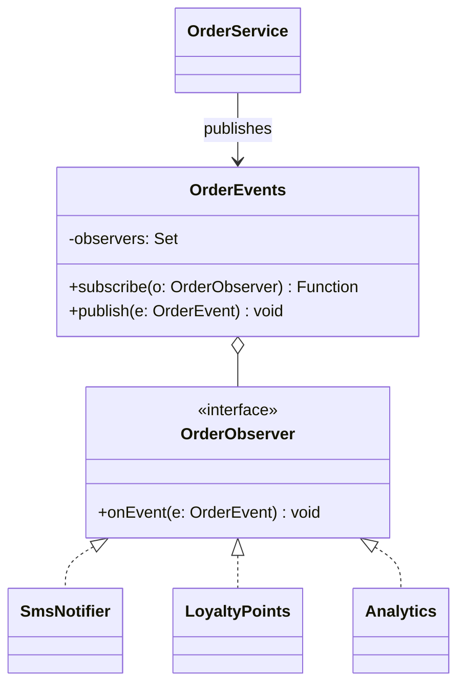

# P11 · Observer

> **Read time:** 15 min · **Visual:** [v24 Observer and pub-sub](../../../visuals/v24-observer-pubsub.html) · **Run it:** `npx tsx lld/concepts/patterns/p11-observer.ts`
> **Used in:** [05 Notification Service](../../problems/05-notification-service/README.md), [12 Library Management](../../problems/12-library-management/README.md), [15 Pub-Sub Queue](../../problems/15-pub-sub-queue/README.md), [17 Ride Sharing](../../problems/17-ride-sharing/README.md), [18 Food Delivery](../../problems/18-food-delivery/README.md), [01 Parking Lot](../../problems/01-parking-lot/README.md) (display board extension)

## The idea in one line

A subject keeps a list of observers and notifies all of them when something happens, without knowing what each one does.

## The problem it solves

```ts
// Before: the order service calls every interested module directly
class OrderService {
  markDelivered(orderId: string) {
    this.repo.setStatus(orderId, 'DELIVERED');
    this.sms.send(orderId, 'Delivered');        // notifications team
    this.loyalty.addPoints(orderId);            // loyalty team
    this.analytics.track('delivered', orderId); // data team
    // a new team = edit OrderService again; one failure stops the rest
  }
}
```

## The pattern

```ts
type OrderEvent = { type: 'DELIVERED' | 'CANCELLED'; orderId: string; userId: string };
interface OrderObserver { onEvent(e: OrderEvent): void }

class OrderEvents {
  private observers = new Set<OrderObserver>();
  subscribe(o: OrderObserver): () => void {
    this.observers.add(o);
    return () => this.observers.delete(o); // unsubscribe handle
  }
  publish(e: OrderEvent) {
    for (const o of this.observers) {
      try { o.onEvent(e); } catch (err) { console.error('observer failed', err); } // isolate failures
    }
  }
}

class OrderService {
  constructor(private events: OrderEvents) {}
  markDelivered(orderId: string, userId: string) {
    // ...update state...
    this.events.publish({ type: 'DELIVERED', orderId, userId });
  }
}
```

**Typed EventEmitter.** In Node, `EventEmitter` is the built-in subject. You can type it with an event map:

```ts
import { EventEmitter } from 'node:events';
type Events = { delivered: [orderId: string]; cancelled: [orderId: string, reason: string] };
const bus = new EventEmitter<Events>(); // generic types in recent @types/node
bus.on('cancelled', (id, reason) => console.log(id, reason));
```

## Class diagram



## Observer vs pub-sub

| | Observer | Pub-sub |
|---|---|---|
| Who knows whom | Subject holds the observer list | Publisher and subscriber only know a broker and a topic |
| Timing | Usually synchronous, same process | Usually async, can be another process or later |
| Failure | An observer error can affect the subject | Broker buffers, retries, dead-letter queues |
| Examples | `EventEmitter`, DOM events | Kafka, RabbitMQ, Redis pub/sub, SNS |

In an LLD round, start with an in-process observer. Say that in production the same events go to a queue, so slow consumers don't block the request.

## When to use it

- One state change, many independent reactions (notify user, update display board, loyalty points, analytics).
- New reactions are expected later, and the core flow should not change for them.
- UI or live updates: driver location changes, seat map updates.

## When NOT to use it

- Only one reaction, which is part of the core flow: call it directly. Hidden control flow is harder to read.
- When the order of reactions matters, or one reaction must succeed for the operation to succeed (payment then ledger entry): call them explicitly, in a transaction.
- Long event chains (A emits, B reacts and emits, C reacts...) are hard to debug.

## In the Node/TS world

- `EventEmitter`: `on`, `once`, `off`, `emit`. Listeners run **synchronously, in registration order**, inside `emit()`. A slow listener blocks the emitter.
- Emitting `'error'` with no `'error'` listener **throws**. Always add one on streams and emitters.
- More than 10 listeners for one event prints a "possible memory leak" warning (`setMaxListeners` changes it). Forgetting `off()` is a real leak.
- Streams, `http.Server` (`'request'`), `process` (`'exit'`, `'SIGTERM'`) are all emitters.
- RxJS Observables extend the idea with operators. Some ORMs offer entity listeners or subscribers (TypeORM `@AfterInsert`, `EntitySubscriberInterface`).

## What to say in the interview

> "When an order is delivered, the service publishes an `OrderDelivered` event. Notifications, loyalty and analytics subscribe. The service doesn't know them, so a new consumer doesn't change it. Each observer is isolated with try/catch. In production I'd publish to Kafka or SQS, using an outbox, so slow consumers don't block the request and events survive a crash."

## Common follow-ups

<details><summary>Are `EventEmitter` listeners async?</summary>

No. `emit()` calls each listener synchronously and returns after all of them. If a listener is `async`, `emit()` doesn't wait for its promise, and a rejection becomes an unhandled rejection unless you catch it (or use `captureRejections`).
</details>

<details><summary>How do you avoid memory leaks with observers?</summary>

Return an unsubscribe function from `subscribe()` and call it on cleanup. Use `once()` for one-time events. Watch the max-listeners warning.
</details>

<details><summary>Push vs pull observers?</summary>

Push sends the data in the event (`{ orderId, status }`). Pull sends a small signal and the observer reads what it needs from the subject. Push is simpler; pull avoids sending big payloads to observers that don't need them.
</details>

## Self-test (answer before opening)

<details><summary>1. A listener throws inside `emit('paid')`. What happens to listeners after it?</summary>

With plain `EventEmitter`, the error propagates out of `emit()` and the later listeners do not run. Wrap listeners or catch inside them.
</details>

<details><summary>2. Parking lot display board: which is the subject and which is the observer?</summary>

The floor (or the spot allocator) is the subject. It publishes "spot freed / taken". The display board is an observer that updates its counts.
</details>

<details><summary>3. Why might you still use a queue instead of an in-process observer?</summary>

Durability (events survive a crash), retries, consumers in other services, and not blocking the request on slow consumers.
</details>

## Go deeper

- GoF Design Patterns, "Observer" (Behavioral Patterns chapter)
- Head First Design Patterns, chapter 2 ("Keeping your Objects in the Know")
- Node.js docs: the `events` module page (synchronous calls, the `'error'` event, `captureRejections`)
- Older notes in this repo: `archive/notes/LLD-guide.md`, PART 3, "Observer Pattern" section
- Related: [P17 Mediator](p17-mediator.md), [17 Message queues](../../../hld/concepts/17-message-queues.md)
