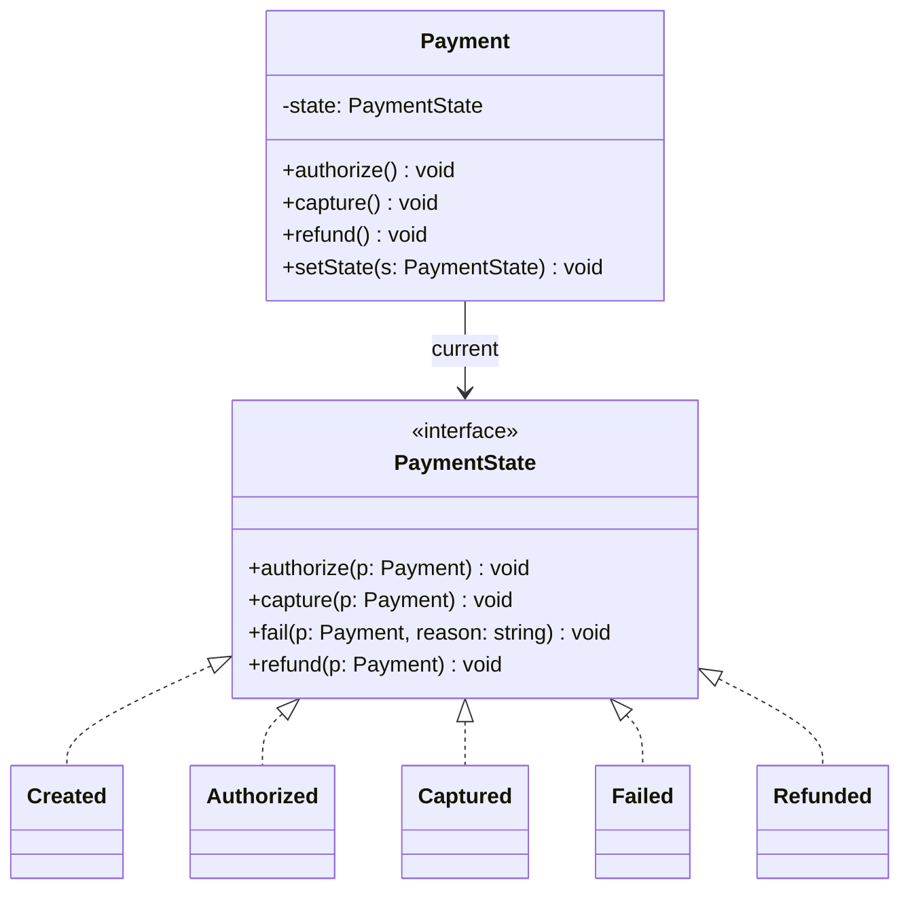
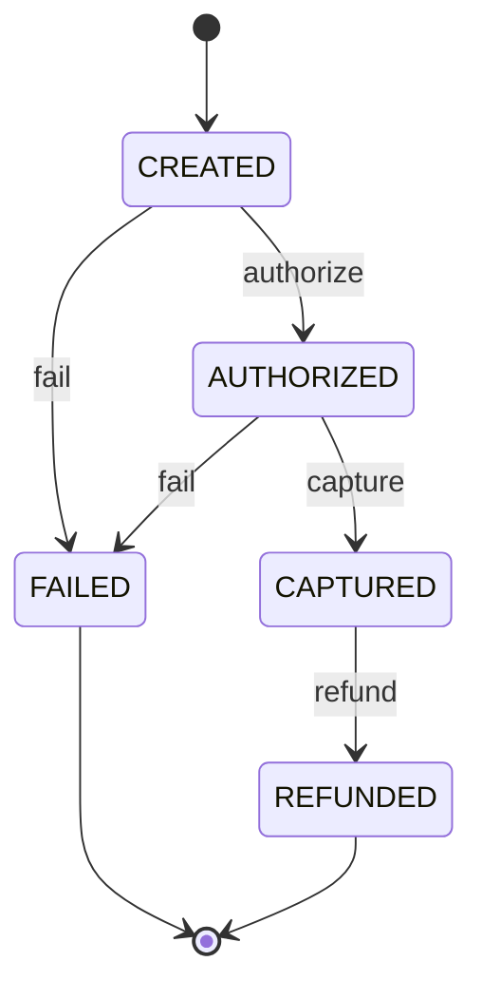

# P12 · State

> **Read time:** 18 min · **Visual:** [v25 State pattern: vending machine](../../../visuals/v25-state-machine.html) · **Run it:** `npx tsx lld/concepts/patterns/p12-state.ts`
> **Used in:** [06 Vending Machine](../../problems/06-vending-machine/README.md), [10 Elevator](../../problems/10-elevator/README.md), [11 ATM](../../problems/11-atm/README.md), [17 Ride Sharing](../../problems/17-ride-sharing/README.md), [18 Food Delivery](../../problems/18-food-delivery/README.md), [19 Payment Wallet](../../problems/19-payment-wallet/README.md)

## The idea in one line

An object changes its behaviour when its internal state changes. Each state is its own object (or a row in a transition table) that decides what each event does and which state comes next.

## The problem it solves

```ts
// Before: every method checks the status, and the rules are scattered
class Payment {
  status = 'CREATED';
  authorize() {
    if (this.status === 'CREATED') this.status = 'AUTHORIZED';
    else throw new Error('bad state');
  }
  capture() {
    if (this.status === 'AUTHORIZED') this.status = 'CAPTURED';
    else if (this.status === 'CAPTURED') return; // idempotent? only here, by accident
    else throw new Error('bad state');
  }
  refund() {
    if (this.status === 'CAPTURED') this.status = 'REFUNDED';
    // forgot: refund of a FAILED payment silently does nothing
  }
}
```

Add a `PARTIALLY_REFUNDED` state and you edit every method.

## The pattern

**Option A: state classes (GoF).** Each state implements every event. The context delegates.

```ts
interface PaymentState {
  readonly name: Status;
  authorize(p: Payment): void;
  capture(p: Payment): void;
  fail(p: Payment, reason: string): void;
  refund(p: Payment): void;
}

abstract class BaseState implements PaymentState {
  abstract readonly name: Status;
  authorize(p: Payment) { this.reject('authorize'); }
  capture(p: Payment) { this.reject('capture'); }
  fail(p: Payment, reason: string) { this.reject('fail'); }
  refund(p: Payment) { this.reject('refund'); }
  protected reject(event: string): never { throw new Error(`Cannot ${event} when ${this.name}`); }
}

class Authorized extends BaseState {
  readonly name = 'AUTHORIZED';
  capture(p: Payment) { p.setState(new Captured()); }
  fail(p: Payment, reason: string) { p.failureReason = reason; p.setState(new Failed()); }
}
```

**Option B: a transition table.** For simple machines with little behaviour per state, this is shorter and easy to review:

```ts
type Status = 'CREATED' | 'AUTHORIZED' | 'CAPTURED' | 'FAILED' | 'REFUNDED';
type Event = 'authorize' | 'capture' | 'fail' | 'refund';
const transitions: Record<Status, Partial<Record<Event, Status>>> = {
  CREATED: { authorize: 'AUTHORIZED', fail: 'FAILED' },
  AUTHORIZED: { capture: 'CAPTURED', fail: 'FAILED' },
  CAPTURED: { refund: 'REFUNDED' },
  FAILED: {},
  REFUNDED: {},
};
```

Combine it with a discriminated union ([05 TS for LLD](../05-ts-for-lld.md)) when each state carries different data.

## Class diagram





## When to use it

- The problem has a clear lifecycle: vending machine (idle, has money, dispensing), ATM (no card, card inserted, PIN ok), ride (requested, accepted, ongoing, completed), order, payment, elevator.
- The same event does different things in different states (insert coin when idle vs when dispensing).
- Invalid transitions must be rejected clearly.

## When NOT to use it

- Two or three states with almost no behaviour: an enum and a table are enough. Five state classes for a `TODO / DONE` flag is over-engineering.
- Don't let state classes reach into everything. They should call a few methods on the context (`setState`, `refundCoins`), not edit its fields freely.

## In the Node/TS world

- XState is a popular library for statecharts in TS (front-end and back-end).
- Payment providers expose status lifecycles (created, authorized, captured, refunded, failed) and send webhooks for transitions. Your webhook handler must reject or ignore out-of-order transitions, using a table like the one above.
- Node's own streams have internal states (flowing, paused, ended, destroyed). Calling `write()` after `end()` raises an error.
- In a DB, protect transitions with a conditional update: `UPDATE payments SET status='CAPTURED' WHERE id=$1 AND status='AUTHORIZED'`.

## What to say in the interview

> "The payment has a clear lifecycle, so I'll model it as a state machine. Here is the transition table: created to authorized or failed, authorized to captured or failed, captured to refunded. Each state is a class that handles the events valid for it, and the base class rejects the rest with a clear error. Adding partial refunds is one new state and two table entries. In the database, every transition is a conditional update on the current status, so two webhooks can't both move it."

## Common follow-ups

<details><summary>Who decides the next state: the context or the state?</summary>

In GoF State, the current state object decides (`p.setState(new Captured())`). This keeps transition rules next to the behaviour. A central table keeps all transitions in one place for review. Both are fine; say which you chose and why.
</details>

<details><summary>Should state objects be singletons?</summary>

If they have no fields, yes, you can share one instance per state (`States.CAPTURED`). Data that belongs to a payment (failure reason, amounts) stays on the context.
</details>

<details><summary>How do you handle a duplicate `capture` webhook?</summary>

Make it idempotent: in `CAPTURED`, a `capture` event is a no-op that returns success, not an error. Decide per event, and write it in the table.
</details>

## Self-test (answer before opening)

<details><summary>1. Vending machine states?</summary>

`Idle`, `HasMoney` (or `CoinInserted`), `Dispensing`, and maybe `OutOfStock`. Events: insert coin, select product, cancel (refund), dispense done.
</details>

<details><summary>2. State vs Strategy in one sentence.</summary>

Strategy is chosen from outside and stays; State changes itself as events arrive.
</details>

<details><summary>3. `refund()` on a `FAILED` payment. What should happen?</summary>

Throw a clear error ("Cannot refund when FAILED"). The base state rejects every event a state doesn't handle.
</details>

## Go deeper

- GoF Design Patterns, "State" (Behavioral Patterns chapter)
- Head First Design Patterns, chapter 10 ("The State of Things", the gumball machine)
- Older notes in this repo: `archive/notes/LLD-guide.md`, PART 3, "State Pattern" section
- Related: [P10 Strategy](p10-strategy.md), [05 TS for LLD](../05-ts-for-lld.md) (discriminated unions)
