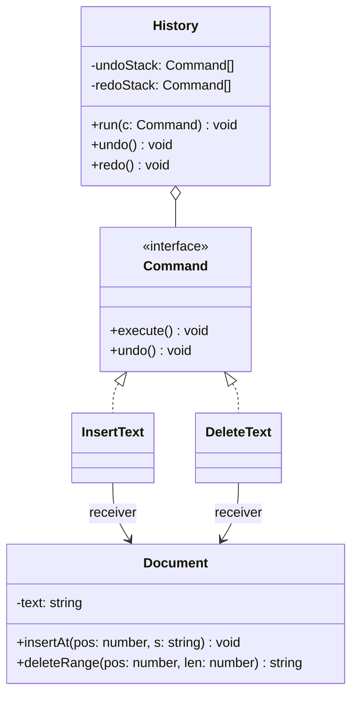

# P13 · Command (and Memento)

> **Read time:** 18 min · **Visual:** [v27 Command: undo and redo](../../../visuals/v27-command-undo-redo.html) · **Run it:** `npx tsx lld/concepts/patterns/p13-command.ts`
> **Used in:** [22 Text Editor](../../problems/22-text-editor/README.md), [14 In-memory KV Store](../../problems/14-kv-store/README.md) (transactions), [19 Payment Wallet](../../problems/19-payment-wallet/README.md) (ledger operations), [16 Task Scheduler](../../problems/16-task-scheduler/README.md) (jobs as objects)

## The idea in one line

Turn a request into an object with `execute()` (and often `undo()`), so you can queue it, log it, retry it or reverse it. Memento is the helper that saves a snapshot so you can restore it later.

## The problem it solves

```ts
// Before: actions are direct method calls, nothing remembers them
editor.insert(5, 'hello');
editor.delete(0, 3);
// "undo" now needs to know what the last action was and how to reverse it.
// You end up with a big switch over action names and their saved arguments.
```

## The pattern

```ts
interface Command {
  execute(): void;
  undo(): void;
}

class InsertText implements Command {
  constructor(private doc: Document, private pos: number, private text: string) {}
  execute() { this.doc.insertAt(this.pos, this.text); }
  undo() { this.doc.deleteRange(this.pos, this.text.length); }
}

class DeleteText implements Command {
  private removed = '';
  constructor(private doc: Document, private pos: number, private len: number) {}
  execute() { this.removed = this.doc.deleteRange(this.pos, this.len); } // remember what was removed
  undo() { this.doc.insertAt(this.pos, this.removed); }
}

class History {
  private undoStack: Command[] = [];
  private redoStack: Command[] = [];
  run(c: Command) { c.execute(); this.undoStack.push(c); this.redoStack = []; } // a new action clears redo
  undo() { const c = this.undoStack.pop(); if (c) { c.undo(); this.redoStack.push(c); } }
  redo() { const c = this.redoStack.pop(); if (c) { c.execute(); this.undoStack.push(c); } }
}
```

**Memento.** When "undo" is hard to compute, save a snapshot instead. The originator creates and restores the memento; the caretaker only stores it and never looks inside.

```ts
class KvStore {
  private data = new Map<string, string>();
  save(): Readonly<{ snapshot: Map<string, string> }> { return Object.freeze({ snapshot: new Map(this.data) }); }
  restore(m: { snapshot: Map<string, string> }) { this.data = new Map(m.snapshot); }
}
// BEGIN = push(store.save()), ROLLBACK = store.restore(stack.pop()), COMMIT = stack.pop()
```

Undo by command (store the reverse operation) is cheap in memory. Undo by memento (store full state) is simple but costs memory. Real KV transactions often store only the old values of keys touched in the transaction.

## Class diagram



## When to use it

- Undo/redo (editors, drawing tools, form builders).
- Transactions with rollback in an in-memory store.
- Queues of work: jobs that are created now and run later, retried, or run by a worker.
- An audit log of operations, or replaying operations (event sourcing uses a similar idea).
- Macro commands: a list of commands run as one.

## When NOT to use it

- No undo, no queue, no logging: a direct method call is clearer.
- Don't make a command class for every getter. Commands are for actions that change state.
- Memento of a huge state on every keystroke wastes memory. Store diffs or reverse commands.

## In the Node/TS world

- Job queues like BullMQ: a job is a serialized command (name + data) that a worker executes, with retries and backoff.
- Redis `MULTI` / `EXEC` queues commands and runs them together; `DISCARD` drops the queue.
- Database migrations have `up()` and `down()`: execute and undo.
- CQRS command handlers (for example `@nestjs/cqrs`) send command objects to a handler through a bus.

## What to say in the interview

> "Each edit is a command object with `execute` and `undo`. The command keeps what it needs to reverse itself. For example, delete remembers the removed text. The history keeps an undo stack and a redo stack, and any new command clears the redo stack. For the KV store transactions, I'd keep a stack of snapshots or, better, the old values of keys changed in each nested transaction, so rollback restores only those."

## Common follow-ups

<details><summary>How do nested transactions work in the KV store?</summary>

`BEGIN` pushes a new layer. Writes record the old value of each key in the top layer (only the first time per layer). `ROLLBACK` pops the top layer and restores its old values. `COMMIT` pops the top layer and merges its records into the layer below (or drops them at the outermost level).
</details>

<details><summary>Why clear the redo stack after a new command?</summary>

The redo commands were based on a state that no longer exists. Re-applying them could produce wrong text or invalid positions.
</details>

<details><summary>How is a wallet operation a command?</summary>

`Transfer { from, to, amount, idempotencyKey }` is a command. It is validated, executed once (the key prevents duplicates), written to the ledger, and reversed with a new compensating command (a refund), never by deleting history.
</details>

## Self-test (answer before opening)

<details><summary>1. Type "abc", delete "c", undo, undo. What is the text?</summary>

"abc" after the first undo, then "" after the second (assuming the insert of "abc" was one command).
</details>

<details><summary>2. Command undo vs memento: which uses less memory for a 1 MB document?</summary>

Command undo: each command stores only its change. A memento would store 1 MB per step.
</details>

<details><summary>3. In Memento, who can read the snapshot's content?</summary>

Only the originator (the object that made it). The caretaker (history) just stores and returns it.
</details>

## Go deeper

- GoF Design Patterns, "Command" and "Memento" (Behavioral Patterns chapter)
- Head First Design Patterns, chapter 6 ("Encapsulating Invocation"); Memento is in the "Leftover Patterns" appendix
- Older notes in this repo: `archive/notes/LLD-guide.md`, PART 3, "Command Pattern" section
- Related: [P04 Prototype](p04-prototype.md) (copying state), [21 Event-driven, CQRS, event sourcing](../../../hld/concepts/21-event-driven-cqrs.md)
