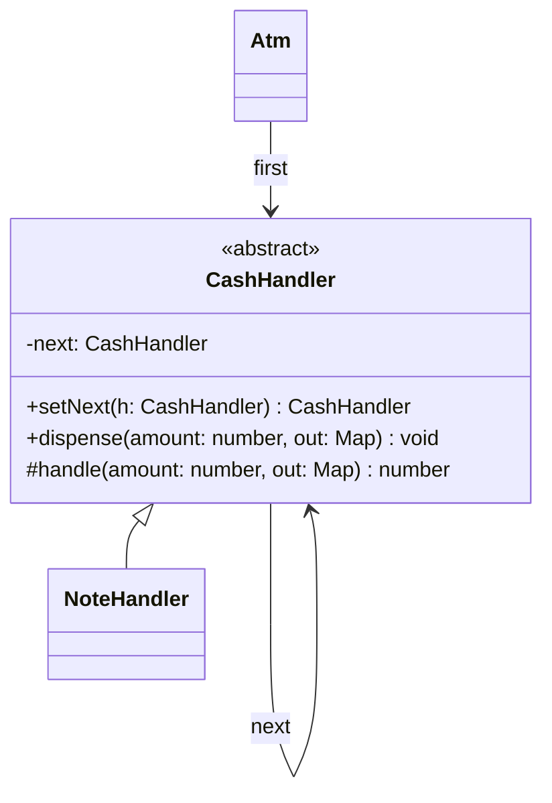

# P14 · Chain of Responsibility

> **Read time:** 15 min · **Visual:** [v26 Decorator and Chain of Responsibility](../../../visuals/v26-decorator-chain.html) · **Run it:** `npx tsx lld/concepts/patterns/p14-chain-of-responsibility.ts`
> **Used in:** [03 Logger](../../problems/03-logger/README.md) (log levels), [11 ATM](../../problems/11-atm/README.md) (cash dispenser), [20 Cart with Coupons](../../problems/20-ecommerce-cart-coupons/README.md) (discount and validation rules)

## The idea in one line

Pass a request along a chain of handlers. Each handler either handles it (and may stop the chain) or passes it to the next one.

## The problem it solves

```ts
// Before: one function with every check, in a fixed order
async function createPayment(req: PaymentRequest) {
  if (!req.headers.authorization) throw new Error('401');
  if (await rateLimiter.isLimited(req.userId)) throw new Error('429');
  if (req.amount <= 0 || req.amount > 2_00_000) throw new Error('400');
  if (await fraud.score(req) > 0.9) throw new Error('blocked');
  // ...the actual payment...
}
// a new check = edit this function; the refund endpoint copies half of it
```

## The pattern

```ts
type Handler = (req: PaymentRequest, next: () => Promise<Result>) => Promise<Result>;

function chain(handlers: Handler[], final: (req: PaymentRequest) => Promise<Result>) {
  return (req: PaymentRequest): Promise<Result> => {
    const run = (i: number): Promise<Result> =>
      i === handlers.length ? final(req) : handlers[i]!(req, () => run(i + 1));
    return run(0);
  };
}

const auth: Handler = (req, next) => (req.token ? next() : Promise.resolve({ ok: false, error: 'unauthorized' }));
const limits: Handler = (req, next) => (req.amount <= 200_000 ? next() : Promise.resolve({ ok: false, error: 'over limit' }));

const createPayment = chain([auth, limits, fraudCheck], chargeGateway);
```

The classic GoF form uses objects with a `next` link:

```ts
abstract class CashHandler {
  private next?: CashHandler;
  setNext(h: CashHandler): CashHandler { this.next = h; return h; }
  dispense(amount: number, out: Map<number, number>): void {
    const left = this.handle(amount, out);
    if (left > 0) {
      if (!this.next) throw new Error(`Cannot dispense ${left}`);
      this.next.dispense(left, out);
    }
  }
  protected abstract handle(amount: number, out: Map<number, number>): number;
}
// Note2000 -> Note500 -> Note200 -> Note100
```

Each note handler gives as many notes as it can and passes the rest on. That is the ATM problem.

## Class diagram



## When to use it

- A request goes through checks or processing steps that can stop it: auth, rate limit, validation, fraud, then the handler.
- The set or order of steps changes per endpoint or by config.
- Several handlers might handle a request and you don't want the sender to choose (log levels, ATM notes, support escalation).
- Discount rules in a cart: each rule looks at the cart and either applies or passes.

## When NOT to use it

- A fixed sequence of two steps that never changes: just call them.
- If every handler always runs and none can stop, it is a pipeline (or Decorator), not really a chain. That's fine, but name it right.
- A long chain where a request "falls off the end" silently. Always define what happens at the end (default handler or error).

## In the Node/TS world

- **Express middleware** is the best-known example. `app.use((req, res, next) => ...)`: a middleware either sends a response (stops) or calls `next()`. `next(err)` jumps to error-handling middleware.
- **Koa** uses the same idea with `await next()`. Code after `await next()` runs on the way back ("onion" model), so a middleware can wrap the rest of the chain.
- **axios interceptors**: `axios.interceptors.request.use(fn)` and `.response.use(onOk, onError)` run each request and response through a list of functions. They can modify, retry or reject.
- NestJS guards, interceptors and pipes form a request pipeline around each handler.

## What to say in the interview

> "Checks before the payment are a chain: auth, rate limit, amount limits, fraud. Each handler either rejects or calls `next`. It's the same model as Express middleware. Endpoints build their own chain from the same handlers, so refund can skip the fraud check. For the ATM, the note dispensers are a chain from 2000 down to 100, and each one gives what it can and passes the remainder on."

## Common follow-ups

<details><summary>Chain of Responsibility vs Decorator?</summary>

A decorator always calls the wrapped object. A chain handler may stop the request. Koa middleware sits in between: it can stop, or call `next()` and also do work after it, like a decorator.
</details>

<details><summary>ATM: what if the machine has 2000s but not enough 100s?</summary>

Greedy note-by-note can fail even when a solution exists for some note sets. Check first: compute the plan with the available counts, and only then remove notes. If the plan fails, reject without changing anything.
</details>

<details><summary>How do you test a chain?</summary>

Test each handler alone with a fake `next` (check whether it was called). Then one test for the assembled chain order.
</details>

## Self-test (answer before opening)

<details><summary>1. In Express, what happens if a middleware neither responds nor calls `next()`?</summary>

The request hangs until the client or server times out.
</details>

<details><summary>2. Dispense 3,700 with notes 2000, 500, 200, 100 and plenty of each.</summary>

1 x 2000, 3 x 500, 1 x 200 = 3,700.
</details>

<details><summary>3. Logger with DEBUG, INFO, ERROR handlers. How does a chain help?</summary>

Each handler checks if it accepts the level and writes to its sink (console, file, alerting), then passes the message on. New sinks are new handlers.
</details>

## Go deeper

- GoF Design Patterns, "Chain of Responsibility" (Behavioral Patterns chapter)
- Head First Design Patterns, appendix "Leftover Patterns" (Chain of Responsibility)
- Older notes in this repo: `archive/notes/LLD-guide.md`, PART 3, "Chain of Responsibility Pattern" section
- Related: [P06 Decorator](p06-decorator.md), [P15 Template Method](p15-template-method.md)
