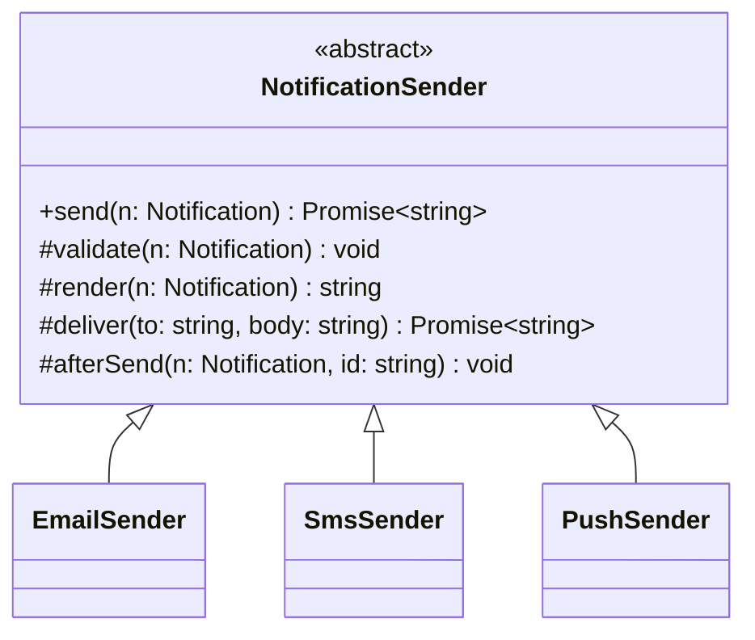

# P15 · Template Method

> **Read time:** 12 min · **Run it:** `npx tsx lld/concepts/patterns/p15-template-method.ts`
> **Used in:** [05 Notification Service](../../problems/05-notification-service/README.md) (validate → render → deliver → log), [03 Logger](../../problems/03-logger/README.md) (format then write), [23 Chess](../../problems/23-chess/README.md) (a shared move-validation skeleton)

## The idea in one line

A base class fixes the steps of an algorithm in one method. Subclasses fill in some steps, but they cannot change the order.

## The problem it solves

```ts
// Before: each channel copies the whole flow and they drift apart
class EmailSender {
  async send(n: Notification) {
    if (!n.to.includes('@')) throw new Error('bad email');
    const body = render(n.template, n.vars);
    await smtp.send(n.to, body);
    await audit.log('EMAIL', n.id); // audit
  }
}
class SmsSender {
  async send(n: Notification) {
    const body = render(n.template, n.vars).slice(0, 160);
    await smsApi.send(n.to, body);
    // forgot validation and the audit log
  }
}
```

## The pattern

```ts
abstract class NotificationSender {
  // the template method: fixed order, not meant to be overridden
  async send(n: Notification): Promise<string> {
    this.validate(n);
    const body = this.render(n);
    const id = await this.deliver(n.to, body);
    this.afterSend(n, id); // hook
    return id;
  }

  protected abstract validate(n: Notification): void;            // required step
  protected abstract deliver(to: string, body: string): Promise<string>;
  protected render(n: Notification): string {                      // default step
    return n.template.replace(/\{(\w+)\}/g, (_, k) => n.vars[k] ?? '');
  }
  protected afterSend(_n: Notification, _id: string): void {}      // hook: empty by default
}

class SmsSender extends NotificationSender {
  protected validate(n: Notification) { if (!/^\d{10}$/.test(n.to)) throw new Error('bad phone'); }
  protected render(n: Notification) { return super.render(n).slice(0, 160); }
  protected async deliver(to: string, body: string) { return `sms_${to}`; }
}
```

Three kinds of steps:

- **Abstract steps**: each subclass must provide them (`deliver`).
- **Default steps**: subclasses may override (`render`).
- **Hooks**: empty by default, a place to add extra behaviour (`afterSend`).

TS has no `final` keyword. Document that `send()` must not be overridden, or keep the template as a function that takes the steps.

## Class diagram



## When to use it

- Several variants share the same steps in the same order, and only some steps differ.
- You must guarantee shared steps (validation, audit log, metrics) always run.
- Framework code: the base class runs the lifecycle and calls your overrides.

## When NOT to use it

- When the variable part should be chosen at runtime or combined freely: use [Strategy](p10-strategy.md) (composition). Template Method locks you into inheritance.
- Deep hierarchies (`BaseSender → TransactionalSender → OtpSmsSender`): each level overrides a bit, and nobody knows what runs.
- When subclasses need to change the order of steps, the template is the wrong abstraction.

## In the Node/TS world

- **Node streams**: `Readable` runs the stream logic and calls your `_read()`. `Writable` calls your `_write()` / `_final()`. `Transform` calls `_transform()` and `_flush()`. These are template methods.
- Test frameworks: `beforeEach` / `afterEach` hooks around each test are the same idea as hook methods.
- NestJS lifecycle hooks (`onModuleInit`, `onApplicationShutdown`) are hooks the framework calls in a fixed order.
- Base repository classes with `beforeSave()` / `afterSave()` hooks in some ORMs.

## What to say in the interview

> "All channels follow the same flow: validate, render, deliver, then audit. I'll put that flow in an abstract `NotificationSender.send()` so the order and the audit step are always there. Each channel implements `validate` and `deliver`, and SMS overrides `render` to cut to 160 characters. If we need to mix and match parts at runtime, I'd switch to strategies injected into one sender."

## Common follow-ups

<details><summary>Template Method vs Strategy: which do you prefer?</summary>

Strategy is usually more flexible (composition, swap at runtime, test each part alone). Template Method is fine when the skeleton is stable and you want to enforce it. A middle ground: one `NotificationSender` class that takes a `Channel` strategy for `deliver` and keeps the skeleton itself.
</details>

<details><summary>What is the "Hollywood principle"?</summary>

"Don't call us, we'll call you." The base class calls the subclass steps, not the other way round. Frameworks work this way.
</details>

<details><summary>How do you stop a subclass from overriding `send()`?</summary>

TS can't mark methods `final`. Options: a code review rule, a lint rule, or composition (the template is a function or class that receives the steps, so there is nothing to override).
</details>

## Self-test (answer before opening)

<details><summary>1. In a Node `Transform` stream, which methods are the steps you fill in?</summary>

`_transform(chunk, encoding, callback)` and optionally `_flush(callback)`.
</details>

<details><summary>2. Name the three kinds of steps in a template method.</summary>

Abstract (required), default (overridable), and hooks (optional, empty by default).
</details>

<details><summary>3. A new channel (WhatsApp) needs a delivery receipt step after deliver. How?</summary>

Override the `afterSend` hook in `WhatsAppSender`. The skeleton doesn't change.
</details>

## Go deeper

- GoF Design Patterns, "Template Method" (Behavioral Patterns chapter)
- Head First Design Patterns, chapter 8 ("Encapsulating Algorithms")
- Node.js docs: the `stream` module, "API for stream implementers"
- Related: [P10 Strategy](p10-strategy.md), [01 OOP pillars](../01-oop-pillars.md) (inheritance vs composition)
