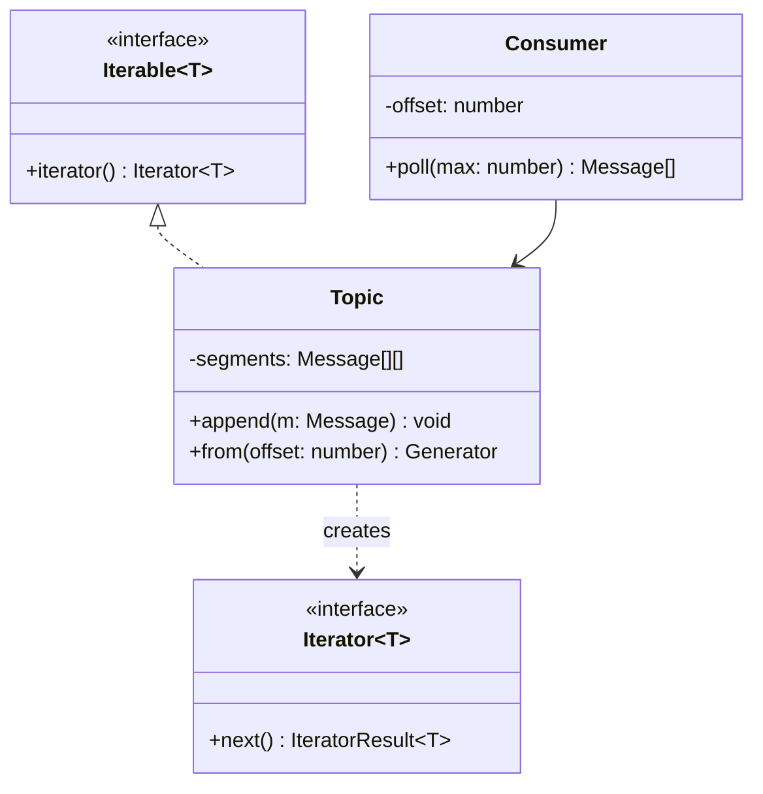

# P16 · Iterator

> **Read time:** 12 min · **Run it:** `npx tsx lld/concepts/patterns/p16-iterator.ts`
> **Used in:** [15 Pub-Sub Queue](../../problems/15-pub-sub-queue/README.md) (consumers read from an offset), [24 In-memory File System](../../problems/24-file-system/README.md) (walk the tree), [02 LRU / LFU Cache](../../problems/02-lru-cache/README.md) (walk the list in order)

## The idea in one line

Give a way to walk through a collection one item at a time without exposing how the collection is stored.

## The problem it solves

```ts
// Before: callers know the internal structure
class Topic {
  segments: Message[][] = [[], []]; // stored in segments of 1000
}
for (const seg of topic.segments) {        // every consumer repeats this
  for (const m of seg) handle(m);
}
// change to a ring buffer or a linked list, and every consumer breaks
```

## The pattern

In JavaScript, the Iterator pattern is built into the language: the **iteration protocol**. An object is iterable if it has a `[Symbol.iterator]()` method that returns an object with `next()` → `{ value, done }`. A **generator** (`function*`) writes that for you.

```ts
class Topic implements Iterable<Message> {
  private segments: Message[][] = [[]];
  append(m: Message) { /* push into the last segment, start a new one when full */ }

  *[Symbol.iterator](): Iterator<Message> {
    for (const seg of this.segments) yield* seg;
  }

  *from(offset: number): Generator<Message> {  // a second way to iterate
    let i = 0;
    for (const m of this) if (i++ >= offset) yield m;
  }
}

for (const m of topic) handle(m);         // for..of, spread, Array.from all work
const firstTen = [...topic.from(0)].slice(0, 10);
```

Generators are **lazy**: they compute the next item only when asked. You can iterate an infinite or huge sequence without building an array.

**Async iterators** do the same for data that arrives over time: `async *[Symbol.asyncIterator]()` and `for await (const x of source)`.

```ts
async function* fetchAllPayments(api: Api) {
  let cursor: string | undefined;
  do {
    const page = await api.listPayments({ cursor, limit: 100 });
    yield* page.items;
    cursor = page.nextCursor;
  } while (cursor);
}
for await (const p of fetchAllPayments(api)) reconcile(p); // callers never see pages
```

## Class diagram



## When to use it

- A collection with a non-trivial internal structure (tree, segments, linked list, pages from an API).
- More than one way to walk it (in-order, from an offset, depth-first vs breadth-first).
- Large or infinite data that should be processed lazily.
- Paging through an external API without leaking cursor logic to callers.

## When NOT to use it

- A plain array that you're happy to expose as `readonly T[]`: just return it.
- Don't write a hand-made `Iterator` class with `hasNext()` / `next()` like in Java. Use a generator; it is shorter and works with `for..of`.
- Be careful when the collection changes during iteration. Define the rule (snapshot, or "see new items") and test it.

## In the Node/TS world

- `Map`, `Set`, arrays and strings are iterable. `map.entries()` returns an iterator.
- Node `Readable` streams are async iterable: `for await (const chunk of fs.createReadStream(path))`. `readline.createInterface()` lets you read a file line by line with `for await`.
- `events.on(emitter, 'event')` returns an async iterator of events.
- Many SDKs offer async-iterable pagination helpers. Kafka consumers keep an **offset** per partition: a durable iterator position.

## What to say in the interview

> "The topic stores messages in segments, but consumers shouldn't know that. Topic is iterable through a generator, and each consumer group keeps its own offset, like Kafka. `poll(n)` returns the next n messages from that offset and then moves the offset forward. Because generators are lazy, reading from an offset doesn't copy the log."

## Common follow-ups

<details><summary>Iterable vs Iterator?</summary>

An iterable has `[Symbol.iterator]()` and can be iterated many times. An iterator is the cursor with `next()`; it is used up once it's done. Generators return objects that are both, but they can only be walked once.
</details>

<details><summary>How does each consumer group read at its own pace?</summary>

Each group stores its own offset (an index into the log). The log is shared and append-only. Committing an offset after processing gives at-least-once delivery.
</details>

<details><summary>What happens if you `break` out of a `for..of` over a generator?</summary>

The generator's `return()` is called, so its `finally` blocks run. That's where you close resources (a file handle, a DB cursor).
</details>

## Self-test (answer before opening)

<details><summary>1. Write the signature of an async generator that yields rows page by page.</summary>

`async function* rows(): AsyncGenerator<Row> { ... yield* page.items ... }`
</details>

<details><summary>2. Why is `for await (const line of rl)` better than reading the whole file?</summary>

Memory stays small. It reads chunk by chunk and handles backpressure, so a 5 GB log file is fine.
</details>

<details><summary>3. File system: how do you give both depth-first and breadth-first walks?</summary>

Two generator methods on the folder: `*walkDepthFirst()` (recursion with `yield*`) and `*walkBreadthFirst()` (a queue).
</details>

## Go deeper

- GoF Design Patterns, "Iterator" (Behavioral Patterns chapter)
- Head First Design Patterns, chapter 9 ("Well-Managed Collections")
- Node.js docs: `stream` ("Consuming readable streams with async iterators"), `readline`, `events.on()`
- Related: [P09 Composite](p09-composite.md), [18 Kafka deep dive](../../../hld/concepts/18-kafka-deep-dive.md)
