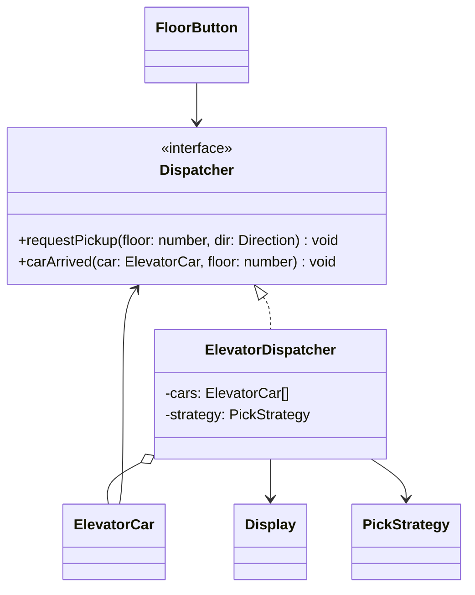

# P17 · Mediator

> **Read time:** 12 min · **Run it:** `npx tsx lld/concepts/patterns/p17-mediator.ts`
> **Used in:** [10 Elevator](../../problems/10-elevator/README.md) (the dispatcher between floor buttons and cars), [21 Meeting Room Scheduler](../../problems/21-meeting-room-scheduler/README.md) (the scheduler between rooms and requests), [17 Ride Sharing](../../problems/17-ride-sharing/README.md) (matching riders and drivers)

## The idea in one line

Objects don't talk to each other directly. They talk to one mediator, which holds the coordination logic.

## The problem it solves

```ts
// Before: every component knows every other component
class FloorButton {
  constructor(private elevators: Elevator[]) {}
  press(floor: number) {
    // the button picks the elevator itself: nearest idle, same direction, not under maintenance...
    const e = this.elevators.filter((x) => !x.maintenance).sort((a, b) => /* ... */ 0)[0];
    e.addStop(floor);
  }
}
class Elevator {
  constructor(private display: Display, private otherElevators: Elevator[]) {}
  // ...also tells the display and the others when it moves
}
// N components with N x N links; the dispatch rule is copied into buttons, the app and the admin panel
```

## The pattern

```ts
interface Dispatcher {
  requestPickup(floor: number, dir: 'UP' | 'DOWN'): void;
  carArrived(car: ElevatorCar, floor: number): void;
}

class ElevatorDispatcher implements Dispatcher {
  constructor(private cars: ElevatorCar[], private display: Display) {}
  requestPickup(floor: number, dir: 'UP' | 'DOWN') {
    const car = this.pickCar(floor, dir);     // the one place with the dispatch rule
    car.addStop(floor);
  }
  carArrived(car: ElevatorCar, floor: number) {
    this.display.show(car.id, floor);         // cars don't know about displays
  }
  private pickCar(floor: number, dir: 'UP' | 'DOWN'): ElevatorCar { /* nearest suitable car */ }
}

class FloorButton {
  constructor(private floor: number, private dispatcher: Dispatcher) {}
  press(dir: 'UP' | 'DOWN') { this.dispatcher.requestPickup(this.floor, dir); }
}
```

Each component knows only the mediator. N components need N links, not N x N. The pick rule is often a [Strategy](p10-strategy.md) inside the mediator.

## Class diagram



## When to use it

- Many objects interact in complex ways and the rules of interaction change (dispatch, matching, scheduling).
- A chat room: users send to the room, and the room decides who receives (mute, block, rate limit).
- A form or UI: changing one field enables or validates others.
- Matching: riders and drivers, buyers and sellers, requests and rooms.

## When NOT to use it

- Two objects with a simple relationship: let them call each other.
- **The god-object risk.** A mediator that grows to hold every rule of the system is just the old mess in one file. Keep it to coordination; put the decision rule in a strategy and the state in the components.
- If components only need to announce events and don't care who reacts, [Observer](p11-observer.md) is enough.

## In the Node/TS world

- A chat server with Socket.IO: clients emit to the server, and the server decides which room or socket gets the message. The server is the mediator between clients.
- `@nestjs/cqrs` command bus and libraries like MediatR (in .NET) send a request to a central bus that finds the handler. People call this the mediator pattern.
- An API gateway or orchestrator service between microservices plays a similar role at a larger scale.

## Mediator vs Observer vs Facade

| | Mediator | Observer | Facade |
|---|---|---|---|
| Direction | Two-way: components call it, it calls them | One-way: subject to observers | One-way: client to subsystems |
| Knows the others | Yes, it coordinates them | No, just a list of listeners | Yes, but subsystems don't know it |
| Holds logic | Interaction rules | None | The common flow |

## What to say in the interview

> "Floor buttons and elevator cars don't talk to each other. They report to an `ElevatorDispatcher`. The dispatcher picks a car using a pluggable strategy (nearest car, or same direction first) and updates the displays. That keeps the dispatch rule in one place. I'll keep car movement inside `ElevatorCar` and only coordination in the dispatcher, so it doesn't become a god class."

## Common follow-ups

<details><summary>Isn't the mediator a single point of failure?</summary>

In one process, it's just an object. In a distributed system, a central dispatcher or matcher must be replicated or sharded (for example by city for ride matching). The pattern is about code structure; the deployment question is separate.
</details>

<details><summary>How do you stop the mediator from growing too big?</summary>

Split by concern: a `PickStrategy` for decisions, components keep their own state and rules, and the mediator only routes. If it has many unrelated methods, it may need to be several mediators.
</details>

## Self-test (answer before opening)

<details><summary>1. Chat room: user A blocks user B. Where does that rule live?</summary>

In the chat room (the mediator). It checks block lists before delivering B's messages to A. Users never hold references to each other.
</details>

<details><summary>2. How many links with 10 components, with and without a mediator?</summary>

Without: up to 10 x 9 / 2 = 45 pairs. With: 10 links to the mediator.
</details>

<details><summary>3. Mediator vs Observer in one sentence.</summary>

Observer broadcasts events to whoever listens; a mediator actively coordinates specific components using rules.
</details>

## Go deeper

- GoF Design Patterns, "Mediator" (Behavioral Patterns chapter)
- Head First Design Patterns, appendix "Leftover Patterns" (Mediator)
- Related: [P11 Observer](p11-observer.md), [P07 Facade](p07-facade.md), [P10 Strategy](p10-strategy.md)
