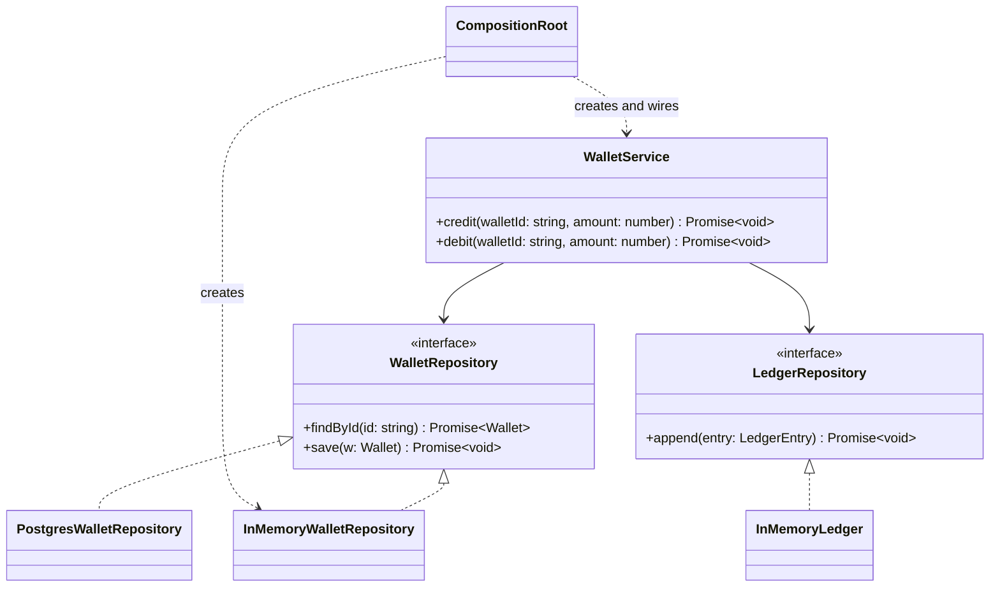

# P18 · Repository and Dependency Injection

> **Read time:** 18 min · **Run it:** `npx tsx lld/concepts/patterns/p18-repository-di.ts`
> **Used in:** [12 Library Management](../../problems/12-library-management/README.md), [19 Payment Wallet](../../problems/19-payment-wallet/README.md), and in practice every problem (storage behind an interface, clock and IDs injected)

## The idea in one line

A repository hides storage behind a collection-like interface (`save`, `findById`). Dependency injection means a class receives its dependencies (repositories, gateways, clock) from outside instead of creating them.

## The problem it solves

```ts
// Before: the service creates its own DB client and writes SQL inline
import { Pool } from 'pg';
class WalletService {
  private db = new Pool({ connectionString: process.env.DATABASE_URL }); // hard-wired
  async credit(walletId: string, amount: number) {
    const r = await this.db.query('SELECT balance FROM wallets WHERE id = $1', [walletId]);
    await this.db.query('UPDATE wallets SET balance = $1 WHERE id = $2', [r.rows[0].balance + amount, walletId]);
    await this.db.query('INSERT INTO ledger ...');
    console.log(new Date().toISOString());                                  // real clock, can't test
  }
}
// Testing needs a running Postgres. Switching storage means editing business logic.
```

## The pattern

**Repository:** one interface per aggregate, in domain terms.

```ts
interface Wallet { id: string; userId: string; balance: number; version: number }

interface WalletRepository {
  findById(id: string): Promise<Wallet | undefined>;
  save(w: Wallet): Promise<void>;             // throws ConcurrencyError if the version changed
}

class InMemoryWalletRepository implements WalletRepository {
  private rows = new Map<string, Wallet>();
  async findById(id: string) { const w = this.rows.get(id); return w && { ...w }; } // return copies
  async save(w: Wallet) {
    const current = this.rows.get(w.id);
    if (current && current.version !== w.version - 1) throw new Error('ConcurrencyError');
    this.rows.set(w.id, { ...w });
  }
}
// later: class PostgresWalletRepository implements WalletRepository { ... }
```

**Constructor injection + a composition root:**

```ts
class WalletService {
  constructor(
    private readonly wallets: WalletRepository,
    private readonly ledger: LedgerRepository,
    private readonly clock: () => Date,
  ) {}
  async credit(walletId: string, amount: number) { /* domain logic only */ }
}

// main.ts: the only place that knows concrete classes
const service = new WalletService(new InMemoryWalletRepository(), new InMemoryLedger(), () => new Date());
```

Tests build the same service with in-memory repositories and a fixed clock. No mocks library needed.

## Class diagram



## When to use it

- Every machine-coding round: keep data in a `Map` behind a repository, and say "this becomes a DB later".
- Any class that touches I/O (DB, HTTP, queue, file system, time, randomness): inject it.
- When you want fast, deterministic unit tests.

## When NOT to use it

- Don't create a generic `BaseRepository<T>` with 20 methods. Add only the queries the use cases need (`findByUser`, `findOverdue`).
- Don't inject pure helpers (`formatCurrency`) or value objects. Import them.
- A DI container (decorators, tokens) is overkill in a 90-minute round. Constructor parameters plus `main.ts` is enough.
- Don't leak ORM types (Prisma models, TypeORM entities with lazy relations) out of the repository if you want the domain to stay storage-free. In a small CRUD app, using the ORM directly is often fine.

## In the Node/TS world

- **TypeORM** has a built-in repository API: `dataSource.getRepository(Order).findOneBy({ id })`, and custom repositories.
- **Prisma** gives a generated client (`prisma.order.findUnique(...)`). It's closer to a typed query builder or data mapper than a repository. Teams often wrap it in their own repository class to keep the domain independent and to make tests easy.
- **NestJS DI**: classes marked `@Injectable()` are providers. A module lists them, and Nest injects them by constructor type. For an interface (erased at runtime), you bind a token: `{ provide: 'WALLET_REPO', useClass: PrismaWalletRepository }` and `@Inject('WALLET_REPO')`.
- Without a framework: a composition root in `main.ts`, or a small factory function `buildApp(deps)`. Libraries like `tsyringe`, `inversify` and `awilix` exist if you need a container.

## What to say in the interview

> "All storage goes through repositories: `WalletRepository` and `LedgerRepository`. For this round they're in-memory maps, and later they become Postgres classes with the same interface. The service gets them, plus a clock and an ID generator, through its constructor. `main.ts` is the composition root that wires everything. That's dependency injection without a framework, and it lets me test with fakes and a fixed clock. The wallet has a version field, so `save` can detect lost updates."

## Common follow-ups

<details><summary>Repository vs DAO?</summary>

A DAO is table-centric (`WalletDao.updateBalance(id, x)`), close to the database. A repository is domain-centric: it loads and saves whole aggregates (a wallet with its rules) and looks like a collection. In practice the names are often mixed; explain which one you mean.
</details>

<details><summary>How do you do a transaction across two repositories?</summary>

A Unit of Work: begin a transaction, give both repositories the same transaction client, commit at the end. In Prisma, `prisma.$transaction(async (tx) => ...)` and pass `tx` to repositories created for that transaction. In NestJS, a request-scoped or explicit transaction context.
</details>

<details><summary>Why return copies from the in-memory repository?</summary>

So callers can't change stored state without calling `save()`. A real DB behaves like that, so the in-memory fake should too. Otherwise tests pass in memory and fail on Postgres.
</details>

<details><summary>Constructor injection vs property or method injection?</summary>

Constructor injection makes dependencies required and visible, and the object is complete after `new`. Use method injection only for per-call things (a request context).
</details>

## Self-test (answer before opening)

<details><summary>1. Where is the only place `new PostgresWalletRepository()` should appear?</summary>

The composition root (`main.ts`, or a DI module).
</details>

<details><summary>2. Two credits run at once on the same wallet. How does the version field help?</summary>

Both read version 3. The first saves version 4. The second tries to save version 4 based on 3, but the stored version is already 4, so it fails with a conflict and retries with fresh data. See [06 Concurrency](../06-concurrency-in-node.md).
</details>

<details><summary>3. NestJS can't inject an interface by type. Why, and what do you do?</summary>

TS interfaces don't exist at runtime, so there's no type to look up. Use an injection token (a string, a symbol, or an abstract class) and `@Inject(TOKEN)`.
</details>

## Go deeper

- Patterns of Enterprise Application Architecture (Martin Fowler): "Repository", "Data Mapper", "Unit of Work"
- Domain-Driven Design (Eric Evans), chapter 6 ("The Life Cycle of a Domain Object": aggregates, factories, repositories)
- Dependency Injection Principles, Practices, and Patterns (Mark Seemann, Steven van Deursen): the "Composition Root" chapter
- Related: [02 SOLID](../02-solid.md) (dependency inversion), [05 TS for LLD](../05-ts-for-lld.md) (DI without a framework)
